<div class="original-branding"></div>

<!-- Original deck 1, slide 1 -->

::: {.source-slide #part3-01-slide-01}

## 3.1 Introduction to Probability Distributions {#part3-01}

:::

<!-- Original deck 1, slide 2 -->

::: {.source-slide #part3-01-slide-02}

### Content {#part3-title-01-02}

```{=html}
<div class="source-text">
<p>Introduction to Inferential Statistics</p>
<p>Random Variables and Probability Distributions</p>
<p>Discrete Random Variables</p>
<p>Continuous Random Variables</p>
<p>The Normal Distribution</p>
<p>The Empirical Rule</p>
<p>The Standard Normal Distribution and the Standard Scores (Z-Scores)</p>
<p>Using the Z-Tables</p>
</div>
```

:::

<!-- Original deck 1, slide 3 -->

::: {.source-slide #part3-01-slide-03}

### Introduction to Inferential Statistics {#part3-title-01-03}

```{=html}
<div class="source-text">
<p><strong>Definition</strong>: Inferential statistics is the branch of statistics that involves making inferences or predictions about a population based on sample data.</p>
<p><strong>Objective</strong>: The main goal of inferential statistics is to draw conclusions, make predictions, or test hypotheses about a population using information obtained from a sample.</p>
</div>
```

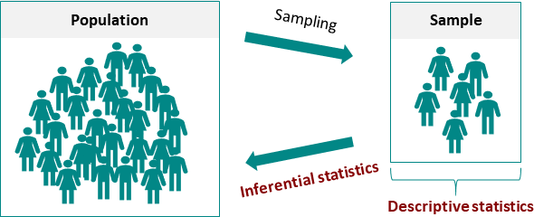{width="68%" fig-alt="Original graphic, section 3.1, slide 3"}

:::

<!-- Original deck 1, slide 4 -->

::: {.source-slide #part3-01-slide-04}

### Inferential Statistics Uses {#part3-title-01-04}

```{=html}
<div class="source-text">
<p>Inferential statistics is used in various fields and contexts to make predictions, draw conclusions, and make inferences about populations based on sample data. Here are some common areas and applications where inferential statistics is used:</p>
<p><strong>Scientific Research</strong>: Inferential statistics is fundamental in scientific research across disciplines such as biology, physics, chemistry, and environmental science. Researchers use statistical tests to analyze data and draw conclusions about hypotheses.</p>
<p><strong>Business and Economics</strong>: Businesses use inferential statistics for market research, sales forecasting, quality control, and decision-making. Econometric models are employed to analyze economic data and make policy recommendations.</p>
<p><strong>Healthcare and Medicine</strong>: Medical researchers and healthcare professionals use inferential statistics to study the effectiveness of treatments, analyze patient data, and draw conclusions about disease prevalence. Clinical trials rely heavily on inferential statistics.</p>
<p><strong>Education</strong>: In the field of education, inferential statistics are used to assess the effectiveness of teaching methods, evaluate standardized test scores, and make policy decisions about educational programs.</p>
<p><strong>Market Research and Data Analysis</strong>: Market researchers use inferential statistics to make predictions about consumer preferences, market trends, and the impact of marketing campaigns.</p>
<p><strong>Finance and Investment</strong>: In finance, inferential statistics are used to assess investment risk, analyze stock market data, and estimate future asset prices. Portfolio optimization and risk management rely on statistical modeling.</p>
<p><strong>Criminal Justice and Criminology</strong>: Researchers and law enforcement agencies use inferential statistics to analyze crime data, study crime patterns, and evaluate the effectiveness of criminal justice programs.</p>
<p><strong>Sports and Athletics</strong>:  In sports analytics, inferential statistics are used to analyze player performance, predict game outcomes, and make strategic decisions in sports management.</p>
</div>
```

:::

<!-- Original deck 1, slide 5 -->

::: {.source-slide #part3-01-slide-05}

### Introduction to Inferential Statistics {#part3-title-01-05}

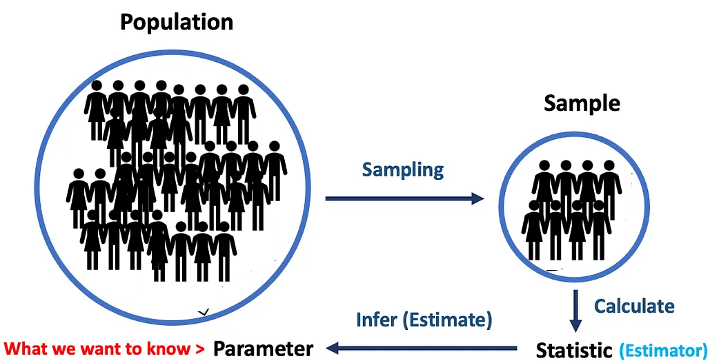{width="54%" fig-alt="Original graphic, section 3.1, slide 5"}

```{=html}
<div class="source-text">
<p><strong>Key</strong> <strong>Concepts</strong>:</p>
<p><strong>Population</strong>: The entire group of individuals or items of interest that we want to study.</p>
<p><strong>Sample</strong>: A subset of the population from which data is collected and analyzed.</p>
<p><strong>Parameter</strong>: A numerical characteristic of a population (e.g., mean, proportion).</p>
<p><strong>Statistic</strong>: A numerical characteristic of a sample (e.g., sample mean, sample proportion).</p>
</div>
```

```{=html}
<div class="source-text">
<p>https://medium.com/towards-data-science/what-is-p-value-370056b8244d</p>
</div>
```

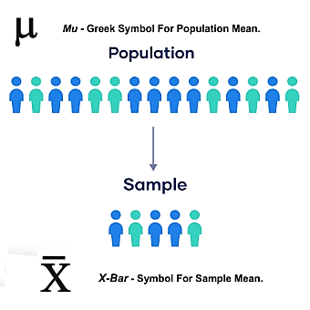{width="30%" fig-alt="Original graphic, section 3.1, slide 5"}

:::

<!-- Original deck 1, slide 6 -->

::: {.source-slide #part3-01-slide-06}

### Types of Inferential Statistics {#part3-title-01-06}

```{=html}
<div class="source-text">
<p class="source-bullet source-level-0">Estimation</p>
<p>Point Estimation: Provides a single best guess about a population parameter (e.g., the mean, proportion).</p>
<p>Interval Estimation (Confidence Intervals): Gives a range of values for a population parameter with a certain level of confidence.</p>
<p class="source-bullet source-level-0">Hypothesis Testing</p>
<p>A statistical method that uses sample data to evaluate a hypothesis about a population parameter, determining whether there is sufficient evidence to accept or reject a given hypothesis about that population.</p>
<p class="source-bullet source-level-0">Regression Analysis</p>
<p>Assesses the linear relationship between one continuous dependent variable and one or more independent variables.</p>
</div>
```

:::

<!-- Original deck 1, slide 7 -->

::: {.source-slide #part3-01-slide-07}

### Introduction to Random Variables {#part3-title-01-07}

```{=html}
<div class="source-text">
<p>Understanding the Basics of Probability in Statistics</p>
</div>
```

{width="30%" fig-alt="Original graphic, section 3.1, slide 7"}

:::

<!-- Original deck 1, slide 8 -->

::: {.source-slide #part3-01-slide-08}

### What is a Random Variable?  {#part3-title-01-08}

{width="30%" fig-alt="Original graphic, section 3.1, slide 8"}

```{=html}
<div class="source-text">
<p>A random variable is a variable whose possible values are outcomes of a random process.</p>
</div>
```

```{=html}
<div class="source-text">
<p>A random process is a process or event or where the outcome cannot be predicted with certainty, and each possible outcome has an associated probability.</p>
<p>It can be classified as discrete or continuous depending on the range of values that it assumes. </p>
<p>A discrete random variable assumes a countable number of distinct values, whereas a continuous random variable is characterized by measurable (uncountable) values. </p>
<p>Example: Flipping a coin (discrete), measuring the amount of rain in a day (continuous)</p>
</div>
```

:::

<!-- Original deck 1, slide 9 -->

::: {.source-slide #part3-01-slide-09}

### Discrete Random Variables {#part3-title-01-09}

```{=html}
<div class="source-text">
<p>A Discrete Random Variable is a variable which can take on only a countable number of distinct values like 0, 1, 2, 3, 4, 5…100, 1 million, etc. </p>
<p>Examples of discrete random variables:</p>
<p>The number of cars that passes through a toll booth everyday in a given day.</p>
<p>The number of times a coin lands on tails after being flipped 20 times.</p>
<p>The number of defective widgets in a box of 50 widgets.</p>
<p>Number of Calls Received by a Call Center.</p>
<p>Number of Emails Received in a Day</p>
</div>
```

{width="34%" fig-alt="Original graphic, section 3.1, slide 9"}

{width="34%" fig-alt="Original graphic, section 3.1, slide 9"}

:::

<!-- Original deck 1, slide 10 -->

::: {.source-slide #part3-01-slide-10}

### Continuous Random Variables {#part3-title-01-10}

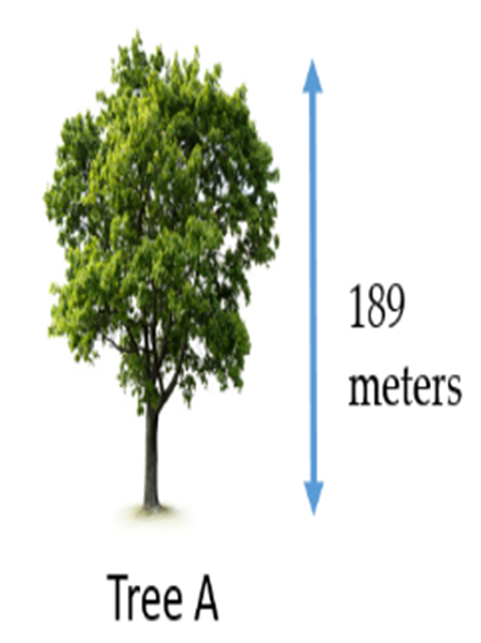{width="30%" fig-alt="Original graphic, section 3.1, slide 10"}

```{=html}
<div class="source-text">
<p>A Continuous Random Variable is a variable which can take on an infinite number of possible values. </p>
<p>Examples of continuous random variables:</p>
<p>Business profits.</p>
<p>The height of a tree.</p>
<p>The weight of an animal.</p>
<p>Arrival times of airlines.</p>
<p>Time required to run a marathon.</p>
<p>The weight of a chocolate bar on a production line.</p>
</div>
```

{width="30%" fig-alt="Original graphic, section 3.1, slide 10"}

:::

<!-- Original deck 1, slide 11 -->

::: {.source-slide #part3-01-slide-11}

### Introduction to Probability Distributions {#part3-title-01-11}

```{=html}
<div class="source-text">
<p>Discrete and Continuous Probability Distributions</p>
</div>
```

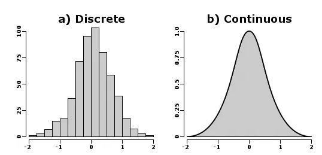{width="58%" fig-alt="Original graphic, section 3.1, slide 11"}

:::

<!-- Original deck 1, slide 12 -->

::: {.source-slide #part3-01-slide-12}

### Discrete Probabilities Distributions {#part3-title-01-12}

:::

<!-- Original deck 1, slide 13 -->

::: {.source-slide #part3-01-slide-13}

### Introduction to Probability Distributions {#part3-title-01-13}

```{=html}
<div class="source-text">
<p>Probability distributions are mathematical functions that describe the likelihood of various outcomes in a statistical experiment.</p>
<p>They provide a mathematical framework for modeling random phenomena.</p>
<p>Discrete vs. Continuous Probability Distributions</p>
<p>Discrete distributions: Outcomes are countable and have finite or countably infinite values.</p>
<p>Continuous distributions: Outcomes are uncountable and have an infinite range of values.</p>
<p>For a probability distribution to be valid, it must satisfy the following two criteria:</p>
<p>The probability for each outcome must be between 0 and 1.</p>
<p>The sum of all the probabilities must add up to 1.</p>
</div>
```

:::

<!-- Original deck 1, slide 14 -->

::: {.source-slide #part3-01-slide-14}

### Discrete Probability Distributions The Discrete Uniform Distribution {#part3-title-01-14}

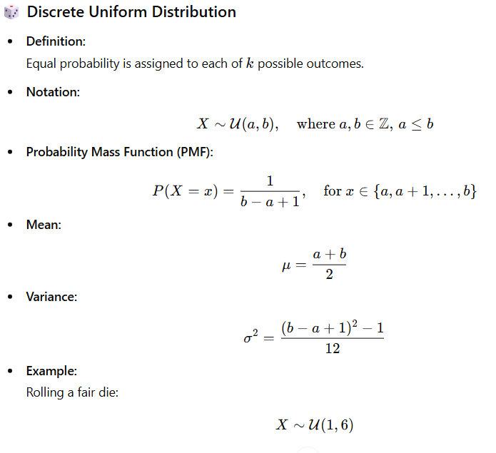{width="54%" fig-alt="Original graphic, section 3.1, slide 14"}

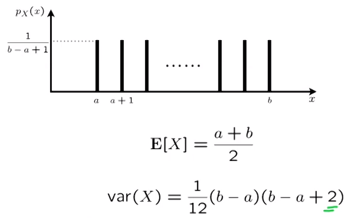{width="45%" fig-alt="Original graphic, section 3.1, slide 14"}

:::

<!-- Original deck 1, slide 15 -->

::: {.source-slide #part3-01-slide-15}

### Discrete Uniform – PMF Uses {#part3-title-01-15}

```{=html}
<div class="source-text">
<p><strong>Calculating individual probabilities</strong></p>
<p>Example: For a fair die (U(1,6)), the probability of rolling a 3 is:</p>
<p>P(X = 3) = 1/(6-1+1) = 1/6 ≈ 0.167</p>
<p><strong>Finding probabilities of events</strong></p>
<p>For multiple outcomes: Sum the individual probabilities</p>
<p>Example: Probability of rolling an even number:</p>
<p>P(X ∈ {2,4,6}) = P(X=2) + P(X=4) + P(X=6) = 1/6 + 1/6 + 1/6 = 3/6 = 0.5</p>
<p><strong>Range probabilities</strong></p>
<p>Example: Probability of rolling between 2 and 5 inclusive:</p>
<p>P(2 ≤ X ≤ 5) = (5-2+1)/(6-1+1) = 4/6 = 0.667</p>
</div>
```

#### R equivalent (added)

```{r}
#| label: inferential-1-15
# rep() assigns equal mass to the six fair-die outcomes; sum() adds the selected probabilities.
# %in% selects even outcomes; the second selection includes both endpoints 2 and 5.
outcomes <- 1:6
probability <- rep(1/6, 6)
c(three = probability[3], even = sum(probability[outcomes %in% c(2,4,6)]),
  between_2_and_5 = sum(probability[outcomes >= 2 & outcomes <= 5]))
```

:::

<!-- Original deck 1, slide 16 -->

::: {.source-slide #part3-01-slide-16}

### Discrete Probability Distributions The Binomial Distribution {#part3-title-01-16}

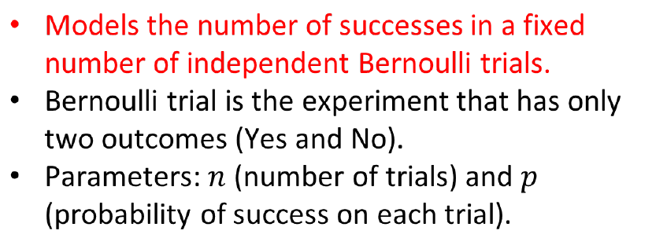{width="64%" fig-alt="Original graphic, section 3.1, slide 16"}

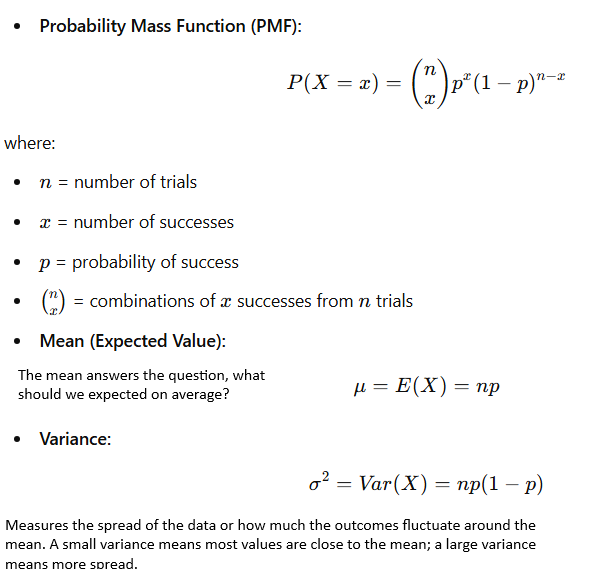{width="44%" fig-alt="Original graphic, section 3.1, slide 16"}

```{=html}
<div class="source-text">
<p>Example: The defect ratio in a car factory is 2% and the factory produces 80 cars in a month,. We can use the binomial distribution to answer questions similar to: </p>
<p>what is the probability that exactly 2 cars are defective?</p>
<p>what is the probability that less than 2 cars are defective?</p>
<p>what is the probability that more than 2 cars are defective?</p>
<p>What is the probability that all cars produced in a month will have no defects?</p>
</div>
```

{width="30%" fig-alt="Original graphic, section 3.1, slide 16"}

#### R equivalent (added)

```{r}
#| label: inferential-1-16
# dbinom() gives exact counts; pbinom() gives cumulative probabilities for 80 independent cars.
# less than 2 means X<=1; lower.tail=FALSE computes P(X>2), using the stated defect probability 0.02.
c(exactly_2 = dbinom(2, size=80, prob=0.02), less_than_2 = pbinom(1,80,0.02),
  more_than_2 = pbinom(2,80,0.02,lower.tail=FALSE), no_defects = dbinom(0,80,0.02))
```

:::

<!-- Original deck 1, slide 17 -->

::: {.source-slide #part3-01-slide-17}

### The Binomial Distribution {#part3-title-01-17}

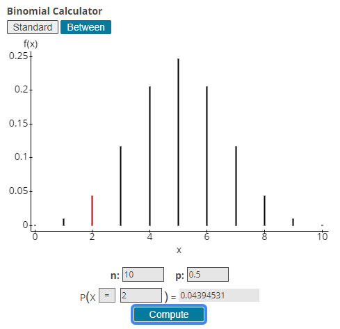{width="45%" fig-alt="Original graphic, section 3.1, slide 17"}

{width="30%" fig-alt="Original graphic, section 3.1, slide 17"}

```{=html}
<div class="source-text">
<p>What is the probability of having 2 Heads ONLY out of 10 trials, knowing that the probability of Head = 50%?</p>
</div>
```

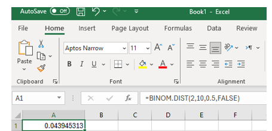{width="49%" fig-alt="Original graphic, section 3.1, slide 17"}

{width="30%" fig-alt="Original graphic, section 3.1, slide 17"}

```{=html}
<div class="source-text">
<p><strong>Excel Function</strong><br><strong>=BINOM.DIST(2,10,0.5,FALSE)</strong></p>
</div>
```

```{=html}
<div class="source-text">
<p>The larger the number of trials (e.g. ask 100 students) the more the distribution will look like normal distribution.</p>
</div>
```

#### R equivalent (added)

```{r}
#| label: inferential-1-17
# dbinom() models the number of heads in ten independent fair-coin trials.
# plot(type="h") draws vertical probability masses; this is a discrete, not continuous, distribution.
x <- 0:10
plot(x, dbinom(x,10,0.5), type="h", lwd=3, col="#356B8C", xlab="Heads", ylab="Probability")
dbinom(2,10,0.5)
```

:::

<!-- Original deck 1, slide 18 -->

::: {.source-slide #part3-01-slide-18}

### Discrete Probability Distributions The Poisson Distribution {#part3-title-01-18}

```{=html}
<div class="source-text">
<p class="source-bullet source-level-0">Poisson Distribution can be used to model the number of times an event occurs within a specified time period or in a given space. </p>
<p class="source-bullet source-level-0">It&#x27;s particularly useful for estimating the likelihood of rare events over short intervals.</p>
<p class="source-bullet source-level-0">The key feature of the Poisson distribution is that it is defined by just one parameter, <strong>λ</strong> (lambda), which represents the average rate at which events occur.</p>
</div>
```

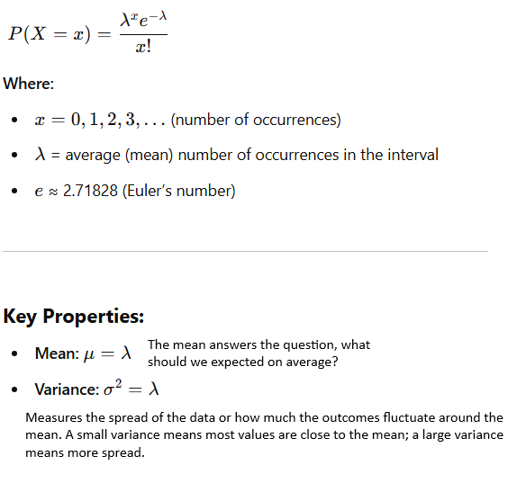{width="42%" fig-alt="Original graphic, section 3.1, slide 18"}

```{=html}
<div class="source-text">
<p>Example: Suppose that Zein call center receives 1000 calls/hour on average, and that data center has a capacity of receiving 1100 calls/hours. </p>
<p>Use the Poisson Distribution to find the probability that the number of calls will exceed the call center&#x27;s capacity, which will require additional temporary staff?</p>
</div>
```

{width="30%" fig-alt="Original graphic, section 3.1, slide 18"}

#### R equivalent (added)

```{r}
#| label: inferential-1-18
# ppois() uses the stated one-hour mean lambda=1000 under a homogeneous Poisson model.
# lower.tail=FALSE gives P(X>1100), so exactly 1100 calls does not exceed capacity.
ppois(1100, lambda=1000, lower.tail=FALSE)
```

:::

<!-- Original deck 1, slide 19 -->

::: {.source-slide #part3-01-slide-19}

### Poisson Distribution {#part3-title-01-19}

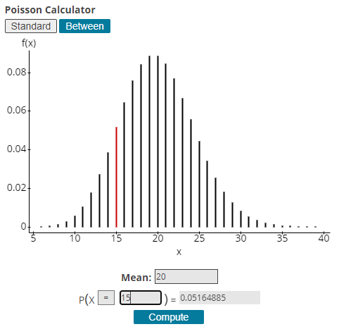{width="45%" fig-alt="Original graphic, section 3.1, slide 19"}

{width="30%" fig-alt="Original graphic, section 3.1, slide 19"}

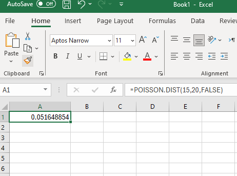{width="43%" fig-alt="Original graphic, section 3.1, slide 19"}

{width="30%" fig-alt="Original graphic, section 3.1, slide 19"}

```{=html}
<div class="source-text">
<p><strong>Excel Function</strong><br><strong>=POISSON.DIST(15,20,FALSE)</strong></p>
</div>
```

```{=html}
<div class="source-text">
<p>The larger the average rate <strong>λ, </strong>the more the distribution will look like normal distribution.</p>
</div>
```

#### R equivalent (added)

```{r}
#| label: inferential-1-19
# dpois() computes the exact mass P(X=15) for a Poisson count with mean 20 per interval.
# It corresponds to the source POISSON.DIST(15,20,FALSE) example.
dpois(15, lambda=20)
```

:::

<!-- Original deck 1, slide 20 -->

::: {.source-slide #part3-01-slide-20}

### Continuous Probabilities Distributions {#part3-title-01-20}

:::

<!-- Original deck 1, slide 21 -->

::: {.source-slide #part3-01-slide-21}

### The Continuous Uniform Distribution {#part3-title-01-21}

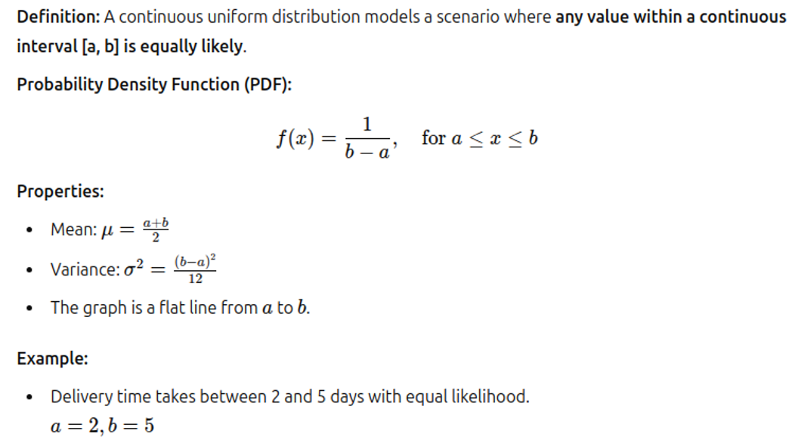{width="65%" fig-alt="Original graphic, section 3.1, slide 21"}

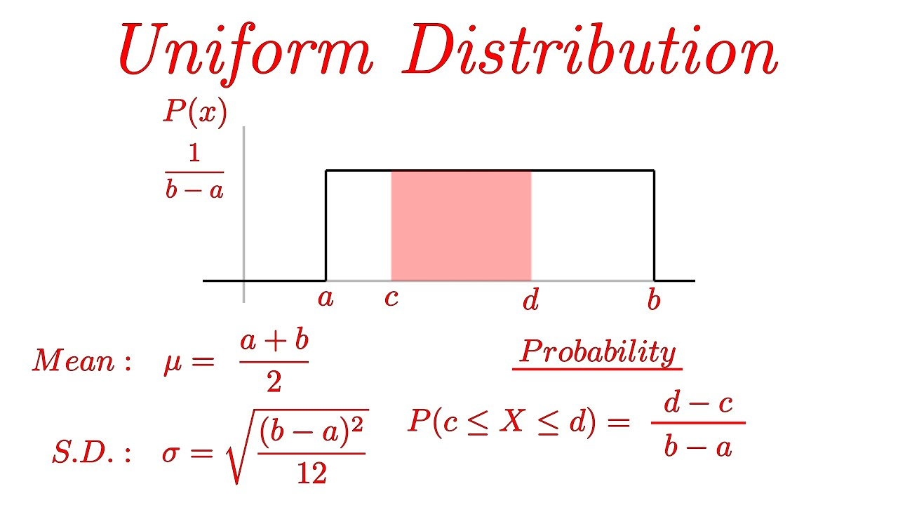{width="47%" fig-alt="Original graphic, section 3.1, slide 21"}

:::

<!-- Original deck 1, slide 22 -->

::: {.source-slide #part3-01-slide-22}

### The Continuous Uniform Distribution Business Cases Studies {#part3-title-01-22}

```{=html}
<div class="source-text">
<p><strong>Inventory Arrival</strong></p>
<p>A retailer&#x27;s deliveries arrive uniformly between 8 AM and 12 PM.</p>
</div>
```

```{=html}
<div class="source-text">
<p><strong>Manufacturing</strong></p>
<p>A machine produces widgets with diameters uniformly distributed between 9.8mm and 10.2mm.</p>
</div>
```

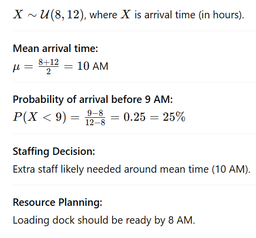{width="41%" fig-alt="Original graphic, section 3.1, slide 22"}

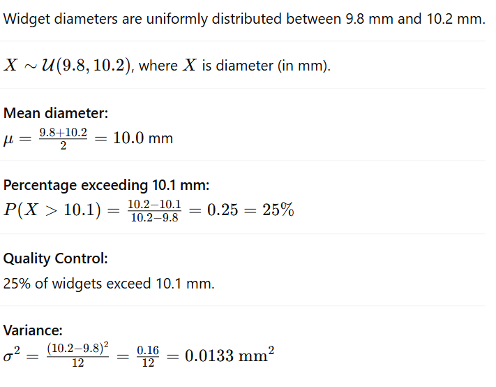{width="49%" fig-alt="Original graphic, section 3.1, slide 22"}

:::

<!-- Original deck 1, slide 23 -->

::: {.source-slide #part3-01-slide-23}

### The Normal Distribution {#part3-title-01-23}

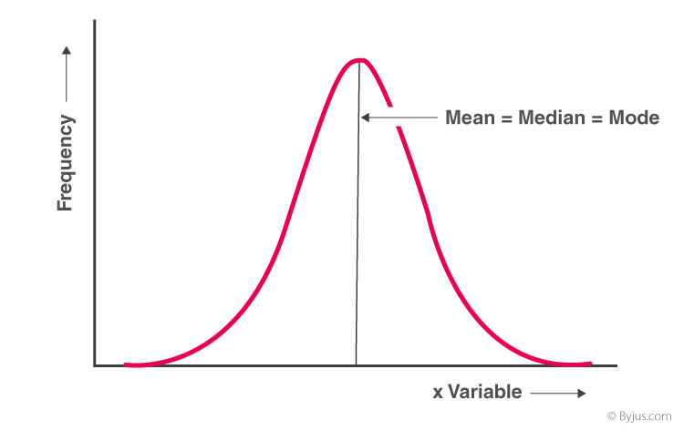{width="44%" fig-alt="Original graphic, section 3.1, slide 23"}

```{=html}
<div class="source-text">
<p>The normal distribution is the most extensively used probability distribution in statistical work.</p>
<p>It is also known as the Gaussian distribution and the Bell Curve.</p>
<p>The x-axis represents the outcomes of the normal process (e.g. students scores, heights, salaries…etc.).</p>
<p>The AREA UNDER THE CURVE represents the probability of the outcome.</p>
<p>The normal distribution has a symmetric distribution where most of the observations cluster around the central peak.</p>
<p>Theoretically, a normal random variable can assume any value between minus infinity and plus infinity.</p>
<p>Normal Distribution Main Features:</p>
<p>Symmetrically distributed</p>
<p>Long Tails / Bell Shaped</p>
<p>Mean/ Mode and Median are the same</p>
</div>
```

{width="32%" fig-alt="Original graphic, section 3.1, slide 23"}

:::

<!-- Original deck 1, slide 24 -->

::: {.source-slide #part3-01-slide-24}

### Parameters of the Normal Distribution {#part3-title-01-24}

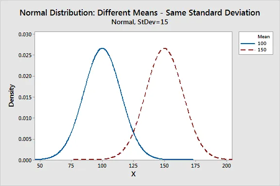{width="38%" fig-alt="Original graphic, section 3.1, slide 24"}

```{=html}
<div class="source-text">
<p>The normal distribution is completely described by two parameters, the Mean and the Standard Deviation. </p>
<p>Where X is a continuous random variable (the expected outcome of a continuous random process).</p>
<p>μ = The Mean of the Outcomes of the Random Process.</p>
<p>σ = The Standard Deviation of the Outcomes of the Random Process.</p>
<p>π is approximately 3.14159.</p>
<p>e is approximately 2.71828.</p>
</div>
```

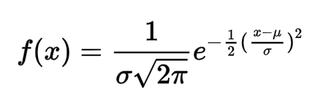{width="35%" fig-alt="Original graphic, section 3.1, slide 24"}

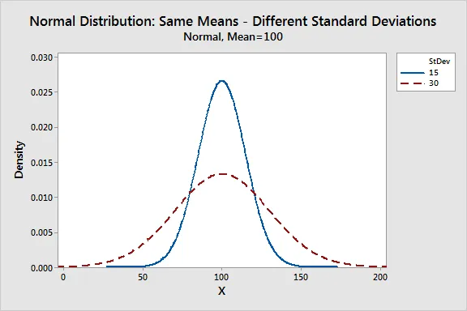{width="38%" fig-alt="Original graphic, section 3.1, slide 24"}

:::

<!-- Original deck 1, slide 25 -->

::: {.source-slide #part3-01-slide-25}

### The Empirical Rule for the Normal Distribution {#part3-title-01-25}

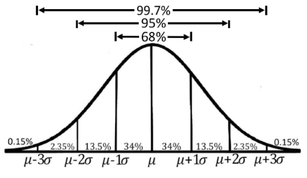{width="44%" fig-alt="Original graphic, section 3.1, slide 25"}

```{=html}
<div class="source-text">
<p>The Empirical Rule describes how data (continuous outcomes) are spread in a normal distribution.</p>
<p>The proportion of the area that falls under the curve between two points on a probability distribution indicates the probability that a value will fall within that interval. </p>
<p>If we know that the data are drawn from a relatively symmetric and bell-shaped distribution - perhaps by a visual inspection of its histogram, then we can make statements about the percentage of observations that fall within certain intervals.</p>
</div>
```

```{=html}
<div class="source-text">
<p class="source-bullet source-level-0">Approximately 68% of data fall within one standard deviation (σ) of the mean (μ).</p>
<p class="source-bullet source-level-0">Around 95% are within two standard deviations.</p>
<p class="source-bullet source-level-0">About 99.7% lie within three standard deviations.</p>
</div>
```

:::

<!-- Original deck 1, slide 26 -->

::: {.source-slide #part3-01-slide-26}

### Empirical Rule Example {#part3-title-01-26}

```{=html}
<div class="source-text">
<p>A large lecture class has 280 students. The professor has announced that the mean score in an exam is 74 with a standard deviation of 8. </p>
<p>Use the Empirical Rule to answer the following:</p>
<p class="source-bullet source-level-1">Approximately how many students within 58 and 90?</p>
<p class="source-bullet source-level-1">Approximately how many students scored higher than 90?</p>
</div>
```

{width="41%" fig-alt="Original graphic, section 3.1, slide 26"}

:::

<!-- Original deck 1, slide 27 -->

::: {.source-slide #part3-01-slide-27}

### The Z - Score {#part3-title-01-27}

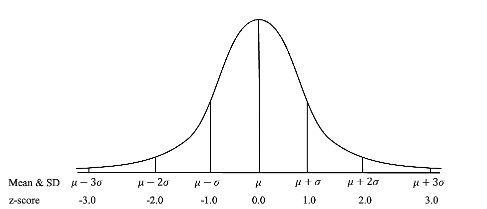{width="53%" fig-alt="Original graphic, section 3.1, slide 27"}

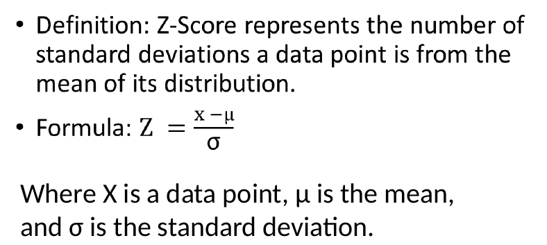{width="59%" fig-alt="Original graphic, section 3.1, slide 27"}

```{=html}
<div class="source-text">
<p>Where X is a data point, μ is the mean, and σ is the standard deviation.</p>
</div>
```

```{=html}
<div class="source-text">
<p>Interpretation:</p>
<p class="source-bullet source-level-0">A z-score of 0 corresponds to a data point that is exactly at the mean.</p>
<p class="source-bullet source-level-0">Positive z-scores indicate values above the mean.</p>
<p class="source-bullet source-level-0">Negative z-scores indicate values below the mean.</p>
</div>
```

:::

<!-- Original deck 1, slide 28 -->

::: {.source-slide #part3-01-slide-28}

### Back to our Empirical Rule Example {#part3-title-01-28}

```{=html}
<div class="source-text">
<p>A large lecture class has 280 students. The professor has announced that the mean score in an exam is 74 with a standard deviation of 8. </p>
<p>Use the Empirical Rule to answer the following:</p>
<p class="source-bullet source-level-1">Approximately how many students within 58 and 90?</p>
<p class="source-bullet source-level-1">Approximately how many students scored higher than 90?</p>
</div>
```

{width="41%" fig-alt="Original graphic, section 3.1, slide 28"}

```{=html}
<div class="source-text">
<p><strong>Solution for part (a) </strong></p>
<p class="source-bullet source-level-1">First, we find the z-scores corresponding to 58 and 90.</p>
<p class="source-bullet source-level-1">Z for 58 = (58 – 74) / 8 = -16/8 = -2, Z for 90 = (58 – 74) / 8 = 16/8 = +2</p>
<p class="source-bullet source-level-1">Using the empirical rule, we know that 95% of observations falls within 2 standard deviations (each side) from the mean, therefore, the number of students under this criteria = 280 x .95 = 266 students.</p>
</div>
```

{width="30%" fig-alt="Original graphic, section 3.1, slide 28"}

```{=html}
<div class="source-text">
<p><strong>Solution for part (b) </strong></p>
<p class="source-bullet source-level-1">The score 90 is 2 standard deviations above the mean.</p>
<p class="source-bullet source-level-1">Therefore, 97.5% of students are below that value and 2.5% are above it.</p>
<p class="source-bullet source-level-1">Consequently, 2.5/100 * 280 = 7 students are above 90.</p>
</div>
```

#### R equivalent (added)

```{r}
#| label: inferential-1-28
# c() collects the two approximate expected counts, using the original 95% empirical-rule approximation.
# These are normal-model approximations for 280 students, not observed counts.
c(between_58_and_90 = 280*0.95, above_90 = 280*0.025)
```

:::

<!-- Original deck 1, slide 29 -->

::: {.source-slide #part3-01-slide-29}

### Z-Scores Uses in Statistics {#part3-title-01-29}

```{=html}
<div class="source-text">
<p class="source-bullet source-level-0"><strong>Standardization</strong>: Z-scores standardize different distributions to be comparable by converting them to a common scale.</p>
<p class="source-bullet source-level-0"><strong>Identification of Outliers</strong>: Data points with z-scores less than -2 or greater than 2 are often considered outliers.</p>
<p class="source-bullet source-level-0"><strong>Compare values </strong>from different populations (e.g. exam results between courses).</p>
<p class="source-bullet source-level-0"><strong>Probabilities and Percentiles</strong>: Z-scores link data points to their probabilities and percentiles in a normal distribution. E.g., a z-score of 1.96 corresponds to the 97.5th percentile.</p>
</div>
```

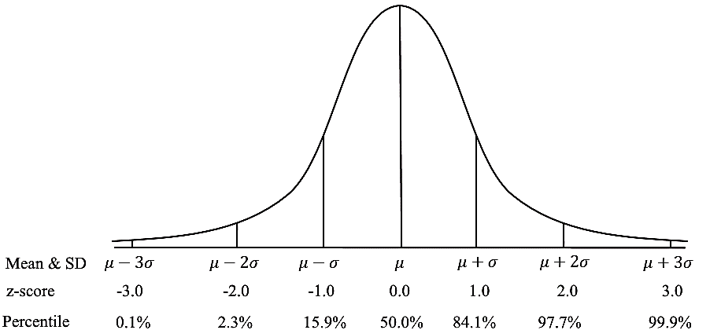{width="61%" fig-alt="Original graphic, section 3.1, slide 29"}

:::

<!-- Original deck 1, slide 30 -->

::: {.source-slide #part3-01-slide-30}

### Z-Scores Example – Comparing Values {#part3-title-01-30}

```{=html}
<div class="source-text">
<p>Khalid achieved 90 in both Python &amp; Database exams. The mean μ for the Python exam was 70 and σ = 10, The μ for the Database exam was 80 and σ = 10.</p>
<p>Use standard scores to determine where did Khalid achieve a better score.</p>
</div>
```

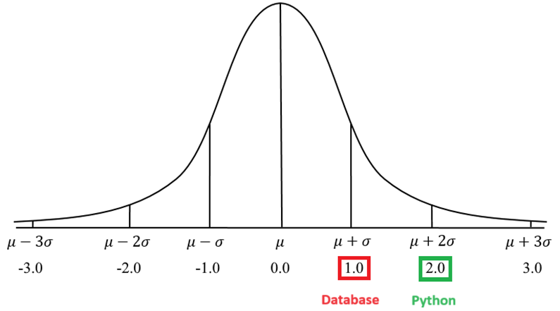{width="40%" fig-alt="Original graphic, section 3.1, slide 30"}

```{=html}
<div class="source-text">
<p class="source-bullet source-level-0">Standard score for the Python Exam: (90−70)/10 =2</p>
<p class="source-bullet source-level-0">Standard score for the Database Exam: (90−80)/10 =1</p>
<p class="source-bullet source-level-0">Khalid&#x27;s Z-score for the Python exam is 2, which means his score was 2 standard deviations above the mean. </p>
<p class="source-bullet source-level-0">His Z-score for the Database exam is 1, indicating his score was 1 standard deviation above the mean.</p>
<p class="source-bullet source-level-0">Khalid performed better on the Python exam than Database exam since his Z-score is higher for that exam. </p>
</div>
```

#### R equivalent (added)

```{r}
#| label: inferential-1-30
# Standardization subtracts the stated course mean and divides by that course's SD.
# Both exam scores are 90; a larger z-score means a higher position relative to the course mean.
c(Python = (90-70)/10, Database = (90-80)/10)
```

:::

<!-- Original deck 1, slide 31 -->

::: {.source-slide #part3-01-slide-31}

### How to Find the Right Distribution {#part3-title-01-31}

#### Original Python example

```python
from distfit import distfit
import numpy as np

# Let's say you have some data
my_data = np.random.normal(25, 8, 2000) # 2000 data points

# Set up the distribution fitter
fitter = distfit(method='parametric')

# Let it try different distributions and find the best fit
fitter.fit_transform(my_data)

# See what it found
print("Best fit:", fitter.model['name'])
print("Parameters:", fitter.model['params'])
```

```{=html}
<div class="source-text">
<p class="source-bullet source-level-0">Distfit library tests around 90 different distributions automatically. </p>
<p class="source-bullet source-level-0">It&#x27;s like having a statistician who&#x27;s willing to try every possible option and tell you which one works best.</p>
</div>
```

```{=html}
<div class="source-text">
<p>https://medium.com/data-science-collective/how-to-find-the-right-distribution-for-your-data-a-practical-guide-for-non-statistician-with-two-dc2aa0ed707f</p>
</div>
```

#### R equivalent (added)

```{r}
#| label: inferential-1-31
# set.seed() makes rnorm() reproducible; the 2,000 simulated values use the source mean 25 and SD 8.
# MASS::fitdistr() fits three candidate families by maximum likelihood; this is a limited R comparison.
set.seed(307312)
y <- rnorm(2000, mean=25, sd=8)
fits <- lapply(c("normal","logistic","cauchy"), function(family) MASS::fitdistr(y, family))
# AIC() trades fit against parameter count; lower AIC only compares these candidates, not all distributions.
# sapply() applies AIC to each fitted object; names label the results for interpretation.
aic <- sapply(fits, AIC)
names(aic) <- c("normal","logistic","cauchy")
aic
```

:::

<!-- Original deck 1, slide 32 -->

::: {.source-slide #part3-01-slide-32}

```{=html}
<div class="source-text">
<p>Z-Tables</p>
</div>
```

:::

<!-- Original deck 1, slide 33 -->

::: {.source-slide #part3-01-slide-33}

### The Z-Tables {#part3-title-01-33}

```{=html}
<div class="source-text">
<p>The area under the curve in continuous probability distributions represents the probability of outcome occurrence.</p>
<p>The Empirical Rule has pre-defined areas for certain Z-Scores.</p>
<p>What can we do if we need the area between other Z-Scores e.g. +1.25, -2.33?</p>
<p>It will be hard to compute the integral for different intervals:</p>
<p>A simpler solution would be to use a table of pre-computed areas (The Z-Table).</p>
<p>But we need to compute that area ONCE. Therefore, we need to create a Standard Distribution.</p>
</div>
```

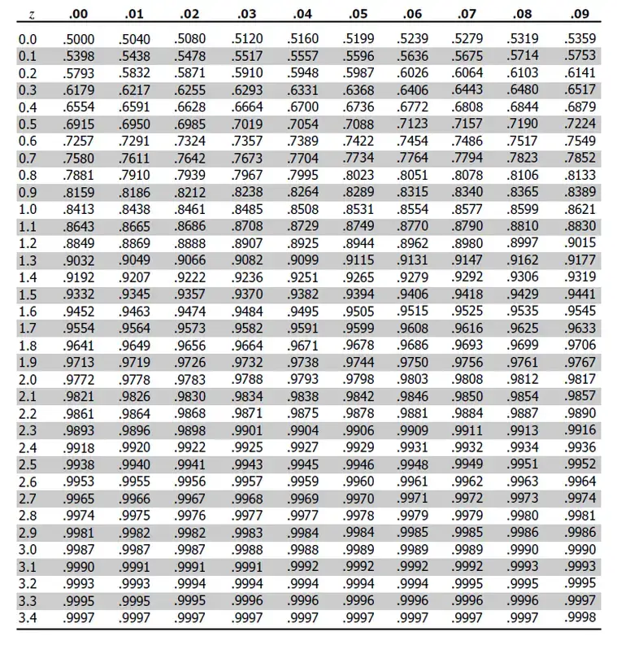{width="45%" fig-alt="Original graphic, section 3.1, slide 33"}

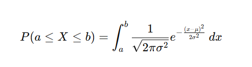{width="33%" fig-alt="Original graphic, section 3.1, slide 33"}

:::

<!-- Original deck 1, slide 34 -->

::: {.source-slide #part3-01-slide-34}

### Standard Normal Distribution and Standard Z Scores {#part3-title-01-34}

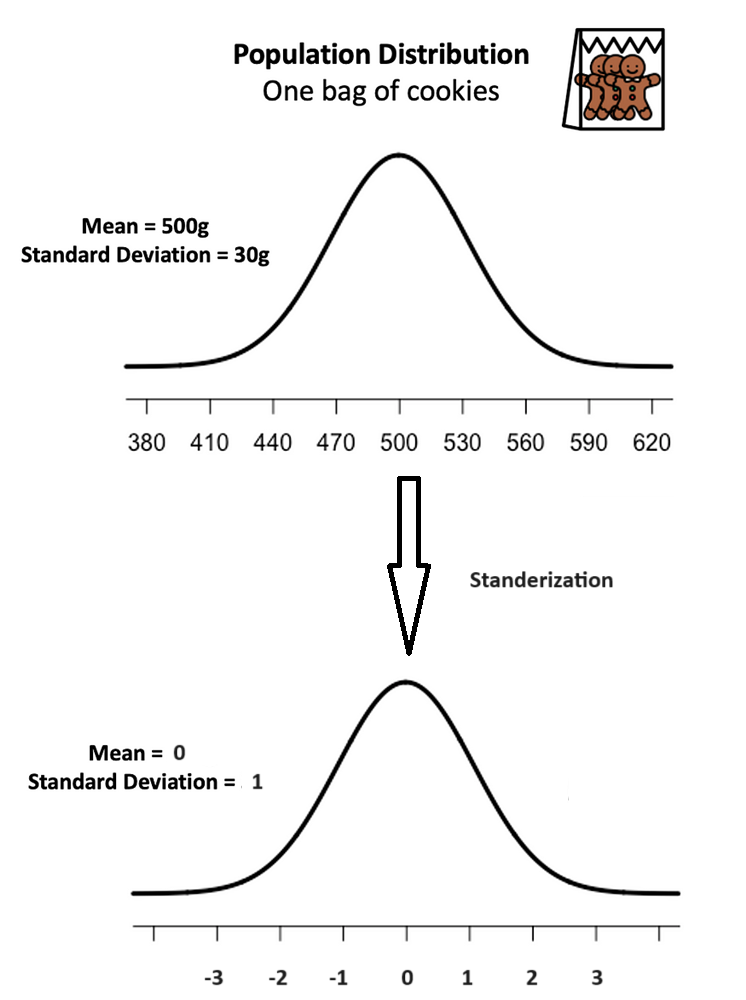{width="36%" fig-alt="Original graphic, section 3.1, slide 34"}

```{=html}
<div class="source-text">
<p>The standard normal distribution is a special case of the normal distribution where the mean is zero and the standard deviation is 1. </p>
<p>This distribution is also known as the Z-distribution.</p>
<p>A value on the standard normal distribution is known as a standard score or a Z-score. </p>
<p>A standard score represents the number of standard deviations above or below the mean that a specific observation falls. </p>
<p>For example, a standard score of 1.5 indicates that the observation is 1.5 standard deviations above the mean. </p>
<p>On the other hand, a negative score represents a value below the average. </p>
<p>The mean has a Z-score of 0.</p>
</div>
```

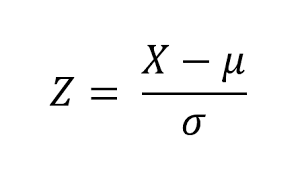{width="30%" fig-alt="Original graphic, section 3.1, slide 34"}

```{=html}
<div class="source-text">
<p>https://medium.com/towards-data-science/what-is-p-value-370056b8244d</p>
</div>
```

:::

<!-- Original deck 1, slide 35 -->

::: {.source-slide #part3-01-slide-35}

### Z-Table for Z Values above 0 {#part3-title-01-35}

```{=html}
<div class="source-text">
<p><strong>Z-Table for Z Values below 0</strong></p>
</div>
```

{width="45%" fig-alt="Original graphic, section 3.1, slide 35"}

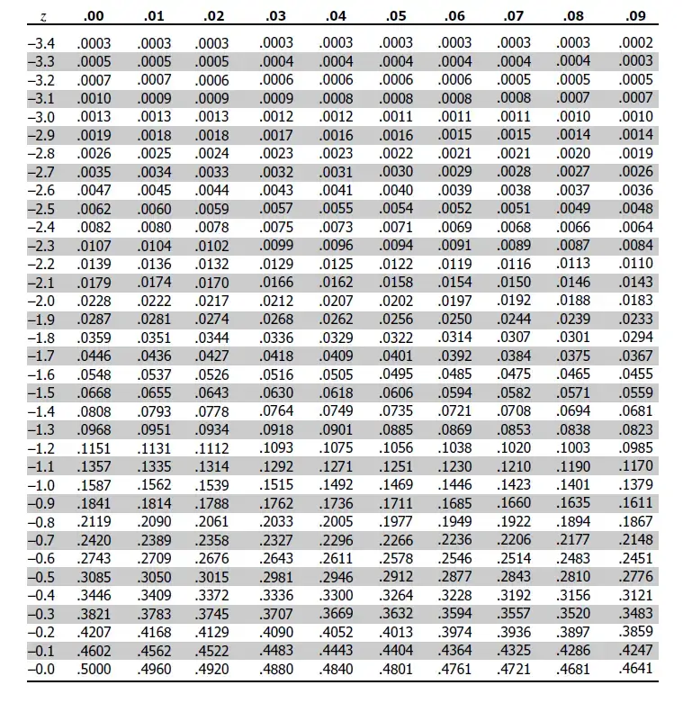{width="44%" fig-alt="Original graphic, section 3.1, slide 35"}

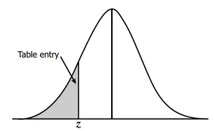{width="30%" fig-alt="Original graphic, section 3.1, slide 35"}

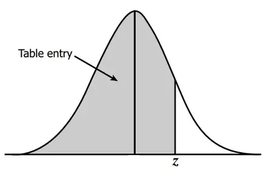{width="30%" fig-alt="Original graphic, section 3.1, slide 35"}

:::

<!-- Original deck 1, slide 36 -->

::: {.source-slide #part3-01-slide-36}

### Z-Tables Example {#part3-title-01-36}

```{=html}
<div class="source-text">
<p>The average score for the MID exam in Descriptive Statistics course was 70. The standard Deviation for that exam was 6.</p>
<p>Knowing that the exam scores are normally distributed, what is the probability of having a score higher than 75 in that exam?</p>
</div>
```

{width="45%" fig-alt="Original graphic, section 3.1, slide 36"}

```{=html}
<div class="source-text">
<p>First, we need to find the standard position (z-score) for the 75 score.</p>
<p>Z score for (75) = (75 – 70) / 6 = 5/6 = .833</p>
<p>Using the z table, the closest value for .833 is: 0.7967 which corresponds to 79.67% of scores are below 75.</p>
<p>To find the probability of having a score over 75, we subtract 79.67% out of the total probability of 100%:</p>
<p>100 – 79.67 = 20.33%</p>
</div>
```

#### R equivalent (added)

```{r}
#| label: inferential-1-36
# pnorm() integrates the stated normal model: mean 70, SD 6, and a score threshold of 75.
# lower.tail=FALSE gives P(score>75) directly, without rounding the z-score to a table entry.
pnorm(75, mean=70, sd=6, lower.tail=FALSE)
```

:::

<!-- Original deck 1, slide 37 -->

::: {.source-slide #part3-01-slide-37}

### Z-Tables using Excel Functions {#part3-title-01-37}

```{=html}
<div class="source-text">
<p>The average score for the MID exam in Descriptive Statistics course was 70. The standard Deviation for that exam was 6.</p>
<p>What is the probability of having a score higher than 90 in that exam?</p>
<p>We can use Excel NORM.DIST function. This function expects 4 values, the value we want to find its probability, the mean, the standard deviation and we set cumulative = TRUE.</p>
<p>NORM.DIST(75,70,6,True) = 0.797672 </p>
<p>Therefore, the probability of having a score &gt; 75 = 1 - .797672 = .2023% ~ 20%</p>
</div>
```

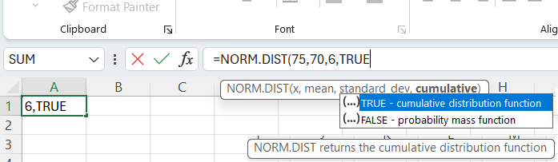{width="50%" fig-alt="Original graphic, section 3.1, slide 37"}

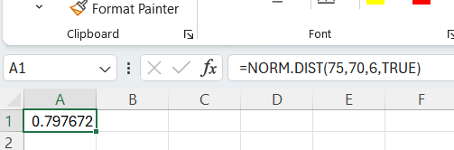{width="47%" fig-alt="Original graphic, section 3.1, slide 37"}

#### R equivalent (added)

```{r}
#| label: inferential-1-37
# pnorm() evaluates both thresholds because the original question says 90 but its Excel solution uses 75.
# lower.tail=FALSE calculates upper-tail probabilities; multiplying by 100 would express percentages.
c(above_90 = pnorm(90,70,6,lower.tail=FALSE), above_75 = pnorm(75,70,6,lower.tail=FALSE))
```

:::

<!-- Original deck 2, slide 1 -->

::: {.source-slide #part3-02-slide-01}

## 3.2 Introduction to Estimation in Statistics {#part3-02}

:::

<!-- Original deck 2, slide 2 -->

::: {.source-slide #part3-02-slide-02}

### Content {#part3-title-02-02}

```{=html}
<div class="source-text">
<p class="source-bullet source-level-0">Introduction to Inferential Statistics</p>
<p class="source-bullet source-level-0">Estimation in Statistics (Point Estimate and Interval Estimate)</p>
<p class="source-bullet source-level-0">The Central Limit Theorem (CLT)</p>
<p class="source-bullet source-level-0">Confidence Intervals – Using Z-Tables</p>
<p class="source-bullet source-level-0">Confidence Intervals – Using T-Tables</p>
</div>
```

:::

<!-- Original deck 2, slide 3 -->

::: {.source-slide #part3-02-slide-03}

### Estimation in Statistics {#part3-title-02-03}

```{=html}
<div class="source-text">
<p class="source-bullet source-level-0">Often in statistics we’re interested in measuring population parameters.</p>
<p class="source-bullet source-level-0">Two of the most common population parameters are:</p>
<p class="source-bullet source-level-1">Population mean: the mean value of some variable in a population (e.g. the mean height of males in the U.S.)</p>
<p class="source-bullet source-level-1">Population proportion: the proportion of some variable in a population (e.g. the proportion of residents in a county who support a certain law)</p>
<p class="source-bullet source-level-0">Although we’re interested in measuring these parameters, it’s usually too costly and time-consuming to go around and collect data on every individual in a population in order to calculate the population parameter.</p>
<p class="source-bullet source-level-0">Instead, <strong>we typically take a random sample </strong>from the overall population and use data from the sample to <strong>estimate</strong> the population parameter.</p>
</div>
```

:::

<!-- Original deck 2, slide 4 -->

::: {.source-slide #part3-02-slide-04}

### Point vs. Interval {#part3-title-02-04}

```{=html}
<div class="source-text">
<p class="source-bullet source-level-0">A point estimate is a single value estimate of a parameter. For instance, a sample mean is a point estimate of a population mean. </p>
<p class="source-bullet source-level-0">An interval estimate gives you a range of values where the parameter is expected to lie. </p>
<p class="source-bullet source-level-0">Both types of estimates are important for gathering a clear idea of where a parameter is likely to lie.</p>
</div>
```

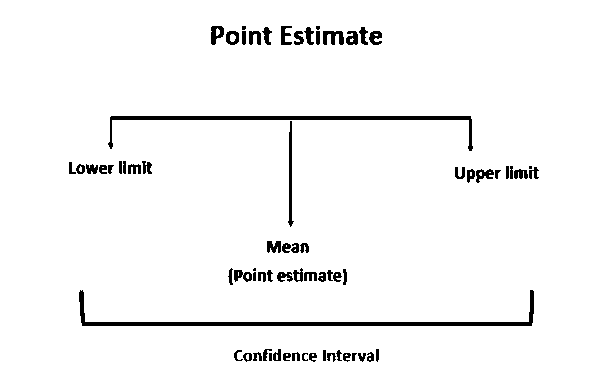{width="42%" fig-alt="Original graphic, section 3.2, slide 4"}

:::

<!-- Original deck 2, slide 5 -->

::: {.source-slide #part3-02-slide-05}

### Point Estimates {#part3-title-02-05}

```{=html}
<div class="source-text">
<p class="source-bullet source-level-0">Suppose we want to estimate the mean weight of a students in the university.</p>
<p class="source-bullet source-level-0">Since there are thousands of students in the university, it would be extremely time-consuming and costly to go around and weigh each individual student.</p>
<p class="source-bullet source-level-0">Instead, we might take a random sample of 50 students and use the mean weight of the students in this sample to estimate the true population mean.</p>
</div>
```

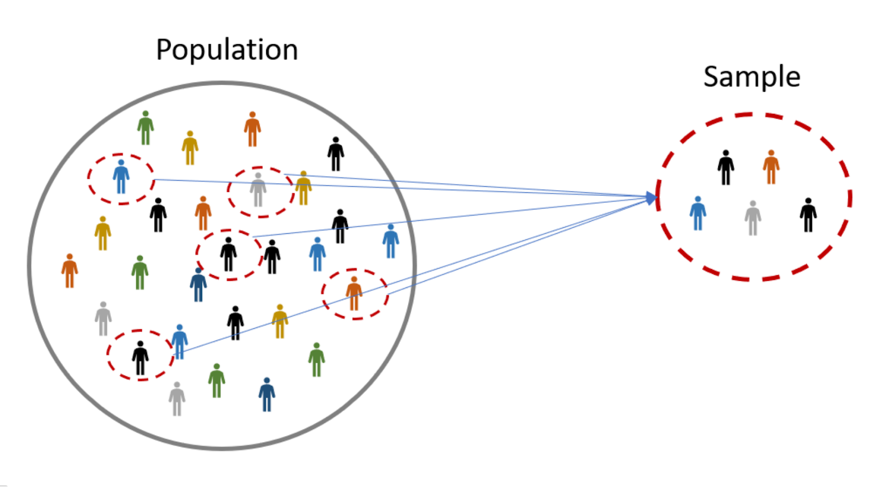{width="49%" fig-alt="Original graphic, section 3.2, slide 5"}

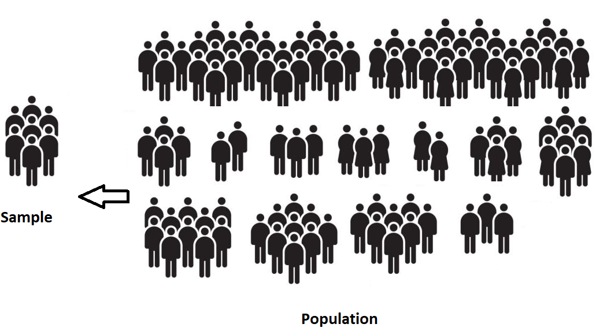{width="30%" fig-alt="Original graphic, section 3.2, slide 5"}

```{=html}
<div class="source-text">
<p class="source-bullet source-level-0">In this case, the mean weight  of the sample is called a Point Estimate for the true mean weight of the population.</p>
</div>
```

:::

<!-- Original deck 2, slide 6 -->

::: {.source-slide #part3-02-slide-06}

### Interval Estimates - Confidence Intervals {#part3-title-02-06}

```{=html}
<div class="source-text">
<p class="source-bullet source-level-0">The problem with the previous example is that the mean weight of students in the sample <strong>is not guaranteed </strong>to exactly match the mean weight of students in the whole population. </p>
<p class="source-bullet source-level-0">For example, we might just happen to pick a sample full of low-weight students or perhaps a sample full of heavy students.</p>
<p class="source-bullet source-level-0">To capture this uncertainty, we can create an Interval Estimate or a confidence interval around our point estimate<strong>.</strong></p>
</div>
```

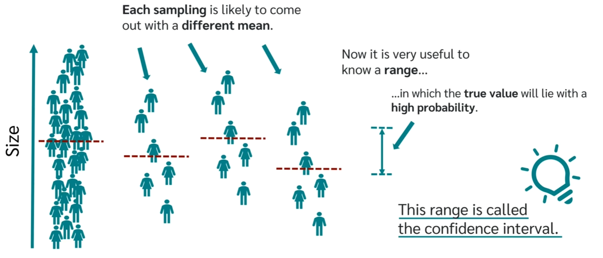{width="60%" fig-alt="Original graphic, section 3.2, slide 6"}

```{=html}
<div class="source-text">
<p class="source-bullet source-level-0">The confidence interval gives us a range of values that are likely to contain the true population parameter.</p>
</div>
```

:::

<!-- Original deck 2, slide 7 -->

::: {.source-slide #part3-02-slide-07}

### Computing Confidence Intervals {#part3-title-02-07}

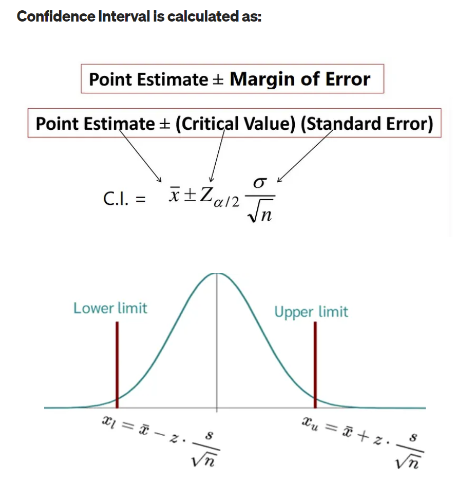{width="47%" fig-alt="Original graphic, section 3.2, slide 7"}

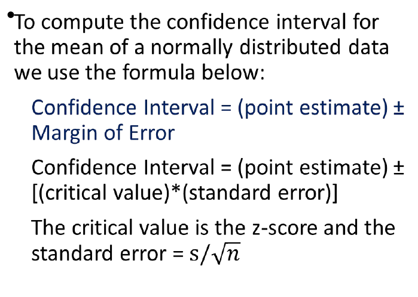{width="52%" fig-alt="Original graphic, section 3.2, slide 7"}

```{=html}
<div class="source-text">
<p>https://medium.com/@ashisharora2204/hypothesis-testing-confidence-interval-level-margin-of-error-39aa7c7ddcd2</p>
</div>
```

:::

<!-- Original deck 2, slide 8 -->

::: {.source-slide #part3-02-slide-08}

### The Significance Level Alpha (α) and The Confidence Level {#part3-title-02-08}

```{=html}
<div class="source-text">
<p class="source-bullet source-level-0">To compute the confidence interval, we need to define the Significance Level Alpha (<em>α</em><em>)</em> or the Confidence Level.</p>
<p class="source-bullet source-level-0">The two terms are related to each other according to the following equation:</p>
<p><strong>Confidence level= 1 – </strong><em><strong>α</strong></em></p>
<p class="source-bullet source-level-0">Common values for these notations are listed in the table</p>
</div>
```

```{=html}
<div class="source-table"><table><tr><td><p><strong>Alpha -  </strong><em>α</em></p></td><td><p><strong>5%</strong></p></td><td><p><strong>1%</strong></p></td></tr><tr><td><p><strong>Confidence level</strong></p></td><td><p><strong>95%</strong></p></td><td><p><strong>99%</strong></p></td></tr><tr><td><p><strong>z-Value</strong></p></td><td><p><strong>1.96</strong></p></td><td><p><strong>2.58</strong></p></td></tr></table></div>
```

:::

<!-- Original deck 2, slide 9 -->

::: {.source-slide #part3-02-slide-09}

### The Significance Level Alpha (α) and The Confidence Level {#part3-title-02-09}

```{=html}
<div class="source-text">
<p class="source-bullet source-level-0">The confidence level (e.g. 95%) means that if we collected 100 samples and created confidence intervals for each of these samples, we would expect that 95% of these confidence intervals will contain the true population parameter. </p>
<p class="source-bullet source-level-0">It&#x27;s important to note that this is a theoretical long-term proportion—it&#x27;s about what we&#x27;d expect to happen over many repetitions of the same process, not a guarantee for any individual interval.</p>
</div>
```

{width="47%" fig-alt="Original graphic, section 3.2, slide 9"}

:::

<!-- Original deck 2, slide 10 -->

::: {.source-slide #part3-02-slide-10}

### Relationship Between Confidence Level and Significance Level in Statistics {#part3-title-02-10}

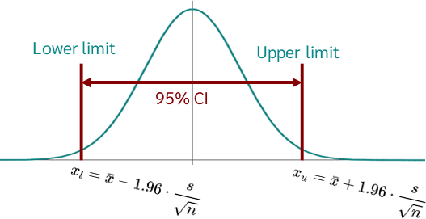{width="40%" fig-alt="Original graphic, section 3.2, slide 10"}

```{=html}
<div class="source-text">
<p>The <strong>confidence level</strong> and the <strong>significance level (α)</strong> are inverse and complementary concepts in statistical inference and hypothesis testing.</p>
<p><strong>Relationship:</strong></p>
<p class="source-bullet source-level-0">The two are <strong>complementary</strong>, meaning that if you increase one, you decrease the other, and vice versa.</p>
<p class="source-bullet source-level-0">A <strong>higher confidence level</strong> corresponds to a <strong>lower significance level</strong>, while a <strong>lower confidence level</strong> corresponds to a <strong>higher significance level</strong>.</p>
<p><strong>Formula:</strong></p>
<p class="source-bullet source-level-0">Confidence Level=1−α</p>
<p><strong>Example:</strong></p>
<p class="source-bullet source-level-0">A 95% confidence level means the significance level is 0.05 (α = 5%).</p>
<p class="source-bullet source-level-0">A 99% confidence level means the significance level is 0.01 (α = 1%).</p>
</div>
```

:::

<!-- Original deck 2, slide 11 -->

::: {.source-slide #part3-02-slide-11}

### Where did the Standard Error Come From? The Central Limit Theorem  {#part3-title-02-11}

:::

<!-- Original deck 2, slide 12 -->

::: {.source-slide #part3-02-slide-12}

### The Central Limit Theorem {#part3-title-02-12}

```{=html}
<div class="source-text">
<p class="source-bullet source-level-0">The Central Limit Theorem (CLT) states that samples means created from large number of samples will be approximately normally distribution although the distribution we sample from might not be normal.</p>
<p class="source-bullet source-level-0">When we collect large number of samples and we compute the average for each of these samples, we call the generated means as the Sampling Distribution of the means.</p>
<p class="source-bullet source-level-0">The distribution of samples means becomes more normal when the samples size increases.</p>
<p>According to CLT:</p>
<p>1- The mean of the sampling distribution would be equal to the mean of the original distribution.</p>
<p>2- The variance of the sampling distribution of the sample mean would be equal to the variance of the original distribution divided by n, where n is the size of the samples.</p>
</div>
```

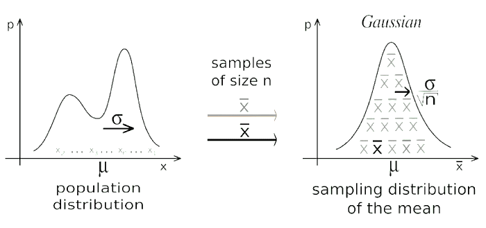{width="47%" fig-alt="Original graphic, section 3.2, slide 12"}

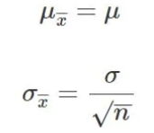{width="30%" fig-alt="Original graphic, section 3.2, slide 12"}

{width="30%" fig-alt="Original graphic, section 3.2, slide 12"}

```{=html}
<div class="source-text">
<p>Click here for a CLT simulator.</p>
</div>
```

:::

<!-- Original deck 2, slide 13 -->

::: {.source-slide #part3-02-slide-13}

### Inference: Turning the Sampling Model Around {#part3-title-02-13}

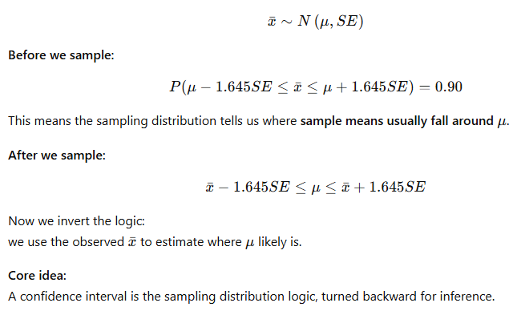{width="71%" fig-alt="Original graphic, section 3.2, slide 13"}

:::

<!-- Original deck 2, slide 14 -->

::: {.source-slide #part3-02-slide-14}

### The Symmetry IThe Symmetry Idea Behind Confidence Intervalsdea Behind Confidence Intervals {#part3-title-02-14}

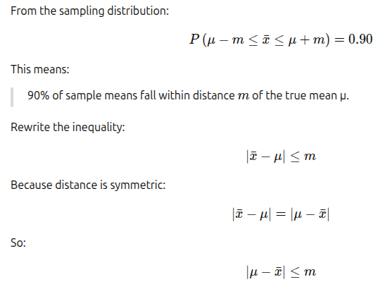{width="50%" fig-alt="Original graphic, section 3.2, slide 14"}

:::

<!-- Original deck 2, slide 15 -->

::: {.source-slide #part3-02-slide-15}

### From CLT to Confidence Intervals {#part3-title-02-15}

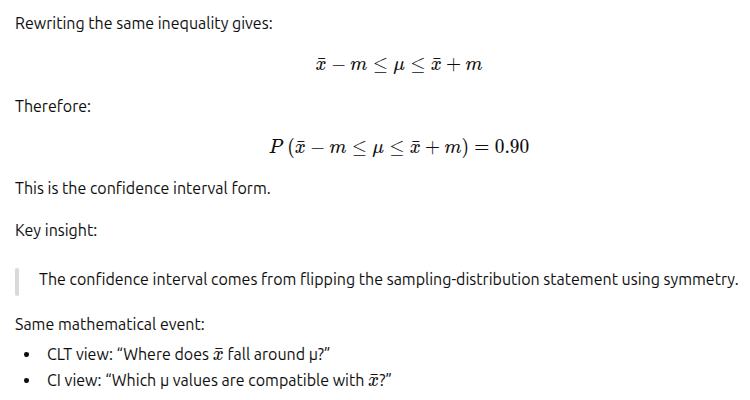{width="70%" fig-alt="Original graphic, section 3.2, slide 15"}

:::

<!-- Original deck 2, slide 16 -->

::: {.source-slide #part3-02-slide-16}

### Empirical Proof that Standard Error is an Approximate for the True SD of Sample Means {#part3-title-02-16}

#### Original Python example

```python
import numpy as np
import matplotlib.pyplot as plt

# Set population parameters
population = np.random.normal(loc=50, scale=10, size=1000000)
true_sigma = np.std(population)

# Simulation setup
sample_size = 30
num_samples = 1000
sample_means = []
sample_sds = []

for _ in range(num_samples):
    sample = np.random.choice(population, sample_size)
    sample_means.append(np.mean(sample))
    sample_sds.append(np.std(sample, ddof=1))

# Calculate actual SD of sample means
sd_of_sample_means = np.std(sample_means)

# Calculate average standard error estimate
average_se = np.mean([s / np.sqrt(sample_size) for s in sample_sds])

print(f"True SD of sample means: {sd_of_sample_means:.4f}")
print(f"Average estimated SE:     {average_se:.4f}")

# Optional: plot histogram
plt.hist(sample_means, bins=30, edgecolor='black')
plt.title('Distribution of Sample Means')
plt.xlabel('Sample Mean')
plt.ylabel('Frequency')
plt.show()


```

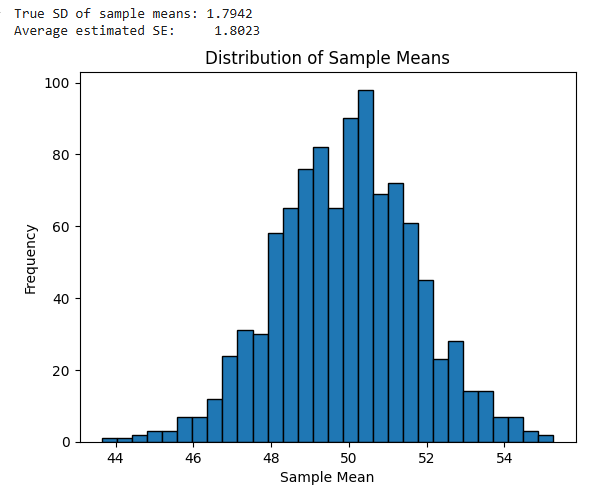{width="48%" fig-alt="Original graphic, section 3.2, slide 16"}

#### R equivalent (added)

```{r}
#| label: inferential-2-16
# set.seed() makes this simulation reproducible; rnorm() creates the source's artificial population.
# replicate() repeats sampling with replacement; each column returns a mean and a sample-based SE.
set.seed(307312)
population <- rnorm(1000000, mean=50, sd=10)
results <- replicate(1000, {
  x <- sample(population, size=30, replace=TRUE)
  c(sample_mean=mean(x), estimated_SE=sd(x)/sqrt(30))
})
# sd() and mean() compare simulated sampling spread and average estimated SE; agreement is illustrative.
# hist() uses 30 bins to display the 1,000 sample means; this simulation is not a mathematical proof.
c(SD_of_sample_means=sd(results[1,]), average_estimated_SE=mean(results[2,]))
hist(results[1,], breaks=30, col="#E9DDE7", main="Distribution of Sample Means", xlab="Sample Mean")
```

:::

<!-- Original deck 2, slide 17 -->

::: {.source-slide #part3-02-slide-17}

### Confidence Intervals Example {#part3-title-02-17}

```{=html}
<div class="source-text">
<p>Suppose we randomly collected a sample of students with the following information:</p>
<p class="source-bullet source-level-1">Sample size n = 50</p>
<p class="source-bullet source-level-1">Sample mean weight x = 73.16 kg</p>
<p class="source-bullet source-level-1">Population standard deviation s = 8.63</p>
<p>What is the 90% confidence interval for the true population mean weight?</p>
</div>
```

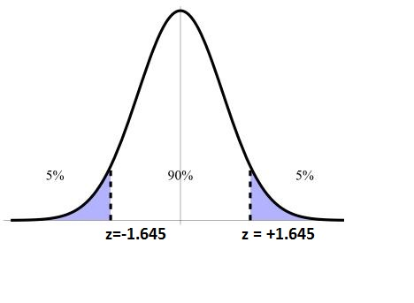{width="30%" fig-alt="Original graphic, section 3.2, slide 17"}

{width="35%" fig-alt="Original graphic, section 3.2, slide 17"}

```{=html}
<div class="source-text">
<p class="source-bullet source-level-0">To find the upper bound z-score for the 90% CI, we need to look for area 95% in the z table i.e. 90% + 5% (Look at the Figure)</p>
<p class="source-bullet source-level-0">Therefore, according to the z-table, the upper bound z-score for the 90% Confidence Interval = 1.64 i.e. lower bound is -1.64.</p>
<p class="source-bullet source-level-0">The Margin of Error = 1.64 * (8.63/√50) = ~2</p>
<p class="source-bullet source-level-0">Therefore, the 90% CI = 73.16 ± 2 = [71.16, 75.16]</p>
</div>
```

#### R equivalent (added)

```{r}
#| label: inferential-2-17
# qnorm(0.95) gives the upper critical z for a central 90% interval; sigma=8.63 is treated as known.
# sqrt(n) scales population SD into SE; c(-1,1) constructs the lower and upper endpoints in kg.
n <- 50; xbar <- 73.16; sigma <- 8.63
xbar + c(-1,1)*qnorm(0.95)*sigma/sqrt(n)
```

:::

<!-- Original deck 2, slide 18 -->

::: {.source-slide #part3-02-slide-18}

### Confidence Intervals Example {#part3-title-02-18}

{width="46%" fig-alt="Original graphic, section 3.2, slide 18"}

```{=html}
<div class="source-text">
<p>We interpret this 90% confidence interval as follows:</p>
<p class="source-bullet source-level-0">The interval [71.16 kgs to 75.16 kgs] gives us a good estimate of where the mean lies, based on the collective information from our samples. </p>
<p class="source-bullet source-level-0">The 90% means that if we estimate the population parameter and computed the confidence intervals 100 times, we expect that 90% of these intervals will contain our parameter.</p>
</div>
```

:::

<!-- Original deck 2, slide 19 -->

::: {.source-slide #part3-02-slide-19}

### Solving Confidence Intervals using Excel Functions {#part3-title-02-19}

```{=html}
<div class="source-text">
<p>Suppose we randomly collected a sample of students with the following information:</p>
<p class="source-bullet source-level-1">Sample size n = 50</p>
<p class="source-bullet source-level-1">Sample mean weight x = 73.16 kg</p>
<p class="source-bullet source-level-1">Sample standard deviation s = 8.63</p>
<p>What is the 90% confidence interval for the true population mean weight?</p>
</div>
```

{width="48%" fig-alt="Original graphic, section 3.2, slide 19"}

{width="36%" fig-alt="Original graphic, section 3.2, slide 19"}

```{=html}
<div class="source-text">
<p class="source-bullet source-level-0">We can compute the confidence interval using Excel CONFIDENCE.NORM function.</p>
<p class="source-bullet source-level-0">This function computes the margin of error.</p>
<p class="source-bullet source-level-0">CONFIDENCE.NORM(.1 , 8.63 , 50) = 2.0074 ~ 2</p>
<p class="source-bullet source-level-0">Therefore, the 90% CI = 73.16 ± 2 = [71.16, 75.16]</p>
</div>
```

#### R equivalent (added)

```{r}
#| label: inferential-2-19
# qt(0.95,df=49) gives the central 90% t critical value when SD 8.63 is estimated from 50 observations.
# This t interval uses unknown population SD; it can differ from the original normal approximation.
73.16 + c(-1,1)*qt(0.95,df=49)*8.63/sqrt(50)
```

:::

<!-- Original deck 2, slide 20 -->

::: {.source-slide #part3-02-slide-20}

### Transitioning to T-Distribution {#part3-title-02-20}

```{=html}
<div class="source-text">
<p class="source-bullet source-level-0">The T-distribution, like the normal distribution, is bell-shaped and symmetric but has heavier tails.</p>
<p class="source-bullet source-level-0">This means there is more probability in the tails and less in the center compared to a normal distribution.</p>
<p class="source-bullet source-level-0">The exact shape of the T-distribution depends on the degrees of freedom (df), which are related to the sample size.</p>
<p class="source-bullet source-level-0">Degrees of freedom in the context of the T-distribution refer to the number of independent values in a calculation of a statistic that are free to vary.</p>
<p class="source-bullet source-level-0">For a confidence interval, df is equal to the sample size (n) minus 1 (df = n - 1).</p>
<p class="source-bullet source-level-0">As the sample size increases, the T-distribution approaches the normal Z-distribution.</p>
</div>
```

{width="43%" fig-alt="Original graphic, section 3.2, slide 20"}

{width="39%" fig-alt="Original graphic, section 3.2, slide 20"}

```{=html}
<div class="source-text">
<p>https://www.scribbr.com/statistics/t-distribution/</p>
</div>
```

:::

<!-- Original deck 2, slide 21 -->

::: {.source-slide #part3-02-slide-21}

### When to use T-Distribution {#part3-title-02-21}

```{=html}
<div class="source-text">
<p class="source-bullet source-level-0">We can use the Z-distribution when the population variance is known or when our data is large enough (n &gt; 30).</p>
<p class="source-bullet source-level-0">However, real-world data often doesn&#x27;t come with this information.</p>
<p class="source-bullet source-level-0">In practice, the population variance is unknown, and we usually estimate the population variance using the sample variance, which introduces more variability into our statistics.</p>
<p class="source-bullet source-level-0">The T-distribution accommodates this additional uncertainty and is especially useful for small sample sizes.</p>
<p class="source-bullet source-level-0">The T-distribution often serves as a safer alternative because it accounts for the additional uncertainty from estimating the population variance.</p>
</div>
```

:::

<!-- Original deck 2, slide 22 -->

::: {.source-slide #part3-02-slide-22}

### The T Table {#part3-title-02-22}

{width="42%" fig-alt="Original graphic, section 3.2, slide 22"}

```{=html}
<div class="source-text">
<p class="source-bullet source-level-0">The first column, denoted &quot;v,&quot; lists the degrees of freedom. </p>
<p class="source-bullet source-level-0">Degrees of freedom typically equal the sample size minus one (n-1) and relate to the number of independent values in a set of observations.</p>
<p class="source-bullet source-level-0">The top row lists different significance levels (α), like the probabilities in z-table.</p>
<p class="source-bullet source-level-0">The intersection of a row and column gives the t-value or t score, which is the cutoff point on the t-distribution. </p>
<p class="source-bullet source-level-0">The table lists the areas (probability) on the right side, of the t-scores (opposite to the z-tables), therefore, to find a t scores for confident intervals we split α by 2 and look out the resulting value in the table.</p>
<p class="source-bullet source-level-0">For example, to find the 90% confidence interval for a sample of 20 observations, we find α which is 1 - .9 = .1</p>
<p class="source-bullet source-level-0">We split α by 2 = .1 / 2 = 0.05 and we lookout that value in the table = 1.729</p>
</div>
```

:::

<!-- Original deck 2, slide 23 -->

::: {.source-slide #part3-02-slide-23}

### Confidence Intervals Using T-Distribution {#part3-title-02-23}

{width="100%" fig-alt="Original graphic, section 3.2, slide 23"}

{width="30%" fig-alt="Original graphic, section 3.2, slide 23"}

:::

<!-- Original deck 2, slide 24 -->

::: {.source-slide #part3-02-slide-24}

### Interval Estimates - Confidence Intervals {#part3-title-02-24}

{width="40%" fig-alt="Original graphic, section 3.2, slide 24"}

```{=html}
<div class="source-text">
<p>Suppose we randomly collected a sample of students with the following information:</p>
<p class="source-bullet source-level-1">Sample size n = 20</p>
<p class="source-bullet source-level-1">Sample mean weight x = 72.94 kg</p>
<p class="source-bullet source-level-1">Samples standard deviation s = 8.3946</p>
<p>What is the 90% confidence interval for the true population mean weight?</p>
</div>
```

```{=html}
<div class="source-text">
<p class="source-bullet source-level-0">Confidence Interval 90%  <em>α</em><em> = 1 - 0.9 = 0.1 </em><em></em><em> </em><em>α</em><em>/2 = 0.05</em></p>
<p class="source-bullet source-level-0">According to the t-table, the t-score for the 0.05 with df 20 – 1 =  19  t score = 1.729</p>
<p class="source-bullet source-level-0">The Margin of Error = 1.729 * (8.3946/√20) = 3.25 </p>
<p class="source-bullet source-level-0">Therefore, the 90% CI = 72.94 ± 3.25 = [69.69, 76.19]</p>
</div>
```

```{=html}
<div class="source-text">
<p><strong>What is the difference between the 90% Confidence Interval of the Z-Distribution and the 90% Confidence Interval of the T-Distribution?</strong></p>
</div>
```

#### R equivalent (added)

```{r}
#| label: inferential-2-24
# qt() uses 19 degrees of freedom for n=20; the central 90% interval leaves 5% in each tail.
# The stated sample SD 8.3946 and mean 72.94 are in kg; no individual observations are invented.
72.94 + c(-1,1)*qt(0.95,df=19)*8.3946/sqrt(20)
```

:::

<!-- Original deck 2, slide 25 -->

::: {.source-slide #part3-02-slide-25}

### Solving Confidence Intervals using Excel Functions {#part3-title-02-25}

```{=html}
<div class="source-text">
<p>Suppose we randomly collected a sample of students with the following information:</p>
<p class="source-bullet source-level-1">Sample size n = 20</p>
<p class="source-bullet source-level-1">Sample mean weight x = 72.94 kg</p>
<p class="source-bullet source-level-1">Samples standard deviation s = 8.3946</p>
<p>What is the 90% confidence interval for the true population mean weight?</p>
</div>
```

{width="30%" fig-alt="Original graphic, section 3.2, slide 25"}

```{=html}
<div class="source-text">
<p class="source-bullet source-level-0">We can compute the confidence interval using Excel CONFIDENCE.T function.</p>
<p class="source-bullet source-level-0">This function computes the margin of error.</p>
<p class="source-bullet source-level-0">CONFIDENCE.T(.1 , 8. 39 , 20) = 3.24 ~ 2</p>
<p class="source-bullet source-level-0">Therefore, the 90% CI = 72.94 ± 3.24 = [69.69, 76.19]</p>
</div>
```

{width="30%" fig-alt="Original graphic, section 3.2, slide 25"}

:::

<!-- Original deck 2, slide 26 -->

::: {.source-slide #part3-02-slide-26}

### Steps to Calculate the Needed Sample Size {#part3-title-02-26}

{width="55%" fig-alt="Original graphic, section 3.2, slide 26"}

```{=html}
<div class="source-text">
<p class="source-bullet source-level-0"><strong>Define your research objectives and questions.</strong></p>
<p class="source-bullet source-level-0"><strong>Choose a significance level (α) and desired margin of error (E).</strong></p>
<p class="source-bullet source-level-0"><strong>Estimate population variability (σ),</strong> or use conservative estimates if unknown.</p>
<p class="source-bullet source-level-0"><strong>Determine the population size (N).</strong></p>
<p class="source-bullet source-level-0"><strong>Select the type of sampling</strong> (random or stratified).</p>
<p class="source-bullet source-level-0"><strong>Choose the statistical test or analysis</strong> that will be applied.</p>
<p class="source-bullet source-level-0"><strong>Use a sample size formula or software tool</strong> to calculate the required sample size.</p>
<p class="source-bullet source-level-0"><strong>Consider practical constraints</strong> and adjust for potential non-response.</p>
<p class="source-bullet source-level-0"><strong>Conduct the study, analyze data, and interpret results.</strong></p>
</div>
```

:::

<!-- Original deck 3, slide 1 -->

::: {.source-slide #part3-03-slide-01}

## 3.3 Introduction to Hypothesis Testing {#part3-03}

:::

<!-- Original deck 3, slide 2 -->

::: {.source-slide #part3-03-slide-02}

### Content {#part3-title-03-02}

```{=html}
<div class="source-text">
<p>Introduction to Hypothesis Testing</p>
<p>Business Examples</p>
<p>Significance Level – Alpha</p>
<p>Computing T-Statistic</p>
<p>Critical Value Approach vs P-Value Approach</p>
<p>Type I and Type II Errors</p>
<p>T-Test: Used for normally distributed data when the variance is unknown.</p>
<p>One-sample t-test: Tests the mean of a single group against a known mean.</p>
<p>Two-sample t-test: Compares the means of two dependent groups (paired test).</p>
<p>Two-sample t-test: Compares the means of two independent groups (variance assumed to be equal).</p>
<p>Two-sample t-test: Compares the means of two independent groups (variance assumed to be not equal).</p>
<p>Proportion Test: Compare sample proportion to a benchmark (e.g., open rate, conversion rate).</p>
<p>ANOVA (Analysis of Variance): Used to compare the means of three or more samples.</p>
<p class="source-bullet source-level-1">One Way ANOVA</p>
<p class="source-bullet source-level-1">Two Way ANOVA</p>
<p>Chi-square test: Tests for relationships between categorical variables.</p>
</div>
```

:::

<!-- Original deck 3, slide 3 -->

::: {.source-slide #part3-03-slide-03}

### Hypothesis Testing {#part3-title-03-03}

```{=html}
<div class="source-text">
<p><strong>Hypothesis Testing </strong>is a statistical method that uses sample data to evaluate a hypothesis about a population parameter.</p>
<p>A <strong>hypothesis</strong> is a claim about a population parameter that can be examined.</p>
<p>The purpose of hypothesis testing is to determine whether there is enough evidence in a sample of data to support a particular belief about a population.</p>
<p>Examples of claims that can be checked:</p>
<p class="source-bullet source-level-1">Testing if a new marketing campaign increases customer engagement.</p>
<p class="source-bullet source-level-1">Checking whether a redesigned website improves conversion rates.</p>
<p class="source-bullet source-level-1">Evaluating if a new product packaging affects sales volume.</p>
<p class="source-bullet source-level-1">Determining if weekend promotions boost in-store foot traffic.</p>
<p class="source-bullet source-level-1">Assessing whether remote work impacts employee productivity.</p>
<p class="source-bullet source-level-1">Comparing customer satisfaction between two service locations.</p>
<p class="source-bullet source-level-1">Testing if a loyalty program increases repeat purchase rates.</p>
<p class="source-bullet source-level-1">Seeing if a price change affects total revenue.</p>
<p class="source-bullet source-level-1">Checking whether a new supplier leads to fewer product defects.</p>
<p class="source-bullet source-level-1">Measuring if training improves sales team performance.</p>
</div>
```

:::

<!-- Original deck 3, slide 4 -->

::: {.source-slide #part3-03-slide-04}

### Business Related Examples in Hypothesis Testing {#part3-title-03-04}

```{=html}
<div class="source-table"><table><tr><td><p>Category</p></td><td><p>Scenario</p></td><td><p>Type of Test</p></td><td><p>Detailed Experiment Design</p></td></tr><tr><td><p>Marketing</p></td><td><p>Testing if a new marketing campaign increases customer engagement.</p></td><td><p>Proportion</p></td><td><p class="source-bullet source-level-0">Compare engagement rates (clicks, opens) between users exposed to the new vs. old campaign. </p>
<p class="source-bullet source-level-0">Randomly assign at least 500 customers to two groups: one receiving the new campaign, one the old. </p>
<p class="source-bullet source-level-0">Track engagement (clicks/opens) over a week.</p></td></tr><tr><td></td><td><p>Seeing if a promotional email improves open or click-through rates.</p></td><td><p>Proportion</p></td><td><p class="source-bullet source-level-0">Compare open/click-through rates between two versions of an email. </p>
<p class="source-bullet source-level-0">Send Version A to 1,000 customers and Version B to another 1,000. </p>
<p class="source-bullet source-level-0">Ensure equal demographic spread. </p>
<p class="source-bullet source-level-0">Compare open and click-through rates.</p></td></tr><tr><td></td><td><p>Measuring whether influencer partnerships drive more traffic to the site.</p></td><td><p>Mean</p></td><td><p class="source-bullet source-level-0">Compare average daily website visits with and without influencer campaigns. </p>
<p class="source-bullet source-level-0">Track daily website traffic for 30 days before and after the influencer campaign. </p>
<p class="source-bullet source-level-0">Use rolling averages to minimize noise.</p></td></tr><tr><td></td><td><p>Evaluating if social media ads result in more conversions.</p></td><td><p>Proportion</p></td><td><p class="source-bullet source-level-0">Compare conversion rates for users who saw the ads vs. those who did not. </p>
<p class="source-bullet source-level-0">Randomly expose 5,000 users to social media ads while keeping a matched control group unexposed. </p>
<p class="source-bullet source-level-0">Track conversion behavior over 7 days.</p></td></tr><tr><td><p>Sales &amp; Revenue</p></td><td><p>Determining if a price change affects total revenue.</p></td><td><p>Mean</p></td><td><p class="source-bullet source-level-0">Compare average revenue per user before and after price change. </p>
<p class="source-bullet source-level-0">Collect revenue data for 4 weeks before and after price change. </p>
<p class="source-bullet source-level-0">Use at least 1,000 transactions in each period to ensure reliability.</p></td></tr><tr><td></td><td><p>Testing whether bundling products increases average order value.</p></td><td><p>Mean</p></td><td><p class="source-bullet source-level-0">Compare average order value for bundled vs. unbundled products. </p>
<p class="source-bullet source-level-0">Assign 500 customers to view bundled product pricing and 500 to unbundled. </p>
<p class="source-bullet source-level-0">Track order values across one sales cycle.</p></td></tr><tr><td></td><td><p>Assessing if offering free shipping improves purchase completion rates.</p></td><td><p>Proportion</p></td><td><p class="source-bullet source-level-0">Compare checkout completion rates with and without free shipping. </p>
<p class="source-bullet source-level-0">Split 2,000 checkout users evenly into groups with and without free shipping. </p>
<p class="source-bullet source-level-0">Track completion rate within 24 hours.</p></td></tr></table></div>
```

:::

<!-- Original deck 3, slide 5 -->

::: {.source-slide #part3-03-slide-05}

```{=html}
<div class="source-table"><table><tr><td><p>Category</p></td><td><p>Scenario</p></td><td><p>Type of Test</p></td><td><p>Detailed Experiment Design</p></td></tr><tr><td><p>Operations</p></td><td><p>Checking whether a new supplier leads to fewer product defects.</p></td><td><p>Proportion</p></td><td><p class="source-bullet source-level-0">Compare defect rates between products from the old vs. new supplier. </p>
<p class="source-bullet source-level-0">Collect defect data from 1,000 units produced using the old supplier and 1,000 from the new. </p>
<p class="source-bullet source-level-0">Monitor under similar production conditions.</p></td></tr><tr><td></td><td><p>Evaluating if a new production method reduces waste or error rates.</p></td><td><p>Mean</p></td><td><p class="source-bullet source-level-0">Compare mean waste/error amounts using old vs. new methods. </p>
<p class="source-bullet source-level-0">Run the production process using each method for a week, generating at least 500 measurements of waste or errors per method.</p></td></tr><tr><td></td><td><p>Determining if delivery time decreases with a new logistics provider.</p></td><td><p>Mean</p></td><td><p class="source-bullet source-level-0">Compare average delivery times between the two providers. </p>
<p class="source-bullet source-level-0">Record 1,000 delivery times for each provider across the same set of shipping regions and similar order types.</p></td></tr><tr><td><p>Customer Behavior</p></td><td><p>Testing if a loyalty program increases repeat purchase rates.</p></td><td><p>Proportion</p></td><td><p class="source-bullet source-level-0">Compare proportion of returning customers with and without loyalty program. </p>
<p class="source-bullet source-level-0">Track purchase frequency over 3 months for 1,000 loyalty program users and 1,000 non-users, matched by purchase history.</p></td></tr><tr><td></td><td><p>Seeing if a new mobile app design boosts daily active users.</p></td><td><p>Mean</p></td><td><p class="source-bullet source-level-0">Compare average daily users before and after redesign. </p>
<p class="source-bullet source-level-0">Monitor app usage data for 30 days before and after the redesign, using data from at least 5,000 active users.</p></td></tr><tr><td></td><td><p>Measuring if customer satisfaction differs after a policy change.</p></td><td><p>Mean</p></td><td><p class="source-bullet source-level-0">Compare satisfaction ratings before and after the policy change. </p>
<p class="source-bullet source-level-0">Survey at least 500 customers before and after the policy change or use NPS ratings from two equivalent time periods.</p></td></tr><tr><td><p>Human Resources</p></td><td><p>Assessing whether remote work impacts employee productivity.</p></td><td><p>Mean</p></td><td><p class="source-bullet source-level-0">Compare average productivity scores of remote vs. in-office workers. </p>
<p class="source-bullet source-level-0">Randomly select 200 remote and 200 in-office employees with similar roles. Track weekly productivity for 1 month.</p></td></tr><tr><td></td><td><p>Measuring if training improves sales team performance.</p></td><td><p>Mean</p></td><td><p class="source-bullet source-level-0">Compare average sales figures before and after training. </p>
<p class="source-bullet source-level-0">Analyze sales data from 100 employees for the 3 months before and after training. Normalize for seasonal trends.</p></td></tr><tr><td></td><td><p>Testing if flexible hours reduce employee turnover.</p></td><td><p>Proportion</p></td><td><p class="source-bullet source-level-0">Compare turnover rates between employees with and without flexible hours. Track turnover across 1,000 employees with flexible hours and 1,000 without, matched on role and tenure, over a year.</p></td></tr></table></div>
```

:::

<!-- Original deck 3, slide 6 -->

::: {.source-slide #part3-03-slide-06}

### Key Concepts {#part3-title-03-06}

```{=html}
<div class="source-text">
<p class="source-bullet source-level-0"><strong>Null Hypothesis (H₀):</strong> A statement of no effect or no difference (usually we want to test this null state against a difference made by an intervention)</p>
<p class="source-bullet source-level-0"><strong>Alternative Hypothesis (H₁ or Ha):</strong> What you want to prove – a statement of effect or difference.</p>
<p class="source-bullet source-level-0"><strong>Significance Level (α):</strong> Probability of rejecting H₀ when it is actually true. Common choices: 0.05, 0.01.</p>
<p class="source-bullet source-level-0"><strong>p-value:</strong> Probability of observing a result at least as extreme as the one obtained, assuming H₀ is true.</p>
<p class="source-bullet source-level-0"><strong>Test Statistic:</strong> A value calculated from the sample to decide whether to reject H₀.</p>
</div>
```

:::

<!-- Original deck 3, slide 7 -->

::: {.source-slide #part3-03-slide-07}

### The Null and The Alternative Hypothesis {#part3-title-03-07}

```{=html}
<div class="source-text">
<p>When formulating a hypothesis test, we define two hypotheses: the null hypothesis (𝐻₀) and the alternative hypothesis (𝐻₁ or 𝐻ₐ).</p>
<p>These two hypotheses complement each other—only one of them can be valid.</p>
<p>For example, suppose a company claims that the average delivery time of its orders is 3 days. </p>
<p>To test this claim, the company defines the hypotheses as following:</p>
<p><strong>The Null hypothesis 𝐻₀:</strong> The average delivery time <strong>IS EQUAL TO 3 days.</strong></p>
<p><strong>The Alternative hypothesis 𝐻ₐ:</strong> The average delivery time <strong>IS NOT 3 days.</strong></p>
<p>Hypotheses are often expressed with symbols like this:</p>
<p>𝐻₀: μ = 3 days</p>
<p>𝐻ₐ: μ ≠ 3 days</p>
<p>Notice that the null hypothesis sets a <strong>baseline</strong> assuming no difference or effect—in this context, that the mean delivery time is not different from 3 days.</p>
<p>The burden of proof lies with the alternative hypothesis, which must show sufficient evidence that the average delivery time is different from 3 days.</p>
</div>
```

:::

<!-- Original deck 3, slide 8 -->

::: {.source-slide #part3-03-slide-08}

### Choosing the Right Test {#part3-title-03-08}

```{=html}
<div class="source-text">
<p class="source-bullet source-level-0"><strong>One-sample z-test or t-test</strong>: Compare sample mean to a known value.</p>
<p><strong>Proportion test</strong>: Compare sample proportion to a benchmark (e.g., open rate, conversion rate).</p>
<p class="source-bullet source-level-0"><strong>Two-sample t-test</strong>: Compare means between two groups (e.g., control vs test).</p>
<p class="source-bullet source-level-0"><strong>Chi-square test</strong>: Compare categorical variables (e.g., customer satisfaction vs region).</p>
<p class="source-bullet source-level-0"><strong>ANOVA Test: </strong>Compare means between three or more groups.</p>
</div>
```

:::

<!-- Original deck 3, slide 9 -->

::: {.source-slide #part3-03-slide-09}

### The Process {#part3-title-03-09}

```{=html}
<div class="source-text">
<p><strong>Compare the Test Statistic to Critical Values</strong></p>
<p>If the calculated test statistic falls into the critical region, reject H₀.</p>
<p>Otherwise, fail to reject H₀.</p>
<p><strong>Calculate the P-Value (Alternative Approach)</strong></p>
<p>The p-value is the probability of observing a test statistic as extreme as, or more extreme than, the one obtained, assuming H₀ is true.</p>
<p><strong>Decision rule:</strong></p>
<p>If p ≤ α → reject H₀</p>
<p>If p &gt; α → fail to reject H₀</p>
<p><strong>Make a Decision</strong></p>
<p><strong>Reject H₀:</strong> Conclude there is evidence supporting Hₐ.</p>
<p><strong>Fail to reject H₀:</strong> Conclude there is insufficient evidence to support Hₐ.</p>
<p><strong>Interpret Results</strong></p>
<p>Explain findings in the context of the research question.</p>
<p>Discuss practical significance and implications of the results.</p>
<p>Would you like me to also turn this into a <strong>step-by-step flowchart</strong> or <strong>visual diagram</strong> for easier understanding?</p>
</div>
```

```{=html}
<div class="source-text">
<p><strong>Formulate Hypotheses</strong></p>
<p><strong>Null hypothesis (H₀):</strong> A statement of no effect or no difference. It represents the default assumption being tested.</p>
<p><strong>Alternative hypothesis (Hₐ):</strong> The hypothesis you want to provide evidence for, suggesting there is an effect, difference, or relationship in the population.</p>
<p><strong>Choose a Significance Level (α)</strong></p>
<p>Select the probability of making a Type I error (rejecting H₀ when it is true).</p>
<p>Common choices: 0.05 (5%) or 0.01 (1%).</p>
<p><strong>Collect and Analyze Data</strong></p>
<p>Gather sample data relevant to your research question.</p>
<p>Perform an appropriate statistical analysis (e.g., t-test, chi-square test, ANOVA) depending on your study design.</p>
<p><strong>Calculate the Test Statistic</strong></p>
<p>Compute the test statistic based on sample data and H₀.</p>
<p>This quantifies how different the sample is from what is expected under H₀.</p>
<p><strong>Determine the Critical Region</strong></p>
<p>Identify the rejection region in the probability distribution of the test statistic.</p>
<p>If the statistic falls within this region, H₀ will be rejected.</p>
</div>
```

:::

<!-- Original deck 3, slide 10 -->

::: {.source-slide #part3-03-slide-10}

### The Process in Brief {#part3-title-03-10}

```{=html}
<div class="source-text">
<p class="source-bullet source-level-0"><strong>State</strong> H₀ and Ha.</p>
<p class="source-bullet source-level-0"><strong>Choose</strong> α (e.g., 0.05).</p>
<p class="source-bullet source-level-0"><strong>Collect data </strong>and compute a test statistic.</p>
<p class="source-bullet source-level-0"><strong>Compute</strong> the p-value.</p>
<p class="source-bullet source-level-0"><strong>Compare</strong> p-value to α.</p>
<p class="source-bullet source-level-0"><strong>Decision:</strong> Reject or fail to reject H₀.</p>
</div>
```

```{=html}
<div class="source-text">
<p class="source-bullet source-level-0">Note: We cannot we accept the null hypothesis, we can only reject it or fail to reject it. </p>
<p class="source-bullet source-level-0">The basis for this testing process comes from logic. </p>
<p class="source-bullet source-level-0">For example, if our null hypothesis = All students live in Amman, it will be challenging to check if all students live in Amman. </p>
<p class="source-bullet source-level-0">On the other hand, it will be much easier to find just one student who does not live in Amman and therefore reject the null hypothesis.</p>
<p class="source-bullet source-level-0">Rejecting is much easier that proving or accepting the hypothesis.</p>
</div>
```

:::

<!-- Original deck 3, slide 11 -->

::: {.source-slide #part3-03-slide-11}

### More about Hypothesis Testing Core Concepts {#part3-title-03-11}

```{=html}
<div class="source-text">
<p>Alpha value, The Test Statistic and Critical Values, P-Value, Type I and Type II Errors</p>
</div>
```

:::

<!-- Original deck 3, slide 12 -->

::: {.source-slide #part3-03-slide-12}

### The Significance Level α {#part3-title-03-12}

```{=html}
<div class="source-text">
<p>Before conducting the test, we need to set the significance level α.</p>
<p>The significance level is a measure of the strength of the evidence that must be present in our sample to reject the null hypothesis and conclude that the effect is statistically significant.</p>
<p>Typical significance levels are: α=0.1 (10%), α=0.05 (5%), α=0.01 (1%)</p>
<p>A lower significance level means that the evidence in the data needs to be stronger to reject the null hypothesis.</p>
</div>
```

{width="44%" fig-alt="Original graphic, section 3.3, slide 12"}

```{=html}
<div class="source-text">
<p>There is no &quot;correct&quot; significance level - it only states the amount of uncertainty of the conclusion.</p>
<p>A 5% significance level means that we expect to reject a true null hypothesis 5 out of 100 times (Type I Error).</p>
</div>
```

:::

<!-- Original deck 3, slide 13 -->

::: {.source-slide #part3-03-slide-13}

### The Test Statistic {#part3-title-03-13}

```{=html}
<div class="source-text">
<p>The test statistic is the value we compute based on the sample data that we collect.</p>
<p>The test statistic is used to decide the outcome of the hypothesis test.</p>
<p>We standardize test statistic using:</p>
<p>Z Standard Normal Distribution for large samples or when the variance is known.</p>
<p>The Student&#x27;s T-Distribution (T) for small samples and the population variance is unknown.</p>
</div>
```

:::

<!-- Original deck 3, slide 14 -->

::: {.source-slide #part3-03-slide-14}

### Computing the Test Statistic Dependence on our Knowledge about Variance {#part3-title-03-14}

{width="100%" fig-alt="Original graphic, section 3.3, slide 14"}

:::

<!-- Original deck 3, slide 15 -->

::: {.source-slide #part3-03-slide-15}

### The Critical Value and the p-Value Approach to Hypothesis Testing {#part3-title-03-15}

```{=html}
<div class="source-text">
<p>To decide whether to reject the null hypothesis, a test statistic is calculated. </p>
<p>The decision is made based on the numerical value of that test statistic. </p>
<p>There are two approaches how to arrive at that decision: The critical value approach and the p-value approach.</p>
<p><strong>The critical value approach</strong></p>
<p>By applying the critical value approach, it is determined, whether the observed test statistic is more extreme than a defined critical value. </p>
<p>Therefore, the observed test statistic (calculated based on sample data) is compared to the critical value (a kind of cutoff value). </p>
<p>If the test statistic is more extreme than the critical value, the null hypothesis is rejected. </p>
<p>If the test statistic is not as extreme as the critical value, the null hypothesis is not rejected. </p>
<p>The critical value is computed based on the given significance level α  and the type of probability distribution of the idealized model. </p>
<p>The critical value divides the area under the probability distribution curve in rejection region(s) and non-rejection region.</p>
</div>
```

{width="30%" fig-alt="Original graphic, section 3.3, slide 15"}

:::

<!-- Original deck 3, slide 16 -->

::: {.source-slide #part3-03-slide-16}

### The Critical Value Approach to Hypothesis Testing {#part3-title-03-16}

{width="100%" fig-alt="Original graphic, section 3.3, slide 16"}

{width="78%" fig-alt="Original graphic, section 3.3, slide 16"}

{width="30%" fig-alt="Original graphic, section 3.3, slide 16"}

:::

<!-- Original deck 3, slide 17 -->

::: {.source-slide #part3-03-slide-17}

### The p-Value Approach to Hypothesis Testing {#part3-title-03-17}

```{=html}
<div class="source-text">
<p>The p-value represents:</p>
<p>The probability of observing the sample data or more extreme values, given that the null hypothesis is true. </p>
<p>The amount of evidence against the null hypothesis, the smaller (closer to 0) the p-value, the stronger is the evidence against the null hypothesis.</p>
<p>If the p-value (<strong>Green Area</strong>) is less than or equal to the specified significance level α (<strong>Yellow Area</strong>) , the null hypothesis is rejected. Otherwise, we fail to reject the null hypothesis.</p>
</div>
```

{width="65%" fig-alt="Original graphic, section 3.3, slide 17"}

{width="30%" fig-alt="Original graphic, section 3.3, slide 17"}

:::

<!-- Original deck 3, slide 18 -->

::: {.source-slide #part3-03-slide-18}

### Type I and Type II Errors {#part3-title-03-18}

{width="50%" fig-alt="Original graphic, section 3.3, slide 18"}

{width="57%" fig-alt="Original graphic, section 3.3, slide 18"}

```{=html}
<div class="source-text">
<p>A Type I error occurs when the null hypothesis is incorrectly rejected when it is actually true. </p>
<p>Conversely, a Type II error happens when the null hypothesis is not rejected when it is in fact false, akin to a false negative, where we fail to detect a true effect or difference.</p>
<p>Consider a pharmaceutical company deciding whether a new drug is effective. A Type I error would occur if the company concludes the drug works when it does not, potentially leading to a costly recall and reputation damage when the truth emerges. </p>
<p>On the other hand, a Type II error would be failing to recognize the drug&#x27;s efficacy, missing out on the opportunity to bring a beneficial product to market, which can result in lost revenue and competitive disadvantage. The company must balance these risks, often prioritizing the avoidance of one type of error over the other based on the potential costs and impacts associated with each.</p>
</div>
```

:::

<!-- Original deck 3, slide 19 -->

::: {.source-slide #part3-03-slide-19}

### Hypothesis Testing Examples {#part3-title-03-19}

:::

<!-- Original deck 3, slide 20 -->

::: {.source-slide #part3-03-slide-20}

### Z Test vs T Test {#part3-title-03-20}

```{=html}
<div class="source-text">
<p class="source-bullet source-level-0">A z-test is used to test a Null Hypothesis if the popula on variance is known, or if the sample size is larger than 30, for an unknown popula on variance. </p>
<p class="source-bullet source-level-0">A t-test is used when the sample size is less than 30 and the popula on variance is unknown.</p>
<p>In our work, we will focus on T-Tests</p>
</div>
```

{width="50%" fig-alt="Original graphic, section 3.3, slide 20"}

:::

<!-- Original deck 3, slide 21 -->

::: {.source-slide #part3-03-slide-21}

### One Sample Test – Testing for Two Tails {#part3-title-03-21}

```{=html}
<div class="source-text">
<p class="source-bullet source-level-0"><strong>Scenario:</strong> A logistics company believe that its average delivery time is equal to 3 days. The company wants to test this belief.</p>
<p class="source-bullet source-level-0">The company collected a sample data of 40 delivery times to test if  there enough evidence (at α = .05) to conclude that the population mean delivery time for the company is equal to 3 days?</p>
<p>H₀: μ = 3</p>
<p>Ha: μ ≠ 3</p>
<p class="source-bullet source-level-0">Using the collected data, the t-statistic will be computed:</p>
<p>If the test statistic is within the rejection region, we reject the null hypothesis, otherwise we fail to reject the null hypothesis noting that the sample data did not show enough evidence against the null hypothesis.</p>
</div>
```

{width="34%" fig-alt="Original graphic, section 3.3, slide 21"}

{width="30%" fig-alt="Original graphic, section 3.3, slide 21"}

:::

<!-- Original deck 3, slide 22 -->

::: {.source-slide #part3-03-slide-22}

### Implement the Test Using Excel Data Analysis Add In {#part3-title-03-22}

{width="42%" fig-alt="Original graphic, section 3.3, slide 22"}

```{=html}
<div class="source-table"><table><tr><td><p>Delivery Times for 40 Days Sample – In Days</p></td><td></td><td></td><td></td></tr><tr><td><p>1</p></td><td><p>4</p></td><td><p>1</p></td><td><p>4</p></td></tr><tr><td><p>3</p></td><td><p>3</p></td><td><p>4</p></td><td><p>2</p></td></tr><tr><td><p>5</p></td><td><p>1</p></td><td><p>6</p></td><td><p>3</p></td></tr><tr><td><p>3</p></td><td><p>4</p></td><td><p>4</p></td><td><p>3</p></td></tr><tr><td><p>3</p></td><td><p>2</p></td><td><p>4</p></td><td><p>4</p></td></tr><tr><td><p>4</p></td><td><p>2</p></td><td><p>1</p></td><td><p>3</p></td></tr><tr><td><p>2</p></td><td><p>3</p></td><td><p>3</p></td><td><p>3</p></td></tr><tr><td><p>5</p></td><td><p>4</p></td><td><p>6</p></td><td><p>5</p></td></tr><tr><td><p>3</p></td><td><p>5</p></td><td><p>2</p></td><td><p>4</p></td></tr><tr><td><p>6</p></td><td><p>2</p></td><td><p>4</p></td><td><p>5</p></td></tr></table></div>
```

```{=html}
<div class="source-table"><table><tr><td><p>Test Results</p></td><td></td></tr><tr><td></td><td><p>Delivery Times</p></td></tr><tr><td><p>Mean</p></td><td><p>3.4</p></td></tr><tr><td><p>Variance</p></td><td><p>1.887179487</p></td></tr><tr><td><p>Observations</p></td><td><p>40</p></td></tr><tr><td><p>Hypothesized Mean Difference</p></td><td><p>0</p></td></tr><tr><td><p>df</p></td><td><p>39</p></td></tr><tr><td><p>t Stat</p></td><td><p>1.841549442</p></td></tr><tr><td><p>P(T&lt;=t) one-tail</p></td><td><p>0.036577924</p></td></tr><tr><td><p>t Critical one-tail</p></td><td><p>1.684875122</p></td></tr><tr><td><p>P(T&lt;=t) two-tail</p></td><td><p>0.073155849</p></td></tr><tr><td><p>t Critical two-tail</p></td><td><p>2.02269092</p></td></tr></table></div>
```

```{=html}
<div class="source-text">
<p class="source-bullet source-level-0">According to the test results, we fail to reject the null hypothesis which states that the mean delivery time is equal to 3 days.</p>
<p class="source-bullet source-level-0">The collected sample data did not provide us with sufficient evidence to conclude that the mean delivery time is different from 3.</p>
<p class="source-bullet source-level-0">We reached this conclusion because the t statistic falls inside the non-rejection region.</p>
<p class="source-bullet source-level-0">We also reached that conclusion because the p-value (0.07315) which is greater than alpha 0.05.</p>
<p class="source-bullet source-level-0">Computing t-statistic manually, t = (3.4 - 3) / (1.37 / √40) ≈ 1.84</p>
</div>
```

#### R equivalent (added)

```{r}
#| label: inferential-3-22
# This summary-data t test uses the source's n=40, mean 3.4 days, and variance 1.887179487 days squared.
# pt() gives tail area with df=39; doubling the upper tail of abs(t) gives the two-sided p-value.
n <- 40; t_stat <- (3.4-3)/sqrt(1.887179487/n)
c(t=t_stat, df=n-1, p_value=2*pt(abs(t_stat),df=n-1,lower.tail=FALSE))
```

:::

<!-- Original deck 3, slide 23 -->

::: {.source-slide #part3-03-slide-23}

### One Sample – One Tail Test – Upper Tail {#part3-title-03-23}

```{=html}
<div class="source-text">
<p><strong>Business Context:</strong><br>A manufacturing company believes that its daily production output is larger than 500 units. </p>
<p>The company collect sample outputs for 30 days.</p>
<p><strong>Hypothesis Formulation:</strong></p>
<p>Null Hypothesis (H₀): μ ≤ 500 (Baseline)</p>
<p>Alternative Hypothesis (H₁): μ &gt; 500 (Output is larger)</p>
<p>This setup calls for a <strong>one-tailed (upper-tailed) t-test</strong>, as the interest lies specifically in detecting an increase in the mean output.</p>
</div>
```

{width="40%" fig-alt="Original graphic, section 3.3, slide 23"}

:::

<!-- Original deck 3, slide 24 -->

::: {.source-slide #part3-03-slide-24}

### Implement the Test Using Excel Data Analysis Add In {#part3-title-03-24}

{width="44%" fig-alt="Original graphic, section 3.3, slide 24"}

```{=html}
<div class="source-table"><table><tr><td><p>Collect Daily Output Data</p></td><td></td></tr><tr><td><p>517</p></td><td><p>534</p></td></tr><tr><td><p>528</p></td><td><p>483</p></td></tr><tr><td><p>517</p></td><td><p>520</p></td></tr><tr><td><p>494</p></td><td><p>539</p></td></tr><tr><td><p>537</p></td><td><p>530</p></td></tr><tr><td><p>486</p></td><td><p>509</p></td></tr><tr><td><p>515</p></td><td><p>547</p></td></tr><tr><td><p>528</p></td><td><p>526</p></td></tr><tr><td><p>500</p></td><td><p>538</p></td></tr><tr><td><p>564</p></td><td><p>531</p></td></tr><tr><td><p>521</p></td><td><p>509</p></td></tr><tr><td><p>510</p></td><td><p>538</p></td></tr><tr><td><p>512</p></td><td><p>491</p></td></tr><tr><td><p>519</p></td><td><p>505</p></td></tr><tr><td><p>518</p></td><td><p>534</p></td></tr></table></div>
```

```{=html}
<div class="source-table"><table><tr><td><p>t-Test: Two-Sample Assuming Unequal Variances</p></td><td></td><td></td></tr><tr><td></td><td></td><td></td></tr><tr><td></td><td><p>Daily Output</p></td><td><p>Dummy</p></td></tr><tr><td><p>Mean</p></td><td><p>520</p></td><td><p>500</p></td></tr><tr><td><p>Variance</p></td><td><p>340.0689655</p></td><td><p>0</p></td></tr><tr><td><p>Observations</p></td><td><p>30</p></td><td><p>4</p></td></tr><tr><td><p>Hypothesized Mean Difference</p></td><td><p>0</p></td><td></td></tr><tr><td><p>df</p></td><td><p>29</p></td><td></td></tr><tr><td><p>t Stat</p></td><td><p>5.940282826</p></td><td></td></tr><tr><td><p>P(T&lt;=t) one-tail</p></td><td><p>9.38286E-07</p></td><td></td></tr><tr><td><p>t Critical one-tail</p></td><td><p>1.699127027</p></td><td></td></tr><tr><td><p>P(T&lt;=t) two-tail</p></td><td><p>1.87657E-06</p></td><td></td></tr><tr><td><p>t Critical two-tail</p></td><td><p>2.045229642</p></td><td></td></tr></table></div>
```

```{=html}
<div class="source-text">
<p>1</p>
</div>
```

```{=html}
<div class="source-text">
<p>T statistic is above the critical value and P-Value is very small &lt; alpha, therefore we reject the null hypothesis</p>
</div>
```

```{=html}
<div class="source-text">
<p>2</p>
</div>
```

#### R equivalent (added)

```{r}
#| label: inferential-3-24
# Use the source summary values: n=30, mean output 520 units, and sample variance 340.0689655 units squared.
# pt(lower.tail=FALSE) tests the stated upper-tail alternative mu>500, with df=29.
t_stat <- (520-500)/sqrt(340.0689655/30)
c(t=t_stat, p_value=pt(t_stat,df=29,lower.tail=FALSE))
```

:::

<!-- Original deck 3, slide 25 -->

::: {.source-slide #part3-03-slide-25}

### Two Sample T-Tests {#part3-title-03-25}

```{=html}
<div class="source-text">
<p class="source-bullet source-level-0">Two-sample t-test: Compares the means of two dependent groups (Paired t test).</p>
<p class="source-bullet source-level-0">Two-sample t-test: Compares the means of two independent groups (variance assumed to be equal).</p>
<p class="source-bullet source-level-0">Two-sample t-test: Compares the means of two independent groups (variance assumed to be not equal).</p>
</div>
```

:::

<!-- Original deck 3, slide 26 -->

::: {.source-slide #part3-03-slide-26}

### Two Samples T-Test – Testing Dependent Groups (Paired T Test) {#part3-title-03-26}

```{=html}
<div class="source-text">
<p>The dependent samples T-test (or paired samples t-test) is a statistical test that determines whether there is a difference between two dependent groups or samples.</p>
<p>We need the paired t-test whenever we survey the same group or sample at two points in time. </p>
<p>This can be the case, for example, in longitudinal studies with several measurement points (time series analyses) or in intervention studies with experimental designs (before-after measurement).</p>
<p>An example of dependent sampling is when the weight of a group of people is measured at two points in time (before and after going into a diet).</p>
<p>The weight of a person can be measured individually before and after going into the diet, and the difference in the measured values can be calculated in each case.</p>
</div>
```

{width="30%" fig-alt="Original graphic, section 3.3, slide 26"}

{width="43%" fig-alt="Original graphic, section 3.3, slide 26"}

{width="30%" fig-alt="Original graphic, section 3.3, slide 26"}

:::

<!-- Original deck 3, slide 27 -->

::: {.source-slide #part3-03-slide-27}

### Two Samples T-Test – Testing Dependent Groups (Paired T Test) {#part3-title-03-27}

```{=html}
<div class="source-text">
<p>We are interested in the question whether an online statistics learning tutorial helps students improve their grades. </p>
<p>There are three variables of interest in the student&#x27;s data set (score1, score2 and online.tutorial).</p>
<p>The variables score1 and score2 show the grades (0-100) for two exams on mathematics after attending online training. The higher the value the better the student performed. </p>
<p>The variable online.tutorial is a binary variable, which is 1  if the student completed the online statistics learning tutorial, or 0  otherwise. </p>
<p>The first exam takes place before the students attended the online statistics learning tutorial. </p>
<p>The participation in the online statistics learning tutorial is not mandatory, however the two exams are obligatory for all students. </p>
<p>We want to examine if the group of students, which attended the online statistics learning tutorial, performs better on the second exam compared to the first exam.</p>
</div>
```

```{=html}
<div class="source-table"><table><tr><td><p>Random sample of students who took the online training</p></td><td></td><td></td></tr><tr><td><p>`</p></td><td><p>Score 1</p></td><td><p>Score 2</p></td></tr><tr><td><p>1</p></td><td><p>67</p></td><td><p>71</p></td></tr><tr><td><p>2</p></td><td><p>62</p></td><td><p>64</p></td></tr><tr><td><p>3</p></td><td><p>60</p></td><td><p>57</p></td></tr><tr><td><p>4</p></td><td><p>53</p></td><td><p>52</p></td></tr><tr><td><p>5</p></td><td><p>75</p></td><td><p>77</p></td></tr><tr><td><p>6</p></td><td><p>64</p></td><td><p>79</p></td></tr><tr><td><p>7</p></td><td><p>43</p></td><td><p>48</p></td></tr><tr><td><p>8</p></td><td><p>74</p></td><td><p>70</p></td></tr><tr><td><p>9</p></td><td><p>59</p></td><td><p>53</p></td></tr><tr><td><p>10</p></td><td><p>54</p></td><td><p>58</p></td></tr><tr><td><p>11</p></td><td><p>66</p></td><td><p>66</p></td></tr><tr><td><p>12</p></td><td><p>81</p></td><td><p>90</p></td></tr><tr><td><p>13</p></td><td><p>55</p></td><td><p>57</p></td></tr><tr><td><p>14</p></td><td><p>64</p></td><td><p>68</p></td></tr><tr><td><p>15</p></td><td><p>72</p></td><td><p>71</p></td></tr><tr><td><p>16</p></td><td><p>76</p></td><td><p>78</p></td></tr><tr><td><p>17</p></td><td><p>75</p></td><td><p>73</p></td></tr><tr><td><p>18</p></td><td><p>90</p></td><td><p>92</p></td></tr><tr><td><p>19</p></td><td><p>83</p></td><td><p>90</p></td></tr><tr><td><p>20</p></td><td><p>64</p></td><td><p>73</p></td></tr><tr><td><p>21</p></td><td><p>49</p></td><td><p>51</p></td></tr><tr><td><p>22</p></td><td><p>41</p></td><td><p>51</p></td></tr><tr><td><p>23</p></td><td><p>75</p></td><td><p>87</p></td></tr><tr><td><p>24</p></td><td><p>66</p></td><td><p>66</p></td></tr><tr><td><p>25</p></td><td><p>75</p></td><td><p>74</p></td></tr><tr><td><p>26</p></td><td><p>49</p></td><td><p>57</p></td></tr><tr><td><p>27</p></td><td><p>91</p></td><td><p>89</p></td></tr><tr><td><p>28</p></td><td><p>68</p></td><td><p>69</p></td></tr><tr><td><p>29</p></td><td><p>72</p></td><td><p>72</p></td></tr><tr><td><p>30</p></td><td><p>87</p></td><td><p>93</p></td></tr></table></div>
```

```{=html}
<div class="source-table"><table><tr><td></td><td><p><em>Null Hypothesis states that there is no effect for the intervention</em></p></td></tr><tr><td></td><td><p><em>Alternative Hypothesis claims that the intervention caused an effect</em></p></td></tr></table></div>
```

{width="30%" fig-alt="Original graphic, section 3.3, slide 27"}

#### R equivalent (added)

```{r}
#| label: inferential-3-27
# read.csv() loads the exact 30 paired observations printed in the source slide.
# paired=TRUE tests within-student changes; greater tests whether score2 exceeds score1.
paired <- read.csv("data/inferential-statistics/paired_scores.csv")
t.test(paired$score2, paired$score1, paired=TRUE, alternative="greater")
```

:::

<!-- Original deck 3, slide 28 -->

::: {.source-slide #part3-03-slide-28}

### Two Samples T-Test – Testing Dependent Groups (Paired T Test) {#part3-title-03-28}

```{=html}
<div class="source-text">
<p>2</p>
</div>
```

```{=html}
<div class="source-text">
<p>3</p>
</div>
```

{width="47%" fig-alt="Original graphic, section 3.3, slide 28"}

{width="37%" fig-alt="Original graphic, section 3.3, slide 28"}

```{=html}
<div class="source-text">
<p>1</p>
</div>
```

{width="34%" fig-alt="Original graphic, section 3.3, slide 28"}

```{=html}
<div class="source-text">
<p class="source-bullet source-level-0">Based on the sample data and the test statistic, we found that there is a statistically significant difference between the before and after score, the after score (score2) is higher than score1.</p>
<p class="source-bullet source-level-0">This finding is supported by the test statistic and the p-value, therefore we REJECT the null hypothesis, and we conclude that the online tutorial helped students in enhancing their exam performance.</p>
</div>
```

{width="30%" fig-alt="Original graphic, section 3.3, slide 28"}

:::

<!-- Original deck 3, slide 29 -->

::: {.source-slide #part3-03-slide-29}

### Two Samples T-Test – Testing Independent Groups (Unpaired T Test) (variance assumed to be equal) {#part3-title-03-29}

```{=html}
<div class="source-table"><table><tr><td></td><td><p>Male Random Sample</p></td><td><p>Female Random Sample</p></td></tr><tr><td><p>1</p></td><td><p>$39,647.68</p></td><td><p>$29,543.60</p></td></tr><tr><td><p>2</p></td><td><p>$55,726.10</p></td><td><p>$30,972.76</p></td></tr><tr><td><p>3</p></td><td><p>$34,717.77</p></td><td><p>$33,216.12</p></td></tr><tr><td><p>4</p></td><td><p>$29,999.35</p></td><td><p>$24,143.27</p></td></tr><tr><td><p>5</p></td><td><p>$50,763.66</p></td><td><p>$40,466.69</p></td></tr><tr><td><p>6</p></td><td><p>$52,433.73</p></td><td><p>$29,543.60</p></td></tr><tr><td><p>7</p></td><td><p>$44,385.84</p></td><td><p>$47,760.48</p></td></tr><tr><td><p>8</p></td><td><p>$36,599.27</p></td><td><p>$45,054.95</p></td></tr><tr><td><p>9</p></td><td><p>$47,842.44</p></td><td><p>$42,742.79</p></td></tr><tr><td><p>10</p></td><td><p>$30,854.42</p></td><td><p>$42,202.39</p></td></tr><tr><td><p>11</p></td><td><p>$58,614.72</p></td><td><p>$40,606.41</p></td></tr><tr><td><p>12</p></td><td><p>$62,887.03</p></td><td><p>$29,783.76</p></td></tr><tr><td><p>13</p></td><td><p>$48,288.53</p></td><td><p>$46,945.17</p></td></tr><tr><td><p>14</p></td><td><p>$43,191.15</p></td><td><p>$29,555.94</p></td></tr><tr><td><p>15</p></td><td><p>$43,756.58</p></td><td><p>$45,042.30</p></td></tr><tr><td><p>16</p></td><td><p>$48,453.00</p></td><td><p>$29,555.94</p></td></tr><tr><td><p>17</p></td><td><p>$23,090.67</p></td><td><p>$45,625.09</p></td></tr><tr><td><p>18</p></td><td><p>$55,660.20</p></td><td><p>$28,017.87</p></td></tr><tr><td><p>19</p></td><td><p>$57,527.17</p></td><td><p>$35,840.90</p></td></tr><tr><td><p>20</p></td><td><p>$65,776.23</p></td><td><p>$33,648.38</p></td></tr><tr><td><p>21</p></td><td><p>$50,011.69</p></td><td><p>$46,858.67</p></td></tr><tr><td><p>22</p></td><td><p>$46,213.64</p></td><td><p>$42,463.48</p></td></tr><tr><td><p>23</p></td><td><p>$42,211.41</p></td><td><p>$33,200.27</p></td></tr><tr><td><p>24</p></td><td><p>$61,384.55</p></td><td><p>$28,338.17</p></td></tr><tr><td><p>25</p></td><td><p>$49,780.18</p></td><td><p>$26,265.35</p></td></tr><tr><td><p>26</p></td><td><p>$50,474.57</p></td><td><p>$34,373.99</p></td></tr><tr><td><p>27</p></td><td><p>$43,281.92</p></td><td><p>$37,312.85</p></td></tr><tr><td><p>28</p></td><td><p>$55,484.64</p></td><td><p>$37,709.73</p></td></tr><tr><td><p>29</p></td><td><p>$24,409.73</p></td><td><p>$35,106.01</p></td></tr><tr><td><p>30</p></td><td><p>$40,489.49</p></td><td><p>$37,807.11</p></td></tr></table></div>
```

```{=html}
<div class="source-text">
<p>In this section we perform a hypothesis test for the means of two populations. </p>
<p>We examine the mean annual salary (in Euro) of graduates.</p>
<p>The first population consist of male students and the second population of female students. </p>
<p>The standard deviations of the two populations are unknown but assumed to be equal.</p>
<p>The question is, whether there is a difference (at α 5%) in the mean annual salary of graduates related to gender (two tailed test)</p>
</div>
```

{width="30%" fig-alt="Original graphic, section 3.3, slide 29"}

```{=html}
<div class="source-table"><table><tr><td></td><td><p><em>Null Hypothesis states that there is no difference</em></p></td></tr><tr><td></td><td><p><em>Alternative Hypothesis claims that there is a difference</em></p></td></tr></table></div>
```

{width="30%" fig-alt="Original graphic, section 3.3, slide 29"}

#### R equivalent (added)

```{r}
#| label: inferential-3-29
# read.csv() loads the exact printed salary samples; the source currency labels conflict (Euro narrative, dollar table).
# var.equal=TRUE uses the source's pooled-variance assumption; the default alternative is two-sided.
salaries <- read.csv("data/inferential-statistics/graduate_salaries.csv")
t.test(salaries$male, salaries$female, var.equal=TRUE)
```

:::

<!-- Original deck 3, slide 30 -->

::: {.source-slide #part3-03-slide-30}

### Two Samples T-Test – Testing Independent Groups (Unpaired T Test) (variance assumed to be equal) {#part3-title-03-30}

```{=html}
<div class="source-text">
<p>3</p>
</div>
```

{width="55%" fig-alt="Original graphic, section 3.3, slide 30"}

{width="39%" fig-alt="Original graphic, section 3.3, slide 30"}

```{=html}
<div class="source-text">
<p>2</p>
</div>
```

```{=html}
<div class="source-text">
<p>1</p>
</div>
```

{width="30%" fig-alt="Original graphic, section 3.3, slide 30"}

```{=html}
<div class="source-text">
<p class="source-bullet source-level-0">Based on the sample data and the test statistic, we found that there is a statistically significant difference between male salaries and female salaries.</p>
<p class="source-bullet source-level-0">This finding is supported by the test statistic and the p-value, therefore we REJECT the null hypothesis, and we conclude that the salaries of male graduates and female graduates are not equal.</p>
</div>
```

{width="30%" fig-alt="Original graphic, section 3.3, slide 30"}

:::

<!-- Original deck 3, slide 31 -->

::: {.source-slide #part3-03-slide-31}

### Two Samples T-Test – Testing Independent Groups (Unpaired T Test) (variance assumed to be NOT equal) {#part3-title-03-31}

```{=html}
<div class="source-text">
<p>In this section we perform a hypothesis test for the means of two populations. </p>
<p>To showcase the non-pooled t-test we test a claim that states that the annual salaries for political science female students is higher than the annual salaries of the social science female students. </p>
<p>The standard deviations of the two populations are unknown and assumed to be unequal.</p>
<p>We want to test at α 1%, whether the mean political science salary is higher than the mean salary of the social science (one tail test, upper tail).</p>
</div>
```

```{=html}
<div class="source-table"><table><tr><td></td><td><p>Political Science Random Sample</p></td><td><p>Social Science Random Sample</p></td></tr><tr><td><p>1</p></td><td><p>$30,796.16</p></td><td><p>$33,641.73</p></td></tr><tr><td><p>2</p></td><td><p>$32,038.41</p></td><td><p>$29,635.67</p></td></tr><tr><td><p>3</p></td><td><p>$32,038.41</p></td><td><p>$38,738.01</p></td></tr><tr><td><p>4</p></td><td><p>$32,996.39</p></td><td><p>$21,453.99</p></td></tr><tr><td><p>5</p></td><td><p>$33,648.38</p></td><td><p>$31,484.80</p></td></tr><tr><td><p>6</p></td><td><p>$41,430.16</p></td><td><p>$34,287.96</p></td></tr><tr><td><p>7</p></td><td><p>$40,032.78</p></td><td><p>$35,583.43</p></td></tr><tr><td><p>8</p></td><td><p>$39,710.80</p></td><td><p>$28,672.85</p></td></tr><tr><td><p>9</p></td><td><p>$36,911.26</p></td><td><p>$30,062.71</p></td></tr><tr><td><p>10</p></td><td><p>$45,900.13</p></td><td><p>$34,420.48</p></td></tr><tr><td><p>11</p></td><td><p>$35,270.19</p></td><td><p>$33,641.73</p></td></tr><tr><td><p>12</p></td><td><p>$43,318.41</p></td><td><p>$26,291.32</p></td></tr><tr><td><p>13</p></td><td><p>$41,282.13</p></td><td><p>$31,151.42</p></td></tr><tr><td><p>14</p></td><td><p>$41,430.16</p></td><td><p>$38,738.01</p></td></tr><tr><td><p>15</p></td><td><p>$21,485.62</p></td><td><p>$33,565.74</p></td></tr><tr><td><p>16</p></td><td><p>$29,195.50</p></td><td><p>$31,484.80</p></td></tr><tr><td><p>17</p></td><td><p>$45,141.81</p></td><td><p>$32,194.59</p></td></tr><tr><td><p>18</p></td><td><p>$34,492.08</p></td><td><p>$35,746.22</p></td></tr><tr><td><p>19</p></td><td><p>$27,893.26</p></td><td><p>$28,281.25</p></td></tr><tr><td><p>20</p></td><td><p>$38,591.54</p></td><td><p>$31,405.48</p></td></tr><tr><td><p>21</p></td><td><p>$33,726.58</p></td><td><p>$32,194.59</p></td></tr><tr><td><p>22</p></td><td><p>$29,832.22</p></td><td><p>$35,987.41</p></td></tr><tr><td><p>23</p></td><td><p>$32,154.94</p></td><td><p>$35,583.43</p></td></tr><tr><td><p>24</p></td><td><p>$34,686.49</p></td><td><p>$34,227.49</p></td></tr><tr><td><p>25</p></td><td><p>$25,607.82</p></td><td><p>$25,758.88</p></td></tr><tr><td><p>26</p></td><td><p>$33,726.58</p></td><td><p>$34,373.99</p></td></tr><tr><td><p>27</p></td><td><p>$37,782.86</p></td><td><p>$25,658.83</p></td></tr><tr><td><p>28</p></td><td><p>$35,507.83</p></td><td><p>$34,201.58</p></td></tr><tr><td><p>29</p></td><td><p>$33,955.21</p></td><td><p>$31,151.42</p></td></tr><tr><td><p>30</p></td><td><p>$25,883.03</p></td><td><p>$33,641.73</p></td></tr></table></div>
```

{width="30%" fig-alt="Original graphic, section 3.3, slide 31"}

```{=html}
<div class="source-table"><table><tr><td></td><td><p><em>Null Hypothesis states that the salaries are equal</em></p></td></tr><tr><td></td><td><p><em>Alternative Hypothesis claims that political science is higher</em></p></td></tr></table></div>
```

{width="30%" fig-alt="Original graphic, section 3.3, slide 31"}

#### R equivalent (added)

```{r}
#| label: inferential-3-31
# read.csv() preserves the two exact printed female-graduate salary samples.
# var.equal=FALSE uses Welch's test; greater tests Political Science > Social Science, with 99% confidence.
majors <- read.csv("data/inferential-statistics/female_major_salaries.csv")
t.test(majors$political_science, majors$social_science,
       alternative="greater", var.equal=FALSE, conf.level=0.99)
```

:::

<!-- Original deck 3, slide 32 -->

::: {.source-slide #part3-03-slide-32}

### Two Samples T-Test – Testing Independent Groups (Unpaired T Test) (variance assumed to be NOT equal) {#part3-title-03-32}

```{=html}
<div class="source-text">
<p>3</p>
</div>
```

```{=html}
<div class="source-text">
<p>2</p>
</div>
```

{width="49%" fig-alt="Original graphic, section 3.3, slide 32"}

{width="44%" fig-alt="Original graphic, section 3.3, slide 32"}

```{=html}
<div class="source-text">
<p>1</p>
</div>
```

{width="32%" fig-alt="Original graphic, section 3.3, slide 32"}

```{=html}
<div class="source-text">
<p class="source-bullet source-level-0">Based on the sample data and the test statistic, we found that there is no statistically significant difference (at α 1%) between the salaries of political science and social science.</p>
<p class="source-bullet source-level-0">This finding is supported by the test statistic and the p-value, therefore we FAIL TO REJECT the null hypothesis which states that the salaries of political science and social science are equal for female graduates.</p>
</div>
```

{width="30%" fig-alt="Original graphic, section 3.3, slide 32"}

:::

<!-- Original deck 3, slide 33 -->

::: {.source-slide #part3-03-slide-33}

### Testing Proportions {#part3-title-03-33}

:::

<!-- Original deck 3, slide 34 -->

::: {.source-slide #part3-03-slide-34}

### Introduction to Proportion Tests {#part3-title-03-34}

```{=html}
<div class="source-text">
<p class="source-bullet source-level-0"><strong>A Proportion</strong> is a fraction or percentage of a population exhibiting a specific trait (e.g., success/failure).</p>
<p class="source-bullet source-level-0">Proportion tests allow us to <strong>infer population parameters</strong> from sample data.</p>
<p><strong>Key Differences from t-tests:</strong></p>
<p class="source-bullet source-level-0">Applied to <strong>categorical data</strong> (e.g., success/failure), not continuous variables.</p>
<p class="source-bullet source-level-0">Uses the <strong>normal approximation</strong> to the binomial distribution. The <strong>central limit theorem</strong> says: if the sample size is large enough, the binomial distribution starts to look like a <strong>normal distribution</strong>. </p>
<p class="source-bullet source-level-0">Therefore, to use the normal distribution as an approximation for the binomial, both of these must be true:</p>
<p>𝑛.𝑝 ≥ 10 </p>
<p>𝑛.(1−𝑝) ≥ 10</p>
<p>Where:</p>
<p>𝑛 = sample size</p>
<p>𝑝 = hypothesized population proportion (under the null hypothesis)</p>
</div>
```

:::

<!-- Original deck 3, slide 35 -->

::: {.source-slide #part3-03-slide-35}

### One-Sample Proportion Test {#part3-title-03-35}

{width="57%" fig-alt="Original graphic, section 3.3, slide 35"}

:::

<!-- Original deck 3, slide 36 -->

::: {.source-slide #part3-03-slide-36}

### Example {#part3-title-03-36}

{width="86%" fig-alt="Original graphic, section 3.3, slide 36"}

{width="69%" fig-alt="Original graphic, section 3.3, slide 36"}

#### R equivalent (added)

```{r}
#| label: inferential-3-36
# prop.test() tests the source's 140 satisfied customers out of 200 against p=0.75.
# correct=FALSE omits continuity correction to match the source normal-approximation calculation.
prop.test(140,200,p=0.75,alternative="two.sided",correct=FALSE)
```

:::

<!-- Original deck 3, slide 37 -->

::: {.source-slide #part3-03-slide-37}

### Two-Samples Proportion Test {#part3-title-03-37}

{width="57%" fig-alt="Original graphic, section 3.3, slide 37"}

:::

<!-- Original deck 3, slide 38 -->

::: {.source-slide #part3-03-slide-38}

### Example: Does the New Treatment Work? {#part3-title-03-38}

{width="67%" fig-alt="Original graphic, section 3.3, slide 38"}

```{=html}
<div class="source-text">
<p>This is a one-tailed test for comparing two proportions</p>
</div>
```

{width="43%" fig-alt="Original graphic, section 3.3, slide 38"}

#### R equivalent (added)

```{r}
#| label: inferential-3-38
# prop.test() compares 65/100 in the new-treatment group with 50/100 in the standard-treatment group.
# greater sets the source's one-sided alternative; correct=FALSE matches its uncorrected pooled z test.
prop.test(c(65,50),c(100,100),alternative="greater",correct=FALSE)
```

:::

<!-- Original deck 3, slide 39 -->

::: {.source-slide #part3-03-slide-39}

### Hypothesis Testing for Categorical Data {#part3-title-03-39}

```{=html}
<div class="source-text">
<p>Chi-Square Tests</p>
</div>
```

:::

<!-- Original deck 3, slide 40 -->

::: {.source-slide #part3-03-slide-40}

### Introduction to Chi-Square Tests {#part3-title-03-40}

```{=html}
<div class="source-text">
<p>Definition: Chi-square tests are statistical methods used to determine whether there&#x27;s a significant association between categorical variables or whether observed data differs significantly from expected values.</p>
<p>Types of Chi-Square Tests:</p>
<p>Test of Independence: Determines if two or more categories are independent.</p>
<p>Goodness of Fit Test: Determines if a sample matches an expected distribution.</p>
</div>
```

:::

<!-- Original deck 3, slide 41 -->

::: {.source-slide #part3-03-slide-41}

### Examples {#part3-title-03-41}

```{=html}
<div class="source-text">
<p><strong>Test of Independence</strong></p>
<p class="source-bullet source-level-0"><strong>Marketing</strong>: Is customer gender associated with product preference?</p>
<p class="source-bullet source-level-0"><strong>HR Analytics</strong>: Is employee department linked to job satisfaction level?</p>
<p class="source-bullet source-level-0"><strong>Retail</strong>: Does store location affect the type of payment method used?</p>
<p class="source-bullet source-level-0"><strong>Healthcare Management</strong>: Is patient age group related to preferred appointment times?</p>
<p class="source-bullet source-level-0"><strong>Customer Service</strong>: Is complaint category associated with region?</p>
</div>
```

:::

<!-- Original deck 3, slide 42 -->

::: {.source-slide #part3-03-slide-42}

### Chi-Square Steps – Test of Independence {#part3-title-03-42}

```{=html}
<div class="source-text">
<p>Step-by-Step Process:</p>
<p>1. Set a contingency table to show the expected frequencies and the observed frequencies.</p>
<p>2. Calculate the expected frequencies for each cell using the following formula.</p>
</div>
```

{width="34%" fig-alt="Original graphic, section 3.3, slide 42"}

```{=html}
<div class="source-text">
<p>3. Compute Chi-Square statistic using the formula</p>
</div>
```

{width="30%" fig-alt="Original graphic, section 3.3, slide 42"}

:::

<!-- Original deck 3, slide 43 -->

::: {.source-slide #part3-03-slide-43}

### Chi-Square Steps – Test of Independence {#part3-title-03-43}

```{=html}
<div class="source-text">
<p>4. Use the Chi-Square distribution to find the Chi-Square statistic and compare it to the critical values at common significance level e.g. (0.05)</p>
</div>
```

{width="47%" fig-alt="Original graphic, section 3.3, slide 43"}

{width="100%" fig-alt="Original graphic, section 3.3, slide 43"}

:::

<!-- Original deck 3, slide 44 -->

::: {.source-slide #part3-03-slide-44}

### Example: Product Preference Across Age Groups {#part3-title-03-44}

```{=html}
<div class="source-text">
<p>A company wants to determine if there is a significant association between the age group of its customers and their preference for one of two new beverage products. </p>
<p>The marketing team has conducted a survey and <strong>collected data </strong>from different age groups.</p>
<p>The table below shows the <strong>observed frequency </strong>table based on the survey:</p>
</div>
```

```{=html}
<div class="source-table"><table><tr><td></td><td><p><br><strong>Product A</strong></p></td><td><p><strong>Product B</strong></p></td><td><p><strong>Total</strong></p></td></tr><tr><td><p><strong>Under 30</strong></p></td><td><p>30</p></td><td><p>40</p></td><td><p>70</p></td></tr><tr><td><p><strong>30 to 50</strong></p></td><td><p>50</p></td><td><p>30</p></td><td><p>80</p></td></tr><tr><td><p><strong>Over 50</strong></p></td><td><p>20</p></td><td><p>30</p></td><td><p>50</p></td></tr><tr><td><p><strong>Total</strong></p></td><td><p>100</p></td><td><p>100</p></td><td><p>200</p></td></tr></table></div>
```

```{=html}
<div class="source-text">
<p><strong>Task: </strong>Perform a Chi-Square Test of Independence to determine if there&#x27;s a significant relationship between age group and product preference.</p>
</div>
```

#### R equivalent (added)

```{r}
#| label: inferential-3-44
# matrix(byrow=TRUE) enters the exact three age-group rows and two product columns printed in the source.
# chisq.test() tests independence; expected shows model-based cell counts, not new observations.
beverages <- matrix(c(30,40,50,30,20,30),nrow=3,byrow=TRUE,
  dimnames=list(c("Under 30","30 to 50","Over 50"),c("Product A","Product B")))
chi <- chisq.test(beverages,correct=FALSE)
chi
chi$expected
```

:::

<!-- Original deck 3, slide 45 -->

::: {.source-slide #part3-03-slide-45}

### State the Null and the Alternative Hypothesis {#part3-title-03-45}

```{=html}
<div class="source-text">
<p>For a <strong>Chi-Square Test of Independence</strong>, the hypotheses are defined in terms of whether the two categorical variables are related.</p>
<p><strong>Null Hypothesis (H₀): </strong>There is <strong>no association</strong> between customer age group and beverage product preference.<br>Equivalently, product preference is <strong>independent</strong> of age group.</p>
<p><strong>Alternative Hypothesis (H</strong><strong>₁): </strong>There <strong>is an association</strong> between customer age group and beverage product preference.<br>Equivalently, product preference is <strong>not independent</strong> of age group.</p>
<p>These hypotheses set up the test to evaluate whether the observed differences in product preference across age groups are due to random variation or reflect a statistically significant relationship.</p>
</div>
```

:::

<!-- Original deck 3, slide 46 -->

::: {.source-slide #part3-03-slide-46}

### Steps to Solve in Excel {#part3-title-03-46}

{width="86%" fig-alt="Original graphic, section 3.3, slide 46"}

:::

<!-- Original deck 3, slide 47 -->

::: {.source-slide #part3-03-slide-47}

### Calculate Chi-Square Value {#part3-title-03-47}

{width="30%" fig-alt="Original graphic, section 3.3, slide 47"}

```{=html}
<div class="source-table"><table><tr><td><p><strong>Category (Age Group, Product)</strong></p></td><td><p><strong>Observed (O)</strong></p></td><td><p><strong>Expected (E)</strong></p></td><td><p><strong>O−E</strong></p></td><td><p><strong>(O−E)^2</strong></p></td><td><p><strong>E(O−E)^2​</strong></p></td></tr><tr><td><p>Under 30, Product A</p></td><td><p>30</p></td><td><p>35</p></td><td><p>-5</p></td><td><p>25</p></td><td><p>25/35≈0.714</p></td></tr><tr><td><p>Under 30, Product B</p></td><td><p>40</p></td><td><p>35</p></td><td><p>5</p></td><td><p>25</p></td><td><p>25/35≈0.714</p></td></tr><tr><td><p>30 to 50, Product A</p></td><td><p>50</p></td><td><p>40</p></td><td><p>10</p></td><td><p>100</p></td><td><p>100/40=2.500</p></td></tr><tr><td><p>30 to 50, Product B</p></td><td><p>30</p></td><td><p>40</p></td><td><p>-10</p></td><td><p>100</p></td><td><p>100/40=2.500</p></td></tr><tr><td><p>Over 50, Product A</p></td><td><p>20</p></td><td><p>25</p></td><td><p>-5</p></td><td><p>25</p></td><td><p>25/25=1.000</p></td></tr><tr><td><p>Over 50, Product B</p></td><td><p>30</p></td><td><p>25</p></td><td><p>5</p></td><td><p>25</p></td><td><p>25/25=1.000</p></td></tr><tr><td><p>Total</p></td><td><p>200</p></td><td><p>200</p></td><td></td><td></td><td><p>χ2≈8.428</p></td></tr></table></div>
```

:::

<!-- Original deck 3, slide 48 -->

::: {.source-slide #part3-03-slide-48}

### Steps to Solve in Excel {#part3-title-03-48}

{width="100%" fig-alt="Original graphic, section 3.3, slide 48"}

```{=html}
<div class="source-text">
<p><strong>Interpretation</strong></p>
<p>After calculating the Chi-Square statistic and comparing it with the critical value from a Chi-Square distribution table (or using p-value), you can conclude whether there is a statistically significant association between age group and product preference.</p>
</div>
```

:::

<!-- Original deck 3, slide 49 -->

::: {.source-slide #part3-03-slide-49}

### Check the Solution in The Excel File {#part3-title-03-49}

{width="91%" fig-alt="Original graphic, section 3.3, slide 49"}

:::

<!-- Original deck 3, slide 50 -->

::: {.source-slide #part3-03-slide-50}

### Hypothesis Testing for More than Two Populations Means {#part3-title-03-50}

```{=html}
<div class="source-text">
<p>One Way ANOVA</p>
</div>
```

:::

<!-- Original deck 3, slide 51 -->

::: {.source-slide #part3-03-slide-51}

### Introduction to One-Way ANOVA {#part3-title-03-51}

```{=html}
<div class="source-text">
<p><strong>Definition: </strong>One-Way ANOVA is a statistical test that compares the means of three or more independent groups to determine if at least one group mean is statistically different from the others.</p>
<p><strong>Purpose:</strong> To test for significant differences between the means of multiple groups when you have one categorical independent variable and one continuous dependent variable.</p>
<p>Appropriate Use Cases:</p>
<p>Comparing customer satisfaction levels across different store locations.</p>
<p>Examining student performance across different teaching methods.</p>
<p>Key Advantage:</p>
<p>Allows simultaneous comparison of more than two groups, providing a broader analysis than t-tests.</p>
</div>
```

:::

<!-- Original deck 3, slide 52 -->

::: {.source-slide #part3-03-slide-52}

### One Way ANOVA {#part3-title-03-52}

```{=html}
<div class="source-text">
<p>Hypothesis in One-Way ANOVA:</p>
<p>Null Hypothesis (H0): All group means are equal.</p>
<p>Alternative Hypothesis (H1): At least one group mean is different from the others.</p>
<p>How to Calculate?</p>
<p class="source-bullet source-level-0">Calculate Group Means and Overall Mean</p>
<p class="source-bullet source-level-0">Compute Sum of Squares:</p>
<p>Total Sum of Squares (SST): Variability of all data points around the overall mean.</p>
<p>Within-Group Sum of Squares (SSW): Variability within each group.</p>
<p>Between-Group Sum of Squares (SSB): Variability due to the interaction between the groups.</p>
<p class="source-bullet source-level-0">Calculate Mean Squares:</p>
<p>Mean Square Between (MSB): SSB divided by the degrees of freedom between groups (k-1).</p>
<p>Mean Square Within (MSW): SSW divided by the degrees of freedom within groups (N-k).</p>
<p class="source-bullet source-level-0">F-Statistic:</p>
<p>F = MSB / MSW</p>
</div>
```

:::

<!-- Original deck 3, slide 53 -->

::: {.source-slide #part3-03-slide-53}

### ANOVA Example {#part3-title-03-53}

```{=html}
<div class="source-text">
<p>Scenario: A school tests three different teaching methods to determine which one results in the best performance on a standardized test. </p>
<p>The students are randomly assigned to one of three groups, each receiving instruction through a different method. </p>
<p>Their scores on a standardized test are recorded.</p>
<p>Variables:</p>
<p>Group: The teaching method group (A, B, C)</p>
<p>Score: The score each student received on the standardized test.</p>
</div>
```

```{=html}
<div class="source-table"><table><tr><td><p><strong>Student ID</strong></p></td><td><p><strong>Group</strong></p></td><td><p><strong>Score</strong></p></td></tr><tr><td><p>1</p></td><td><p>A</p></td><td><p>82</p></td></tr><tr><td><p>2</p></td><td><p>A</p></td><td><p>88</p></td></tr><tr><td><p>3</p></td><td><p>A</p></td><td><p>84</p></td></tr><tr><td><p>4</p></td><td><p>A</p></td><td><p>90</p></td></tr><tr><td><p>5</p></td><td><p>A</p></td><td><p>85</p></td></tr><tr><td><p>6</p></td><td><p>B</p></td><td><p>78</p></td></tr><tr><td><p>7</p></td><td><p>B</p></td><td><p>75</p></td></tr><tr><td><p>8</p></td><td><p>B</p></td><td><p>80</p></td></tr><tr><td><p>9</p></td><td><p>B</p></td><td><p>82</p></td></tr><tr><td><p>10</p></td><td><p>B</p></td><td><p>77</p></td></tr><tr><td><p>11</p></td><td><p>C</p></td><td><p>90</p></td></tr><tr><td><p>12</p></td><td><p>C</p></td><td><p>92</p></td></tr><tr><td><p>13</p></td><td><p>C</p></td><td><p>95</p></td></tr><tr><td><p>14</p></td><td><p>C</p></td><td><p>91</p></td></tr><tr><td><p>15</p></td><td><p>C</p></td><td><p>94</p></td></tr></table></div>
```

#### R equivalent (added)

```{r}
#| label: inferential-3-53
# read.csv() loads the exact 15 scores printed for the three teaching methods.
# aov(score~group) fits one-way ANOVA; summary() reports its F test under independent normal errors and equal variances.
methods <- read.csv("data/inferential-statistics/teaching_methods.csv")
summary(aov(score~group,data=methods))
```

:::

<!-- Original deck 3, slide 54 -->

::: {.source-slide #part3-03-slide-54}

### Interpreting Results {#part3-title-03-54}

{width="57%" fig-alt="Original graphic, section 3.3, slide 54"}

```{=html}
<div class="source-text">
<p>F-Statistic and P-Value:</p>
<p>An F-Statistic higher than the critical value or a P-value less than the alpha level (e.g., 0.05) indicates significant differences between group means.</p>
<p>In our example, both the F-Statistic and the P-value indicate significant difference between groups means, therefore we reject the null hypothesis.</p>
<p>Post Hoc Tests: If the ANOVA is significant, perform post hoc tests (e.g., Tukey’s HSD) to determine which specific groups differ from each other.</p>
</div>
```

:::

<!-- Original deck 3, slide 55 -->

::: {.source-slide #part3-03-slide-55}

### 2-Way ANOVA {#part3-title-03-55}

```{=html}
<div class="source-text">
<p><strong>Case Study: Effect of Teaching Method and Gender on Student Performance</strong></p>
<p><strong>Objective:</strong></p>
<p>A school administrator wants to investigate whether <strong>student performance</strong> is affected by:</p>
<p class="source-bullet source-level-1"><strong>Teaching method</strong> (Traditional vs. Online)</p>
<p class="source-bullet source-level-1"><strong>Student gender</strong> (Male vs. Female)</p>
<p>This leads to a <strong>2x2 factorial design</strong>:</p>
<p class="source-bullet source-level-0">Factor A: Teaching Method (Traditional, Online)</p>
<p class="source-bullet source-level-0">Factor B: Gender (Male, Female)</p>
<p class="source-bullet source-level-0">Response Variable: Final Exam Score (numerical)</p>
</div>
```

:::

<!-- Original deck 3, slide 56 -->

::: {.source-slide #part3-03-slide-56}

### 2-Way ANOVA {#part3-title-03-56}

```{=html}
<div class="source-table"><table><tr><td><p><strong>Gender</strong></p></td><td><p><strong>Teaching Method</strong></p></td><td><p><strong>Exam Score</strong></p></td></tr><tr><td><p>Male</p></td><td><p>Traditional</p></td><td><p>75</p></td></tr><tr><td><p>Male</p></td><td><p>Traditional</p></td><td><p>78</p></td></tr><tr><td><p>Female</p></td><td><p>Traditional</p></td><td><p>85</p></td></tr><tr><td><p>Female</p></td><td><p>Traditional</p></td><td><p>82</p></td></tr><tr><td><p>Male</p></td><td><p>Online</p></td><td><p>70</p></td></tr><tr><td><p>Male</p></td><td><p>Online</p></td><td><p>68</p></td></tr><tr><td><p>Female</p></td><td><p>Online</p></td><td><p>80</p></td></tr><tr><td><p>Female</p></td><td><p>Online</p></td><td><p>83</p></td></tr></table></div>
```

```{=html}
<div class="source-table"><table><tr><td></td><td><p>Traditional</p></td><td></td><td><p>Online</p></td><td></td></tr><tr><td></td><td><p>Male</p></td><td><p>Female</p></td><td><p>Male</p></td><td><p>Female</p></td></tr><tr><td><p>Score1</p></td><td><p>75</p></td><td><p>85</p></td><td><p>70</p></td><td><p>80</p></td></tr><tr><td><p>Score2</p></td><td><p>78</p></td><td><p>82</p></td><td><p>68</p></td><td><p>83</p></td></tr></table></div>
```

#### R equivalent (added)

```{r}
#| label: inferential-3-56
# factor() treats gender and method as categories in the exact eight printed observations.
# gender*method includes both main effects and their interaction; aov() assumes independent, equal-variance normal errors.
teaching <- read.csv("data/inferential-statistics/teaching_gender.csv")
teaching$gender <- factor(teaching$gender)
teaching$method <- factor(teaching$method)
summary(aov(score~gender*method,data=teaching))
```

:::

<!-- Original deck 3, slide 57 -->

::: {.source-slide #part3-03-slide-57}

### How to Select Test Type {#part3-title-03-57}

{width="47%" fig-alt="Original graphic, section 3.3, slide 57"}

:::

<!-- Original deck 4, slide 1 -->

::: {.source-slide #part3-04-slide-01}

## 3.4 Introduction to Linear Regression {#part3-04}

:::

<!-- Original deck 4, slide 2 -->

::: {.source-slide #part3-04-slide-02}

### Introduction to Regression Analysis {#part3-title-04-02}

```{=html}
<div class="source-text">
<p>Definition: Regression analysis is a powerful statistical method used for predicting a dependent variable based on one or more independent variables.</p>
<p>Purpose: To understand how the typical value of the dependent variable changes when any one of the independent variables is varied, while the other independent variables are held fixed</p>
</div>
```

:::

<!-- Original deck 4, slide 3 -->

::: {.source-slide #part3-04-slide-03}

### Types of Regression {#part3-title-04-03}

```{=html}
<div class="source-text">
<p>Simple Linear Regression: Involves one independent variable and one dependent variable and the relationship between them is modeled by a linear function.</p>
<p>Multiple Linear Regression (Focus of this presentation): Involves multiple independent variables influencing a single dependent variable.</p>
<p>Other Types: Logistic regression, polynomial regression, Ridge Regression, Lasso Regression etc., used for more specific types of data and relationships.</p>
</div>
```

:::

<!-- Original deck 4, slide 4 -->

::: {.source-slide #part3-04-slide-04}

### The Regression Equation {#part3-title-04-04}

{width="94%" fig-alt="Original graphic, section 3.4, slide 4"}

{width="38%" fig-alt="Original graphic, section 3.4, slide 4"}

:::

<!-- Original deck 4, slide 5 -->

::: {.source-slide #part3-04-slide-05}

### Finding the Best Fit Line {#part3-title-04-05}

{width="53%" fig-alt="Original graphic, section 3.4, slide 5"}

```{=html}
<div class="source-text">
<p>The goal of the linear regression algorithm is to get the best values for B0 and B1 to find the best fit line.</p>
<p>The best fit line is the line that has the least error which means the error between predicted values and actual values should be minimum.</p>
<p>In regression, the difference between the observed value of the dependent variable(Yi) and the predicted value(predicted) is called the residuals.</p>
</div>
```

```{=html}
<div class="source-text">
<p><em>εi</em><em> =  Y Predicted –   Yi</em></p>
<p><em>Where Y Predicted =   B0 + B1 * Xi</em></p>
<p>In simple terms, the best fit line is a line that fits the given scatter plot in the best way. Mathematically, the best fit line is obtained by minimizing the Residual Sum of Squares(RSS).</p>
</div>
```

:::

<!-- Original deck 4, slide 6 -->

::: {.source-slide #part3-04-slide-06}

### Finding the Best Fit Line {#part3-title-04-06}

{width="57%" fig-alt="Original graphic, section 3.4, slide 6"}

{width="30%" fig-alt="Original graphic, section 3.4, slide 6"}

{width="43%" fig-alt="Original graphic, section 3.4, slide 6"}

:::

<!-- Original deck 4, slide 7 -->

::: {.source-slide #part3-04-slide-07}

### Evaluating the Model {#part3-title-04-07}

```{=html}
<div class="source-text">
<p>R-squared (The Goodness of Fit): Proportion of variance in the dependent variable that is predictable from the independent variables.</p>
<p>Adjusted R-squared: Modified version of R-squared adjusted for the number of predictors.</p>
<p>F-Statistic: Tests whether at least one predictor variable has a non-zero coefficient.</p>
<p>t-Tests on Coefficients: Each beta coefficient has an associated t-test to determine if the variable is statistically significant.</p>
</div>
```

:::

<!-- Original deck 4, slide 8 -->

::: {.source-slide #part3-04-slide-08}

### Linear Regression Example {#part3-title-04-08}

```{=html}
<div class="source-text">
<p>Scenario: A real estate company wants to predict the selling price of houses based on various features.</p>
<p>Variables:</p>
<p>Price: Selling price of the house (in thousands of dollars).</p>
<p>Size: Size of the house in square feet.</p>
<p>Bedrooms: Number of bedrooms.</p>
<p>Age: Age of the house in years.</p>
<p>Location: Categorical variable indicating the neighborhood quality (1 = Low, 2 = Medium, 3 = High).</p>
</div>
```

:::

<!-- Original deck 4, slide 9 -->

::: {.source-slide #part3-04-slide-09}

### Simple Linear Regression {#part3-title-04-09}

```{=html}
<div class="source-text">
<p>2</p>
</div>
```

{width="55%" fig-alt="Original graphic, section 3.4, slide 9"}

{width="45%" fig-alt="Original graphic, section 3.4, slide 9"}

```{=html}
<div class="source-text">
<p>3</p>
</div>
```

```{=html}
<div class="source-text">
<p>1</p>
</div>
```

{width="30%" fig-alt="Original graphic, section 3.4, slide 9"}

```{=html}
<div class="source-table"><table><tr><td><p><strong>House ID</strong></p></td><td><p><strong>Price</strong></p></td><td><p><strong>Size</strong></p></td></tr><tr><td><p>1</p></td><td><p>250</p></td><td><p>1500</p></td></tr><tr><td><p>2</p></td><td><p>315</p></td><td><p>1800</p></td></tr><tr><td><p>3</p></td><td><p>270</p></td><td><p>1650</p></td></tr><tr><td><p>4</p></td><td><p>230</p></td><td><p>1400</p></td></tr><tr><td><p>5</p></td><td><p>450</p></td><td><p>2000</p></td></tr><tr><td><p>6</p></td><td><p>190</p></td><td><p>1300</p></td></tr><tr><td><p>7</p></td><td><p>350</p></td><td><p>1850</p></td></tr><tr><td><p>8</p></td><td><p>300</p></td><td><p>1600</p></td></tr><tr><td><p>9</p></td><td><p>280</p></td><td><p>1500</p></td></tr><tr><td><p>10</p></td><td><p>310</p></td><td><p>1700</p></td></tr></table></div>
```

#### R equivalent (added)

```{r}
#| label: inferential-4-9
# read.csv() imports the ten houses printed in the source; price is in thousands of dollars and size in square feet.
# lm(price~size) fits least squares with an intercept; summary() reports coefficients, R-squared, and inference.
houses <- read.csv("data/inferential-statistics/houses.csv")
simple <- lm(price~size,data=houses)
summary(simple)
```

:::

<!-- Original deck 4, slide 10 -->

::: {.source-slide #part3-04-slide-10}

### Regression Statistics {#part3-title-04-10}

```{=html}
<div class="source-text">
<p class="source-bullet source-level-0"><strong>Multiple R (0.946288)</strong>:</p>
<p>This is the <strong>correlation coefficient</strong>, showing the strength and direction of the linear relationship between the independent variable (Size) and the dependent variable (Price).</p>
<p>Value close to 1 or -1 indicates a strong linear relationship.</p>
<p class="source-bullet source-level-0"><strong>R Square (0.895461)</strong>:</p>
<p>The <strong>coefficient of determination</strong>, indicating how much of the variation in the dependent variable (Price) is explained by the independent variable (Size).</p>
<p>In this case, ~89.55% of the variance in price is explained by size.</p>
<p class="source-bullet source-level-0"><strong>Adjusted R Square (0.882394)</strong>:</p>
<p>Adjusted for the number of predictors in the model.</p>
<p>Useful when comparing models with different numbers of predictors; penalizes for adding non-significant predictors.</p>
<p class="source-bullet source-level-0"><strong>Standard Error (24.46997)</strong>:</p>
<p>The <strong>standard deviation of the residuals</strong>. Smaller values indicate better model fit, as residuals are closer to zero.</p>
<p class="source-bullet source-level-0"><strong>Observations (10)</strong>:</p>
<p>The number of data points used in the regression analysis.</p>
</div>
```

:::

<!-- Original deck 4, slide 11 -->

::: {.source-slide #part3-04-slide-11}

### ANOVA (Analysis of Variance): {#part3-title-04-11}

```{=html}
<div class="source-text">
<p>The ANOVA table tests whether the regression model as a whole is statistically significant.</p>
<p class="source-bullet source-level-0"><strong>df</strong><strong> (Degrees of Freedom)</strong>:</p>
<p>Regression: Number of predictors (1) + Intercept (0) = 1.</p>
<p>Residual: Total observations (10) - Number of predictors (1) - 1 = 8.</p>
<p>Total: n−1=9n - 1 = 9n−1=9.</p>
<p class="source-bullet source-level-0"><strong>SS (Sum of Squares)</strong>:</p>
<p><strong>Regression SS (41032.27)</strong>: Variation in the dependent variable explained by the model.</p>
<p><strong>Residual SS (4790.234)</strong>: Variation not explained by the model (errors).</p>
<p><strong>Total SS (45822.5)</strong>: Total variation in the dependent variable.</p>
<p class="source-bullet source-level-0"><strong>MS (Mean Square)</strong>:</p>
<p><strong>Regression MS (41032.27)</strong>: Regression SS divided by its df: 41032.27 ÷ 1</p>
<p><strong>Residual MS (598.7793)</strong>: Residual SS divided by its df: 4790.234 ÷ 8</p>
<p class="source-bullet source-level-0"><strong>F (68.52653)</strong>:</p>
<p>The <strong>F-statistic</strong>, which tests whether the regression model explains a significant proportion of the variation in the dependent variable.</p>
<p>Larger values indicate the model is a good fit.</p>
<p class="source-bullet source-level-0"><strong>Significance F (3.41185E-05)</strong>:</p>
<p>The <strong>p-value</strong> for the F-test. A small value (e.g., &lt;0.05) indicates the model is statistically significant.</p>
</div>
```

#### R equivalent (added)

```{r}
#| label: inferential-4-11
# anova() partitions the fitted model's variability into regression and residual components.
# The F test assumes the source's independent, constant-variance normal-error linear model.
anova(simple)
```

:::

<!-- Original deck 4, slide 12 -->

::: {.source-slide #part3-04-slide-12}

### Coefficients Table {#part3-title-04-12}

```{=html}
<div class="source-text">
<p class="source-bullet source-level-0"><strong>Intercept (-217.422)</strong>:</p>
<p class="source-bullet source-level-1">The value of the dependent variable (Price) when the independent variable (Size) is zero.</p>
<p class="source-bullet source-level-0"><strong>Size Coefficient (0.31406)</strong>:</p>
<p class="source-bullet source-level-1">The <strong>slope</strong> of the regression line. For every unit increase in size, the price increases by 0.31406 units.</p>
<p class="source-bullet source-level-0"><strong>Standard Error (62.32294 for Intercept, 0.037939 for Size)</strong>:</p>
<p class="source-bullet source-level-1">Measures the variability in the coefficient estimates. Smaller values indicate more precise estimates.</p>
<p class="source-bullet source-level-1">The standard error of a coefficient measures the variability in the estimate of that coefficient if we repeatedly sampled data from the population and fitted the regression model each time.</p>
<p class="source-bullet source-level-0"><strong>t Stat (-3.48863 for Intercept, 8.278075 for Size)</strong>:</p>
<p class="source-bullet source-level-1">The <strong>t-test statistic</strong>, used to test whether the coefficient is significantly different from zero.</p>
<p class="source-bullet source-level-0"><strong>P-value (0.008215 for Intercept, 3.411E-05 for Size)</strong>:</p>
<p class="source-bullet source-level-1">Tests the null hypothesis that the coefficient is zero (no effect).</p>
<p class="source-bullet source-level-1">A small p-value (&lt;0.05) means the coefficient is statistically significant.</p>
<p class="source-bullet source-level-1">The smaller the value, the better the predictor – note value like 9.3499E-5 = 9.3 X 10 ^-5 = 0.00000934</p>
<p class="source-bullet source-level-0"><strong>Lower 95% and Upper 95%</strong>:</p>
<p class="source-bullet source-level-1">The <strong>confidence interval</strong> for the coefficient. For example, the coefficient for Size (0.31406) is likely between 0.22657 and 0.40155, with 95% confidence.</p>
</div>
```

:::

<!-- Original deck 4, slide 13 -->

::: {.source-slide #part3-04-slide-13}

### Conclusion {#part3-title-04-13}

```{=html}
<div class="source-text">
<p class="source-bullet source-level-0">The model is statistically significant (Significance F &lt; 0.05), and <strong>Size</strong> has a significant positive effect on Price (p-value for Size is very small).</p>
<p class="source-bullet source-level-0">The model explains ~89.55% of the variation in Price (R² = 0.895461), which is strong.</p>
<p class="source-bullet source-level-0">The residuals have a standard error of 24.47, indicating the average prediction error.</p>
<p><strong>What Does Standard Error Mean in Regression?</strong></p>
<p>In regression, the <strong>standard error (SE)</strong> reported in the output refers to the <strong>standard deviation of the residuals</strong>, also known as the <strong>residual standard error (RSE)</strong> or simply the &quot;standard error of the regression.&quot; It measures how far the observed data points (dependent variable values) are from the predicted values, on average.</p>
<p>In our example, the standard error value indicates that, on average, the predictions made by your regression model are <strong>off by 24.47 units</strong> (the units of your dependent variable, likely apartment prices).</p>
<p>It tells you how much variability (or error) remains unexplained by your model.</p>
</div>
```

:::

<!-- Original deck 4, slide 14 -->

::: {.source-slide #part3-04-slide-14}

### Multiple Linear Regression {#part3-title-04-14}

```{=html}
<div class="source-text">
<p>2</p>
</div>
```

```{=html}
<div class="source-text">
<p>Overall model p-value (significance), small value  good model</p>
</div>
```

{width="52%" fig-alt="Original graphic, section 3.4, slide 14"}

```{=html}
<div class="source-text">
<p>3</p>
</div>
```

{width="57%" fig-alt="Original graphic, section 3.4, slide 14"}

```{=html}
<div class="source-text">
<p>1</p>
</div>
```

{width="30%" fig-alt="Original graphic, section 3.4, slide 14"}

```{=html}
<div class="source-text">
<p>Smaller P-Value  Best Predictor</p>
</div>
```

```{=html}
<div class="source-table"><table><tr><td><p><strong>House ID</strong></p></td><td><p><strong>Price</strong></p></td><td><p><strong>Size</strong></p></td><td><p><strong>Bedrooms</strong></p></td><td><p><strong>Age</strong></p></td><td><p><strong>Location</strong></p></td></tr><tr><td><p>1</p></td><td><p>250</p></td><td><p>1500</p></td><td><p>3</p></td><td><p>10</p></td><td><p>2</p></td></tr><tr><td><p>2</p></td><td><p>315</p></td><td><p>1800</p></td><td><p>4</p></td><td><p>15</p></td><td><p>3</p></td></tr><tr><td><p>3</p></td><td><p>270</p></td><td><p>1650</p></td><td><p>3</p></td><td><p>5</p></td><td><p>3</p></td></tr><tr><td><p>4</p></td><td><p>230</p></td><td><p>1400</p></td><td><p>2</p></td><td><p>20</p></td><td><p>2</p></td></tr><tr><td><p>5</p></td><td><p>450</p></td><td><p>2000</p></td><td><p>4</p></td><td><p>2</p></td><td><p>3</p></td></tr><tr><td><p>6</p></td><td><p>190</p></td><td><p>1300</p></td><td><p>3</p></td><td><p>30</p></td><td><p>1</p></td></tr><tr><td><p>7</p></td><td><p>350</p></td><td><p>1850</p></td><td><p>4</p></td><td><p>8</p></td><td><p>3</p></td></tr><tr><td><p>8</p></td><td><p>300</p></td><td><p>1600</p></td><td><p>3</p></td><td><p>12</p></td><td><p>2</p></td></tr><tr><td><p>9</p></td><td><p>280</p></td><td><p>1500</p></td><td><p>3</p></td><td><p>10</p></td><td><p>2</p></td></tr><tr><td><p>10</p></td><td><p>310</p></td><td><p>1700</p></td><td><p>3</p></td><td><p>6</p></td><td><p>3</p></td></tr></table></div>
```

```{=html}
<div class="source-text">
<p>Overall Model Accuracy</p>
</div>
```

#### R equivalent (added)

```{r}
#| label: inferential-4-14
# factor(location) treats the source location codes 1,2,3 as categories rather than equal-spaced numerical scores.
# lm() adds size, bedrooms, age, and location effects; ten rows provide very limited residual degrees of freedom.
houses$location <- factor(houses$location)
multiple <- lm(price~size+bedrooms+age+location,data=houses)
summary(multiple)
```

:::

<!-- Original deck 4, slide 15 -->

::: {.source-slide #part3-04-slide-15}

### Assumptions of Linear Regression {#part3-title-04-15}

```{=html}
<div class="source-text">
<p>1. Linearity</p>
<p>The relationship between the independent variables (predictors) and the dependent variable (response) should be linear. </p>
<p>This means that the change in the dependent variable is proportional to the change in the independent variable.</p>
<p><strong>Example</strong>: If you are predicting house prices (dependent variable) based on the size of the house (independent variable), a linear relationship implies that each additional square foot of the house size increases the price by a constant amount.</p>
</div>
```

:::

<!-- Original deck 4, slide 16 -->

::: {.source-slide #part3-04-slide-16}

### Assumptions of Linear Regression {#part3-title-04-16}

```{=html}
<div class="source-text">
<p><strong>How to Test Linearity</strong>: Plot the residuals vs. predicted using a scatter plot, look for a random distribution (no patterns).</p>
</div>
```

{width="46%" fig-alt="Original graphic, section 3.4, slide 16"}

{width="48%" fig-alt="Original graphic, section 3.4, slide 16"}

```{=html}
<div class="source-text">
<p>To check if the relationship between the independent variable (Size) and the dependent variable (Price) is linear, we look for patterns in the residuals, a random scatter indicates a linear relationship while curves or trends suggest a non-linear relationship.</p>
</div>
```

#### R equivalent (added)

```{r}
#| label: inferential-4-16
# fitted() returns predicted prices and resid() returns observed minus fitted prices in thousands of dollars.
# abline(h=0) adds a horizontal reference: patterns may reveal model problems, not prove an assumption.
plot(fitted(simple),resid(simple),pch=16,col="#356B8C",xlab="Fitted price (thousands of dollars)",ylab="Residual")
abline(h=0,lty=2)
```

:::

<!-- Original deck 4, slide 17 -->

::: {.source-slide #part3-04-slide-17}

### Assumptions of Linear Regression {#part3-title-04-17}

```{=html}
<div class="source-text">
<p>2. Independence</p>
<p>Observations should be independent of each other. This means that the residuals (errors) should not be correlated across observations. This assumption is important for the validity of standard statistical tests.</p>
<p>Example: In a study measuring the effect of a new drug on blood pressure, each patient&#x27;s measurement should be independent. If measurements from the same patient at different times are used, they are not independent.</p>
<p><strong>How to Test</strong>: Use the Durbin-Watson test to check for autocorrelation in residuals, particularly for time-series data. This test calculates a test statistic (range 0-4). A value around 2 indicates no autocorrelation, values &lt;2 suggest positive autocorrelation, and &gt;2 indicate negative autocorrelation.</p>
</div>
```

:::

<!-- Original deck 4, slide 18 -->

::: {.source-slide #part3-04-slide-18}

### Assumptions of Linear Regression {#part3-title-04-18}

```{=html}
<div class="source-text">
<p>3. Homoscedasticity</p>
<p>The variance of the error terms (residuals) should be constant across all levels of the independent variables. </p>
<p>If this assumption is violated, it indicates heteroscedasticity, meaning the spread of residuals varies at different levels of the independent variables.</p>
<p><strong>Example: </strong>When plotting residuals against fitted values in a regression analysis of apartment prices against apartment size, the spread of residuals should be roughly constant. If residuals spread out more as apartment size increases, this indicates heteroscedasticity.</p>
</div>
```

:::

<!-- Original deck 4, slide 19 -->

::: {.source-slide #part3-04-slide-19}

### Assumptions of Linear Regression {#part3-title-04-19}

```{=html}
<div class="source-text">
<p><strong>How to Test Homoscedasticity</strong> : Plot residuals vs. predicted values. The spread of residuals variance should be consistent (no funnel-shaped patterns).</p>
</div>
```

{width="66%" fig-alt="Original graphic, section 3.4, slide 19"}

```{=html}
<div class="source-text">
<p><strong>Good Residual Spead</strong></p>
<p><strong>Good Linear Relation</strong></p>
</div>
```

```{=html}
<div class="source-text">
<p><strong>Not a Good Residual Spead</strong></p>
<p><strong>Not a Good Linear Relation</strong></p>
</div>
```

```{=html}
<div class="source-text">
<p><strong>Funnel shape note good</strong></p>
<p><strong>الشكل مثل القمع يبين بأن العلاقة الخطية غير مناسبة</strong></p>
</div>
```

```{=html}
<div class="source-text">
<p><strong>التوزيع العشوائي للنقاط حول الصفر على طول المدى هو التوزيع الأفضل الذي يبين أن الموديل الخطي مناسب</strong></p>
</div>
```

:::

<!-- Original deck 4, slide 20 -->

::: {.source-slide #part3-04-slide-20}

### Assumptions of Linear Regression {#part3-title-04-20}

```{=html}
<div class="source-text">
<p>4. Normal Distribution of Errors</p>
<p>The error terms should be normally distributed. This assumption is especially important for small sample sizes because it affects the validity of confidence intervals and hypothesis tests.</p>
<p>Example: After fitting a regression model predicting apartment price based on apartment size, plotting a histogram or a Q-Q plot of the residuals should show that they follow a normal distribution.</p>
</div>
```

{width="45%" fig-alt="Original graphic, section 3.4, slide 20"}

```{=html}
<div class="source-table"><table><tr><td><p>Residuals</p></td><td><p>Standard Residuals</p></td><td><p>Rank</p></td><td><p>Percentiles</p></td><td><p>Theoritical Residuals</p></td></tr><tr><td><p>-32.890625</p></td><td><p>-1.425656831</p></td><td><p>1</p></td><td><p>0.05</p></td><td><p>-1.644853627</p></td></tr><tr><td><p>-30.78125</p></td><td><p>-1.334225158</p></td><td><p>2</p></td><td><p>0.15</p></td><td><p>-1.036433389</p></td></tr><tr><td><p>-13.59375</p></td><td><p>-0.589226339</p></td><td><p>3</p></td><td><p>0.25</p></td><td><p>-0.67448975</p></td></tr><tr><td><p>-6.484375</p></td><td><p>-0.281067736</p></td><td><p>4</p></td><td><p>0.35</p></td><td><p>-0.385320466</p></td></tr><tr><td><p>-3.671875</p></td><td><p>-0.159158839</p></td><td><p>5</p></td><td><p>0.45</p></td><td><p>-0.125661347</p></td></tr><tr><td><p>-0.859375</p></td><td><p>-0.037249941</p></td><td><p>6</p></td><td><p>0.55</p></td><td><p>0.125661347</p></td></tr><tr><td><p>7.734375</p></td><td><p>0.335249469</p></td><td><p>7</p></td><td><p>0.65</p></td><td><p>0.385320466</p></td></tr><tr><td><p>14.921875</p></td><td><p>0.646794429</p></td><td><p>8</p></td><td><p>0.75</p></td><td><p>0.67448975</p></td></tr><tr><td><p>26.328125</p></td><td><p>1.141202737</p></td><td><p>9</p></td><td><p>0.85</p></td><td><p>1.036433389</p></td></tr><tr><td><p>39.296875</p></td><td><p>1.703338209</p></td><td><p>10</p></td><td><p>0.95</p></td><td><p>1.644853627</p></td></tr></table></div>
```

#### R equivalent (added)

```{r}
#| label: inferential-4-20
# qqnorm() compares residual quantiles with a normal distribution; qqline() adds a reference line.
# This plot examines the error-normality assumption; it does not require normally distributed predictors.
qqnorm(resid(simple),pch=16,col="#356B8C")
qqline(resid(simple))
```

:::

<!-- Original deck 4, slide 21 -->

::: {.source-slide #part3-04-slide-21}

### Assumptions of Linear Regression {#part3-title-04-21}

```{=html}
<div class="source-text">
<p>5. No Multicollinearity</p>
<p>Independent variables should not be too highly correlated with each other. High correlation between predictors (multicollinearity) can inflate the variances of the coefficient estimates and make the model unstable.</p>
<p>Example: In a regression model predicting salary based on education level and years of experience, if education level and years of experience are highly correlated, it could cause multicollinearity issues. Checking the Variance Inflation Factor (VIF) can help detect this.</p>
<p><strong>How to Test</strong>: Calculate Variance Inflation Factor (VIF). VIF values above 10 (or sometimes 5) indicate high multicollinearity. A VIF &gt;10 (or sometimes &gt;5) indicates problematic multicollinearity.</p>
</div>
```

:::

