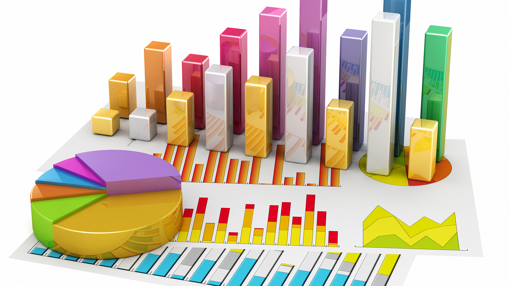
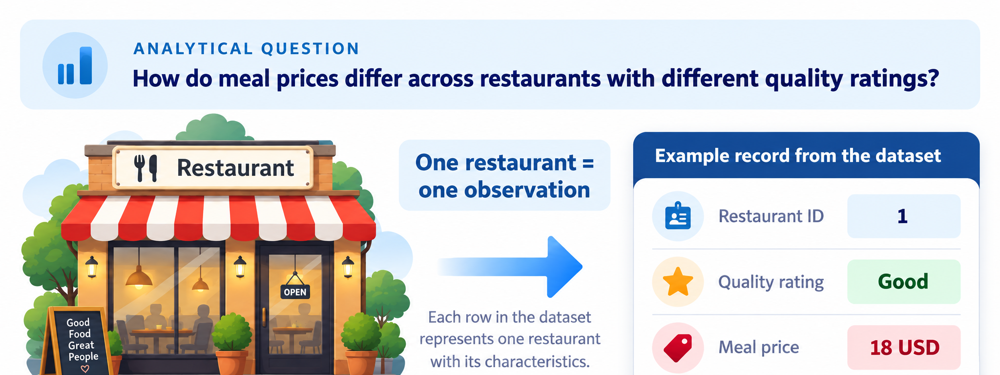
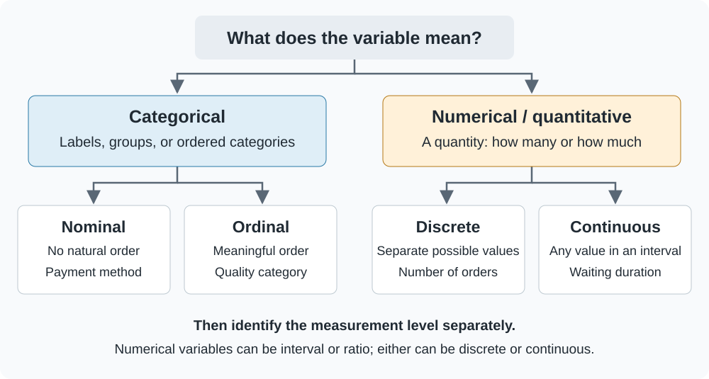
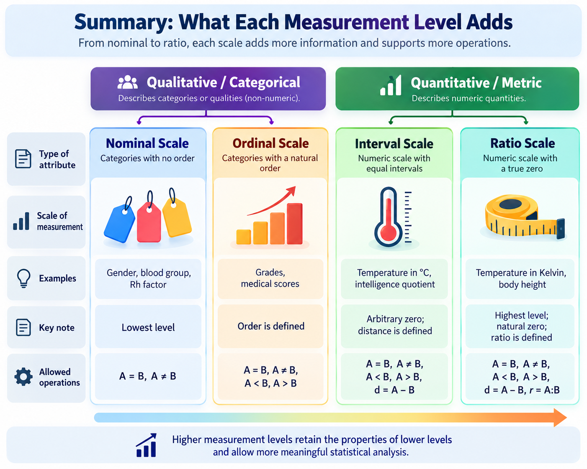
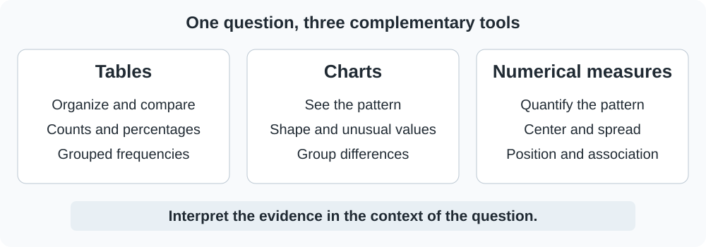
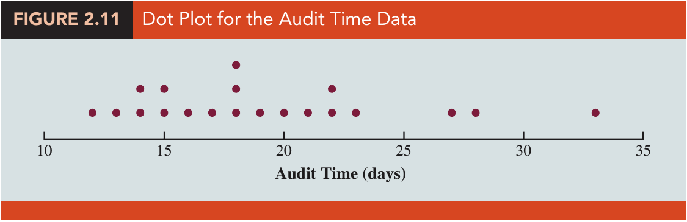

## What is statistics?

**Statistics is the science of collecting, organizing, presenting, analyzing, and interpreting data to answer questions and support informed decisions.**

{width=85% fig-align="center" fig-alt="Conceptual illustration showing colorful bars, pie slices, and an area chart representing different ways to display data."}

## Our starting question

A restaurant analyst asks: **How do meal prices differ between restaurants with different quality ratings?** Before choosing a formula or drawing a chart, we must understand what each variable means.

This case gives the lesson a concrete purpose. We will return to the same question as we classify variables, select tables and charts, and interpret numerical summaries.

::: {.case-narration lang="ar" dir="rtl"}
يسأل محلّل يدرس بيانات المطاعم: **كيف تختلف أسعار الوجبات بين المطاعم ذات تقييمات الجودة المختلفة؟** قبل اختيار معادلة أو رسم بياني، علينا أن نفهم معنى كل متغيّر.

تمنحنا هذه الحالة سؤالًا عمليًا يوجّه التعلّم. سنعود إلى السؤال نفسه عند تصنيف المتغيّرات، واختيار الجداول والرسوم البيانية، وتفسير المقاييس العددية.
:::


{width=100% fig-alt="A restaurant storefront leads to one observation, with restaurant ID 1, quality rating Good, and meal price 18 USD. The analytical question asks how meal prices differ across quality ratings."}

This lesson follows a deliberate sequence:

1. Define categorical and numerical data.
2. Distinguish discrete and continuous numerical variables.
3. Identify nominal, ordinal, interval, and ratio measurement levels.
4. Choose from the descriptive statistics toolbox: **tables, charts, and numerical measures**.

By the end, you should be able to classify a variable, justify a suitable summary, and interpret the result without making claims beyond the data.

**Book reference:** Section 1.2 (printed pp.5–8); the discrete/continuous distinction in Section 5.1 (pp.219–220); Chapter 2 for tables and charts; Chapter 3 for numerical measures. We introduce the distinction from Chapter 5 now, without requiring probability distributions.

```{r}
#| label: setup
#| include: false
# library(): loads a package so its functions can be used in this session.
# theme_set(): sets the default theme for subsequent ggplot charts in this R session.
# theme_minimal(): uses a minimal chart style; base_size controls the base text size in points.
# theme(): customizes non-data plot elements such as legends, grids, and axis text.
# element_text(): sets text appearance; size uses points and angle rotates labels.
# element_blank(): removes the selected non-data plot element.
# read.csv(): reads a comma-separated file into a data frame; its first row supplies column names by default.
# as.character(): converts values to character text; for a factor it returns displayed category labels.
# factor(): stores categorical values; levels fixes their permitted order and labels can rename their display.
# c(): combines values into a vector, converting them to a common type when needed.
# stopifnot(): stops execution if any supplied condition is FALSE; successful checks produce no output.
# nrow(): returns the number of rows in a table or matrix.
# anyNA(): returns TRUE if any value is missing; !anyNA(...) requires no missing values.
# Load the packages and teaching data used by the lesson, and define shared settings or helpers.
# This setup chunk is hidden in the report; stopifnot() checks required data conditions where specified.
library(ggplot2)
library(knitr)
theme_set(theme_minimal(base_size = 14) +
  theme(plot.title.position = "plot",
        plot.title = element_text(face = "bold", colour = "#222222"),
        panel.grid.minor = element_blank()))
restaurants <- read.csv("data/module02/restaurant_ratings.csv")
audit <- read.csv("data/module02/audit_times.csv")
electronics <- read.csv("data/module02/electronics_sales.csv")
restaurants$restaurant_id <- as.character(restaurants$restaurant_id)
restaurants$quality_rating <- factor(restaurants$quality_rating,
  levels = c("Good", "Very Good", "Excellent"), ordered = TRUE)
stopifnot(nrow(restaurants) == 300, nrow(audit) == 20,
          nrow(electronics) == 10, !anyNA(restaurants), !anyNA(audit))
```

## First identify the observation and the variable

An **element**, or observational unit, is the entity being studied. A **variable** is a characteristic recorded for that entity. An **observation** is the collection of recorded values for one unit.

In our restaurant dataset:

- The observational unit is **one restaurant**.
- The variables include an identifier, a quality rating, and a meal price.
- One row contains one restaurant's recorded values; one column contains one variable.

```{r}
#| label: restaurant-preview
#| echo: false
# c(): combines values into a vector, converting them to a common type when needed.
# head(..., 5) selects the first five restaurant records for inspection.
# kable() formats them as a report table; col.names supplies readable headings.
kable(head(restaurants, 5), col.names = c("Restaurant ID", "Quality rating", "Meal price (USD)"))
```

The same-looking number can play different roles. The value `101` could identify a restaurant, count orders, or measure a price. Its statistical meaning comes from the variable definition and units, not from its appearance in a spreadsheet.

## Categorical and numerical data

**Categorical data** identify a group, label, or ordered category. They tell us **which category** an observation belongs to.

**Numerical data**, also called **quantitative data**, represent a quantity. They tell us **how many** or **how much**. Numerical differences have a quantitative interpretation, although the measurement level determines which other operations are meaningful.

| Variable | Example values | Data type | Why? |
|---|---|---|---|
| Payment method | Cash, card, e-wallet | Categorical | The values identify groups |
| Restaurant quality | Good, Very Good, Excellent | Categorical | The values identify ordered categories |
| Restaurant ID | 101, 102, 103 | Categorical identifier | The numbers are labels, not quantities |
| Orders received | 0, 1, 2, 3, ... | Numerical | The values count orders |
| Waiting duration | 2.4, 5.1, 8.7 minutes | Numerical | The values measure elapsed time |
| Meal price | 18, 22, 28 USD | Numerical | The values measure an amount of money |

::: {.callout-note title="A numerical code is not automatically a numerical variable"}
Coding Cash = 1, Card = 2, and E-wallet = 3 does not make payment method quantitative. An average code of 2.1 does not mean an average payment method. Likewise, a quality scale coded 1, 2, 3 remains ordinal unless equal spacing has been justified.
:::

**Check your understanding:** Is a telephone number a numerical quantity? Would subtracting two telephone numbers answer a meaningful measurement question?

## Discrete and continuous numerical variables

Once a variable represents a quantity, ask which values are possible.

A **discrete variable** has a finite or countably infinite set of possible values. Values occur at separate points. Counts are common examples: a restaurant can receive 12 or 13 orders, but not 12.6 completed orders.

A **continuous variable** is modeled as able to take any value within an interval. Measurements such as waiting duration, weight, distance, and temperature are common examples. Between 2 and 3 minutes, values such as 2.1, 2.14, and 2.145 minutes are possible.

| Discrete | Continuous |
|---|---|
| Number of customers arriving in an hour | Time between customer arrivals |
| Number of defective items in a batch | Weight of an item |
| Number of complaints in a day | Duration of a service call |
| Number of advertising commercials | Distance traveled |

**The distinction concerns possible values, not whether the displayed data contain decimal points.** A discrete variable can take fractional steps, such as package sizes restricted to 0.5, 1.0, and 1.5 liters. Conversely, a continuous measurement may be rounded to a whole number.

Our audit times are recorded in whole days, but elapsed audit duration is an underlying continuous quantity. Money recorded to the nearest cent has discrete recording increments; business analyses often approximate monetary amounts using continuous models. State the recording precision and modeling choice when they matter.

{fig-alt="Categorical variables lead to nominal and ordinal categories. Numerical variables lead to discrete and continuous possibilities. Measurement level is assessed separately."}

## Levels of measurement

A measurement level describes what comparisons and operations make sense. The book distinguishes **nominal, ordinal, interval, and ratio** levels.

| Level | What the values tell us | Meaningful comparisons | Example |
|---|---|---|---|
| **Nominal** | Category membership | Same or different; category counts and proportions | Payment method, restaurant ID |
| **Ordinal** | Membership and meaningful order | Higher/lower; ordered frequencies, mode, and median category | Good, Very Good, Excellent |
| **Interval** | Order and equal measurement units | Differences and averages; ratios of raw values are not meaningful | Temperature in degrees Celsius |
| **Ratio** | Equal units and a meaningful zero indicating absence of the measured quantity | Differences and ratios, where defined | Duration, distance, weight, number of orders |

### Nominal: labels without a natural ranking

Cash is not inherently above or below card. Relabeling their category codes changes no substantive information. Use counts, percentages, and category comparisons.

### Ordinal: order without established equal gaps

Excellent is above Very Good, and Very Good is above Good. That does not establish that the two gaps are equal. An ordered bar chart is meaningful; treating the category labels as equally spaced measurements is an additional assumption.

### Interval: equal differences, an arbitrary zero

A change from 10°C to 20°C has the same size as a change from 20°C to 30°C. However, 20°C is not twice the temperature of 10°C: the zero is a conventional reference point. A mean in degrees Celsius is meaningful; a ratio of Celsius readings is not.

### Ratio: equal differences and a meaningful zero

Zero minutes of waiting means no waiting time. A wait of 20 minutes is twice a wait of 10 minutes. A ratio such as 20/0 is still undefined: a meaningful zero does not permit division by zero.

::: {.callout-tip title="Two classifications, two questions"}
**Discrete/continuous:** which values are possible?

**Measurement level:** which comparisons are meaningful?

For example, order count is **discrete and ratio**; waiting duration is **continuous and ratio**; Celsius temperature is usually **continuous and interval**. Calendar year recorded as a year number is **discrete and interval**. The two classifications are not interchangeable.
:::

In R, storage type is a separate issue again. `numeric` does not prove that a variable is quantitative. We converted restaurant ID to character and stored the ordered quality categories as an ordered factor to make their intended roles clearer.

### Summary: what each measurement level adds

{width=100% fig-alt="Four measurement levels progress from nominal category membership, to ordinal ranking, interval differences, and ratio comparisons with a meaningful zero. The supplied diagram groups nominal and ordinal under categorical attributes and interval and ratio under quantitative attributes."}

[Open the diagram at full size](../../assets/module02/measurement-scales-reference.png).

**Read from left to right:** nominal data distinguish categories; ordinal data also support ranking; interval data also support meaningful differences; ratio data additionally support meaningful ratios because they have a meaningful zero. Each step adds measurement information and permits additional summaries and comparisons. For ratios, the denominator must still be nonzero.

This progression describes **which operations are meaningful**, rather than guaranteeing a better analysis. Categorical data also support substantial statistical analysis. The question, study design, and method assumptions still matter. Classify examples such as “grades” or “medical scores” from their actual definitions: ordered rating categories are ordinal, but not every numerical score automatically has that scale.

## The descriptive statistics toolbox

{width=340px fig-align="center" fig-alt="A friendly illustrated teacher beside a toolbox containing charts, a calculator, and a list of descriptive measures including mean, median, mode, range, variance, and standard deviation."}

**Descriptive statistics organize, display, and summarize the observations we have.** They do not, by themselves, justify generalizing from a sample to every restaurant or explaining what caused a pattern.

{fig-alt="Tables organize observations, charts reveal patterns, and numerical measures summarize center, spread, position and association. Interpretation connects all three to the question."}

| Tool | Main purpose | Typical examples | Book reference |
|---|---|---|---|
| **Tables** | Organize observations into an interpretable summary | Frequency tables, relative frequencies, grouped distributions, crosstabs | Chapter 2 §§2.1–2.3 |
| **Charts** | Reveal patterns and comparisons | Bar charts, histograms, dot plots, boxplots, scatterplots | Chapter 2 §§2.1–2.5; Chapter 3 §3.4 |
| **Numerical measures** | Quantify important features | Mean, median, standard deviation, quartiles, correlation | Chapter 3 §§3.1–3.5 |

We normally combine tools. A mean can hide an unusual observation; a graph can reveal it. A graph can suggest a difference; a numerical summary tells us its size.

## Tables: organize the information

### Frequency and relative frequency

A **frequency** is the number of observations in a category or class. A **relative frequency** is that count divided by the total. Multiply a relative frequency by 100 to express it as a percentage.

For the 300 restaurants, keep the quality categories in their natural order.

```{r}
#| label: quality-frequency
# as.data.frame(): converts an object to a rectangular data frame.
# names(): reads or assigns names to vector elements or table columns.
# c(): combines values into a vector, converting them to a common type when needed.
# table() counts restaurants in each ordered quality category.
# Divide counts by nrow(restaurants) to obtain proportions; kable() displays them.
quality_table <- as.data.frame(table(restaurants$quality_rating))
names(quality_table) <- c("Quality", "Frequency")
quality_table$Relative_frequency <- quality_table$Frequency / nrow(restaurants)
quality_table$Percent <- 100 * quality_table$Relative_frequency
kable(quality_table, digits = c(0,0,2,0),
      col.names = c("Quality", "Frequency", "Relative frequency", "Percent"))
```

**Interpretation:** 150 of the 300 restaurants, or 50%, are rated Very Good. This describes the observed restaurants; it does not establish the proportion among all restaurants in the city.

### Grouped frequency tables

For numerical variables with many possible values, group observations into intervals. Classes must not overlap or leave unintended gaps.

An audit manager wants to understand how long audits take and how much their durations vary. We use 20 recorded audit durations, measured in days, to describe their distribution.

::: {.case-narration lang="ar" dir="rtl"}
يريد مدير التدقيق معرفة المدة التي تستغرقها عمليات التدقيق ومدى تفاوت هذه المدد. نستخدم بيانات المدة المسجّلة لعشرين عملية تدقيق، مقيسة بالأيام، لوصف توزيعها.
:::


```{r}
#| label: audit-frequency
# names(): reads or assigns names to vector elements or table columns.
# c(): combines values into a vector, converting them to a common type when needed.
# stopifnot(): stops execution if any supplied condition is FALSE; successful checks produce no output.
# identical(): requires exact equality of values, types, and attributes.
# cut() groups days using boundaries 10, 15, ..., 35 from seq(10,35,5).
# right = FALSE includes the lower endpoint: [10,15), [15,20), and so on.
# table() counts each class; as.data.frame() makes the counts into columns.
# stopifnot() checks the expected counts; kable() displays a readable table.
classes <- cut(audit$audit_days, breaks = seq(10,35,5), right = FALSE)
audit_frequency <- as.data.frame(table(classes))
names(audit_frequency) <- c("Audit_days", "Frequency")
stopifnot(identical(audit_frequency$Frequency, c(4L,8L,5L,2L,1L)))
kable(audit_frequency, col.names = c("Audit duration class (days)", "Frequency"))
```

Here `[15,20)` means **at least 15 but less than 20 days**. An audit lasting 20 days belongs in `[20,25)`. For these whole-day records, the intervals correspond to the book's 10–14, 15–19, and subsequent classes.

A **cumulative frequency** adds the counts up to a given ordered class. It is useful for questions such as “How many audits finished in less than 25 days?” A **crosstab** summarizes two categorical variables, or a category and a grouped numerical variable, in a two-way table.

## Charts: choose a display for the question

| Data and question | Suitable display | What to look for |
|---|---|---|
| One categorical variable: how common is each category? | Bar chart; sometimes a pie chart for a simple part-to-whole comparison | Counts or percentages; preserve order for ordinal categories |
| A numerical count with few possible values | Frequency bar chart or dot plot | Which counts occur and how often |
| One numerical variable with many values | Histogram or dot plot | Center, spread, shape, gaps, and unusual values |
| Numerical values across several groups | Side-by-side boxplots | Medians, variability, overlap, and possible outliers |
| Two numerical variables | Scatterplot | Direction, form, strength, and unusual observations |
| A quantity observed over time | Time-series line chart | Trend, seasonality, changes, and unusual periods |

A bar chart separates categories; a histogram groups values along a numerical axis. Equal-width histogram bars can show counts directly. A pie chart can communicate a small number of proportions, but bar charts usually make precise comparisons easier. Avoid 3D decoration that distorts the comparison.

```{r}
#| label: fig-quality-bar
#| fig-cap: "Original R chart from the checked Restaurant workbook. Counts agree with the book's Table 2.10 (printed p.66)."
#| fig-alt: "An ordered bar chart shows Good 84, Very Good 150, and Excellent 66 restaurants."
# ggplot(): starts a plot from data; additional layers are joined with +.
# scale_y_continuous(): controls numeric y-axis breaks, labels, limits, and spacing.
# c(): combines values into a vector, converting them to a common type when needed.
# labs(): sets axis titles, legend titles, plot titles, and captions.
# geom_col() uses the frequencies already calculated in quality_table.
# aes() maps categories and counts to axes; geom_text() adds the count labels.
ggplot(quality_table, aes(Quality, Frequency)) +
  geom_col(fill = "#2878A5", width = .65) +
  geom_text(aes(label = Frequency), vjust = -.4) +
  scale_y_continuous(limits = c(0,170)) +
  labs(title = "Very Good is the most common quality category",
       x = "Quality rating", y = "Number of restaurants")
```

### See the observations, then summarize their distribution

Each dot in the book's audit plot represents one audit; stacked dots represent repeated values.

{fig-alt="Textbook dot plot of twenty audit durations, with three observations at eighteen days and one at thirty-three days."}

The histogram below uses the same checked observations and the same class boundaries as our grouped table.

```{r}
#| label: fig-audit-histogram
#| fig-cap: "Original R histogram. The class frequencies are 4, 8, 5, 2, and 1, matching the book's audit example."
#| fig-alt: "A histogram of twenty audit durations has its tallest bar from fifteen to under twenty days, and a longer tail toward thirty-three days."
# ggplot(): starts a plot from data; additional layers are joined with +.
# aes(): maps variables to visual properties such as x, y, fill, color, or group.
# seq(): creates an equally spaced sequence; by sets spacing and length.out sets the number of values.
# scale_x_continuous(): controls numeric x-axis breaks, labels, limits, and spacing.
# labs(): sets axis titles, legend titles, plot titles, and captions.
# geom_histogram() counts raw audit durations within the supplied boundaries.
# closed = "left" includes each lower endpoint and excludes its upper endpoint.
ggplot(audit, aes(audit_days)) +
  geom_histogram(breaks = seq(10,35,5), closed = "left",
                 fill = "#2878A5", colour = "white") +
  scale_x_continuous(breaks = seq(10,35,5)) +
  labs(title = "Most audits finish in the lower duration classes",
       x = "Audit duration (days)", y = "Number of audits")
```

Do not remove the 33-day audit just because it is separated from the main cluster. First check whether it is valid and whether its circumstances differ from those of other audits.

## Numerical measures: quantify the pattern

Numerical measures answer different questions. There is no single number that describes every important feature of a dataset.

| Feature | Measures | Interpretation |
|---|---|---|
| **Location / center** | Mean, median, mode | What is typical or most frequent? |
| **Variability / spread** | Range, interquartile range, variance, standard deviation | How different are the observations from one another? |
| **Position** | Percentiles, quartiles, z-scores | Where does an observation sit in the distribution? |
| **Shape and unusual values** | Skewness, supported by plots and outlier checks | Is the distribution asymmetric? Which observations need investigation? |
| **Association** | Covariance and Pearson correlation | How do two numerical variables vary together, especially in a linear pattern? |

### Location

The **mean** adds the numerical observations and divides by their count: $\bar{x}=\sum x_i/n$. The **median** is the middle value after sorting, or the average of the two middle values when the numerical sample size is even. The **mode** is the most frequent value or category; a dataset can have more than one mode.

Mean and standard deviation are not meaningful summaries of arbitrary category codes. For ordinal categories, an ordered median category can be meaningful, but subtracting two category labels is not.

### Spread and position

The **range** is maximum minus minimum. The **interquartile range (IQR)** is $Q_3-Q_1$ and describes the width of the middle half of the observations. Quartiles are the 25th, 50th, and 75th percentiles.

The **sample variance** is $s^2=\sum(x_i-\bar{x})^2/(n-1)$. The **sample standard deviation**, $s=\sqrt{s^2}$, expresses spread in the original measurement units. Variance has squared units. Population variance uses the population size in the denominator instead.

The **coefficient of variation**, $100s/\bar{x}$, expresses standard deviation relative to the mean. Reserve this comparison for suitable ratio-scale variables with a meaningful zero and a positive, nonzero mean; a Celsius-temperature CV is not meaningful.

A **z-score** expresses distance from the mean in standard-deviation units: $(x-\bar{x})/s$. It requires a positive standard deviation, and does not by itself establish that the distribution is normal.

```{r}
#| label: audit-numerical-summary
# c(): combines values into a vector, converting them to a common type when needed.
# data.frame(): builds a table whose named columns have compatible lengths.
# length(): counts elements in a vector or list.
# min(): returns the smallest supplied value.
# max(): returns the largest supplied value.
# diff(): subtracts each preceding value from the next by default; diff(range(x)) gives max minus min.
# range(): returns the minimum and maximum as a two-element vector.
# var(): computes sample variance using denominator n-1.
# kable(): formats a data frame or matrix as a readable report table; digits sets displayed precision.
# quantile(..., type = 6) calculates quartiles using our stated book convention.
# mean(), median(), sd(), and the quartiles summarize different distribution features.
x <- audit$audit_days
quartiles <- quantile(x, c(.25,.50,.75), type = 6, names = FALSE)
summary_table <- data.frame(
  Measure = c("Observations", "Mean (days)", "Median (days)",
              "Minimum (days)", "Maximum (days)", "Range (days)",
              "Q1 (days)", "Q3 (days)", "IQR (days)",
              "Sample variance (days squared)", "Sample SD (days)"),
  Value = c(length(x), mean(x), median(x), min(x), max(x), diff(range(x)),
            quartiles[1], quartiles[3], diff(quartiles[c(1,3)]), var(x), sd(x)))
kable(summary_table, digits = 2)
```

The mean is **19.25 days** and the median is **18 days**. The standard deviation is approximately **5.44 days**. The middle half of the observations lies between **15 and 22 days**. Longer audits pull the mean above the median; the graph gives that difference context.

::: {.callout-note title="Matching the book's percentile convention" collapse="true"}
On printed pp.113–114, the book locates the pth percentile at $(n+1)p/100$ and interpolates between adjacent observations. R's `quantile(..., type = 6)` follows this convention for the interior percentiles used here. R's default is `type = 7`, so specify the method when reproducing the book's calculations. There are several legitimate percentile conventions.
:::

## Combine the tools to answer the business question

Return to the restaurants. Quality is ordinal and price is numerical, so an ordered table of group medians and spreads, together with side-by-side boxplots, is a useful descriptive starting point.

```{r}
#| label: restaurant-group-summary
# names(): reads or assigns names to vector elements or table columns.
# quantile(): computes sample percentiles; probs gives probabilities and type selects the interpolation rule.
# c(): combines values into a vector, converting them to a common type when needed.
# data.frame(): builds a table whose named columns have compatible lengths.
# length(): counts elements in a vector or list.
# median(): returns the middle sorted value, averaging the middle pair for even sample sizes.
# kable(): formats a data frame or matrix as a readable report table; digits sets displayed precision.
# split() separates meal prices by rating while retaining the original values.
# lapply() summarizes each group; do.call(rbind, ...) combines the summary rows.
price_by_quality <- split(restaurants$meal_price_usd, restaurants$quality_rating)
group_summary <- do.call(rbind, lapply(names(price_by_quality), function(group) {
  prices <- price_by_quality[[group]]
  q <- quantile(prices, c(.25,.75), type = 6, names = FALSE)
  data.frame(Quality = group, Restaurants = length(prices),
             Median_USD = median(prices), Q1_USD = q[1], Q3_USD = q[2],
             IQR_USD = q[2]-q[1])
}))
kable(group_summary, digits = 2)
```

```{r}
#| label: fig-price-boxplot
#| fig-cap: "Original R boxplots from the checked Restaurant data. Dots outside whiskers are potential outliers to investigate. The numerical quartiles above use the book's type-6 convention; ggplot2 uses its own standard boxplot calculation, so small differences in hinges can occur."
#| fig-alt: "Side-by-side meal-price boxplots preserve the order Good, Very Good, Excellent and allow their medians and spreads to be compared."
# ggplot(): starts a plot from data; additional layers are joined with +.
# aes(): maps variables to visual properties such as x, y, fill, color, or group.
# labs(): sets axis titles, legend titles, plot titles, and captions.
# geom_boxplot() compares the price distributions within quality categories.
# This overview uses ggplot2 defaults; Lesson 3 constructs explicit type-6 boxplots.
ggplot(restaurants, aes(quality_rating, meal_price_usd)) +
  geom_boxplot(fill = "#9DC7DE", colour = "#303030", width = .55) +
  labs(title = "Compare price distributions, not just averages",
       x = "Quality rating", y = "Meal price (USD)")
```

**Interpretation task:** compare the group medians, the amount of overlap, and the variability. Describe an association, then name one reason why these observational data do not show that a higher rating causes a higher price.

For **two numerical variables**, start with a scatterplot. Correlation can then summarize a linear association. It does not establish causation, and a near-zero Pearson correlation does not rule out a nonlinear relationship.

An electronics retailer wants to examine whether weeks with more advertising commercials tend to have higher sales. We compare ten weeks of advertising counts and sales, measured in hundreds of US dollars. This describes an association; it does not show that advertising caused the sales differences.

::: {.case-narration lang="ar" dir="rtl"}
يريد متجر إلكترونيات أن يفحص ما إذا كانت الأسابيع التي تُعرض فيها إعلانات أكثر تميل إلى تحقيق مبيعات أعلى. نقارن بيانات عشرة أسابيع تشمل عدد الإعلانات والمبيعات، المقيسة بمئات الدولارات الأمريكية. يصف هذا التحليل ارتباطًا بين المتغيّرين، ولا يثبت أن الإعلانات سبّبت الفروق في المبيعات.
:::


```{r}
#| label: fig-advertising-sales
#| fig-cap: "Original R scatterplot. The ten Electronics observations in book Table 2.14 (printed p.76) match the local Stereo workbook; sales are in hundreds of USD."
#| fig-alt: "Ten weekly observations show a positive relationship between the number of commercials and sales, with differing sales at the same number of commercials."
# ggplot(): starts a plot from data; additional layers are joined with +.
# scale_x_continuous(): controls numeric x-axis breaks, labels, limits, and spacing.
# geom_point() draws one paired commercials-sales observation per week.
# aes() maps the two numerical variables; labs() states sales in hundreds of USD.
ggplot(electronics, aes(commercials, sales_hundreds_usd)) +
  geom_point(size = 3, colour = "#2878A5") +
  scale_x_continuous(breaks = 1:5) +
  labs(title = "More commercials tend to accompany higher sales",
       x = "Number of commercials", y = "Weekly sales (hundreds of USD)")
```

## Choose a tool: a short checklist

1. **Define:** what does one row represent? What are the units and recording precision?
2. **Classify:** categorical or numerical? If numerical, discrete or continuous? What is the measurement level?
3. **Ask:** do we want frequencies, a distribution, a group comparison, a relationship, or a time pattern?
4. **Summarize:** choose an appropriate table, chart, and numerical measure where meaningful.
5. **Interpret:** explain the finding, its context, and its limitations.

Do not calculate an average just because a column contains numbers. Do not choose a chart just because the software offers it.

[Open the student exercises](exercises/01-data-types-and-toolbox.qmd) or [return to the Module 2 overview](index.qmd).

## Data for this lesson

[Download the CSV datasets and data guide](../../data/module02/descriptive-statistics-data.zip). The restaurant, audit, and electronics examples above read these CSVs directly. Soft-drink data are used in [Lesson 2: Frequency tables and charts](02-frequency-tables-and-charts.qmd).

## References and provenance

- Anderson, D. R., Sweeney, D. J., Williams, T. A., Camm, J. D., Cochran, J. J., Fry, M. J., and Ohlmann, J. W. (2020). *Essentials of Modern Business Statistics with Microsoft Excel*, 8th edition. Cengage Learning. Definitions and organization: §1.2, pp.5–8; §5.1, pp.219–220; descriptive tools: Chapter 2, pp.35–100, and Chapter 3, pp.103–169. Wording, teaching questions, and unlabelled illustrations in this lesson are original course material.
- The Audit data match all 20 values in book Table 2.4 (p.47). The Restaurant data match the first 10 printed rows in Table 2.9 (p.65) and all 12 crosstab cells in Table 2.10 (p.66); the remaining individual rows are not printed for comparison. The Electronics/Stereo data match all ten rows in Table 2.14 (p.76).
- These are historical teaching datasets. Their role is to teach statistical reasoning, not describe the current restaurant or advertising market. The book figure and original R charts are identified separately in their captions.
