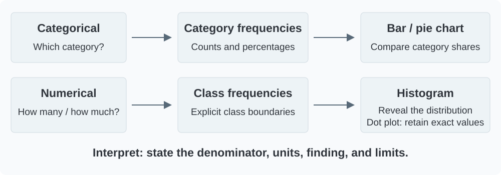

## What we will learn

[Lesson 1](01-data-types-and-toolbox.qmd) introduced the toolbox. Here we use its first two tools in detail: **tables organize the observations; charts help us see their pattern**.

By the end of this lesson, you should be able to:

- Construct frequency, relative-frequency, and percentage tables.
- Choose a useful order for categorical bars.
- Explain when a pie chart can represent a whole.
- Define numerical classes without gaps or overlaps.
- Read a histogram for shape, skewness, modality, center, spread, and unusual features.
- Construct and interpret a histogram and cumulative frequency table.
- Write a short business interpretation with an appropriate limit on the conclusion.

**Reading:** main 8th-edition book, §2.1, printed pp.37–42, and §2.2, pp.47–55. Our wording and R analyses are course material based on these textbook examples.

```{r}
#| label: setup-frequency-lesson
#| include: false
# Load the packages and teaching data used by the lesson, and define shared settings or helpers.
# This setup chunk is hidden in the report; stopifnot() checks required data conditions where specified.
library(ggplot2)
library(knitr)
soft <- read.csv("data/module02/soft_drinks.csv", stringsAsFactors = FALSE)
audit <- read.csv("data/module02/audit_times.csv")
brand_levels <- c("Coca-Cola", "Diet Coke", "Dr. Pepper", "Pepsi", "Sprite")
soft$brand <- factor(soft$brand_book_label, levels = brand_levels)
stopifnot(nrow(soft) == 50, nrow(audit) == 20, !anyNA(soft), !anyNA(audit))
theme_set(theme_minimal(base_size = 14) +
  theme(panel.grid.minor = element_blank(),
        plot.title.position = "plot",
        plot.title = element_text(face = "bold", colour = "#2F343B")))
```

## Business case: which soft drinks were purchased?

A manager wants a clear description of the brands selected in **50 soft-drink purchases**. Which brand was purchased most often, and what proportion of purchases did each brand represent? The book records purchases of five brands; one observation is **one purchase**, not necessarily one distinct customer.

::: {.case-narration lang="ar" dir="rtl"}
يريد مدير أن يحصل على وصف واضح للعلامات التجارية المختارة في **خمسين عملية شراء لمشروبات غازية**. ما العلامة الأكثر شراءً، وما نسبة عمليات الشراء التي تمثلها كل علامة؟ يتضمن مثال الكتاب خمس علامات تجارية، وتمثل كل مشاهدة **عملية شراء واحدة**، وليس بالضرورة عميلًا مختلفًا.
:::

[Download the CSV](../../data/module02/soft_drinks.csv). Use `brand_book_label` for the book's category names. The CSV also preserves `brand_original`: Coke Classic is mapped to Coca-Cola and Pepsi-Cola to Pepsi. This is a documented label alignment, not a change to the counts.

```{r}
#| label: soft-drink-import-example
#| eval: false
# read.csv() imports the teaching file as a data frame with named columns.
# The $ operator selects brand_book_label, the documented textbook-label column.
soft <- read.csv("data/module02/soft_drinks.csv")
# Use this column for the textbook's category labels:
soft$brand_book_label
```

## From observations to a frequency table

A **frequency** is the number of observations assigned to a category or numerical class. A **frequency distribution** lists those categories or classes together with their counts.

For one categorical variable, each observation must belong to exactly one category. Check that categories are consistently named, missing values are handled explicitly, and no record is counted twice. An omitted category with zero observations can still be relevant to the question.

For a dataset of size $n$ and a category frequency $f$:

$$
\text{Relative frequency}=\frac{f}{n},\qquad
\text{Percentage}=100\frac{f}{n}.
$$

A relative frequency is a proportion, such as 0.38. Its percentage equivalent is 38%, not 0.38%.

```{r}
#| label: soft-drink-frequency-table
# table() counts brand occurrences; as.data.frame() turns the counts into columns.
# Divide by nrow(soft) for proportions and multiply by 100 for percentages.
brand_table <- as.data.frame(table(soft$brand))
names(brand_table) <- c("Brand", "Frequency")
brand_table$Relative_frequency <- brand_table$Frequency / nrow(soft)
brand_table$Percent <- 100 * brand_table$Relative_frequency
stopifnot(identical(as.integer(brand_table$Frequency), c(19L, 8L, 5L, 13L, 5L)),
          sum(brand_table$Frequency) == 50,
          abs(sum(brand_table$Relative_frequency) - 1) < 1e-12)
kable(brand_table, digits = c(0, 0, 2, 0),
      col.names = c("Brand", "Frequency", "Relative frequency", "Percent (%)"))
```

The count total is **50**, the relative-frequency total is **1**, and the percentage total is **100%**. Display rounding can sometimes make percentages add to slightly more or less than 100%; calculate from the unrounded values.

**Interpretation:** Coca-Cola accounts for **19 of 50 purchases (38%)**, the largest observed share. This describes the sample of purchases; it does not establish a market share for all consumers or measure profit.

**Check:** Pepsi represents 13 purchases. Calculate its relative frequency and percentage before expanding the code.

## Bar charts: compare categories

A **bar chart** places categories on one axis and their counts or percentages on the other. The bars are separated because categories are distinct. The length of each bar communicates the quantity, so the quantitative axis should start at zero.

Nominal brands have no inherent ranking. Alphabetical order is reasonable for lookup; descending frequency makes a popularity comparison easier. For **ordinal** categories, retain their meaningful order rather than sorting them by frequency.

```{r}
#| label: fig-soft-drink-bars
#| fig-cap: "Original R chart from the checked SoftDrink CSV. Counts match book Table 2.2, printed p.38."
#| fig-alt: "Horizontal bars ordered by frequency show Coca-Cola 19, Pepsi 13, Diet Coke 8, Dr. Pepper 5, and Sprite 5 purchases."
# order() ranks the frequency rows; factor() fixes the displayed category order.
# geom_col() plots the supplied counts and geom_text() places their labels.
ranked <- brand_table[order(-brand_table$Frequency, as.character(brand_table$Brand)), ]
ranked$Brand <- factor(ranked$Brand, levels = rev(as.character(ranked$Brand)))
ggplot(ranked, aes(Frequency, Brand)) +
  geom_col(fill = "#2878A5", width = .65) +
  geom_text(aes(label = Frequency), hjust = -.35) +
  scale_x_continuous(limits = c(0, 22), breaks = seq(0, 20, 5)) +
  labs(title = "Coca-Cola has the largest observed purchase count",
       x = "Purchases (out of 50)", y = NULL)
```

The same counts can be shown as percentages. Do not treat counts and percentages from this one sample as separate findings: one is a rescaling of the other.

### Pie charts: show shares of one whole

A **pie chart** divides a circle into slices whose angles represent proportions of a whole. A 38% share has an angle of $0.38\times360^\circ=136.8^\circ$.

Use it only when categories describe nonoverlapping parts of one clearly defined total. With many categories or similar shares, bars are easier to compare. Use a flat display and direct labels; 3D perspective can distort apparent slice sizes.

```{r}
#| label: fig-soft-drink-pie
#| fig-height: 4.8
#| fig-cap: "Original R chart: the same 50 purchases shown as percentages of one whole. Colors distinguish categories; they do not encode a ranking."
#| fig-alt: "A flat pie chart labels Coca-Cola 38 percent, Diet Coke 16 percent, Dr. Pepper 10 percent, Pepsi 26 percent, and Sprite 10 percent."
# coord_polar(theta = "y") turns the stacked percentage bar into a circle.
# position_stack(vjust = .5) centers each label within its corresponding slice.
pie_data <- brand_table
pie_data$label <- paste0(pie_data$Brand, "\n", pie_data$Percent, "%")
ggplot(pie_data, aes(x = "", y = Percent, fill = Brand)) +
  geom_col(width = 1, colour = "white") +
  coord_polar(theta = "y") +
  geom_text(aes(label = label), position = position_stack(vjust = .5), size = 3.5) +
  scale_fill_manual(values = c("#99C1D9", "#D9E8F0", "#AAD5B7", "#F1DE99", "#E9B5B9")) +
  theme_void() + theme(legend.position = "none")
```

**Discussion:** Which display makes the tie between Sprite and Dr. Pepper easier to assess? Which is easier to read when brand names are long?

### Percentages need a denominator

Always name the whole: here it is **50 recorded purchases**. If comparing datasets with different sample sizes, percentages can be more useful than raw counts, but differences in sampling and population coverage still matter.

Do not cumulatively add nominal categories as though they form a natural numerical progression. Adding the three most frequent brands can answer a stated “top three” question; the order is an analytical choice, not a property of the brand variable. Here the three largest shares total **80%**.

## Business case: how long do audits take?

An accounting firm wants to describe the completion times of **20 year-end audits**, recorded in days. Which duration ranges occur most often, and how many audits finish before a chosen threshold? One observation is **one audit**. These data support a description of recorded durations, not a promise about a future client's completion date.

::: {.case-narration lang="ar" dir="rtl"}
يريد مكتب محاسبة وصف المدد اللازمة لإنجاز **عشرين عملية تدقيق لنهاية السنة**، والمسجّلة بالأيام. ما فئات المدة الأكثر تكرارًا، وكم عملية تدقيق انتهت قبل حد زمني محدد؟ تمثل كل مشاهدة **عملية تدقيق واحدة**. تصف هذه البيانات المدد المسجّلة، ولا تقدّم وعدًا بموعد إنجاز عملية تدقيق لعميل في المستقبل.
:::

[Download the Audit CSV](../../data/module02/audit_times.csv). The variable `audit_days` contains all 20 values printed in book Table 2.4, p.47.

```{r}
#| label: audit-observations
# seq_len(nrow(audit)) creates one row number for each recorded audit.
# data.frame() pairs row numbers with durations; kable() prints the table.
kable(data.frame(Audit = seq_len(nrow(audit)), Days = audit$audit_days),
      col.names = c("Audit (row number)", "Duration (days)"))
```

## Group numerical values into classes

Grouping replaces individual values with ranges. It makes patterns easier to see, but loses detail: a grouped table does not tell us every exact value inside a range.

Choose a number of classes, a convenient width, and boundaries that cover all observations. For Audit, the smallest value is 12 and the largest is 33 days. With five classes, an initial width estimate is $(33-12)/5=4.2$ days. Following the book, use a convenient **5-day width**, starting at 10 days.

Our intervals are **[10,15), [15,20), [20,25), [25,30), [30,35)**. A square bracket includes the boundary; a round bracket excludes it. Thus, 15 belongs to [15,20), while 20 belongs to [20,25). For these whole-day records, these groups reproduce the book's 10–14, 15–19, 20–24, 25–29, and 30–34 classes.

::: {.callout-note title="Class rules"}
Every value must fall into exactly one class. Avoid gaps, overlap, or an uncovered maximum. Retain empty classes when they are part of the chosen numerical scale. There is no universally best number of classes: check that your choice reveals rather than hides the distribution.
:::

```{r}
#| label: audit-grouped-table
# seq(10,35,5) sets class boundaries; cut() assigns each audit to an interval.
# right = FALSE gives [lower, upper) classes; table() counts each class.
boundaries <- seq(10, 35, 5)
audit$class <- cut(audit$audit_days, breaks = boundaries, right = FALSE)
audit_table <- as.data.frame(table(audit$class))
names(audit_table) <- c("Days", "Frequency")
audit_table$Relative_frequency <- audit_table$Frequency / nrow(audit)
audit_table$Percent <- 100 * audit_table$Relative_frequency
stopifnot(!anyNA(audit$class), sum(audit_table$Frequency) == 20,
          identical(as.integer(audit_table$Frequency), c(4L, 8L, 5L, 2L, 1L)))
kable(audit_table, digits = c(0, 0, 2, 0),
      col.names = c("Duration class (days)", "Frequency", "Relative frequency", "Percent (%)"))
```

The **15–<20-day class** is the most frequent: 8 audits, or 40%. This identifies a modal **class**, not an exact modal duration.

## Histograms: reveal the numerical distribution

A **histogram** places numerical intervals on the horizontal axis. With equal-width intervals, bar heights can represent counts directly. The rectangles are adjacent because they represent neighboring intervals on a numerical scale.

```{r}
#| label: fig-audit-frequency-histogram
#| fig-cap: "Original R histogram using the same five classes as the table; frequencies match book Table 2.5, printed p.49."
#| fig-alt: "Five adjacent 5-day bars show counts 4, 8, 5, 2, and 1 from 10 to under 35 days."
# geom_histogram() counts the raw days using the same boundaries as the table.
# closed = "left" keeps the histogram and cut(..., right = FALSE) consistent.
ggplot(audit, aes(audit_days)) +
  geom_histogram(breaks = boundaries, closed = "left",
                 fill = "#2878A5", colour = "white") +
  scale_x_continuous(breaks = boundaries) +
  scale_y_continuous(breaks = 0:8) +
  labs(title = "Audit durations cluster below 25 days",
       x = "Audit duration (days)", y = "Audits")
```

Read the **shape**, the concentration of values, the extent of the spread, and any gaps or isolated observations. Here, most observations lie below 25 days, with fewer audits at longer durations. Investigate the 33-day observation in context rather than deleting it because it is longer.

### What does a distribution tell us?

A **distribution** describes how the observations are spread across possible values: which regions contain many observations, which contain few, and where gaps occur. A histogram groups that information into intervals. Its horizontal axis shows the measured values; its vertical axis shows counts, proportions, or densities as labeled. It does not show changes over time unless time itself is the measured variable.

Read a histogram through four questions:

| Feature | Question to ask | What the histogram can suggest |
|---|---|---|
| **Shape** | Is the distribution balanced or skewed? How many peaks are apparent? | Symmetry, tail direction, and possible clusters |
| **Center** | Where is a typical region? | An approximate central location; exact means and medians require the data |
| **Spread** | How far do values extend and concentrate around the center? | Narrow or broad variation, interpreted with the horizontal scale |
| **Unusual features** | Are there gaps, isolated values, or small separated groups? | Observations or patterns to investigate |

Two histograms can look equally wide while using different axis scales. Always read the values and units before comparing their spread.

### Skewness: name the direction of the longer tail

A **roughly symmetric distribution** has similar shapes on either side of its center. **Right (positive) skewness** means the longer tail extends toward larger values; **left (negative) skewness** means it extends toward smaller values. Name the direction from the tail, not from the location of the tallest bars.

```{r}
#| label: fig-histogram-shapes
#| fig-width: 9
#| fig-height: 3.6
#| fig-cap: "Original illustrations constructed from model quantiles, with 1,200 artificial values per panel. These are teaching patterns, not observed students or textbook records. Bin widths and axes are shared."
#| fig-alt: "Three histograms show a balanced symmetric pattern, a right-skewed pattern with a longer tail toward high values, and a left-skewed pattern with a longer tail toward low values."
# qnorm() and qbeta() generate artificial values at evenly spaced probabilities.
# Reflecting the right-skewed values creates the left-skewed comparison; these are not observed cases.
p <- (seq_len(1200) - .5) / 1200
symmetric_example <- qnorm(p, mean = 50, sd = 12)
right_example <- 100 * qbeta(p, shape1 = 2, shape2 = 6)
shape_labels <- c("Roughly symmetric", "Right-skewed\nlonger right tail", "Left-skewed\nlonger left tail")
shape_examples <- data.frame(
  Value = c(symmetric_example, right_example, 100-right_example),
  Pattern = factor(rep(shape_labels, each = 1200), levels = shape_labels))
stopifnot(all(shape_examples$Value > 0 & shape_examples$Value < 100))
ggplot(shape_examples, aes(Value)) +
  geom_histogram(breaks = seq(0,100,5), closed = "left", fill = "#2878A5", colour = "white") +
  facet_wrap(~Pattern, nrow = 1) +
  scale_x_continuous(breaks = seq(0,100,25)) +
  labs(x = "Illustrative value (arbitrary units)", y = "Count") +
  theme(strip.text = element_text(size = 11))
```

For example, a few unusually long service durations can produce a right tail; many high scores with a few low scores can produce a left tail. These are possible interpretations, not explanations established by the shape alone. In many familiar one-peaked skewed distributions, the mean is pulled toward the long tail; the plot alone does not prove a universal ordering of mean and median. A symmetric histogram does not by itself establish a normal distribution.

### Modality: count prominent peaks, not every uneven bar

A **unimodal** distribution has one prominent peak; **bimodal** has two; **multimodal** has several. Here, a mode is a prominent region of the distribution, not necessarily the most frequent exact recorded value.

```{r}
#| label: fig-histogram-modality
#| fig-width: 9
#| fig-height: 3.6
#| fig-cap: "Original illustrations, each containing 1,200 artificial values. The multi-peak patterns combine constructed groups; such a mechanism cannot be inferred from an observed histogram alone."
#| fig-alt: "Histograms on common axes show one prominent peak near 50, two near 30 and 70, and three near 20, 50 and 80."
# The helper combines artificial normal-component values with chosen centers.
# lapply() builds each component and facet_wrap() separates the modality examples.
make_components <- function(centers, spread) {
  count <- 1200 / length(centers)
  prob <- (seq_len(count)-.5)/count
  unlist(lapply(centers, function(center) qnorm(prob, center, spread)))
}
mode_labels <- c("Unimodal\none prominent peak", "Bimodal\ntwo prominent peaks", "Multimodal\nseveral prominent peaks")
mode_examples <- data.frame(
  Value = c(symmetric_example, make_components(c(30,70),5), make_components(c(20,50,80),3.5)),
  Pattern = factor(rep(mode_labels, each = 1200), levels = mode_labels))
stopifnot(all(mode_examples$Value > 0 & mode_examples$Value < 100))
ggplot(mode_examples, aes(Value)) +
  geom_histogram(breaks = seq(0,100,4), closed = "left", fill = "#2878A5", colour = "white") +
  facet_wrap(~Pattern, nrow = 1) +
  scale_x_continuous(breaks = seq(0,100,25)) +
  labs(x = "Illustrative value (arbitrary units)", y = "Count") +
  theme(strip.text = element_text(size = 11))
```

Several peaks can suggest mixed groups or different operating conditions worth investigating. They do not prove that those groups exist. Sampling variation, rounding, bin width, and bin starting points can produce or obscure apparent peaks. Small fluctuations between adjacent bars are not automatically separate modes.

### Additional comparison: recorded student ages and heights

The local teaching workbook contains **8,239 records** with age and height columns. We exported only those two measurements, without names or identifiers. Its population, collection method, and measurement-unit metadata are not documented locally, so the axes retain **recorded units**. This is a supplementary shape-reading example, not a verified university survey or a textbook dataset.

[Download the two-column CSV](../../data/module02/student_age_height.csv) · [Read the source notes](../../data/module02/student-age-height-notes.md)

```{r}
#| label: fig-student-histogram-comparison
#| fig-width: 9
#| fig-height: 4.2
#| fig-cap: "Original histograms from the local students worksheet (8,239 values per variable; no missing values in these two columns). Age bins have width 2 recorded units and height bins width 3. Each panel has its own axis scales; different scales and bin widths mean bar heights and visual widths should not be compared directly."
#| fig-alt: "Recorded student ages are concentrated near 20 with a long right tail extending to 64. Recorded heights form a broad central concentration near 170, extending from 135 to 206."
# read.csv() loads the two exported measurements; stopifnot() checks their structure.
# The panels use different bin widths and recorded units, so compare shapes rather than bar heights.
students_hist <- read.csv("data/module02/student_age_height.csv")
stopifnot(nrow(students_hist)==8239, !anyNA(students_hist),
          identical(names(students_hist),c("age","height")))
student_values <- rbind(
  data.frame(Variable="Age (recorded units)", Value=students_hist$age),
  data.frame(Variable="Height (recorded units)", Value=students_hist$height))
student_values$Variable <- factor(student_values$Variable,
  levels=c("Age (recorded units)","Height (recorded units)"))
student_bins <- do.call(rbind, lapply(levels(student_values$Variable), function(label) {
  vals <- student_values$Value[student_values$Variable==label]
  breaks <- if (startsWith(label,"Age")) seq(18,66,2) else seq(132,210,3)
  h <- hist(vals, breaks=breaks, right=FALSE, plot=FALSE)
  stopifnot(sum(h$counts)==8239)
  data.frame(Variable=label, Left=head(h$breaks,-1), Right=tail(h$breaks,-1), Count=h$counts)
}))
student_bins$Variable <- factor(student_bins$Variable, levels=levels(student_values$Variable))
ggplot(student_bins, aes(xmin=Left,xmax=Right,ymin=0,ymax=Count)) +
  geom_rect(fill="#2878A5",colour="white") +
  facet_wrap(~Variable,scales="free",nrow=1) +
  labs(x="Recorded measurement value",y="Records") +
  theme(strip.text=element_text(size=12))
```

The age values show a long **right tail**: most are near the lower end, while relatively few extend to 64. The heights have a more balanced central concentration. Small bumps do not establish separate populations or exact normality. Higher ages or extreme heights are not errors merely because they are uncommon; source definitions and individual records would need checking.

### Unusual observations and the effect of bins

A histogram may reveal isolated bars, gaps, or a small separated group. Call these **potential unusual observations** until you examine the raw values and context. There is no universal histogram-only cutoff for an outlier. [Lesson 3](03-numerical-measures.qmd#five-number-summaries-and-boxplots) introduces a stated IQR screening rule, which is a separate procedure.

Compare the **same 20 Audit values** with three class widths. The dashed line marks the observed 33-day audit, not an outlier threshold.

```{r}
#| label: fig-audit-bin-sensitivity
#| fig-width: 9
#| fig-height: 3.8
#| fig-cap: "Original R comparison of the unchanged Audit data. Widths of 1, 5, and 10 days change the apparent detail and prominence of gaps. Every panel contains all 20 audits."
#| fig-alt: "Three Audit histograms use 1-, 5-, and 10-day bins. Narrow bins show gaps and the isolated 33-day value more distinctly; wider bins combine values and obscure detail."
# lapply() repeats the grouping for three bin-width specifications without changing audit values.
# cut() assigns bins; the shared frequency scale helps compare how bin width changes the display.
audit_bin_specs <- list("1-day bins"=seq(10,40,1),"5-day bins"=seq(10,40,5),"10-day bins"=seq(10,40,10))
audit_bin_comparison <- do.call(rbind,lapply(names(audit_bin_specs),function(label){
  h <- hist(audit$audit_days,breaks=audit_bin_specs[[label]],right=FALSE,plot=FALSE)
  stopifnot(sum(h$counts)==20)
  data.frame(Bins=label,Left=head(h$breaks,-1),Right=tail(h$breaks,-1),Count=h$counts)
}))
audit_bin_comparison$Bins <- factor(audit_bin_comparison$Bins,levels=names(audit_bin_specs))
ggplot(audit_bin_comparison,aes(xmin=Left,xmax=Right,ymin=0,ymax=Count)) +
  geom_rect(fill="#2878A5",colour="white") +
  geom_vline(xintercept=33,linetype="dashed",colour="#596775",linewidth=.5) +
  facet_wrap(~Bins,nrow=1) +
  scale_x_continuous(breaks=c(10,20,30,40)) +
  scale_y_continuous(breaks=c(0,3,6,9,12)) +
  labs(x="Audit duration (days)",y="Audits")
```

The data did not change. The display changed. Check more than one sensible bin width and starting point before making a claim about a small peak, gap, or unusual group. Count heights rise as bins combine observations; a taller bar in a wider-bin panel is not evidence of more audits overall.

### Read the Audit histogram in four sentences

- **Shape:** most values are in the lower-duration classes, with a longer tail toward larger durations; the five-day grouping has one prominent peak.
- **Center:** a typical region appears around the high teens. Calculate from the CSV to obtain the exact mean (19.25 days) and median (18 days).
- **Spread:** the recorded durations run from 12 to 33 days. The histogram groups them; standard deviation and IQR quantify other aspects of spread in Lesson 3.
- **Unusual features:** the 33-day observation and the sparsely occupied upper end deserve context, not automatic deletion. Smaller bins and the dot plot show the individual values more clearly.


### Keep the individual values in view

The book's dot plot complements the histogram: each dot represents one audit, preserving repeated and individual durations that grouping hides.

{fig-alt="A dot plot of 20 audit durations shows three audits at 18 days and a longer duration at 33 days."}

### Bar chart or histogram?

| Feature | Bar chart | Histogram |
|---|---|---|
| Horizontal meaning | Distinct categories | Numerical intervals |
| Order | Choose a useful order; retain ordinal order | Keep numerical order |
| Separation | Gaps distinguish categories | Adjacent class rectangles |
| What width means | Usually decorative and consistent | Represents interval width |
| Primary question | How common is each category? | How are numerical values distributed? |

**If class widths differ**, counts as heights can mislead: histogram **area**, rather than height alone, must represent frequency. Density height equals frequency divided by class width (or relative frequency divided by class width). We use equal widths here so count heights are appropriate.

## Cumulative frequencies: answer a threshold question

A **cumulative frequency** adds the counts in successive numerical classes. It answers “how many observations fall below this boundary?” The denominator remains 20 audits.

```{r}
#| label: audit-cumulative-table
# cumsum() adds frequencies successively to count observations below each upper boundary.
# Divide those running totals by nrow(audit) and multiply by 100 for cumulative percentages.
cumulative <- data.frame(
  Threshold = paste("Less than", boundaries[-1], "days"),
  Audits = cumsum(audit_table$Frequency),
  Percent = 100 * cumsum(audit_table$Frequency) / nrow(audit))
stopifnot(identical(as.integer(cumulative$Audits), c(4L,12L,17L,19L,20L)),
          sum(audit$audit_days < 25) == 17)
kable(cumulative, digits = 0, col.names = c("Duration threshold", "Cumulative audits", "Cumulative percent (%)"))
```

**Interpretation:** 17 of the 20 recorded audits (**85%**) took less than 25 days. The remaining three (**15%**) took at least 25 days.

The grouped table cannot give an exact count below a threshold **inside** a class, such as 18 days. For that question, return to the CSV rather than assume values are evenly spread across the class. Similarly, “less than 20” and “20 or less” have different meanings when a 20-day observation is present.

## Summary: choose and explain the display

{fig-alt="Categorical observations lead to category counts and bar or pie charts. Numerical observations lead to class counts and histograms or dot plots. Both paths end in an interpretation with units, denominator, and limitations."}

Before handing a chart to a manager, check:

1. **Meaning:** the observation, variable, units, and denominator are clear.
2. **Construction:** categories or classes are suitable; counts reconcile to the data.
3. **Display:** labels, order, baseline, and widths support a fair comparison.
4. **Interpretation:** describe what the sample shows and avoid unsupported forecasts or causal claims.

[Complete the Lesson 2 practice](exercises/02-frequency-tables-and-charts.qmd). Continue with [Lesson 3: Numerical measures](03-numerical-measures.qmd), using Audit to connect center and spread to the distribution.

## Data and references

- [CSV bundle and data guide](../../data/module02/descriptive-statistics-data.zip). All calculations above read CSV files.
- Main source: Anderson et al. (2020), *Essentials of Modern Business Statistics with Microsoft Excel*, 8th ed., §§2.1–2.2. SoftDrink counts and proportions: Tables 2.2–2.3, p.38; Audit observations: Table 2.4, p.47; grouped frequencies: Tables 2.5–2.6, p.49; dot plot: Figure 2.11, p.52; cumulative distributions: pp.55–56.
- Artificial shape/modality plots are original teaching illustrations. Student age/height plots use a separate local teaching file with undocumented population and unit metadata; see the linked source notes. They are not attributed to the main textbook.
- SoftDrink category totals match after the documented label alignment; row order is not asserted to match the printed table. Audit matches all 20 printed observations. Original R charts are distinguished from the attributed book figure.
