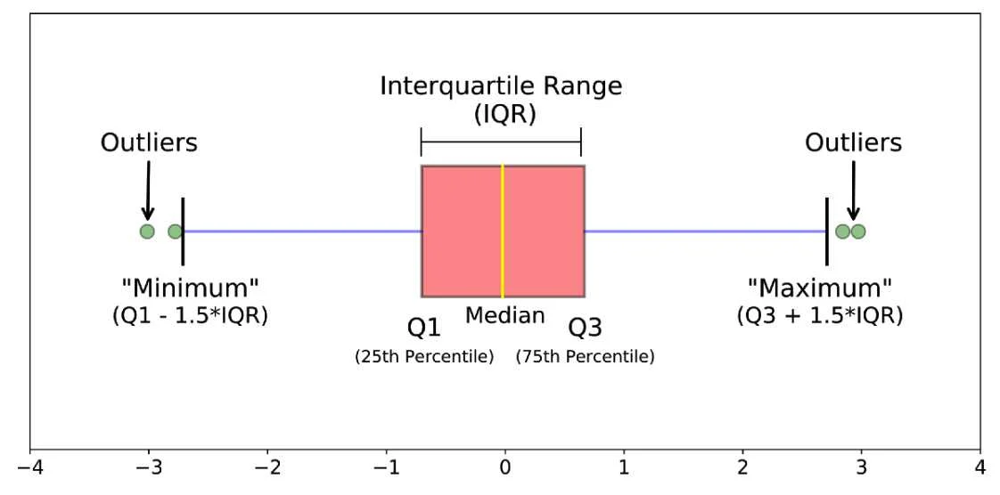
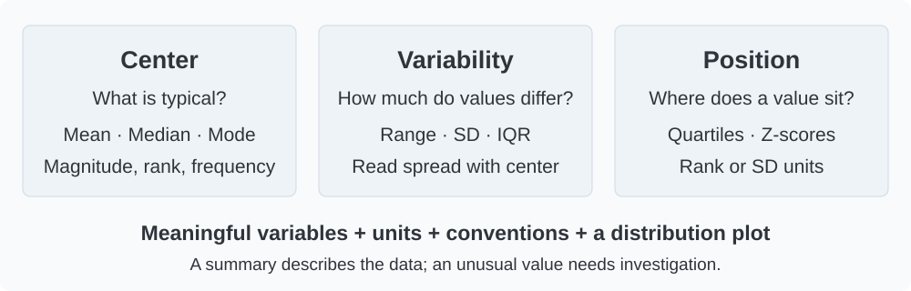

## What we will learn

A table or chart reveals the distribution. Numerical measures describe selected features of that distribution precisely. In [Lesson 2](02-frequency-tables-and-charts.qmd), most audits fell below 25 days. We now ask: **What is typical, how much do durations vary, and which values deserve attention?**

By the end, you should be able to:

- Calculate and interpret the mean, median, and mode.
- Discuss what the mean and range reveal, what they hide, and how extreme values affect them.
- Distinguish range, variance, standard deviation, and interquartile range.
- Calculate quartiles using a stated convention.
- Read a five-number summary and a boxplot.
- Explain a z-score and an outlier flag without overstating either.
- Compare groups with appropriate units and limits.

**Reading:** main 8th-edition book, §3.1 (location and percentiles), §3.2 (variability), selected ideas from §3.3 (z-scores), and §3.4 (five-number summaries and boxplots). The conceptual references are from the book; the R analyses below apply them to our checked Audit and Restaurant CSVs.

```{r}
#| label: setup-numerical-measures
#| include: false
# library(): loads a package so its functions can be used in this session.
# read.csv(): reads a comma-separated file into a data frame; its first row supplies column names by default.
# c(): combines values into a vector, converting them to a common type when needed.
# factor(): stores categorical values; levels fixes their permitted order and labels can rename their display.
# stopifnot(): stops execution if any supplied condition is FALSE; successful checks produce no output.
# length(): counts elements in a vector or list.
# anyNA(): returns TRUE if any value is missing; !anyNA(...) requires no missing values.
# nrow(): returns the number of rows in a table or matrix.
# theme_set(): sets the default theme for subsequent ggplot charts in this R session.
# theme_minimal(): uses a minimal chart style; base_size controls the base text size in points.
# theme(): customizes non-data plot elements such as legends, grids, and axis text.
# element_blank(): removes the selected non-data plot element.
# element_text(): sets text appearance; size uses points and angle rotates labels.
# unname(): removes names or dimension names without changing the underlying values.
# quantile(): computes sample percentiles; probs gives probabilities and type selects the interpolation rule.
# q6(): is a locally defined helper computing type-6 sample quartiles for textbook consistency.
# data.frame(): builds a table whose named columns have compatible lengths.
# min(): returns the smallest supplied value.
# max(): returns the largest supplied value.
# Load the packages and teaching data used by the lesson, and define shared settings or helpers.
# This setup chunk is hidden in the report; stopifnot() checks required data conditions where specified.
library(ggplot2)
library(knitr)
audit <- read.csv("data/module02/audit_times.csv")
restaurants <- read.csv("data/module02/restaurant_ratings.csv")
limitations <- read.csv("data/module02/measure_limitations_examples.csv")
x <- audit$audit_days
quality_levels <- c("Good", "Very Good", "Excellent")
restaurants$quality_rating <- factor(restaurants$quality_rating,
  levels = quality_levels, ordered = TRUE)
stopifnot(length(x) == 20, !anyNA(x), nrow(restaurants) == 300, !anyNA(restaurants))
theme_set(theme_minimal(base_size = 14) +
  theme(plot.title.position = "plot", panel.grid.minor = element_blank(),
        plot.title = element_text(face = "bold", colour = "#2F343B")))
q6 <- function(v, p) unname(quantile(v, p, type = 6))
box_record <- function(v, group) {
  q <- q6(v, c(.25, .5, .75))
  spread <- q[3] - q[1]
  fences <- c(q[1] - 1.5 * spread, q[3] + 1.5 * spread)
  inside <- v[v >= fences[1] & v <= fences[2]]
  data.frame(Group = group, ymin = min(inside), Q1 = q[1], Median = q[2],
             Q3 = q[3], ymax = max(inside), Lower_fence = fences[1], Upper_fence = fences[2])
}
```

## Business case: describe a typical audit and its variability

An accounting manager has completion times for **20 year-end audits**, recorded in days. The manager needs a concise description of a typical duration, the variation between audits, and any unusually long cases to investigate. One row is one audit. These historical observations inform a description; a completion commitment for a new client requires additional information.

::: {.case-narration lang="ar" dir="rtl"}
لدى مدير في مكتب محاسبة بيانات المدة اللازمة لإنجاز **عشرين عملية تدقيق لنهاية السنة**، والمسجّلة بالأيام. يحتاج المدير إلى وصف موجز للمدة المعتادة، ومدى تفاوت المدد بين العمليات، وأي حالات طويلة بصورة غير معتادة تستحق الدراسة. يمثل كل صف عملية تدقيق واحدة. تساعد هذه المشاهدات التاريخية على الوصف، أما الالتزام بموعد إنجاز لعميل جديد فيتطلب معلومات إضافية.
:::

[Download the Audit CSV](../../data/module02/audit_times.csv). We use the original recorded values, not histogram class midpoints. The 20 values match book Table 2.4, p.47.

## Mean, median, and mode: three meanings of typical

### Mean: balance all the numerical values

The **sample mean** adds the observations and divides by their number:

$$\bar{x}=\frac{\sum_{i=1}^{n}x_i}{n}.$$

For these audits, the total is **385 days across 20 audits**, so $\bar{x}=385/20=19.25$ days. This is the average of recorded durations, not a statement that every audit took about 19 days.

The mean **compresses many numerical observations into one useful summary**. It gives an initial insight into the level of the data, preserves the original units, and connects directly to the total: mean × number of observations = total.

Every value contributes to the mean. Long durations can pull it upward; this sensitivity can be useful when total workload matters. However, the mean does not show how observations are distributed, and an extreme value can make it a poor description of where most observations lie. Its usefulness depends on the question being asked.

### Median: locate the middle after sorting

The **median** is the middle ordered value. With an odd number of observations, take the central observation; with an even number of numerical observations, average the two central values.

```{r}
#| label: audit-ordered-values
# kable(): formats a data frame or matrix as a readable report table; digits sets displayed precision.
# c(): combines values into a vector, converting them to a common type when needed.
# sort() orders audit days; seq_along() numbers their positions from 1 to n.
# data.frame() pairs positions with values so we can identify the median observations.
ordered_audits <- data.frame(Position = seq_along(x), Days = sort(x))
kable(ordered_audits, col.names = c("Sorted position", "Audit duration (days)"))
```

There are 20 observations. Positions 10 and 11 are both 18, so the median is $(18+18)/2=18$ days. It describes the center by rank and is less sensitive than the mean to a very large observation. Ties mean that “half below and half above” should not be interpreted as exactly half *strictly* below and above the median.

### Mode: identify the most frequent value

The **mode** is the value or category occurring most frequently. Here **18 days** occurs three times, more than any other exact duration. A dataset can have several modes or no single most frequent value.

R's `mode()` describes an object's storage mode; it does **not** calculate the statistical mode. Count values instead.

```{r}
#| label: audit-center
# max(): returns the largest supplied value.
# data.frame(): builds a table whose named columns have compatible lengths.
# c(): combines values into a vector, converting them to a common type when needed.
# mean(): computes an average; logical TRUE/FALSE values contribute 1/0, giving a proportion.
# median(): returns the middle sorted value, averaging the middle pair for even sample sizes.
# stopifnot(): stops execution if any supplied condition is FALSE; successful checks produce no output.
# identical(): requires exact equality of values, types, and attributes.
# kable(): formats a data frame or matrix as a readable report table; digits sets displayed precision.
# table() counts exact durations; the largest count identifies the statistical mode.
# as.numeric(names(...)) converts the matching table labels back to numerical days.
value_counts <- table(x)
audit_modes <- as.numeric(names(value_counts)[value_counts == max(value_counts)])
center <- data.frame(Measure = c("Mean", "Median", "Mode"),
                     Days = c(mean(x), median(x), audit_modes))
stopifnot(mean(x) == 19.25, median(x) == 18,
          identical(audit_modes, 18), max(value_counts) == 3)
kable(center, digits = 2)
```

```{r}
#| label: fig-audit-center
#| fig-cap: "Original R display of the checked Audit observations. Each dot is one audit; line styles distinguish the mean and median."
#| fig-alt: "Stacked audit observations show a median at 18 days and a mean at 19.25 days, with longer values extending to 33 days."
# data.frame(): builds a table whose named columns have compatible lengths.
# sort(): sorts values; decreasing=TRUE reverses the default ascending order.
# c(): combines values into a vector, converting them to a common type when needed.
# mean(): computes an average; logical TRUE/FALSE values contribute 1/0, giving a proportion.
# median(): returns the middle sorted value, averaging the middle pair for even sample sizes.
# ggplot(): starts a plot from data; additional layers are joined with +.
# aes(): maps variables to visual properties such as x, y, fill, color, or group.
# geom_point(): draws a point for each row at its mapped x and y values.
# scale_y_continuous(): controls numeric y-axis breaks, labels, limits, and spacing.
# labs(): sets axis titles, legend titles, plot titles, and captions.
# theme(): customizes non-data plot elements such as legends, grids, and axis text.
# ave(..., FUN = seq_along) stacks repeated durations so every observation is visible.
# geom_vline() marks the calculated mean and median using distinct line styles.
dots <- data.frame(Days = sort(x))
dots$Stack <- ave(dots$Days, dots$Days, FUN = seq_along)
centers <- data.frame(Measure = c("Mean: 19.25 days", "Median: 18 days"), Days = c(mean(x), median(x)))
ggplot(dots, aes(Days, Stack)) +
  geom_point(size = 3, colour = "#2878A5") +
  geom_vline(data = centers, aes(xintercept = Days, linetype = Measure),
             colour = "#596775", linewidth = .7) +
  scale_y_continuous(breaks = 1:3) +
  labs(title = "The mean and median describe different centers",
       x = "Audit duration (days)", y = "Stacked observations", linetype = NULL) +
  theme(legend.position = "bottom")
```

**Interpretation:** the mean exceeds the median in these observations. The longer durations pull the mean upward. Inspect the distribution as well: the ordering of mean and median alone is not a universal test of skewness.

### When the mean conceals the typical value

The instructor-provided descriptive statistics PDF (p.51; original deck slide 38) uses seven dollar amounts: **1, 2, 3, 3, 3, 1, 100**. Six lie between USD 1 and USD 3, while one is USD 100. These are teaching values, with no business setting specified.

```{r}
#| label: mean-limitation-example
# kable(): formats a data frame or matrix as a readable report table; digits sets displayed precision.
# data.frame(): builds a table whose named columns have compatible lengths.
# c(): combines values into a vector, converting them to a common type when needed.
# stopifnot(): stops execution if any supplied condition is FALSE; successful checks produce no output.
# abs(): returns absolute values; a small tolerance in an equality check permits floating-point rounding.
# subset() selects the extreme-value teaching example from the supplementary CSV.
# sum(), mean(), and median() show how the large value changes the reported center.
amounts <- subset(limitations, example == "extreme_value")$value
kable(data.frame(Measure = c("Total (USD)", "Mean (USD)", "Median (USD)", "Mode (USD)"),
                 Value = c(sum(amounts), mean(amounts), median(amounts), 3)), digits = 2)
stopifnot(sum(amounts) == 113, median(amounts) == 3, abs(mean(amounts)-113/7) < 1e-10)
```

The mean, **USD 16.14**, correctly divides the total by seven. Yet it is above six of the seven observations, so it poorly describes the typical amount in this example. The median, **USD 3**, better describes the middle. The mean remains useful when the total matters. A valid large value should remain in the data even when it makes the mean unrepresentative of most observations.

Here the mode is also **USD 3**, but it answers a different question: which amount occurs most often? The median describes the middle by rank, while the mode describes frequency. Neither supplies the total or describes the spread. We choose and interpret these summaries according to their meaning; they are not automatic replacements for the mean.

[Download the teaching comparisons as CSV](../../data/module02/measure_limitations_examples.csv). The source notes distinguish examples from your instructor's slides and original course illustrations.

## Variability: how different are the durations?

**The mean is useful, but it is not enough on its own to describe data.** Even a correctly calculated, representative mean tells us nothing by itself about how far apart the observations are. The instructor-provided PDF (pp.60–61; original deck slides 44–45) gives five sets of three values. **Every set has mean 200**, despite very different variability. The numbers are conceptual teaching values in arbitrary units, not audit durations.

```{r}
#| label: same-mean-different-spread
# subset(): keeps entries or rows satisfying a condition; select can choose columns.
# do.call(): calls a function using a list of arguments, e.g. rbind to combine a list of tables.
# names(): reads or assigns names to vector elements or table columns.
# data.frame(): builds a table whose named columns have compatible lengths.
# mean(): computes an average; logical TRUE/FALSE values contribute 1/0, giving a proportion.
# stopifnot(): stops execution if any supplied condition is FALSE; successful checks produce no output.
# all(): returns TRUE only when every supplied logical value is TRUE.
# kable(): formats a data frame or matrix as a readable report table; digits sets displayed precision.
# split() separates the instructor examples by set; lapply() summarizes each set.
# paste(..., collapse = ", ") lists its values, and rbind combines the summary rows.
same_mean <- split(subset(limitations, example == "same_mean")$value,
                   subset(limitations, example == "same_mean")$series)
same_mean_table <- do.call(rbind, lapply(names(same_mean), function(g) {
  v <- same_mean[[g]]
  data.frame(Set = g, Values = paste(v, collapse = ", "), Mean = mean(v))
}))
stopifnot(all(same_mean_table$Mean == 200))
kable(same_mean_table, row.names = FALSE)
```

S2 has no variation: every observation is 200. S5 contains widely separated values, from -2000 to 2500. Reporting only “mean = 200” conceals this distinction. The mean has correctly summarized their common average, but it has compressed away information about their differences. **Describe center and dispersion together**, using a plot to see the distribution as well.

### Range: the full observed span

The **range** is maximum minus minimum: $33-12=21$ days. It uses only two observations, so it can change markedly when a single extreme value changes. It does not describe how the values are distributed between those endpoints.

For the five sets above, the ranges are **200, 0, 600, 1200, and 4500**, respectively. The range immediately reveals that their observed spans differ. It is useful when the full observed span matters, but it is not a description of the spread of most observations.

### The range is sensitive to an extreme value

Return to the seven dollar amounts: **1, 2, 3, 3, 3, 1, 100**. Their range is **USD 99**, although six of the seven amounts occupy the narrow interval from USD 1 to USD 3. Both statements are correct: the full span is wide, and most observations are close together.

```{r}
#| label: range-extreme-value
# min() and max() find the endpoints; diff(range()) subtracts the minimum from the maximum.
# data.frame() constructs the summary row, and kable() displays the dollar amounts to two decimals.
# stopifnot() stops if the calculated range fails to match the slide's USD 99 result.
kable(data.frame(Minimum_USD = min(amounts), Maximum_USD = max(amounts),
                 Range_USD = diff(range(amounts))), digits = 2)
stopifnot(diff(range(amounts)) == 99)
```

An extreme value directly changes the range when it changes an endpoint. For example, **if USD 100 were USD 1000 in a hypothetical version**, the range would rise from USD 99 to USD 999 while the other six observations stayed exactly the same. This is a sensitivity illustration, not a correction to the original values.

The range therefore gives limited insight into the spread of the main cluster when an endpoint is extreme. Report it for what it measures, alongside the distribution and other suitable summaries. Measures using all observations can describe internal spread, but they can also be sensitive to extremes.

### The range misses the values between the endpoints

Consider a second, **original course illustration** in arbitrary units:

- Set A: **0, 5, 5, 5, 10**.
- Set B: **0, 0, 5, 10, 10**.

Both have **mean 5 and range 10**. In A, three observations sit at the center. In B, four sit at the extremes. The range cannot distinguish these patterns because their endpoints agree.

```{r}
#| label: fig-same-range-different-spread
#| fig-height: 3.4
#| fig-cap: "Original course illustration. Each dot is one observation; stacked dots indicate repeated values. Both sets share the same mean and range."
#| fig-alt: "Set A has three observations at 5 and one at each endpoint 0 and 10. Set B has one at 5 and two at each endpoint."
# subset(): keeps entries or rows satisfying a condition; select can choose columns.
# ggplot(): starts a plot from data; additional layers are joined with +.
# aes(): maps variables to visual properties such as x, y, fill, color, or group.
# geom_vline(): adds vertical references at xintercept; linetype selects solid or dashed lines.
# geom_point(): draws a point for each row at its mapped x and y values.
# scale_x_continuous(): controls numeric x-axis breaks, labels, limits, and spacing.
# c(): combines values into a vector, converting them to a common type when needed.
# scale_y_continuous(): controls numeric y-axis breaks, labels, limits, and spacing.
# labs(): sets axis titles, legend titles, plot titles, and captions.
# ave() gives repeated values stacking positions within each set.
# facet_wrap() separates A and B while the dashed line marks their common mean.
same_range <- subset(limitations, example == "same_range")
same_range$Stack <- ave(same_range$value, same_range$series, same_range$value, FUN = seq_along)
ggplot(same_range, aes(value, Stack)) +
  geom_vline(xintercept = 5, linetype = "dashed", colour = "#7B858D") +
  geom_point(size = 4, colour = "#2878A5") +
  facet_wrap(~series, ncol = 1) +
  scale_x_continuous(breaks = c(0, 5, 10), limits = c(-1, 11)) +
  scale_y_continuous(breaks = 1:3, limits = c(.5, 3.5)) +
  labs(title = "Equal ranges can conceal different internal spread",
       x = "Value (arbitrary units)", y = "Stacked observations")
```

### Mean absolute deviation: every distance contributes

To describe internal spread, measure each observation's distance from the mean. Simply averaging **signed deviations** fails because they sum to zero. One solution is to average their absolute values:

$$\text{Mean absolute deviation about the mean}=\frac{1}{n}\sum_{i=1}^{n}|x_i-\bar{x}|.$$

For A, the distances are **5, 0, 0, 0, 5**, averaging **2 units**. For B, they are **5, 5, 0, 5, 5**, averaging **4 units**. This measure distinguishes their internal spread and retains the original units.

In R, use `mean(abs(v - mean(v)))`. R's `mad()` calculates a scaled **median** absolute deviation by default, which is a different measure.

The next approach squares distances. Absolute deviations grow linearly with distance, while squared deviations give increasingly large contributions to distant observations. This choice serves a different purpose; it does not make variance or standard deviation universally better or resistant to extremes.

### Sample variance: average squared variation, with an adjustment

For a sample of size $n>1$, the sample variance is

$$s^2=\frac{\sum_{i=1}^{n}(x_i-\bar{x})^2}{n-1}.$$

The deviations describe distances from the mean. Squaring prevents negative and positive deviations from cancelling. The denominator is $n-1$ because estimating the mean uses one degree of freedom. Under independent sampling from a common population with finite variance, this adjustment makes $s^2$ an unbiased estimator of the population variance.

For a complete population, its descriptive variance uses its population mean and denominator $N$. Whether data constitute a population or a sample depends on the question, not whether the file contains “all the rows available.” Here we treat the 20 audits as a sample, and R's `var()` follows the $n-1$ convention.

### Standard deviation: spread in the original units

The **sample standard deviation** is $s=\sqrt{s^2}$. Variance has squared units; standard deviation has the original units. For Audit, variance is approximately **29.57 days²** and standard deviation is **5.44 days**.

Standard deviation summarizes spread around the mean. It is not the standard error, a maximum possible deviation, or a guarantee that every observation lies within one standard deviation of the mean. No normal-distribution assumption is required merely to calculate it.

```{r}
#| label: audit-variability
# sum(): adds vector entries; on logical values it counts TRUE entries.
# data.frame(): builds a table whose named columns have compatible lengths.
# c(): combines values into a vector, converting them to a common type when needed.
# diff(): subtracts each preceding value from the next by default; diff(range(x)) gives max minus min.
# range(): returns the minimum and maximum as a two-element vector.
# stopifnot(): stops execution if any supplied condition is FALSE; successful checks produce no output.
# abs(): returns absolute values; a small tolerance in an equality check permits floating-point rounding.
# length(): counts elements in a vector or list.
# kable(): formats a data frame or matrix as a readable report table; digits sets displayed precision.
# Subtract mean(x), square the deviations, and sum them to measure total squared variation.
# var() divides by n-1; sd() returns its square root in the original units.
squared_deviations <- sum((x - mean(x))^2)
variability <- data.frame(
  Measure = c("Range (days)", "Sum of squared deviations (days squared)",
              "Sample variance (days squared)", "Sample standard deviation (days)"),
  Value = c(diff(range(x)), squared_deviations, var(x), sd(x)))
stopifnot(abs(squared_deviations / (length(x)-1) - var(x)) < 1e-10,
          abs(sd(x)^2 - var(x)) < 1e-10)
kable(variability, digits = 2)
```

Returning to sets A and B, both measures that use all observations detect the difference the range missed:

```{r}
#| label: same-range-summary
# do.call(): calls a function using a list of arguments, e.g. rbind to combine a list of tables.
# lapply(): applies a function separately to each element and returns a list.
# data.frame(): builds a table whose named columns have compatible lengths.
# length(): counts elements in a vector or list.
# stopifnot(): stops execution if any supplied condition is FALSE; successful checks produce no output.
# all(): returns TRUE only when every supplied logical value is TRUE.
# c(): combines values into a vector, converting them to a common type when needed.
# sqrt(): returns the nonnegative square root of a nonnegative number.
# kable(): formats a data frame or matrix as a readable report table; digits sets displayed precision.
# split() processes sets A and B separately; diff(range(v)) calculates maximum minus minimum.
# mean(abs(v-mean(v))) averages absolute distances; sd(v) calculates sample SD.
spread_comparison <- do.call(rbind, lapply(split(same_range$value, same_range$series), function(v) {
  data.frame(N = length(v), Mean = mean(v), Range = diff(range(v)),
             Mean_absolute_deviation = mean(abs(v-mean(v))), Sample_SD = sd(v))
}))
stopifnot(all(spread_comparison$Mean == 5), all(spread_comparison$Range == 10),
          all(spread_comparison$Mean_absolute_deviation == c(2,4)),
          abs(spread_comparison$Sample_SD[1]-sqrt(12.5)) < 1e-10,
          spread_comparison$Sample_SD[2] == 5)
kable(spread_comparison, digits = 2,
      col.names = c("n", "Mean", "Range", "Mean absolute deviation", "Sample SD"))
```

**What has been addressed?** Measures using all values describe internal variation that range alone misses. **What remains?** Mean absolute deviation about the mean and standard deviation still respond to extreme values. We next introduce quartiles and IQR to describe the central portion of the distribution.

## Percentiles and quartiles: locate values by rank

A **percentile** locates a value within an ordered distribution. Quartiles are the 25th, 50th, and 75th percentiles: $Q_1$, $Q_2$ (the median), and $Q_3$. They describe approximate portions of the distribution; ties and interpolation matter in small samples.

There are several accepted sample-percentile conventions. On printed pp.113–114, the book uses the position

$$L_p=(n+1)\frac{p}{100},$$

with interpolation between adjacent sorted observations when the position lies between them. We use **R's `type = 6`** to follow that interior-percentile convention for these quartiles.

For 20 audits:

- $L_{25}=21\times0.25=5.25$: one-quarter of the way from the 5th value (15) to the 6th (15), giving $Q_1=15$.
- $L_{50}=10.5$: halfway from the 10th value (18) to the 11th (18), giving $Q_2=18$.
- $L_{75}=15.75$: three-quarters of the way from the 15th value (22) to the 16th (22), giving $Q_3=22$.

```{r}
#| label: audit-quartiles
# c(): combines values into a vector, converting them to a common type when needed.
# kable(): formats a data frame or matrix as a readable report table; digits sets displayed precision.
# data.frame(): builds a table whose named columns have compatible lengths.
# stopifnot(): stops execution if any supplied condition is FALSE; successful checks produce no output.
# identical(): requires exact equality of values, types, and attributes.
# quantile() finds the requested percentiles; type = 6 follows our book convention.
# unname() removes percentile labels for the display; the numerical quartiles are unchanged.
quartiles <- quantile(x, c(.25,.50,.75), type = 6)
kable(data.frame(Quartile = c("Q1: 25th percentile", "Q2: median", "Q3: 75th percentile"),
                 Days = unname(quartiles)))
stopifnot(identical(unname(quartiles), c(15,18,22)))
```

::: {.callout-note title="State the software convention"}
R's default is `type = 7`. Specify `type = 6` for our book-aligned calculations. `IQR(x)` and ordinary ggplot2 boxplots also use their own defaults, so calculate the IQR from the stated quartiles and use the explicit boxplot statistics below. The methods happen to give the same Audit quartiles; that does not make them interchangeable for every dataset. Do not extrapolate the book's interior-position calculation beyond the available ordered observations.
:::

### Interquartile range: the width of the middle half

The **interquartile range** is $IQR=Q_3-Q_1=22-15=7$ days. The quartiles describe the middle half of the distribution, approximately 15 to 22 days here. With ties, the number of records inside an inclusive quartile interval need not equal exactly half the sample.

Median and IQR emphasize the central part of the distribution. Mean and standard deviation use the magnitudes of all observations. Choose them according to the question and the observed distribution, not from a rule that one pair is always superior.

## Five-number summaries and boxplots

A **five-number summary** contains the minimum, $Q_1$, median, $Q_3$, and maximum.

```{r}
#| label: audit-five-numbers
# min(): returns the smallest supplied value.
# median(): returns the middle sorted value, averaging the middle pair for even sample sizes.
# max(): returns the largest supplied value.
# kable(): formats a data frame or matrix as a readable report table; digits sets displayed precision.
# data.frame(): builds a table whose named columns have compatible lengths.
# c() combines the minimum, quartiles, median, and maximum into a named vector.
# unname() supplies its values to the table without duplicating the vector labels.
five <- c(Minimum = min(x), Q1 = quartiles[1], Median = median(x),
          Q3 = quartiles[3], Maximum = max(x))
kable(data.frame(Measure = c("Minimum", "Q1", "Median", "Q3", "Maximum"),
                 Days = unname(five)))
```

A **boxplot** shows the box from $Q_1$ to $Q_3$, with a line at the median. Under the book's outlier-screening rule, calculate:

$$\text{Lower fence}=Q_1-1.5IQR,\qquad
\text{Upper fence}=Q_3+1.5IQR.$$

The **whiskers end at observed values inside the fences**, not at the fences themselves. Observations beyond the fences are drawn separately. Thus, a whisker endpoint is not always the overall minimum or maximum.

{width=100% fig-alt="A supplied horizontal boxplot illustration labels Q1, median, Q3, the IQR, whiskers, and observations outside the central region. Its quoted minimum and maximum formulas denote fences, which are distinct from actual whisker endpoints."}

::: {.callout-note title="Clarifying the illustration's labels"}
The expressions labeled “Minimum” and “Maximum” in this schematic are the **lower and upper fences**, not generally the dataset's minimum and maximum. For our boxplots, whiskers stop at the most extreme **observed values within** those fences. A point beyond a fence is flagged for investigation.
:::

[Open the illustration at full size](../../assets/module02/boxplot-anatomy-reference.png).

For Audit, the fences are **4.5 and 32.5 days**. The whiskers end at **12 and 28 days**. The 33-day audit is flagged for investigation, while remaining part of the dataset and its five-number summary.

```{r}
#| label: fig-audit-book-boxplot
#| fig-height: 4.5
#| fig-cap: "Original R boxplot using explicit type-6 quartiles and 1.5-IQR fences. The separately drawn point is the 33-day audit; it has not been removed."
#| fig-alt: "Audit box spans 15 to 22 days with median 18, whiskers at 12 and 28, and an outlier flag at 33 days. A dashed upper fence lies at 32.5."
# stopifnot(): stops execution if any supplied condition is FALSE; successful checks produce no output.
# identical(): requires exact equality of values, types, and attributes.
# as.integer(): converts to integers by truncating numeric fractional parts; it does not round to nearest.
# ggplot(): starts a plot from data; additional layers are joined with +.
# aes(): maps variables to visual properties such as x, y, fill, color, or group.
# geom_boxplot(): draws quartiles, whiskers, and flagged points; a flagged value is not automatically an error.
# geom_point(): draws a point for each row at its mapped x and y values.
# data.frame(): builds a table whose named columns have compatible lengths.
# geom_hline(): adds horizontal references at yintercept.
# labs(): sets axis titles, legend titles, plot titles, and captions.
# box_record() is our helper for type-6 quartiles, fences, and observed whisker endpoints.
# stat = "identity" draws those supplied statistics instead of recomputing ggplot2 defaults.
audit_box <- box_record(x, "Audit")
audit_flagged <- x[x < audit_box$Lower_fence | x > audit_box$Upper_fence]
stopifnot(identical(as.integer(audit_flagged), 33L), audit_box$ymin == 12, audit_box$ymax == 28)
ggplot(audit_box, aes(x = Group, ymin = ymin, lower = Q1, middle = Median,
                      upper = Q3, ymax = ymax)) +
  geom_boxplot(stat = "identity", width = .35, fill = "#B6D2E2", colour = "#394B58") +
  geom_point(data = data.frame(Group = "Audit", Days = audit_flagged),
             aes(x = Group, y = Days), inherit.aes = FALSE,
             size = 3, colour = "#B47816") +
  geom_hline(yintercept = audit_box$Upper_fence, linetype = "dashed", colour = "#7B858D") +
  labs(title = "A flag is a prompt to investigate", x = NULL, y = "Audit duration (days)")
```

A flag does not establish a recording error, poor performance, or a reason to delete a valid audit. Check the source record, the audit's scope, and the circumstances. A boxplot also hides detail; return to the dot plot or histogram when looking for clusters or multiple peaks.

## How much does a long observation change the summary?

Consider a **hypothetical sensitivity exercise**: replace the 33-day value with 60 days in a separate copy. This is an illustration, not a correction to the book's data.

```{r}
#| label: audit-sensitivity
# data.frame(): builds a table whose named columns have compatible lengths.
# c(): combines values into a vector, converting them to a common type when needed.
# mean(): computes an average; logical TRUE/FALSE values contribute 1/0, giving a proportion.
# median(): returns the middle sorted value, averaging the middle pair for even sample sizes.
# sd(): computes sample standard deviation using denominator n-1.
# diff(): subtracts each preceding value from the next by default; diff(range(x)) gives max minus min.
# q6(): is a locally defined helper computing type-6 sample quartiles for textbook consistency.
# kable(): formats a data frame or matrix as a readable report table; digits sets displayed precision.
# stopifnot(): stops execution if any supplied condition is FALSE; successful checks produce no output.
# Create a separate copy, then which.max() locates the largest duration to replace.
# Recalculate both sets of summaries while preserving the original audit vector x.
hypothetical <- x
hypothetical[which.max(hypothetical)] <- 60
sensitivity <- data.frame(
  Dataset = c("Original observations", "Hypothetical: 33 replaced by 60"),
  Mean_days = c(mean(x), mean(hypothetical)),
  Median_days = c(median(x), median(hypothetical)),
  SD_days = c(sd(x), sd(hypothetical)),
  IQR_days = c(diff(q6(x, c(.25,.75))), diff(q6(hypothetical, c(.25,.75)))))
kable(sensitivity, digits = 2,
      col.names = c("Dataset", "Mean (days)", "Median (days)", "SD (days)", "IQR (days)"))
stopifnot(mean(x) == 19.25, max(x) == 33, mean(hypothetical) == 20.6,
          median(hypothetical) == 18)
```

The mean rises to **20.60 days** and the standard deviation to **10.25 days**. The median and IQR are unchanged in this particular exercise. This demonstrates resistance to one tail change, not immunity to every possible change in the data.

## Two additional measures: CV and z-scores

### Coefficient of variation

The **coefficient of variation** expresses standard deviation relative to the mean:

$$CV=100\frac{s}{\bar{x}}.$$

For Audit, it is approximately **28.25%**. It can help compare relative variability for suitable positive ratio-scale quantities, but it is unstable when the mean is near zero and is not meaningful for arbitrary-zero scales such as Celsius. Comparing CVs alone does not establish that one business process is better.

### Z-score

A **sample z-score** measures how far a value is from the sample mean in standard-deviation units:

$$z_i=\frac{x_i-\bar{x}}{s},\qquad s>0.$$

The 33-day audit has $z\approx2.53$: it is about 2.53 sample standard deviations above the mean. This calculation does not require a normal distribution, but it does not automatically supply a probability. The 1.5-IQR boxplot rule and a $|z|>3$ screening rule can flag different observations; neither is an automatic deletion rule.

```{r}
#| label: audit-relative-measures
# kable(): formats a data frame or matrix as a readable report table; digits sets displayed precision.
# data.frame(): builds a table whose named columns have compatible lengths.
# c(): combines values into a vector, converting them to a common type when needed.
# 100*sd(x)/mean(x) expresses sample spread as a percentage of the mean (CV).
# (33-mean(x))/sd(x) places the 33-day audit in sample-standard-deviation units.
kable(data.frame(Measure = c("Coefficient of variation (%)", "Z-score of the 33-day audit"),
                 Value = c(100 * sd(x) / mean(x), (33 - mean(x)) / sd(x))), digits = 2)
```

## Business case: compare restaurant price distributions

Return to the **300 restaurants**. An analyst wants to compare meal prices across the ordered quality categories Good, Very Good, and Excellent. Are typical prices different, and how variable are prices within each group? One observation remains one restaurant; prices are in US dollars. These observational comparisons describe an association and do not isolate a causal effect of a quality rating.

::: {.case-narration lang="ar" dir="rtl"}
نعود إلى بيانات **ثلاثمئة مطعم**. يريد محلّل مقارنة أسعار الوجبات بين فئات الجودة المرتبة: جيد، وجيد جدًا، وممتاز. هل تختلف الأسعار المعتادة، وما مدى تفاوت الأسعار داخل كل فئة؟ تظل كل مشاهدة ممثلةً لمطعم واحد، والأسعار مقيسة بالدولار الأمريكي. تصف هذه المقارنات ارتباطًا في بيانات رصدية، ولا تعزل أثرًا سببيًا لتقييم الجودة.
:::

[Download the Restaurant CSV](../../data/module02/restaurant_ratings.csv). Report each group size so a reader can see that the groups differ in size.

```{r}
#| label: restaurant-numerical-measures
# names(): reads or assigns names to vector elements or table columns.
# c(): combines values into a vector, converting them to a common type when needed.
# data.frame(): builds a table whose named columns have compatible lengths.
# length(): counts elements in a vector or list.
# mean(): computes an average; logical TRUE/FALSE values contribute 1/0, giving a proportion.
# median(): returns the middle sorted value, averaging the middle pair for even sample sizes.
# sd(): computes sample standard deviation using denominator n-1.
# diff(): subtracts each preceding value from the next by default; diff(range(x)) gives max minus min.
# stopifnot(): stops execution if any supplied condition is FALSE; successful checks produce no output.
# sum(): adds vector entries; on logical values it counts TRUE entries.
# identical(): requires exact equality of values, types, and attributes.
# kable(): formats a data frame or matrix as a readable report table; digits sets displayed precision.
# split() separates prices by ordered rating; q6() is our type-6 quantile helper.
# lapply() calculates each group summary and do.call(rbind, ...) joins the rows.
groups <- split(restaurants$meal_price_usd, restaurants$quality_rating)
group_summary <- do.call(rbind, lapply(names(groups), function(g) {
  v <- groups[[g]]; q <- q6(v, c(.25,.75))
  data.frame(Quality = g, N = length(v), Mean = mean(v), Median = median(v),
             SD = sd(v), Q1 = q[1], Q3 = q[2], IQR = diff(q))
}))
stopifnot(sum(group_summary$N) == 300,
          identical(group_summary$N, c(84L,150L,66L)))
kable(group_summary[c("Quality","N","Mean","Median","SD")], digits = 2,
      col.names = c("Quality", "n", "Mean (USD)", "Median (USD)", "SD (USD)"))
kable(group_summary[c("Quality","Q1","Q3","IQR")], digits = 2,
      col.names = c("Quality", "Q1 (USD)", "Q3 (USD)", "IQR (USD)"))
```

```{r}
#| label: fig-restaurant-consistent-boxplots
#| fig-cap: "Original R boxplots. Quartiles and fences are explicitly calculated with the same type-6 convention as the summary table. Separate points are flagged observations."
#| fig-alt: "Restaurant price boxplots show increasing median prices from Good to Very Good to Excellent, with overlapping price distributions."
# do.call(): calls a function using a list of arguments, e.g. rbind to combine a list of tables.
# lapply(): applies a function separately to each element and returns a list.
# names(): reads or assigns names to vector elements or table columns.
# factor(): stores categorical values; levels fixes their permitted order and labels can rename their display.
# data.frame(): builds a table whose named columns have compatible lengths.
# rep(): repeats values; times repeats a vector and each repeats individual elements.
# length(): counts elements in a vector or list.
# ggplot(): starts a plot from data; additional layers are joined with +.
# aes(): maps variables to visual properties such as x, y, fill, color, or group.
# geom_point(): draws a point for each row at its mapped x and y values.
# labs(): sets axis titles, legend titles, plot titles, and captions.
# box_record() supplies matching quartiles and whisker endpoints for every quality group.
# geom_boxplot(stat = "identity") draws them; separate points mark values beyond the fences.
restaurant_boxes <- do.call(rbind, lapply(names(groups), function(g) box_record(groups[[g]], g)))
restaurant_boxes$Group <- factor(restaurant_boxes$Group, levels = quality_levels, ordered = TRUE)
flagged <- do.call(rbind, lapply(names(groups), function(g) {
  r <- box_record(groups[[g]], g); v <- groups[[g]]
  out <- v[v < r$Lower_fence | v > r$Upper_fence]
  data.frame(Group = rep(g, length(out)), Price = out)
}))
flagged$Group <- factor(flagged$Group, levels = quality_levels, ordered = TRUE)
ggplot(restaurant_boxes, aes(x = Group, ymin = ymin, lower = Q1, middle = Median,
                             upper = Q3, ymax = ymax)) +
  geom_boxplot(stat = "identity", width = .5, fill = "#B6D2E2", colour = "#394B58") +
  geom_point(data = flagged, aes(x = Group, y = Price), inherit.aes = FALSE,
             colour = "#B47816", size = 2.4) +
  labs(title = "Compare center and spread together", x = "Quality rating", y = "Meal price (USD)")
```

Median prices are **USD 19.50, 25.00, and 34.50** in increasing quality order. The distributions overlap, so the category does not determine an individual restaurant's price. In these data, Good has the smallest IQR (**USD 10**); Very Good has the largest (**USD 12**). “Higher typical price” and “greater price variability” are different questions.

## Summary: match the measure to the question

{fig-alt="Center uses mean, median and mode; variability uses range, SD and IQR; position uses quartiles and z-scores. All measures require meaningful variables, units, a stated convention and a distribution plot."}

| Question | Useful starting measures | Read alongside |
|---|---|---|
| What is the numerical average? | Mean | Distribution and sample SD |
| Where is the middle by rank? | Median | Quartiles, IQR, and shape |
| Which value or category occurs most? | Mode | Frequencies and any ties |
| How widely do values vary? | Range, mean absolute deviation, SD, IQR | Their different sensitivities and units |
| Where does a value sit? | Percentile or z-score | The convention and distribution |
| Do groups differ descriptively? | Group sizes, centers, and spreads | Aligned plots and study context |

| Limitation | Useful companion | Remaining limitation |
|---|---|---|
| The mean can be pulled by extremes | Median and a distribution plot | The median alone hides spread |
| Center alone hides variability | A spread measure and plot | Different spread measures describe different features |
| Range uses only the endpoints | Mean absolute deviation or SD | These still respond to extremes |
| SD is sensitive to extremes | IQR alongside the median | IQR describes the middle half and leaves tail detail out |

Do not compute arithmetic summaries of arbitrary category codes. Do not treat an outlier flag as an explanation. Preserve valid observations, report units and conventions, and connect each number to the business question.

[Complete Lesson 3 practice](exercises/03-numerical-measures.qmd). Continue to [Lesson 4: Relationships between variables](04-relationships-between-variables.qmd) for crosstabs, conditional percentages, scatterplots, covariance, and correlation.

## Sources and data

- [CSV bundle and data guide](../../data/module02/descriptive-statistics-data.zip).
- Anderson et al. (2020), *Essentials of Modern Business Statistics with Microsoft Excel*, 8th ed.: §3.1, pp.105–115; §3.2, pp.121–126; z-scores in §3.3, p.131; five-number summaries and boxplots, §3.4, pp.138–140.
- Audit values match all 20 printed observations in Table 2.4. Restaurant matches the first ten printed rows and all twelve crosstab cells in Tables 2.9–2.10; remaining individual rows are not printed for comparison. The numerical summaries and figures here are original course calculations from these checked CSVs, not claims that each output is printed in Chapter 3.

- Instructor-provided *01-descriptive-statistics.pdf*, pp.51 and 60–63 (original *Part 1 Descriptive Statistics* deck slides 38 and 44–47): extreme dollar value, equal means with different spreads, range sensitivity, and absolute and squared deviations. Adapted explanations and tables; the A/B equal-range comparison is an original course illustration. [Example data and provenance](../../data/module02/measure-limitations-source-notes.md).
