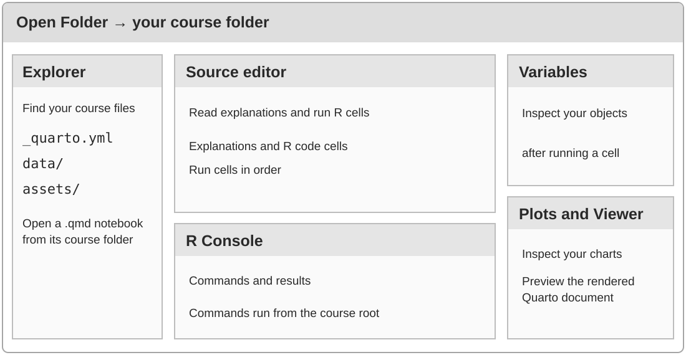
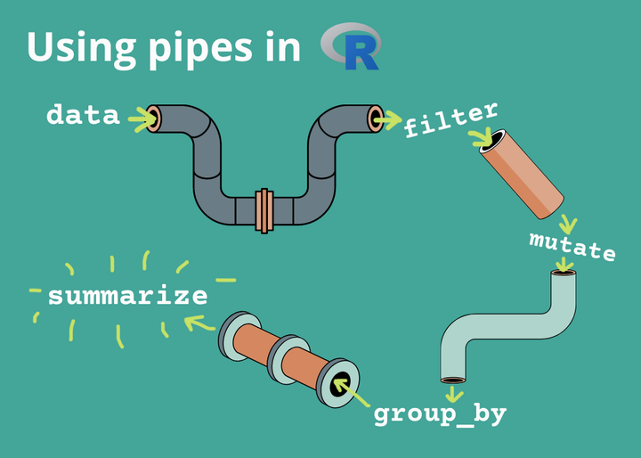
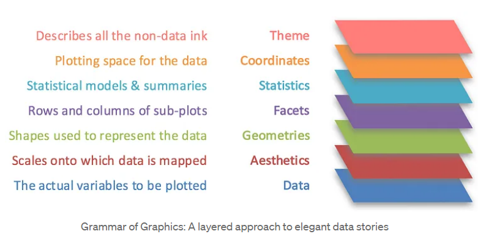

```{r}
#| include: false
knitr::opts_chunk$set(message = FALSE, dpi = 200)
```

## Getting started

- R is a free language and environment for statistical computing and graphics.
- Ross Ihaka and Robert Gentleman began developing R at the University of Auckland in the early 1990s. It is now maintained by the R Core team and contributors.
- This introduction covers the essentials: storing values, selecting data, making decisions, repeating instructions, preparing tables and drawing plots.

### R and Positron

- **R** runs your calculations. **Positron** provides a source editor, R Console, Variables pane and Plots pane.
- Install R from [CRAN](https://cran.r-project.org/), [Positron](https://positron.posit.co/download.html) and [Quarto](https://quarto.org/docs/get-started/).
- Extract the complete course ZIP. In Positron, use **File > Open Folder** and choose the top-level folder containing `_quarto.yml` and `data/`.
- Select your installed R interpreter to start an R Console. Keep its working directory at the course root so the supplied `data/...` paths work.
- In Positron, the **Console** runs a command immediately. A **script** saves commands in a `.R` file. A **Quarto notebook** saves explanations and executable R cells together in a `.qmd` file.
- The supplied workspace sends code cells to the R Console. Run cells in order; the Variables and Plots panes let you inspect the results.
- Use **Preview** to render the notebook as a reading copy with its explanations, code, results and plots.

{width=6in}

### Your first command

`print()` displays its argument, the value inside its parentheses. Quotation marks identify text.

```{r}
print("Hello, World!")
```

The output prefix `[1]` marks the position of the first value on that output line; it is not part of your text.

## Variables and atomic data types

- A variable is a name that refers to a stored object. `<-` assigns the value on the right to the name on the left.
- R is case sensitive: `age` and `Age` are different names.
- `#` starts a comment; R ignores the rest of that line.

```{r}
age <- 25          # Store a number
name <- "Alice"    # Store text
is_registered <- TRUE
age
```

### The types you will use most

An atomic vector holds values of one underlying type. A single value is a vector of length one.

| Type | Example | Meaning |
|:---|:---|:---|
| Double | `72.5` or `25` | Numbers, including decimal values |
| Integer | `25L` | Whole numbers stored as integers |
| Character | `"Alice"` | Text inside quotation marks |
| Logical | `TRUE`, `FALSE` | Truth values used in conditions |

These are the main types needed here. R also supports complex and raw atomic types.

### Finding the type

- `typeof(x)` reports the underlying storage type of object `x`.
- `class(x)` reports the object's class, which helps determine how R handles it.
- `str(object)` displays a compact overview of an object's structure.

```{r}
typeof(age)
class(age)
typeof(25L)
typeof(name)
typeof(is_registered)
```

For `age`, `typeof()` returns `"double"` and `class()` returns `"numeric"`. These describe the same object in different ways.

### Calling a function

In `round(x = 12.345, digits = 2)`, `round` is the function, `x` is the number and `digits` specifies decimal places. Named arguments make each input's role explicit.

```{r}
round(x = 12.345, digits = 2)
```

The result is `12.35`. Use `?round` in the Console to open the function's help page.

## Vectors sequences and selection

### Combining values

`c()` combines its comma-separated arguments into a vector. `length(x)` counts the elements of vector `x`.

```{r}
ages <- c(20, 22, 25, 28, 30)
length(ages)
```

- The result is `5`: five ages are stored.
- Atomic vectors have one type. `c(20, "Alice")` converts the number to text so both elements can be character values.
- Arithmetic works element by element: `ages + 1` adds one to every age; `ages * 2` doubles every age. `^` raises values to a power.

### Creating sequences

- `:` makes a sequence in steps of one, upwards or downwards.
- `seq()` allows another step size: `from` is the start, `to` is the limit and `by` is the step.
- `rep()` repeats values: `x` supplies the value and `times` gives the number of repetitions.

```{r}
1:5
seq(from = 2, to = 10, by = 2)
rep(x = 0, times = 3)
```

### Selecting elements

Square brackets `[]` select positions. **R starts counting at 1.**

```{r}
ages[3]           # Third value: 25
ages[2:4]         # Positions 2, 3 and 4: 22, 25, 28
ages[c(1, 5)]     # First and fifth values: 20, 30
```

`2:4` creates the position vector; `ages[2:4]` uses it to select values. The colon itself does not perform selection.

### Selecting with a condition

`>=` means greater than or equal to. The comparison produces one logical result for each age. Inside `[]`, R retains the positions marked `TRUE`.

```{r}
ages >= 25
ages[ages >= 25]
```

The selected ages are `25`, `28` and `30`.

## Logic decisions and repetition

### Comparing values

| Operator | Meaning | Operator | Meaning |
|:---:|:---|:---:|:---|
| `>` | Greater than | `<` | Less than |
| `>=` | At least | `<=` | At most |
| `==` | Equal to | `!=` | Not equal to |
| `&` | Elementwise AND | &#124; | Elementwise OR |
| `!` | NOT | | |

- Use `<-` to assign a value and `==` to compare values.
- AND requires both conditions; OR requires at least one; NOT reverses a logical value.
- Use full `TRUE` and `FALSE`, rather than their reassignable shortcuts `T` and `F`.

```{r}
ages[(ages >= 22) & (ages <= 28)]
```

This keeps the ages between 22 and 28 inclusive: `22`, `25` and `28`.

### Conditional branching

`if` evaluates one condition. When it is `TRUE`, the first block runs; otherwise the `else` block runs. Braces `{}` group instructions. The condition must be a single, nonmissing logical value.

```{r}
score <- 65
if (score >= 50) {
  print("Pass")
} else {
  print("Below the pass mark")
}
```

The output is `"Pass"`. Add `else if (another_condition)` before `else` when you need a further branch. For two single-value conditions in an `if`, use `&&` for AND or `||` for OR.

### Repetition with a for loop

`for` takes each value from a vector in turn. Here, `number` becomes 1, then 2, then 3. Each time, the block squares it and prints the result.

```{r}
for (number in 1:3) {
  print(number^2)
}
```

The results are `1`, `4` and `9`. For this calculation, `(1:3)^2` also works directly on the vector. A loop is useful when each repetition requires several instructions.

## Working with a classical data frame

A **data frame** is R's standard table object: rows are observations, columns are variables, and each column has the same number of entries. Different columns can have different types. A data frame exists in base R; dplyr is a separate package that operates on it.

### Create a small data frame

`data.frame()` combines named columns into a table. Here, each row represents one person; the values are illustrative.

```{r}
people <- data.frame(
  name = c("Alice", "Bob", "Eva"),
  age = c(25, 30, 22)
)
people
```

### Inspect an existing data frame

For numerical plots we use **mtcars**, the built-in data from the 1974 *Motor Trend* magazine: 32 car models from 1973–1974. It was also used in the original R introduction. Each row represents a car model, not a driver or journey.

| Column | Meaning | Unit or coding |
|:---|:---|:---|
| `mpg` | Fuel economy | Miles per US gallon; a higher value means more distance per gallon |
| `wt` | Vehicle weight | Thousands of pounds |
| `cyl` | Recorded cylinder group | 4, 6 or 8; a grouping variable |

`car_data <- mtcars` creates our working object, leaving the supplied dataset unchanged. No package or CSV import is needed for this built-in dataset.

```{r}
car_data <- mtcars
```

These base R functions help us understand a table before analysing it:

| Function | What it tells us |
|:---|:---|
| `class(x)` | The kind of object; here, `"data.frame"` |
| `dim(x)` | Number of rows followed by number of columns |
| `nrow(x)` and `ncol(x)` | Row count and column count separately |
| `names(x)` | Column names |
| `head(x, n = 3)` and `tail(x, n = 2)` | First three or last two rows |
| `str(object)` | Column types and a compact preview |
| `summary(object)` | Summaries for each selected column |

```{r}
class(car_data)
dim(car_data)
nrow(car_data)
ncol(car_data)
names(car_data)
```

The table has **32 rows and 11 columns**. `dim()` reports these in that order. The row names identify the car models.

### Extract columns and select rows

- `$` extracts a named column as a vector, such as `car_data$mpg`.
- `car_data["mpg"]` keeps a one-column **data frame**; `car_data[["mpg"]]` extracts the column as a **vector**. The double brackets matter when a function expects a vector.
- In `car_data[rows, columns]`, the comma separates row selection from column selection. Leaving one side blank means all rows or all columns on that side.
- Use `:` for consecutive positions and `c()` for a chosen set of column names or positions.

```{r}
car_data[1:3, c("mpg", "wt", "cyl")]
class(car_data["mpg"])
class(car_data[["mpg"]])
```

The two classes are `"data.frame"` and `"numeric"`. A table and one of its columns are different objects.

Before running the next cell, note that `head()` and `tail()` receive the table first and `n` gives the number of rows to display.

```{r}
head(x = car_data[c("mpg", "wt", "cyl")], n = 3)
tail(x = car_data[c("mpg", "wt", "cyl")], n = 2)
```

`str()` identifies the selected columns' types. `summary()` reports their minimum, quartiles, median, mean and maximum; it does not print the individual observations.

```{r}
str(object = car_data[c("mpg", "wt", "cyl")])
summary(object = car_data[c("mpg", "wt")])
```

### Add a column and filter with base R

We can assign a calculated vector directly to a new column with `$`. Since `wt` is in thousands of pounds, multiplying it by **453.59237** converts it to kilograms.

```{r}
car_data$weight_kg <- car_data$wt * 453.59237
head(x = car_data[c("wt", "weight_kg")], n = 3)
```

A logical condition can select whole rows. Here, `mpg >= 25` identifies cars that travel at least 25 miles per US gallon. The column-name vector keeps just the variables needed to inspect them.

```{r}
efficient_cars <- car_data[
  car_data$mpg >= 25, c("mpg", "weight_kg", "cyl")
]
efficient_cars
```

`order(x)` returns the positions that would sort `x`, ascending by default. Using those positions as row indices sorts our selected table by weight.

```{r}
efficient_cars[order(efficient_cars$weight_kg), ]
```

We have selected and sorted rows using base R alone. Later, `filter()`, `select()` and `arrange()` express these table operations with dplyr verbs.

### Read the supplied business CSV

`read.csv()` imports a comma-separated file into a classical data frame. Its `file` argument is a path relative to the opened course root. We use Superstore for the business-data preparation examples below.

```{r}
superstore <- read.csv(file = "data/r-introduction/superstore.csv")
head(x = superstore[c("Category", "Sales", "Profit")], n = 3)
```

- This is the original fictitious Superstore tutorial data with 2014–2017 order dates, separate from the 2023–2025 practical data.
- Each row is an order line, not necessarily a distinct order or customer. Sales and Profit are recorded in US dollars.
- `read.csv()` converts spaces in column names to dots; for example, `Order ID` becomes `Order.ID`. The three names used here are unchanged.

### Recognise missing values

- `NA` represents a missing value. Test it with `is.na(x)`, not `x == NA`.
- `mean(x, na.rm = TRUE)` calculates the arithmetic mean after omitting missing values. Omitting values changes which observations enter the calculation.

```{r}
values <- c(10, NA, 20)
is.na(values)
mean(x = values, na.rm = TRUE)
```

The check returns `FALSE TRUE FALSE`; the mean of the two observed values is `15`. For a table column, use the same pattern, such as `is.na(superstore$Sales)`.

## Preparing data with dplyr

**dplyr is a toolkit for working with tables.** It does not replace the data frame: its functions take a data frame or tibble as input and return a new table. A **tibble** is a data-frame subclass with compact printing; it is not an atomic data type.

### Install once and load each session

`install.packages()` downloads packages named in its `pkgs` argument. Run this cell once in an internet-connected session. Installation is excluded when rendering this document.

```{r}
#| eval: false
install.packages(pkgs = c("dplyr", "ggplot2"))
```

`library()` makes an installed package available in the current session.

```{r}
#| message: false
library(dplyr)
```

### Choose the verb that answers your question

Each function below receives the table as its first argument. Within these functions, use column names directly; quote a text value such as `"Technology"` when comparing values.

| Verb | Task | Meaning in this example |
|:---|:---|:---|
| `select()` | Choose columns | Keep Category, Sales and Profit |
| `filter()` | Choose rows | Keep Technology order lines |
| `arrange()` | Sort rows | Put the largest line sales first |
| `mutate()` | Add or change a column | Express each line's sales in thousands of dollars |
| `rename()` | Rename a column | Give Sales an explicit unit label |
| `group_by()` | Define groups | Prepare a separate calculation for each category |
| `summarise()` | Calculate group results | Return counts or totals, rather than the original lines |

### Select filter and sort

- `select(superstore, Category, Sales, Profit)` keeps three columns and all rows.
- `filter(..., Category == "Technology")` keeps the rows satisfying the condition.
- `arrange(..., desc(Sales))` sorts rows by Sales, largest first; `desc()` requests descending order.
- `head(..., n = 3)` lets us inspect the first three resulting rows.

```{r}
sales_columns <- select(superstore, Category, Sales, Profit)
technology <- filter(sales_columns, Category == "Technology")
largest_first <- arrange(technology, desc(Sales))
head(x = largest_first, n = 3)
```

The result contains the three Technology order lines with the largest recorded sales. These are individual lines, not totals by product or order.

### Calculate and rename columns

`mutate()` uses `new_name = calculation`. Dividing by 1000 changes the reporting unit; it does not change the recorded transaction.

```{r}
sales_units <- mutate(largest_first, Sales_thousands = Sales / 1000)
head(x = sales_units, n = 3)
```

`rename()` uses **new name = existing name**. It changes the heading, not the values.

```{r}
labelled_sales <- rename(sales_columns, Sales_USD = Sales)
head(x = labelled_sales, n = 3)
```

The original `superstore` object is unchanged because we assigned each result to another name.

### Make instructions flow through a pipe

`%>%` takes the result on its left and supplies it as the **first argument** of the function on its right. Read it as **then**. dplyr makes this operator available when loaded.

{width=6.5in}

A pipe passes the resulting object onward; it does not automatically save or print every intermediate table. Save the final result with `<-`, or write its name to inspect it.

These three forms express the same instruction: keep Technology rows, then choose three columns. Each saves its result, so printing the full table does not overwhelm the notebook. `identical(x, y)` checks whether two objects agree exactly; the two comparisons should both return `TRUE`.

```{r}
# Nested calls: read the innermost operation first
nested_technology <- select(
  filter(superstore, Category == "Technology"), Category, Sales, Profit
)

# Intermediate table: store each step
technology <- filter(superstore, Category == "Technology")
step_technology <- select(technology, Category, Sales, Profit)

# Pipeline: read the operations from top to bottom
piped_technology <- superstore %>%
  filter(Category == "Technology") %>%
  select(Category, Sales, Profit)

identical(x = nested_technology, y = piped_technology)
identical(x = step_technology, y = piped_technology)
head(x = piped_technology, n = 3)
```

### Build a meaningful business pipeline

**Question:** Among order lines with at least two units, which categories account for the greatest recorded sales?

Follow the diagram's sequence:

1. **Filter:** `Quantity >= 2` selects the order lines specified by the question.
2. **Mutate:** `Sales / 1000` creates a column measured in thousands of US dollars.
3. **Group:** `group_by(Category)` defines separate category calculations.
4. **Summarise:** `n()` counts lines; `sum()` totals their sales. `.groups = "drop"` removes grouping from the result.
5. **Arrange:** sort the category totals from largest to smallest.

```{r}
multi_unit_totals <- superstore %>%
  filter(Quantity >= 2) %>%
  mutate(Sales_thousands = Sales / 1000) %>%
  group_by(Category) %>%
  summarise(lines = n(),
            sales_thousands = sum(Sales_thousands),
            .groups = "drop") %>%
  arrange(desc(sales_thousands))
multi_unit_totals
```

- Read the output as **one row per category**, with a line count and a sales total in thousands of dollars.
- These totals describe the selected lines only. They are not the full company's sales totals or counts of distinct orders.
- The tibble headings `<int>` and `<dbl>` identify integer and double columns. They describe storage types, not additional observations.
- The order of operations matters: filtering first decides which records enter the calculation; summarising first would discard the individual Quantity values needed for that filter.
- Investigate missing values before summarising a new file; `sum()` without `na.rm = TRUE` returns `NA` when a group contains missing values.

## Conventional plots in base R

Base R includes plotting functions without an additional package. Choose variables that match a clear question, and read the axes before interpreting the pattern.

### Histogram of fuel economy

**Question:** What fuel-economy values occur among the 32 car models?

`hist()` groups numerical values into intervals and plots their frequencies. `x` supplies the observations; `breaks` suggests a number of intervals; `main` sets the title and `xlab` labels the horizontal axis. Actual interval boundaries can differ from the suggested count. `col` sets the fill colour.

```{r}
#| echo: false
par(mar = c(4.2, 4.7, 2.5, 0.8), mgp = c(2.8, 0.7, 0), las = 1, cex = 0.9)
```

```{r}
hist(x = car_data$mpg, breaks = 6,
     main = "Fuel economy of 32 car models",
     xlab = "Miles per US gallon", col = "gray75")
```

The values extend from 10.4 to 33.9 miles per US gallon. Each bar counts car models in a numerical interval; it does not represent a category such as cylinder group.

### Bar plot of category counts

**Question:** How many Superstore order lines fall in each product category?

`table()` counts observations in each category. `barplot()` uses those counts as bar heights; `height` supplies the counts, and `ylab` labels the vertical axis.

```{r}
#| echo: false
par(mar = c(4.2, 4.7, 2.5, 0.8), mgp = c(2.8, 0.7, 0), las = 1, cex = 0.9)
```

```{r}
category_counts <- table(superstore$Category)
barplot(height = category_counts, main = "Order lines by category",
        ylab = "Number of order lines", col = "gray75")
```

Office Supplies has the most lines in this file. This is a comparison of categories; the histogram above describes numerical intervals. Neither chart counts distinct customers or distinct orders.

## Boxplots and scatter plots

### Compare fuel economy across cylinder groups

**Question:** How do the centres and spreads of fuel economy differ between the recorded 4-, 6- and 8-cylinder groups?

- `factor(x)` marks values as categories. The numeric codes 4, 6 and 8 identify groups here, rather than positions on a continuous measurement axis.
- `boxplot()` can use a **formula**: `mpg ~ cylinders` means “compare mpg across cylinder groups”. `data` supplies the table containing those columns.
- `xlab` and `ylab` give the axis labels; `col` sets the box fill.

```{r}
car_data$cylinders <- factor(x = car_data$cyl)
```

```{r}
#| echo: false
par(mar = c(4.2, 4.7, 2.5, 0.8), mgp = c(2.8, 0.7, 0), las = 1, cex = 0.9)
```

```{r}
#| fig-height: 3.8
boxplot(mpg ~ cylinders, data = car_data,
        main = "Fuel economy by cylinder group",
        xlab = "Recorded cylinder group", ylab = "Miles per US gallon",
        col = "gray80")
```

- The median lines are **26.0**, **19.7** and **15.2** miles per US gallon for the 4-, 6- and 8-cylinder groups respectively.
- Each box spans the middle half of its group's observations. Default whiskers extend to the most extreme values within 1.5 box lengths of its edges; more distant values appear separately.
- The group sizes are 11, 7 and 14 car models. These small, unequal groups describe this historical dataset, not all cars.
- The pattern shows a group association. It does not establish that changing a car's cylinder count would cause the observed change in fuel economy.

### Relate vehicle weight to fuel economy

**Question:** Do heavier car models tend to travel fewer miles per gallon?

`plot(x, y)` places weight on the horizontal axis and fuel economy on the vertical axis. `pch = 16` selects filled circles; `cex = 1` uses their standard size; `col` sets their colour.

```{r}
#| echo: false
par(mar = c(4.2, 4.7, 2.5, 0.8), mgp = c(2.8, 0.7, 0), las = 1, cex = 0.9)
```

```{r}
#| fig-height: 3.8
plot(x = car_data$weight_kg, y = car_data$mpg,
     main = "Vehicle weight and fuel economy",
     xlab = "Vehicle weight in kilograms", ylab = "Miles per US gallon",
     pch = 16, cex = 1, col = "gray35")
```

Each point is one car model; all 32 are included. The downward pattern indicates that heavier models generally have lower fuel economy in this dataset. Other design characteristics also differ between models, so this is an association rather than a causal experiment.

## Understanding ggplot2

**ggplot2 describes how data become a graph.** Choose a table, map its columns to visual properties, and add layers that draw marks or calculate summaries. The same data can support different graphs depending on the question.

{width=6.5in}

### Read the layers in the diagram

| Component | What it controls | Example in this introduction |
|:---|:---|:---|
| Data | Which observations enter the plot | The 32 rows of `car_data` |
| Aesthetic mappings | Which variables control positions, colours or symbols | Weight on x; mpg on y; cylinder group as colour |
| Geometries | Which marks represent observations or summaries | Points, boxes, bars |
| Statistics | What is calculated before drawing | Counts for a histogram; quartiles for a boxplot |
| Scales | How values become axis positions, colours or symbols | Numerical axis ticks and category legends |
| Coordinates | How the plotting space is arranged | Ordinary horizontal and vertical axes |
| Facets | How data are split into separate panels | One panel per group, when comparisons need separate views |
| Theme | How non-data elements look | Fonts, grid lines and background |

- **An aesthetic is a visual property**, such as x position, y position, colour, size or shape. `aes()` specifies which variable controls that property.
- Scales then translate variable values into displayed positions, colours or symbols. Mapping and scales are related but distinct ideas.
- A drawing layer normally combines a geometry and a statistical operation. `geom_point()` uses observations directly; `geom_boxplot()` calculates a summary before drawing.
- Layers inherit the data and mappings specified in `ggplot()` unless a layer supplies its own.

### Build a scatter plot in three steps

`library(ggplot2)` loads the package installed earlier. We will construct the same weight–fuel-economy plot as in base R.

```{r}
library(ggplot2)
```

**Step 1 — declare the data and mappings.** `data = car_data` supplies the table. `mapping = aes(x = weight_kg, y = mpg)` connects the two columns to axes. Store the plot definition in `p`; without a drawing layer, this definition has no points.

```{r}
p <- ggplot(data = car_data,
            mapping = aes(x = weight_kg, y = mpg))
```

**Step 2 — add the marks.** `geom_point()` adds one point per row. `size = 2` sets a fixed point size and `colour = "gray35"` sets a fixed colour. Here, `+` combines plot components; it is not numerical addition. Assign the updated plot back to `p`.

```{r}
p <- p + geom_point(size = 2, colour = "gray35")
```

**Step 3 — label and display it.** `labs()` supplies the title and axis labels. `theme_minimal()` simplifies the background without changing the data. This final expression displays the completed plot.

```{r}
p +
  labs(title = "Vehicle weight and fuel economy",
       x = "Vehicle weight in kilograms", y = "Miles per US gallon") +
  theme_minimal()
```

Read the downward relationship exactly as in the base R plot. A different plotting system changes how we specify the graph, not the observations or their meaning.

### Map a group to colour and shape

**Question:** Where do the cylinder groups lie within the weight–fuel-economy relationship?

- Put `colour = cylinders` and `shape = cylinders` **inside `aes()`** so each group controls those visual properties.
- ggplot2 assigns a colour and symbol to each factor level and supplies a legend. Colour and shape together make groups easier to distinguish.
- `size = 2.5` remains outside `aes()` because every point uses the same size.
- `labs(colour = ..., shape = ...)` labels the two mappings; matching titles allow their legends to be combined.

```{r}
ggplot(data = car_data,
       mapping = aes(x = weight_kg, y = mpg,
                     colour = cylinders, shape = cylinders)) +
  geom_point(size = 2.5) +
  labs(title = "Weight and fuel economy by cylinder group",
       x = "Vehicle weight in kilograms", y = "Miles per US gallon",
       colour = "Cylinders", shape = "Cylinders") +
  theme_minimal()
```

The recorded 8-cylinder models are generally heavier and have lower mpg; 4-cylinder models generally occupy the lighter, higher-mpg end. There is overlap between groups. These joint differences help explain why the first scatter plot cannot isolate a causal effect of weight.

**Mapping versus setting:** `aes(colour = cylinders)` means colour varies by a data column. `geom_point(colour = "gray35")` means use one fixed colour. Putting the text `"gray35"` inside `aes()` would instead treat it as a mapped label and can produce an unwanted legend.

### Combine a boxplot layer with the individual observations

We can show both the group summaries and all 32 observations on one plot.

- `aes(x = cylinders, y = mpg)` puts the categories on x and the measured fuel economy on y.
- `geom_boxplot()` draws the group summaries; `fill` sets their fixed interior colour.
- `outlier.shape = NA` hides only the boxplot layer's separate outlier symbols, so those observations are not drawn twice. All observations remain in the point layer.
- `position_jitter(width = 0.12, height = 0, seed = 312)` spreads overlapping points horizontally within their group. It leaves measured mpg unchanged because the vertical offset is zero. The seed makes these display offsets reproducible.
- `geom_point()` draws the actual observations using that position rule, a fixed `size` and a fixed `colour`.

```{r}
#| fig-height: 3.8
ggplot(data = car_data, mapping = aes(x = cylinders, y = mpg)) +
  geom_boxplot(fill = "gray85", outlier.shape = NA) +
  geom_point(position = position_jitter(width = 0.12, height = 0, seed = 312),
             size = 1.6, colour = "gray30") +
  labs(title = "Fuel economy by group with all 32 observations",
       x = "Recorded cylinder group", y = "Miles per US gallon") +
  theme_minimal()
```

Compare the medians, the middle-half spread and the amount of overlap. The visible points also reveal the unequal group sizes. For small samples, base R and ggplot2 may use slightly different conventions for box edges; the observations and group medians here are the same.

### Connect dplyr to ggplot2

- `%>%` passes a prepared **table** into the first argument of `ggplot()`, which is `data`.
- `+` then adds components to the **plot**. Do not substitute a pipe for the plus between drawing layers.
- dplyr decides **which data or summaries** enter the graph; ggplot2 decides **how they are represented**.

The next examples use the same business table as the dplyr section, first at order-line level and then at category-summary level.

## Filter data then draw a histogram

**Question:** How does quantity per order line vary within Technology?

- `filter(Category == "Technology")` keeps only Technology lines. The incoming table is supplied by `%>%`.
- `ggplot(mapping = aes(x = Quantity))` receives that filtered table and maps Quantity to the horizontal axis.
- `geom_histogram()` counts observations within numerical intervals. `binwidth = 1` sets intervals one unit wide; `boundary = 0.5` places their edges at half units so each integer quantity has its own interval.
- `fill` sets one fixed bar colour; `colour` sets the bar outlines. These settings sit outside `aes()` because they do not depend on a variable.

```{r}
superstore %>%
  filter(Category == "Technology") %>%
  ggplot(mapping = aes(x = Quantity)) +
  geom_histogram(binwidth = 1, boundary = 0.5,
                 fill = "gray75", colour = "white") +
  labs(title = "Quantity on Technology order lines",
       x = "Quantity", y = "Number of order lines") +
  theme_minimal()
```

- Each bar counts Technology order lines with that quantity; it does not count distinct orders.
- The original `superstore` table is unchanged: the pipeline passes its filtered result directly to the plot.
- `labs()` and `theme_minimal()` work just as in the earlier scatter plot. The change is in the data preparation and drawing layer.

### Read the pipeline aloud

“Take Superstore, keep Technology lines, use Quantity on the horizontal axis, draw a histogram, then add labels and a simple theme.”

## Summarise data then draw a bar chart

**Question:** What is the total sales value for each product category?

- `group_by(Category)` and `summarise()` produce one row per category. `sum(Sales) / 1000` expresses each total in thousands of US dollars, stored in the new column `sales_thousands`.
- The next pipe sends this summary table to `ggplot()`. Map Category to `x` and sales_thousands to `y`.
- `geom_col()` uses the supplied `y` values as bar heights. In contrast, `geom_bar()` counts rows by default; on this three-row summary table, that would count one row per category instead of showing sales totals.

```{r}
superstore %>%
  group_by(Category) %>%
  summarise(sales_thousands = sum(Sales) / 1000, .groups = "drop") %>%
  ggplot(mapping = aes(x = Category, y = sales_thousands)) +
  geom_col(fill = "gray65") +
  labs(title = "Total sales by category",
       x = "Product category", y = "Sales in US$ thousands") +
  theme_minimal()
```

The bars show sales totals across all tutorial order lines in each category; a height of 800 means US$800,000. This differs from the earlier bar plot of category line counts. `fill` sets the same grey for every bar.

## Check your understanding

1. Create a numeric vector with `c()`. Check its type and select positions 2 to 4.
2. Use a logical condition to keep values above a threshold. Write an `if` and `else` for one value, then a `for` loop that prints the squares of 1 to 5.
3. Use `dim()`, `names()` and `str()` to inspect `car_data`. Explain the difference between `car_data["mpg"]` and `car_data[["mpg"]]`.
4. With base R, select car models with at least 25 mpg and display only mpg and weight in kilograms.
5. Adapt the business pipeline to lines with at least three units. Explain why its totals change.
6. Explain what each point and each box represents in the car plots. Describe one association and one limit on its interpretation.
7. Change the ggplot scatter plot to gross horsepower (`hp`) on x and mpg on y. Update the labels; describe what you see without claiming causation.
8. Adapt the piped histogram to Furniture lines and the grouped bar chart to total Profit by Category. Update the titles, labels and units.

## Sources

Condensed and adapted from the four supplied 307307 R introduction notebooks and their images, retained in the course reference history. The Superstore CSV is unchanged tutorial data supplied with those materials. The original pipe and Grammar of Graphics illustrations are retained unchanged from the supplied 307307 material. The car examples use the built-in R `datasets::mtcars` data and the units/provenance documented in `?mtcars`.

Official references: [R project contributors](https://www.r-project.org/contributors.html), [Introduction to R](https://cran.r-project.org/doc/manuals/r-release/R-intro.html), [dplyr](https://dplyr.tidyverse.org/), [ggplot2](https://ggplot2.tidyverse.org/), [Quarto with R](https://quarto.org/docs/computations/r.html), and [Positron workspace layout](https://positron.posit.co/layout.html).
