The **Try this in R** sections show the code for the matching R practical examples. To execute it in RStudio, open `practicals/descriptive-statistics-r-practical.qmd` in the student project. Run Example 1 first to load `students`; later examples reuse it. Each section has one link to the matching worked example.

<div class="original-branding"></div>

<!-- Original slide 01 -->

::: {.source-slide #slide-01}

## 307312 Applied Statistics — Masters Level {#source-title-01}

{width="18%" fig-alt="Original graphic from slide 1"}

:::

<!-- Original slide 02 -->

::: {.source-slide #slide-02}

### What is Statistics? {#source-title-02}

```{=html}
<div class="source-text">
<p>Statistics is a mathematical science that includes methods for collecting, organizing, analyzing and visualizing data to extract useful information that can be used to make decisions.</p>
<p>Statistics help us solve problems, answer questions and make decisions based on data (Data Driven Decisions).</p>
<p>Statistics Helps to in Reduce Uncertainty.</p>
<p>Statistics is the science of making decisions under uncertainty (Savage, The Foundations of Statistics, 1954).</p>
</div>
```

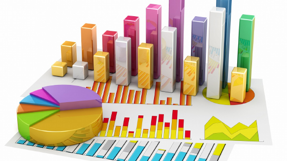{width="44%" fig-alt="Original graphic from slide 2"}

:::

<!-- Original slide 03 -->

::: {.source-slide #slide-03}

### Statistics Branches {#source-title-03}

```{=html}
<div class="source-text">
<p>Statistics is generally divided into two main branches:</p>
<p>1. Descriptive statistics.</p>
<p>Descriptive statistics refers to the summarizing and explaining data using numbers, tables and charts.</p>
<p>2- Inferential statistics.</p>
<p>Inferential statistics refers to drawing conclusions about a population based on a sample data.</p>
<p>A population refers to all members of a specified group (not necessarily people), whereas a sample is a subset of that population.</p>
<p>Population: the collection of all items we are interested in (people, things, plants, stars, trees…etc.), for the purpose of making our decision.</p>
</div>
```

:::

<!-- Original slide 04 -->

::: {.source-slide #slide-04}

### Example of Useful Descriptive Statistics {#source-title-04}

```{=html}
<div class="source-text">
<p>1. Business Sales:</p>
<p class="source-bullet source-level-0">A store owner calculates the average daily sales to get a sense about his income.</p>
<p class="source-bullet source-level-0">The owner also computes the standard deviation of daily sales to understand the variability or consistency in income.</p>
<p>2. Classroom Grades:</p>
<p class="source-bullet source-level-0">A teacher calculates the average grade of a test to understand the overall performance of the class.</p>
<p class="source-bullet source-level-0">The teacher also determines the highest and lowest scores to understand the spread of the grades.</p>
<p>3. Survey Results:</p>
<p class="source-bullet source-level-0">After a customer satisfaction survey, a company finds that 70% of respondents are &quot;satisfied&quot; or &quot;very satisfied.&quot;</p>
<p class="source-bullet source-level-0">The survey also indicates that the mode response to the question, &quot;What&#x27;s the most important feature?&quot; is &quot;product durability.&quot;</p>
</div>
```

:::

<!-- Original slide 05 -->

::: {.source-slide #slide-05}

### Examples of Useful Inferential Statistics {#source-title-05}

```{=html}
<div class="source-text">
<p>1. Medicine:</p>
<p class="source-bullet source-level-0">A research group tests a new drug on 100 patients and finds that 60 of them show significant improvement. </p>
<p class="source-bullet source-level-0">Using inferential statistics, they can make conclusions about the drug&#x27;s effectiveness on the entire population.</p>
<p>2. Agriculture:</p>
<p class="source-bullet source-level-0">A farmer tests a new fertilizer on a sample plot of land to see if it increases crop yield. </p>
<p class="source-bullet source-level-0">Inferential statistics can help predict the impact of using the fertilizer on all their plots.</p>
<p>3. Marketing:</p>
<p class="source-bullet source-level-0">A company launches a new ad campaign in a small geographic area. </p>
<p class="source-bullet source-level-0">They use inferential statistics to determine if rolling out the campaign nationwide would likely produce similar results.</p>
</div>
```

:::

<!-- Original slide 06 -->

::: {.source-slide #slide-06}

### Statistical Process Life Cycle {#source-title-06}



:::

<!-- Original slide 07 -->

::: {.source-slide #slide-07}

## Types of Data & Levels of Measurements {#source-title-07}

:::

<!-- Original slide 08 -->

::: {.source-slide #slide-08}

### Categorical Data vs Numerical Data {#source-title-08}

```{=html}
<div class="source-text">
<p>1. <strong>Qualitative</strong> or <strong>categorical</strong> (non-numerical) data:</p>
<p>Consists of descriptive information, such as colors, tastes, textures, or any other characteristics that can be counted.</p>
<p>2. <strong>Quantitative</strong> or <strong>numerical</strong> data:</p>
<p>Includes data that can be measured and can be represented numerically, such as height, weight, or temperature.</p>
</div>
```

:::

<!-- Original slide 09 -->

::: {.source-slide #slide-09}



:::

<!-- Original slide 10 -->

::: {.source-slide #slide-10}



:::

<!-- Original slide 11 -->

::: {.source-slide #slide-11}

### Why Types of Data and Levels of Measurements Matter? {#source-title-11}

```{=html}
<div class="source-text">
<p class="source-bullet source-level-0">Data Visualization: e.g. Categorical data might be best represented in a bar chart, while continuous data might be better suited for a histogram or scatter plot.</p>
<p class="source-bullet source-level-0">Data Transformation: e.g. Ordinal data might be converted into interval data under certain conditions, or continuous data might be categorized into ordinal data.</p>
<p class="source-bullet source-level-0">Data Quality: e.g. If you expect a variable to be discrete and find continuous values, this could indicate a data quality issue.</p>
<p class="source-bullet source-level-0">Interpretation of Results: e.g. If you have ordinal data, you can make statements about the order of values but not the difference between values.</p>
<p class="source-bullet source-level-0">Appropriate Analysis: e.g. Nominal data can be analyzed using a Chi-square test, while interval data can be analyzed using a t-test or ANOVA. Using the wrong test can lead to incorrect conclusions.</p>
</div>
```

:::

<!-- Original slide 12 -->

::: {.source-slide #slide-12}



```{=html}
<div class="source-text">
<p>Curtesy of: Introduction to statistical analysis with R, Matheus Khol</p>
</div>
```

:::



<!-- Original slide 13 -->

::: {.source-slide #slide-13}

## Descriptive Statistics Tools {#source-title-13}

:::

<!-- Original slide 14 -->

::: {.source-slide #slide-14}

### Statistical Tools  Used in Descriptive Statistics {#source-title-14}

```{=html}
<div class="source-text">
<p class="source-bullet source-level-0">Tables (Data Tables, Frequency Distribution Tables).</p>
<p class="source-bullet source-level-0">Visualization &amp; Charts.</p>
<p class="source-bullet source-level-0">Numerical Measures (Measures of Central Location, Dispersion, Shape, Position, Association).</p>
</div>
```

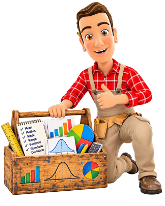{width="24%" fig-alt="Original graphic from slide 14"}

:::

<!-- Original slide 15 -->

::: {.source-slide #slide-15}

### Tables in Descriptive Statistics {#source-title-15}

```{=html}
<div class="source-text">
<p class="source-bullet source-level-0">Tables organize and display data in a structured format.</p>
<p class="source-bullet source-level-0">They are essential for summarizing large data sets efficiently.</p>
<p>Types of Tables in Statistics</p>
<p class="source-bullet source-level-0">Frequency Distribution Tables: Show how often each value in a set of data occurs.</p>
<p class="source-bullet source-level-0">Summary Tables: Provide key statistics like mean, median, mode, range, etc., at a glance.</p>
<p class="source-bullet source-level-0">Contingency Tables/Cross-tabulation: Display the multivariate frequency distribution for categorical data.</p>
<p>In the next section, we present tables examples using students dataset.</p>
</div>
```

:::

<!-- Original slide 16 -->

::: {.source-slide #slide-16}

### Introducing Students Dataset {#source-title-16}

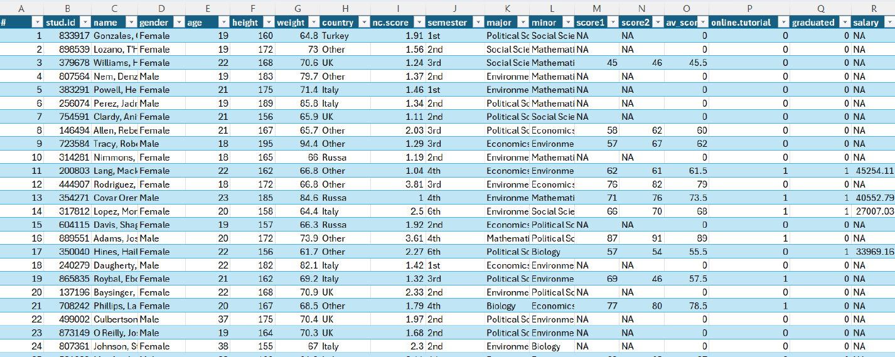{width="100%" fig-alt="Original graphic from slide 16"}

<!-- BEGIN TRY IN R 16 -->
:::: {.try-in-r #try-r-16}

#### Try this in R {.unlisted}

**Example 1: Import and inspect the student data**

```r
# read.csv() imports the supplied CSV; stringsAsFactors=FALSE keeps category labels as text.
# head() previews six rows; height is in cm, weight in kg, and age in years.
# Find the shared data folder from either the course root or this notebook folder.
data_dir <- if (dir.exists("data")) "data" else file.path("..", "data")
students <- read.csv(file.path(data_dir, "descriptive-statistics/students.csv"), stringsAsFactors = FALSE)
head(students)
```

[Open example 1 in the R practical](../practicals/descriptive-statistics-r-practical.html#import-and-inspect-the-student-data).

::::
<!-- END TRY IN R 16 -->

:::

<!-- Original slide 17 -->

::: {.source-slide #slide-17}

### Frequency Distribution Tables  {#source-title-17}

```{=html}
<div class="source-text">
<p>Used to show the distribution of data across different categories or intervals.</p>
<p>Frequency Types:</p>
<p class="source-bullet source-level-0">Absolute Frequency: The actual count of occurrences for each category.</p>
<p class="source-bullet source-level-0">Relative Frequency: The proportion of the total count represented by each category, often expressed as a percentage.</p>
<p class="source-bullet source-level-0">Cumulative Frequency: A running total of frequencies through the categories, showing the number of observations up to a certain category.</p>
</div>
```

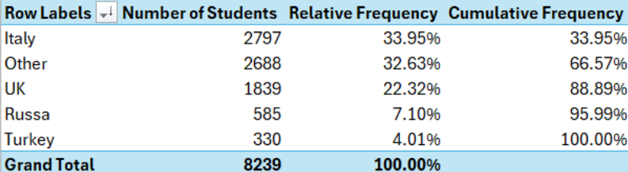{width="60%" fig-alt="Original graphic from slide 17"}

```{=html}
<div class="source-text">
<p><strong>Frequency of Students by Country</strong></p>
</div>
```

<!-- BEGIN TRY IN R 17 -->
:::: {.try-in-r #try-r-17}

#### Try this in R {.unlisted}

**Example 2: Frequency tables and percentages**

```r
# table() counts students in each country category; prop.table() divides by all counted students.
# Multiplying by 100 gives percentages; cumsum() is meaningful only when categories have an order.
country_counts <- table(students$country)
country_counts
100 * prop.table(country_counts)
```

[Open example 2 in the R practical](../practicals/descriptive-statistics-r-practical.html#frequency-tables-and-percentages).

::::
<!-- END TRY IN R 17 -->

:::

<!-- Original slide 18 -->

::: {.source-slide #slide-18}

### Converting Numerical Values into Categorical {#source-title-18}

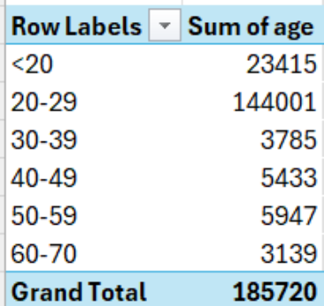{width="27%" fig-alt="Original graphic from slide 18"}

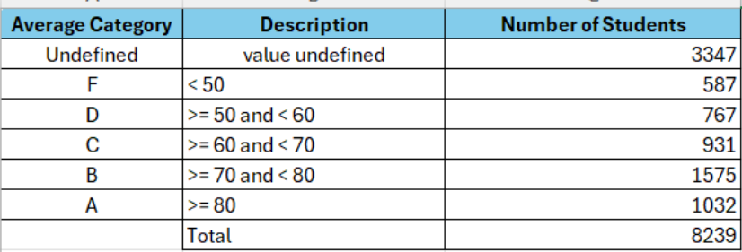{width="62%" fig-alt="Original graphic from slide 18"}

```{=html}
<div class="source-text">
<p><strong>Converting average into average groups</strong></p>
</div>
```

```{=html}
<div class="source-text">
<p><strong>Converting age into age groups</strong></p>
</div>
```

<!-- BEGIN TRY IN R 18 -->
:::: {.try-in-r #try-r-18}

#### Try this in R {.unlisted}

**Example 3: Group numerical values into intervals**

```r
# cut() converts ages in years into intervals; right=FALSE includes the lower boundary, not the upper.
# table() counts each interval; these explicitly chosen bands are an added R illustration.
age_groups <- cut(students$age, breaks = c(0, 20, 25, 30, Inf), right = FALSE)
table(age_groups)
```

[Open example 3 in the R practical](../practicals/descriptive-statistics-r-practical.html#group-numerical-values-into-intervals).

::::
<!-- END TRY IN R 18 -->

:::

<!-- Original slide 19 -->

::: {.source-slide #slide-19}

### Cross-tabulation or Contingency Tables {#source-title-19}

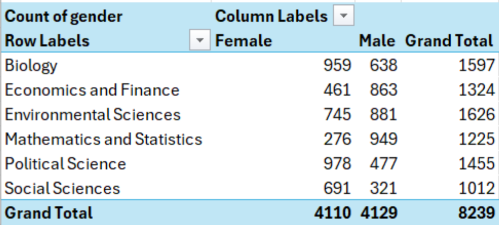{width="74%" fig-alt="Original graphic from slide 19"}

```{=html}
<div class="source-text">
<p>Used to show the <strong>relationship between two categorical variables</strong>.</p>
<p>Major by Gender in our example.</p>
</div>
```

<!-- BEGIN TRY IN R 19 -->
:::: {.try-in-r #try-r-19}

#### Try this in R {.unlisted}

**Example 4: Cross-tabulate two categorical variables**

```r
# xtabs() counts combinations: the formula ~ major + gender creates a two-way frequency table.
# addmargins() adds row and column totals without changing the underlying counts.
major_gender <- xtabs(~ major + gender, data = students)
addmargins(major_gender)
```

[Open example 4 in the R practical](../practicals/descriptive-statistics-r-practical.html#cross-tabulate-two-categorical-variables).

::::
<!-- END TRY IN R 19 -->

:::

<!-- Original slide 20 -->

::: {.source-slide #slide-20}

## Data Visualization {#source-title-20}

:::

<!-- Original slide 21 -->

::: {.source-slide #slide-21}

<span class="source-slide-number">21</span>

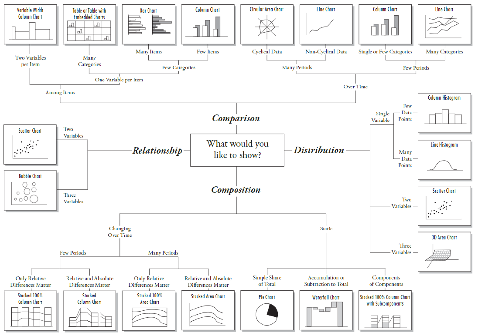{width="83%" fig-alt="Original graphic from slide 21"}

:::

<!-- Original slide 22 -->

::: {.source-slide #slide-22}

### Visualizing Qualitative Data {#source-title-22}

```{=html}
<div class="source-text">
<p>Bar Chart, Pie Chart, Pareto Plots, Side by Side Bars Chart</p>
</div>
```

:::

<!-- Original slide 23 -->

::: {.source-slide #slide-23}

### Bar Charts {#source-title-23}

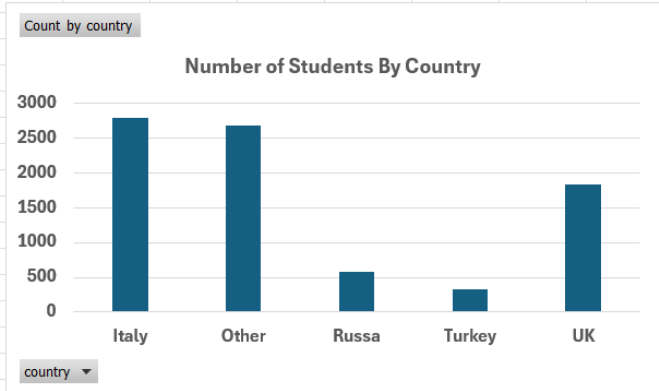{width="49%" fig-alt="Original graphic from slide 23"}

```{=html}
<div class="source-text">
<p class="source-bullet source-level-0">A bar chart is a type of chart that presents data in rectangular bars with lengths proportional to the values they represent. </p>
<p class="source-bullet source-level-0">Bar charts are commonly used to compare the magnitudes of different categories or groups of data.</p>
</div>
```

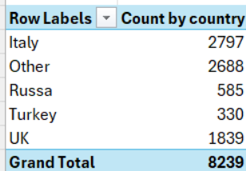{width="23%" fig-alt="Original graphic from slide 23"}

```{=html}
<div class="source-text">
<p>We need to construct a frequency table first.</p>
</div>
```

<!-- BEGIN TRY IN R 23 -->
:::: {.try-in-r #try-r-23}

#### Try this in R {.unlisted}

**Example 5: Bar chart of category frequencies**

```r
# barplot() draws a bar for each category count supplied by table().
# las=2 rotates country labels; ylab states that bar heights are numbers of students.
barplot(table(students$country), las = 2, col = "#356B8C", ylab = "Number of students")
```

[Open example 5 in the R practical](../practicals/descriptive-statistics-r-practical.html#bar-chart-of-category-frequencies).

::::
<!-- END TRY IN R 23 -->

:::

<!-- Original slide 24 -->

::: {.source-slide #slide-24}

### Pie Chart: Visualizing Proportions {#source-title-24}

```{=html}
<div class="source-text">
<p class="source-bullet source-level-0">A pie chart is a circular chart that is divided into segments to represent numerical proportions or percentages. </p>
<p class="source-bullet source-level-0">Each segment of the pie chart represents a different category or group, and the size of each segment is proportional to the value or percentage it represents.</p>
<p class="source-bullet source-level-0">Pie charts are commonly used to display data that can be divided into categories, such as market share, demographic distributions, or survey results. </p>
</div>
```

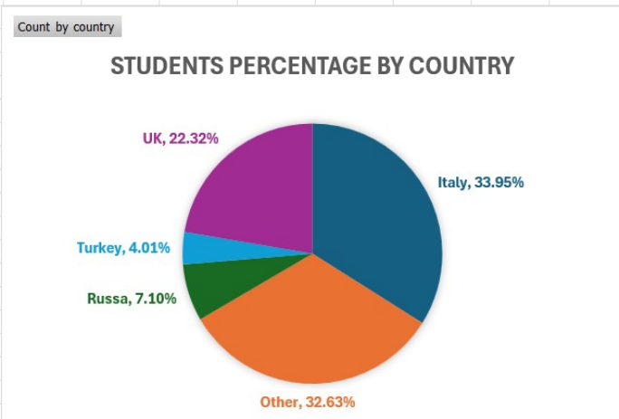{width="51%" fig-alt="Original graphic from slide 24"}

<!-- BEGIN TRY IN R 24 -->
:::: {.try-in-r #try-r-24}

#### Try this in R {.unlisted}

**Example 6: Pie chart of category shares**

```r
# pie() divides the circle according to the country counts computed by table().
# The denominator is all students with a recorded country category, including Other.
pie(table(students$country))
```

[Open example 6 in the R practical](../practicals/descriptive-statistics-r-practical.html#pie-chart-of-category-shares).

::::
<!-- END TRY IN R 24 -->

:::

<!-- Original slide 25 -->

::: {.source-slide #slide-25}

### Pareto Charts: Two Graphs in a Single Chart {#source-title-25}

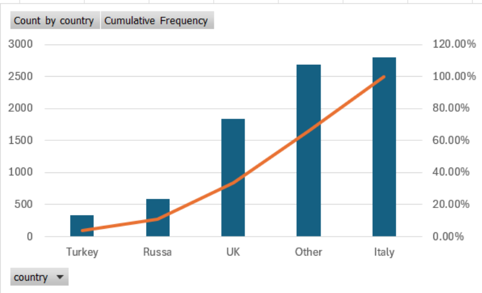{width="61%" fig-alt="Original graphic from slide 25"}

```{=html}
<div class="source-text">
<p class="source-bullet source-level-0">A Pareto chart is a type of chart that combines a bar graph with a line graph (Combo Chart).</p>
<p class="source-bullet source-level-0">It is used to display the relative frequency or size of different categories or groups, and to identify the most important factors affecting a particular outcome or result.</p>
</div>
```

:::

<!-- Original slide 26 -->

::: {.source-slide #slide-26}

### Side by Side Bar Charts: : Visualizing Two Variables {#source-title-26}

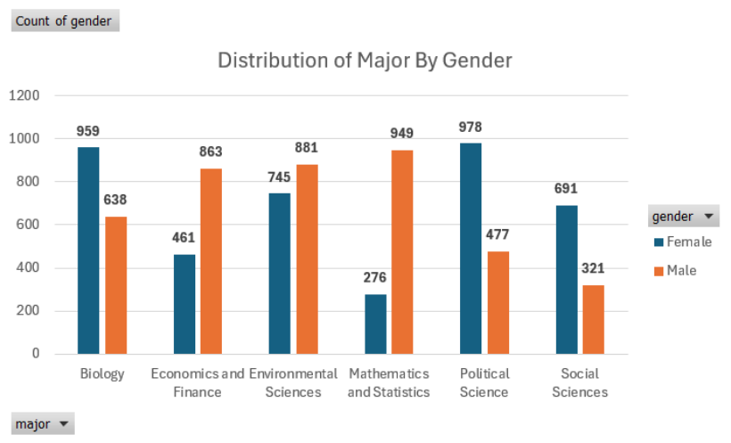{width="62%" fig-alt="Original graphic from slide 26"}

```{=html}
<div class="source-text">
<p class="source-bullet source-level-0">A side-by-side chart is used to compare two or more variables or categories. </p>
<p class="source-bullet source-level-0">The chart displays the data side-by-side in separate columns or bars, making it easy to compare the values of each variable or category.</p>
<p class="source-bullet source-level-0">Side-by-side chart allows viewers to quickly and easily compare the values of different variables and identify patterns or trends in the data. </p>
</div>
```

<!-- BEGIN TRY IN R 26 -->
:::: {.try-in-r #try-r-26}

#### Try this in R {.unlisted}

**Example 7: Grouped bars for two categorical variables**

```r
# table() cross-classifies gender and country; barplot(beside=TRUE) places gender bars side by side.
# legend.text=TRUE labels the groups; counts, rather than percentages, determine bar heights.
barplot(table(students$gender, students$country), beside = TRUE, legend.text = TRUE,
        col = c("#356B8C", "#C47735"), ylab = "Number of students", las = 2)
```

[Open example 7 in the R practical](../practicals/descriptive-statistics-r-practical.html#grouped-bars-for-two-categorical-variables).

::::
<!-- END TRY IN R 26 -->

:::

<!-- Original slide 27 -->

::: {.source-slide #slide-27}

### Visualizing Quantitative Data, Frequency Distributions and Histograms {#source-title-27}

:::

<!-- Original slide 28 -->

::: {.source-slide #slide-28}

### Histograms {#source-title-28}

```{=html}
<div class="source-text">
<p class="source-bullet source-level-0">Histograms provide a way to visualize the distribution of a numeric variable. </p>
<p class="source-bullet source-level-0">Histograms group numeric responses into bins and display the frequency of responses in each. </p>
<p class="source-bullet source-level-0">The x-axis of a histogram reflects the range of values of a numeric variable, while the y-axis can reflect either the frequencies (counts) or relative frequencies.</p>
</div>
```

<!-- BEGIN TRY IN R 28 -->
:::: {.try-in-r #try-r-28}

#### Try this in R {.unlisted}

**Example 8: Histogram of ages**

```r
# hist() groups ages into bins; breaks specifies yearly boundaries at half-year positions.
# freq=TRUE displays counts rather than probability density; recorded ages are measured in years.
hist(students$age, breaks = seq(min(students$age) - 0.5, max(students$age) + 0.5, by = 1),
     freq = TRUE, col = "#356B8C", main = "", xlab = "Age (years)")
```

[Open example 8 in the R practical](../practicals/descriptive-statistics-r-practical.html#histogram-of-ages).

::::
<!-- END TRY IN R 28 -->

:::

<!-- Original slide 29 -->

::: {.source-slide #slide-29}

### Histograms {#source-title-29}

```{=html}
<div class="source-text">
<p>Histograms tell us the following about our data:</p>
<p class="source-bullet source-level-1">Shape – what is the shape of the distribution?</p>
<p class="source-bullet source-level-1">Center – what is an “average” value?</p>
<p class="source-bullet source-level-1">Spread – how far away from the center do values tend to fall?</p>
<p class="source-bullet source-level-1">Unique features – are there any outliers?</p>
</div>
```

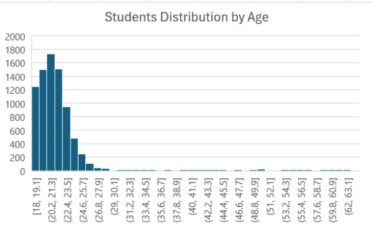{width="46%" fig-alt="Original graphic from slide 29"}

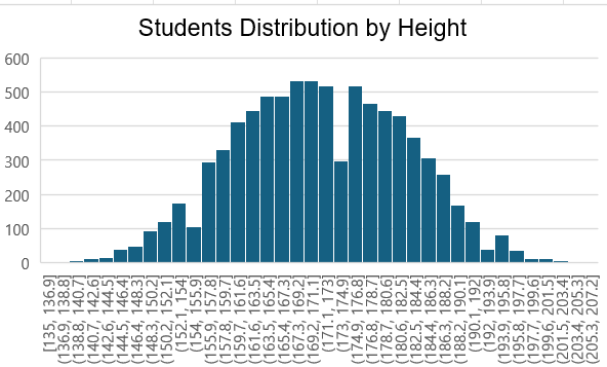{width="46%" fig-alt="Original graphic from slide 29"}

:::

<!-- Original slide 30 -->

::: {.source-slide #slide-30}

### Number of Modes {#source-title-30}

```{=html}
<div class="source-text">
<p class="source-bullet source-level-0">The first distinguishing feature apparent in a histogram is the number of modes, or, in the distribution. </p>
<p class="source-bullet source-level-0">A unimodal distribution only has one peak in the distribution, a bimodal distribution has two peaks, and a multimodal distribution has three or more peaks.</p>
</div>
```

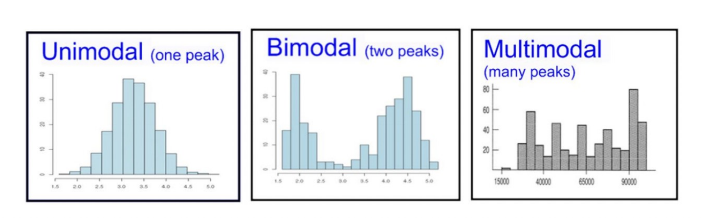{width="100%" fig-alt="Original graphic from slide 30"}

:::

<!-- Original slide 31 -->

::: {.source-slide #slide-31}

### Skewness {#source-title-31}

```{=html}
<div class="source-text">
<p class="source-bullet source-level-0">Histograms can show us if the data is skewed or symmetric. </p>
<p class="source-bullet source-level-0">Symmetric data should look nearly identical if folded in half at the center point of the distribution. </p>
<p class="source-bullet source-level-0">Skewed data indicates that there is a large portion of the data collected on one side of the chart and only a small portion on the other side. </p>
</div>
```

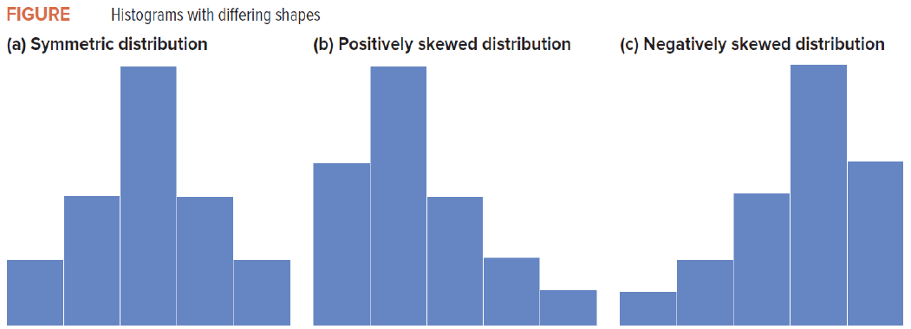{width="79%" fig-alt="Original graphic from slide 31"}

:::

<!-- Original slide 32 -->

::: {.source-slide #slide-32}

### Outliers {#source-title-32}

```{=html}
<div class="source-text">
<p class="source-bullet source-level-0">Outliers are responses that fall well away from the rest of the values.</p>
<p class="source-bullet source-level-0">Histograms can be useful in identifying outliers in our data.</p>
<p class="source-bullet source-level-0">Defining an observation as an outlier is subjective and should lead to an investigation of that value (not an automatic removal from the dataset).</p>
</div>
```

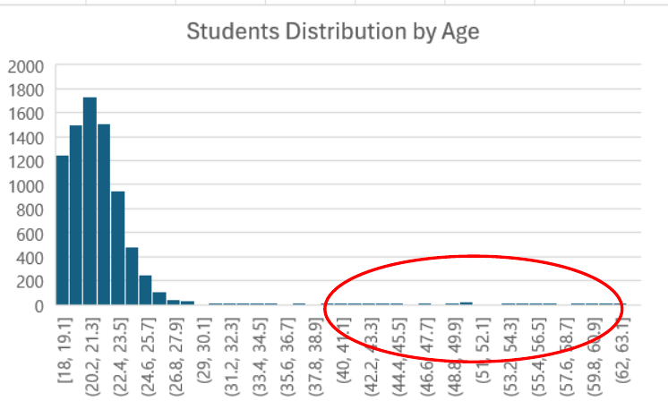{width="56%" fig-alt="Original graphic from slide 32"}

:::

<!-- Original slide 33 -->

::: {.source-slide #slide-33}

### Scotter Plots {#source-title-33}

```{=html}
<div class="source-text">
<p>Scatter plots can be used to examine of there is a relation between two variables.</p>
<p>Consider for instance, how:</p>
<p class="source-bullet source-level-0">Incomes vary with education.</p>
<p class="source-bullet source-level-0">Sales vary with advertising expenditures.</p>
<p class="source-bullet source-level-0">Stock prices vary with corporate profits.</p>
<p class="source-bullet source-level-0">Crop yields vary with the use of fertilizer.</p>
<p class="source-bullet source-level-0">Cholesterol levels vary with dietary intake.</p>
<p class="source-bullet source-level-0">Price varies with reliability.</p>
</div>
```

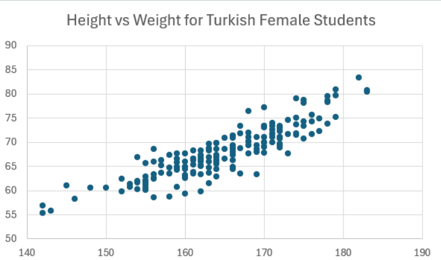{width="56%" fig-alt="Original graphic from slide 33"}

<!-- BEGIN TRY IN R 33 -->
:::: {.try-in-r #try-r-33}

#### Try this in R {.unlisted}

**Example 9: Scatterplot of height and weight**

```r
# plot(x,y) makes a scatterplot, with height on the horizontal axis and weight on the vertical.
# pch=16 uses filled points; no fitted line or causal relationship is assumed.
plot(students$height, students$weight, pch = 16, col = "#356B8C",
     xlab = "Height (cm)", ylab = "Weight (kg)")
```

[Open example 9 in the R practical](../practicals/descriptive-statistics-r-practical.html#scatterplot-of-height-and-weight).

::::
<!-- END TRY IN R 33 -->

:::

<!-- Original slide 34 -->

::: {.source-slide #slide-34}

### Relations between Two Variables {#source-title-34}

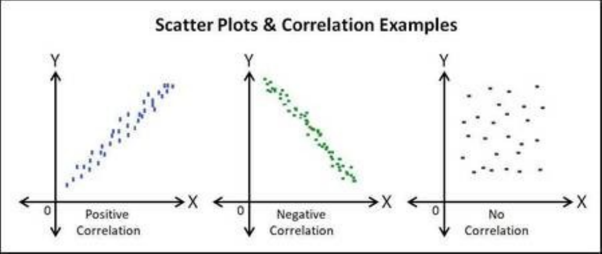{width="100%" fig-alt="Original graphic from slide 34"}

:::

<!-- Original slide 35 -->

::: {.source-slide #slide-35}

## Numerical Measures in Descriptive Statistics {#source-title-35}

:::

<!-- Original slide 36 -->

::: {.source-slide #slide-36}

### Numerical Measures in Descriptive Statistics {#source-title-36}

```{=html}
<div class="source-text">
<p class="source-bullet source-level-0">Numerical measures in descriptive statistics are used to summarize and describe the main features of a dataset through numbers. </p>
<p class="source-bullet source-level-0">These measures provide insights into the distribution, central tendency, dispersion, and shape of the data. </p>
<p class="source-bullet source-level-0">Understanding these measures helps in interpreting the data more effectively. </p>
<p>Examples</p>
<p class="source-bullet source-level-0">Rates in a Society (unemployment rate, crime rate, divorce rate).</p>
<p class="source-bullet source-level-0">Average Income, Maximum age, Minimum score…etc.</p>
</div>
```

:::

<!-- Original slide 37 -->

::: {.source-slide #slide-37}

### Measures of Central Location {#source-title-37}

```{=html}
<div class="source-text">
<p>Mean, Median and Mode</p>
</div>
```

:::

<!-- Original slide 38 -->

::: {.source-slide #slide-38}

### The Mean {#source-title-38}

```{=html}
<div class="source-text">
<p class="source-bullet source-level-0">The <strong>Arithmetic Mean </strong>is the primary measure of central location.</p>
<p class="source-bullet source-level-0">Generally, we refer to the arithmetic mean as simply the <strong>Mean </strong>or the <strong>Average</strong>. </p>
<p class="source-bullet source-level-0">In order to calculate the mean of a data set, we simply add up the observations and divide by the number of observations in the population or sample.</p>
<p class="source-bullet source-level-0"><strong>However, the mean is sensitive to </strong><strong>Outliers</strong><strong>. Consider the following sample dataset:</strong></p>
<p><strong>	</strong><strong>Data = ($1.00, $2.00, $3.00, $3.00, $3.00, $1.00, $100.00)</strong></p>
<p class="source-bullet source-level-0"><strong>Most of the data values are around $3, yet their average is </strong><strong>$16.14 </strong></p>
</div>
```

:::

<!-- Original slide 39 -->

::: {.source-slide #slide-39}

### The Median {#source-title-39}



:::

<!-- Original slide 40 -->

::: {.source-slide #slide-40}

### The Mode {#source-title-40}

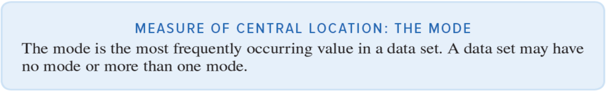{width="97%" fig-alt="Original graphic from slide 40"}

:::

<!-- Original slide 41 -->

::: {.source-slide #slide-41}

### Excel Functions for Measuring Central Location {#source-title-41}

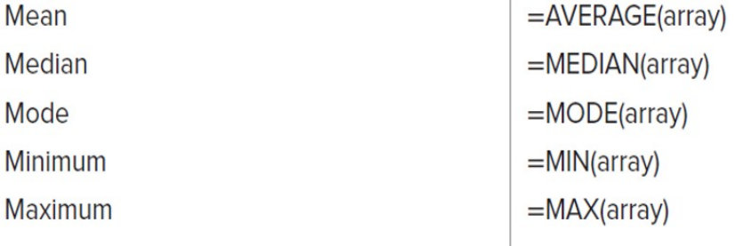{width="63%" fig-alt="Original graphic from slide 41"}

:::

<!-- Original slide 42 -->

::: {.source-slide #slide-42}

### Practical Exercise {#source-title-42}

```{=html}
<div class="source-text">
<p>Use the students.xlsx file:</p>
<p class="source-bullet source-level-0">Compare the Mean, Median for the “age” column for “Italy” and “Russa”.</p>
<p class="source-bullet source-level-0">Find the Mode “age” column for “UK”.</p>
<p>Note: In Excel you can filter out rows by converting a Range to a Table and using the filtering list in each header of a column.</p>
</div>
```

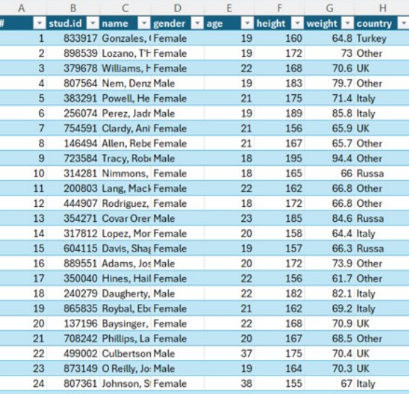{width="43%" fig-alt="Original graphic from slide 42"}

<!-- BEGIN TRY IN R 42 -->
:::: {.try-in-r #try-r-42}

#### Try this in R {.unlisted}

**Example 10: Mean, median and modes**

```r
# mean() and median() summarize ages; table() counts each recorded age to identify every tied mode.
# names() returns the ages whose counts equal max(), the greatest frequency.
mean(students$age)
median(students$age)
age_counts <- table(students$age)
names(age_counts)[age_counts == max(age_counts)]
```

[Open example 10 in the R practical](../practicals/descriptive-statistics-r-practical.html#mean-median-and-modes).

::::
<!-- END TRY IN R 42 -->

:::

<!-- Original slide 43 -->

::: {.source-slide #slide-43}

### Measures of Dispersion {#source-title-43}

```{=html}
<div class="source-text">
<p>Range, Mean Absolution Difference, Variance and Standard Deviation</p>
</div>
```

:::

<!-- Original slide 44 -->

::: {.source-slide #slide-44}

### Measures of Dispersion {#source-title-44}

```{=html}
<div class="source-text">
<p class="source-bullet source-level-0">Average alone is not sufficient to summarize and describe our data.</p>
<p class="source-bullet source-level-0">Consider the following 5 sample datasets.</p>
<p class="source-bullet source-level-0">Although the data values are very different, they all have the same average.</p>
</div>
```

```{=html}
<div class="source-table"><table><tr><td></td><td><p><strong>S1</strong></p></td><td><p><strong>S2</strong></p></td><td><p><strong>S3</strong></p></td><td><p><strong>S4</strong></p></td><td><p><strong>S5</strong></p></td></tr><tr><td></td><td><p>100</p></td><td><p>200</p></td><td><p>0</p></td><td><p>-600</p></td><td><p>-2000</p></td></tr><tr><td></td><td><p>200</p></td><td><p>200</p></td><td><p>600</p></td><td><p>600</p></td><td><p>2500</p></td></tr><tr><td></td><td><p>300</p></td><td><p>200</p></td><td><p>0</p></td><td><p>600</p></td><td><p>100</p></td></tr><tr><td></td><td></td><td></td><td></td><td></td><td></td></tr><tr><td><p><strong>Average</strong></p></td><td><p><strong>200.00</strong></p></td><td><p><strong>200.00</strong></p></td><td><p><strong>200.00</strong></p></td><td><p><strong>200.00</strong></p></td><td><p><strong>200.00</strong></p></td></tr></table></div>
```

:::

<!-- Original slide 45 -->

::: {.source-slide #slide-45}

### Measures of Dispersion – The Range {#source-title-45}

```{=html}
<div class="source-text">
<p class="source-bullet source-level-0">The <strong>Range </strong>is the simplest measure of dispersion, it is the difference between the maximum value and the minimum value in a data set:</p>
<p><em><strong>	</strong></em><em><strong>Range = Maximum Value – Minimum Value</strong></em></p>
<p class="source-bullet source-level-0">Going back to the previous sample datasets, we can see that they have the same average, but their ranges are very different.</p>
</div>
```

```{=html}
<div class="source-table"><table><tr><td></td><td><p><strong>S1</strong></p></td><td><p><strong>S2</strong></p></td><td><p><strong>S3</strong></p></td><td><p><strong>S4</strong></p></td><td><p><strong>S5</strong></p></td></tr><tr><td></td><td><p>100</p></td><td><p>200</p></td><td><p>0</p></td><td><p>-600</p></td><td><p>-2000</p></td></tr><tr><td></td><td><p>200</p></td><td><p>200</p></td><td><p>600</p></td><td><p>600</p></td><td><p>2500</p></td></tr><tr><td></td><td><p>300</p></td><td><p>200</p></td><td><p>0</p></td><td><p>600</p></td><td><p>100</p></td></tr><tr><td></td><td></td><td></td><td></td><td></td><td></td></tr><tr><td><p>Average</p></td><td><p>200.00</p></td><td><p>200.00</p></td><td><p>200.00</p></td><td><p>200.00</p></td><td><p>200.00</p></td></tr><tr><td><p><strong>Range</strong></p></td><td><p><strong>200.00</strong></p></td><td><p><strong>0.00</strong></p></td><td><p><strong>600.00</strong></p></td><td><p><strong>1200.00</strong></p></td><td><p><strong>4500.00</strong></p></td></tr></table></div>
```

```{=html}
<div class="source-text">
<p class="source-bullet source-level-0">Therefore, using the <strong>Range</strong> with the <strong>Average</strong> helped us to better describe and summarize our data (Better Understand Our Data).</p>
<p class="source-bullet source-level-0"><strong>However, the Range is sensitive to Outliers. Consider the following sample dataset:</strong></p>
<p>	Data = ($1.00, $2.00, $3.00, $3.00, $3.00, $1.00, $100.00)</p>
<p class="source-bullet source-level-0">Most of the data values are around $3, yet their Range is $99.00 </p>
</div>
```

:::

<!-- Original slide 46 -->

::: {.source-slide #slide-46}

### Measures of Dispersion - The Mean Absolute Deviation {#source-title-46}

```{=html}
<div class="source-text">
<p class="source-bullet source-level-0">A good measure of dispersion should consider differences of all observations from the mean. </p>
<p class="source-bullet source-level-0">If we simply average all differences from the mean, the positives and the negatives will cancel out, even though they both contribute to dispersion, and the resulting average will equal zero. </p>
<p class="source-bullet source-level-0">The <strong>mean absolute deviation </strong>(MAD) is an average of the absolute differences between the observations and the mean.</p>
</div>
```



:::

<!-- Original slide 47 -->

::: {.source-slide #slide-47}

### Measures of Dispersion - The Variance and the Standard Deviation {#source-title-47}

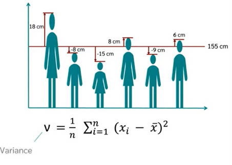{width="34%" fig-alt="Original graphic from slide 47"}

```{=html}
<div class="source-text">
<p class="source-bullet source-level-0">MAD weights large and small differences equally. </p>
<p class="source-bullet source-level-0">Better measures are the <strong>variance </strong>and the <strong>standard deviation.</strong></p>
<p class="source-bullet source-level-0">Instead of calculating the average of the absolute differences from the mean, as in MAD, we calculate the average of the squared differences from the mean.</p>
</div>
```

```{=html}
<div class="source-text">
<p class="source-bullet source-level-0">The squaring of differences from the mean emphasizes larger differences more than smaller ones.</p>
<p class="source-bullet source-level-0">The variance has squared units, therefore, to return the values to their original units of measurement, we compute the square root of the variance, which gives us the standard deviation.</p>
</div>
```



:::

<!-- Original slide 48 -->

::: {.source-slide #slide-48}

### Measures of Dispersion - The Variance and the Standard Deviation {#source-title-48}



:::

<!-- Original slide 49 -->

::: {.source-slide #slide-49}

### Excel Functions for Measuring Dispersion {#source-title-49}

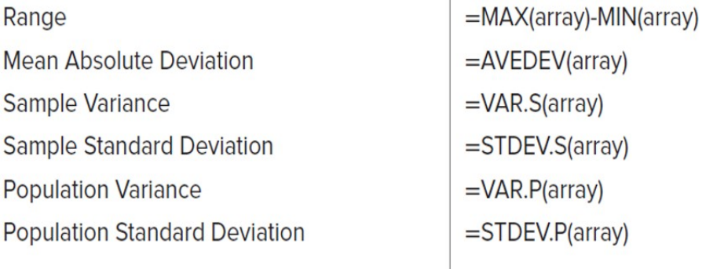{width="67%" fig-alt="Original graphic from slide 49"}

:::

<!-- Original slide 50 -->

::: {.source-slide #slide-50}

### Practical Exercise {#source-title-50}

```{=html}
<div class="source-text">
<p>Use the students.xlsx file to find the Range, MAD, Variance and Standard Deviation for the age column.</p>
<p>Note: In Excel you can filter out rows by converting a Range to a Table and using the filtering list in each header of a column.</p>
</div>
```

{width="43%" fig-alt="Original graphic from slide 50"}

<!-- BEGIN TRY IN R 50 -->
:::: {.try-in-r #try-r-50}

#### Try this in R {.unlisted}

**Example 11: Range, mean absolute deviation, variance and standard deviation**

```r
# diff(range()) gives maximum minus minimum; mean(abs()) calculates mean absolute deviation.
# var() and sd() use the sample denominator n-1; R's mad() instead computes median absolute deviation.
age <- students$age
c(range = diff(range(age)), mean_absolute_deviation = mean(abs(age - mean(age))),
  sample_variance = var(age), sample_standard_deviation = sd(age))
```

[Open example 11 in the R practical](../practicals/descriptive-statistics-r-practical.html#range-mean-absolute-deviation-variance-and-standard-deviation).

::::
<!-- END TRY IN R 50 -->

:::

<!-- Original slide 51 -->

::: {.source-slide #slide-51}

### Practical Exercise: using Excel’s data analysis tools option {#source-title-51}

```{=html}
<div class="source-text">
<p>Select: Data &gt; Data Analysis &gt; Descriptive Statistics &gt; OK.</p>
</div>
```

{width="56%" fig-alt="Original graphic from slide 51"}

:::

<!-- Original slide 52 -->

::: {.source-slide #slide-52}

### The Coefficient of Variation {#source-title-52}

:::

<!-- Original slide 53 -->

::: {.source-slide #slide-53}

### The Coefficient of Variation {#source-title-53}

```{=html}
<div class="source-text">
<p class="source-bullet source-level-0">In some instances, we need to compare the variability of two or more data sets that have different means or different units of measurement.</p>
<p class="source-bullet source-level-0">Consider the following example:</p>
<p class="source-bullet source-level-0">Both datasets have the same absolute spread: their sample standard deviations are equal. To compare spread relative to their different means, use the coefficient of variation.</p>
</div>
```

```{=html}
<div class="source-table"><table><tr><td></td><td><p><strong>DS1</strong></p></td><td><p><strong>DS2</strong></p></td></tr><tr><td></td><td><p>$10</p></td><td><p>$1010</p></td></tr><tr><td></td><td><p>$20</p></td><td><p>$1020</p></td></tr><tr><td></td><td><p>$30</p></td><td><p>$1030</p></td></tr><tr><td></td><td><p>$40</p></td><td><p>$1040</p></td></tr><tr><td></td><td><p>$50</p></td><td><p>$1050</p></td></tr><tr><td><p><strong>Average</strong></p></td><td><p><strong>$30</strong></p></td><td><p><strong>$1030</strong></p></td></tr><tr><td><p><strong>Sample Standard Deviation</strong></p></td><td><p><strong>15.81</strong></p></td><td><p><strong>15.81</strong></p></td></tr></table></div>
```

:::

<!-- Original slide 54 -->

::: {.source-slide #slide-54}

### The Coefficient of Variation {#source-title-54}

```{=html}
<div class="source-text">
<p class="source-bullet source-level-0">For such cases, we can use the Coefficient of Variation Measure which serves as a relative measure of dispersion. </p>
<p class="source-bullet source-level-0">It can be calculated by dividing a data set’s standard deviation by its mean:</p>
<p class="source-bullet source-level-0">When comparing two datasets, the dataset that have larger coefficient of variation indicates that its values varies more than the other dataset. Therefore, it is less stable or less uniform.</p>
</div>
```



:::

<!-- Original slide 55 -->

::: {.source-slide #slide-55}

### The Coefficient of Variation {#source-title-55}

```{=html}
<div class="source-text">
<p class="source-bullet source-level-0">Going back to the previous example, we can calculate the coefficient of variation for both sets to help us in determining which dataset has more variability in its values.</p>
<p class="source-bullet source-level-0">DS1 has greater relative variability than DS2: its standard deviation is larger as a proportion of its mean. Their absolute standard deviations remain equal.</p>
</div>
```

```{=html}
<div class="source-table"><table><tr><td></td><td><p><strong>DS1</strong></p></td><td><p><strong>DS2</strong></p></td></tr><tr><td></td><td><p>$10</p></td><td><p>$1010</p></td></tr><tr><td></td><td><p>$20</p></td><td><p>$1020</p></td></tr><tr><td></td><td><p>$30</p></td><td><p>$1030</p></td></tr><tr><td></td><td><p>$40</p></td><td><p>$1040</p></td></tr><tr><td></td><td><p>$50</p></td><td><p>$1050</p></td></tr><tr><td><p><strong>Average</strong></p></td><td><p><strong>$30</strong></p></td><td><p><strong>$1030</strong></p></td></tr><tr><td><p><strong>Sample Standard Deviation</strong></p></td><td><p><strong>$15.81</strong></p></td><td><p><strong>$15.81</strong></p></td></tr><tr><td><p><strong>CV (ratio)</strong></p></td><td><p><strong>0.5270</strong></p></td><td><p><strong>0.01535</strong></p></td></tr></table></div>
```

**As percentages:** DS1 = **52.70%**; DS2 = **1.54%**. These calculations use the unrounded sample standard deviation.

<!-- BEGIN TRY IN R 55 -->
:::: {.try-in-r #try-r-55}

#### Try this in R {.unlisted}

**Example 12: Coefficient of variation**

```r
# c() creates the exact two datasets shown in the original table; sd() uses the sample denominator n-1.
# sd()/mean() expresses CV as a ratio, without multiplying by 100; these means are positive.
DS1 <- c(10, 20, 30, 40, 50)
DS2 <- c(1010, 1020, 1030, 1040, 1050)
c(DS1 = sd(DS1) / mean(DS1), DS2 = sd(DS2) / mean(DS2))
```

[Open example 12 in the R practical](../practicals/descriptive-statistics-r-practical.html#coefficient-of-variation).

::::
<!-- END TRY IN R 55 -->

:::

<!-- Original slide 56 -->

::: {.source-slide #slide-56}

### Coefficient of Variation Uses in Finance {#source-title-56}

```{=html}
<div class="source-text">
<p class="source-bullet source-level-0">In finance, the coefficient of variation is used to measure the risk per unit of return. </p>
<p class="source-bullet source-level-0">For example, assume that the average monthly return on stock A is 2980 with a standard deviation of 111.06, and the average monthly return on stock B is 9.8 with a standard deviation of 1.3</p>
<p class="source-bullet source-level-0">We can use the coefficient of variation to determine which stock is more stable:</p>
</div>
```



:::

<!-- Original slide 57 -->

::: {.source-slide #slide-57}

## Measures of Association {#source-title-57}

```{=html}
<div class="source-text">
<p>Covariance and Coefficient of Correlation</p>
</div>
```

:::

<!-- Original slide 58 -->

::: {.source-slide #slide-58}

### Measures of Association {#source-title-58}

```{=html}
<div class="source-text">
<p class="source-bullet source-level-0">We previously introduced the idea of a scatter plots to visually assess whether two variables had some type of linear relationship.</p>
<p class="source-bullet source-level-0">In this section, we present two numerical measures of association that quantify the direction and strength of the linear relationship between two variables, x and y.</p>
<p class="source-bullet source-level-0">These two numerical values are the Covariance and the Correlation.</p>
</div>
```

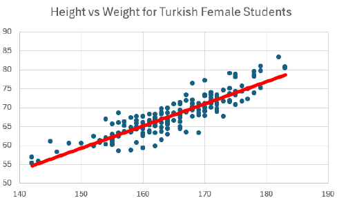{width="37%" fig-alt="Original graphic from slide 58"}

```{=html}
<div class="source-text">
<p>Note: Covariance and Correlation works when the relation between the two variables is LINEAR.</p>
</div>
```

:::

<!-- Original slide 59 -->

::: {.source-slide #slide-59}

### Covariance {#source-title-59}

```{=html}
<div class="source-text">
<p class="source-bullet source-level-0">Covariance measures the joint variability of two random variables.</p>
<p class="source-bullet source-level-0">Indicates the direction of the linear relationship between variables.</p>
</div>
```

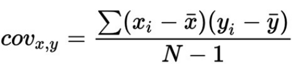{width="37%" fig-alt="Original graphic from slide 59"}

```{=html}
<div class="source-text">
<p class="source-bullet source-level-0">Positive Covariance: X and Y move in the same direction.</p>
<p class="source-bullet source-level-0">Negative Covariance: X and Y move in opposite directions.</p>
<p class="source-bullet source-level-0">Zero Covariance: No linear relationship between X and Y.</p>
</div>
```

::: {.covariance-examples}

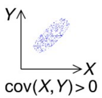{width="100%" fig-alt="Original graphic from slide 59"}

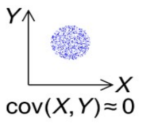{width="100%" fig-alt="Original graphic from slide 59"}

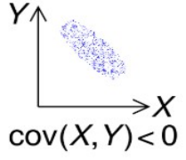{width="100%" fig-alt="Original graphic from slide 59"}

:::

:::

<!-- Original slide 60 -->

::: {.source-slide #slide-60}

### Limitations of Covariance {#source-title-60}

```{=html}
<div class="source-text">
<p>Covariance is sensitive to the units of X and Y.</p>
<p>Changing units changes the covariance value, making direct comparisons difficult.</p>
</div>
```

```{=html}
<div class="source-table"><table><tr><td></td><td><p>Height m</p></td><td><p>Height cm</p></td><td><p>Weight KG</p></td></tr><tr><td></td><td><p>1.6</p></td><td><p>160</p></td><td><p>55</p></td></tr><tr><td></td><td><p>1.7</p></td><td><p>170</p></td><td><p>68</p></td></tr><tr><td></td><td><p>1.8</p></td><td><p>180</p></td><td><p>74</p></td></tr><tr><td><p><strong>Covariance</strong></p></td><td><p><strong>.95</strong></p></td><td><p><strong>95</strong></p></td><td><p>Which one is bigger?</p></td></tr><tr><td><p><strong>Correlation</strong></p></td><td><p><strong>.98</strong></p></td><td><p><strong>.98</strong></p></td><td></td></tr></table></div>
```

:::

<!-- Original slide 61 -->

::: {.source-slide #slide-61}

### The Correlation Coefficient {#source-title-61}

```{=html}
<div class="source-text">
<p class="source-bullet source-level-0">Correlation coefficient can be used to determine the Direction and the Strength of a relationship between two numerical variables.</p>
<p class="source-bullet source-level-0">The correlation coefficient is a dimensionless metric and its value ranges from -1 to +1. </p>
<p class="source-bullet source-level-0">The closer it is to +1 or -1, the more closely the two variables are related. </p>
</div>
```

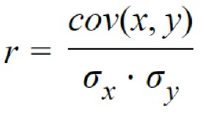{width="18%" fig-alt="Original graphic from slide 61"}

```{=html}
<div class="source-text">
<p class="source-bullet source-level-0">Correlation Formula</p>
</div>
```

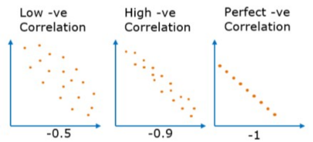{width="46%" fig-alt="Original graphic from slide 61"}

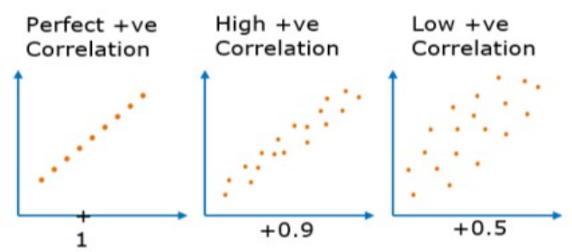{width="48%" fig-alt="Original graphic from slide 61"}

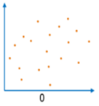{.zero-correlation-plot fig-alt="Original graphic from slide 61"}

:::

<!-- Original slide 62 -->

::: {.source-slide #slide-62}

### Differences between Covariance and Correlation {#source-title-62}

```{=html}
<div class="source-table"><table><tr><td><p>Covariance</p></td><td><p>Correlation</p></td></tr><tr><td><p>Covariance indicates the direction of the linear relationship between variables.</p></td><td><p>Correlation measures both the strength and the direction of the linear relationship between two variables.</p></td></tr><tr><td><p>Covariance value can vary between -∞ and +∞</p></td><td><p>Correlation value ranges between -1 and +1</p></td></tr><tr><td><p>Covariance unit is based on the product of the units of the two variables.</p></td><td><p>Correlation is dimensionless, i.e. It’s a unit-free measure of the relationship between variables.</p></td></tr></table></div>
```

:::

<!-- Original slide 63 -->

::: {.source-slide #slide-63}

### Practical Exercise {#source-title-63}

```{=html}
<div class="source-text">
<p>Use the students.xlsx file:</p>
<p class="source-bullet source-level-0">Compute the covariance and correlation between heights and weights of the students.</p>
<p class="source-bullet source-level-0">Compute the covariance and correlation between heights and ages of the students.</p>
</div>
```

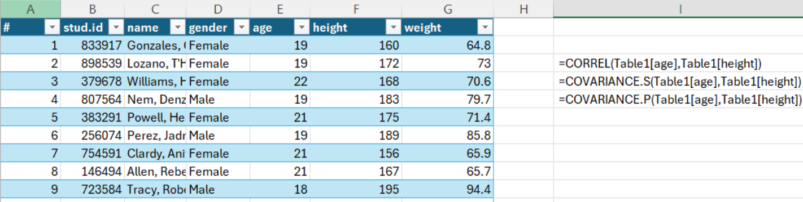{width="100%" fig-alt="Original graphic from slide 63"}

<!-- BEGIN TRY IN R 63 -->
:::: {.try-in-r #try-r-63}

#### Try this in R {.unlisted}

**Example 13: Covariance and Pearson correlation**

```r
# cov() calculates sample covariance and cor() calculates Pearson's linear correlation by default.
# use="complete.obs" omits pairs with missing values; units remain cm, kg, and years.
cov(students$height, students$weight, use = "complete.obs")
cor(students$height, students$weight, use = "complete.obs")
cov(students$height, students$age, use = "complete.obs")
cor(students$height, students$age, use = "complete.obs")
```

[Open example 13 in the R practical](../practicals/descriptive-statistics-r-practical.html#covariance-and-pearson-correlation).

::::
<!-- END TRY IN R 63 -->

:::

<!-- Original slide 64 -->

::: {.source-slide #slide-64}

### Practical Exercise {#source-title-64}

```{=html}
<div class="source-text">
<p>We can also use the Data Analysis add-in for this purpose.</p>
</div>
```

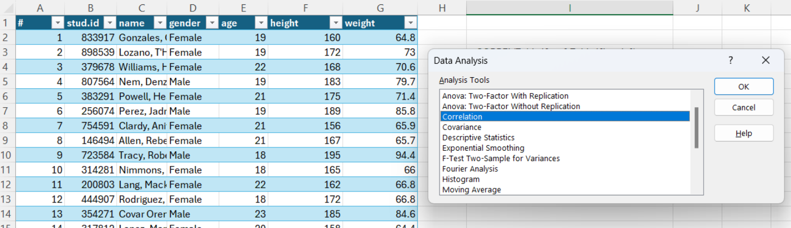{width="100%" fig-alt="Original graphic from slide 64"}

:::

<!-- Original slide 65 -->

::: {.source-slide #slide-65}

## Measures of Distribution {#source-title-65}

```{=html}
<div class="source-text">
<p>Symmetry and Skewness</p>
</div>
```

:::

<!-- Original slide 66 -->

::: {.source-slide #slide-66}

### Skewness {#source-title-66}

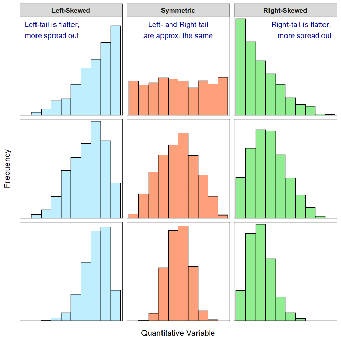{width="50%" fig-alt="Original graphic from slide 66"}

```{=html}
<div class="source-text">
<p class="source-bullet source-level-0"><strong>Definition</strong>: Skewness is a measure of the asymmetry of the probability distribution of a real-valued random variable about its mean.</p>
<p class="source-bullet source-level-0"><strong>Key Point</strong>: Indicates whether the data are spread out more to one side of the mean.</p>
<p class="source-bullet source-level-0"><strong>Positive Skewness (Right-skewed): Tail is longer on the right side of the distribution. Mean is greater than the median.</strong></p>
<p class="source-bullet source-level-0"><strong>Negative Skewness (Left-skewed</strong>): Tail is longer on the left side of the distribution. Mean is less than the median.</p>
<p class="source-bullet source-level-0">Symmetrical Distribution: Skewness is around 0, indicating no skew.</p>
<p class="source-bullet source-level-0">Use histograms or density plots to illustrate examples of positively skewed, negatively skewed, and symmetrical distributions.</p>
</div>
```

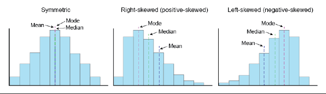{width="100%" fig-alt="Original graphic from slide 66"}

:::

<!-- Original slide 67 -->

::: {.source-slide #slide-67}

### Skewness Coefficient {#source-title-67}

```{=html}
<div class="source-text">
<p class="source-bullet source-level-0">A positive skewness coefficient implies that extreme values are concentrated in the right tail of the distribution, pulling the mean up, relative to the median and the bulk of values lie to the left of the mean. </p>
<p class="source-bullet source-level-0">Similarly, a negative skewness coefficient implies that extreme values are concentrated in the left tail of the distribution, pulling the mean down, relative to the median, and the bulk of values lie to the right of the mean. </p>
</div>
```

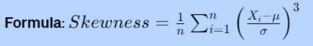{width="39%" fig-alt="Original graphic from slide 67"}

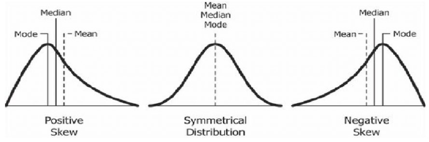{width="64%" fig-alt="Original graphic from slide 67"}

```{=html}
<div class="source-text">
<p class="source-bullet source-level-0"><strong>A skewness value greater than 1 or less than -1 indicates a highly skewed distribution. </strong></p>
<p class="source-bullet source-level-0"><strong>A value between 0.5 and 1 or -0.5 and -1 is moderately skewed. </strong></p>
<p class="source-bullet source-level-0"><strong>A value between -0.5 and 0.5 indicates that the distribution is fairly symmetrical.</strong></p>
<p class="source-bullet source-level-0"><strong>A skewness coefficient of zero indicates that the values are evenly distributed on both sides of the mean. </strong></p>
</div>
```

:::

<!-- Original slide 68 -->

::: {.source-slide #slide-68}

### Practical Example {#source-title-68}

```{=html}
<div class="source-text">
<p class="source-bullet source-level-0">Using the students.xlsx file, find the Skewness value for the “age” column.</p>
<p class="source-bullet source-level-0">You can use Excel’s skew() function to calculate the skewness for a sample, and the skew.p() function to calculate the skewness for a population.</p>
</div>
```

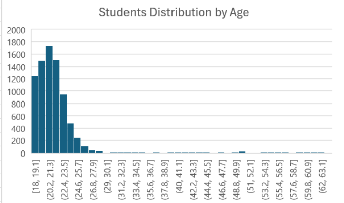{width="51%" fig-alt="Original graphic from slide 68"}

<!-- BEGIN TRY IN R 68 -->
:::: {.try-in-r #try-r-68}

#### Try this in R {.unlisted}

**Example 14: Adjusted sample skewness**

```r
# length() supplies n; sum() adds cubed standardized deviations, using sample sd() with n-1.
# n/((n-1)*(n-2)) gives adjusted sample skewness, corresponding to Excel SKEW for n>2.
age <- students$age
n <- length(age)
n / ((n - 1) * (n - 2)) * sum(((age - mean(age)) / sd(age))^3)
```

[Open example 14 in the R practical](../practicals/descriptive-statistics-r-practical.html#adjusted-sample-skewness).

::::
<!-- END TRY IN R 68 -->

:::

<!-- Original slide 69 -->

::: {.source-slide #slide-69}

### Practical Exercise: using Excel’s data analysis tools option {#source-title-69}

```{=html}
<div class="source-text">
<p>Select: Data &gt; Data Analysis &gt; Descriptive Statistics &gt; OK.</p>
</div>
```

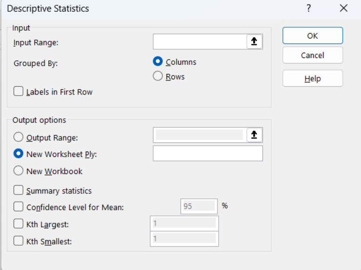{width="56%" fig-alt="Original graphic from slide 69"}

:::

<!-- Original slide 70 -->

::: {.source-slide #slide-70}

## Percentiles, Quartiles and Boxplots {#source-title-70}

:::

<!-- Original slide 71 -->

::: {.source-slide #slide-71}

### Percentiles {#source-title-71}

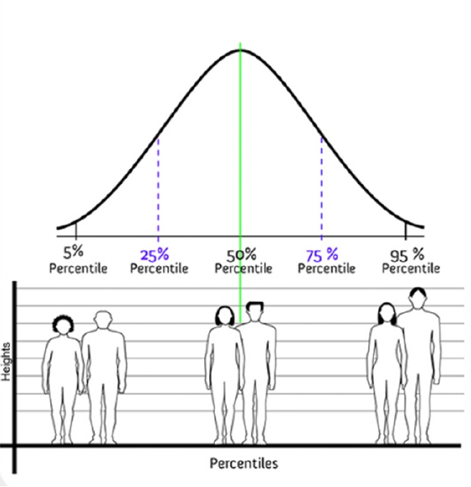{width="50%" fig-alt="Original graphic from slide 71"}

```{=html}
<div class="source-text">
<p class="source-bullet source-level-0">A <strong>percentile</strong> is a measure that helps us understand the position or relative standing of a particular value within a dataset. </p>
<p class="source-bullet source-level-0">Percentiles help us divide the data into equal-sized groups and determine the position of a value within those groups.</p>
<p class="source-bullet source-level-0">For example, if someone&#x27;s score is at the 80th percentile, it means they performed better than 80% of the people in the dataset.</p>
<p class="source-bullet source-level-0">Percentiles provide insights into how a specific value compares to others, allowing us to assess performance, rankings, or distributions. </p>
<p class="source-bullet source-level-0">They are commonly used in various fields, such as education, healthcare, and finance, to understand and communicate data in a meaningful way.</p>
</div>
```

:::

<!-- Original slide 72 -->

::: {.source-slide #slide-72}

### Practical Exercise {#source-title-72}

```{=html}
<div class="source-text">
<p class="source-bullet source-level-0">Using the students.xlsx file, find the 90% Percentile value for the “height” column.</p>
<p class="source-bullet source-level-0">You can use percentile.inc or percentile.exc to compute percentiles in Excel.</p>
</div>
```

{width="43%" fig-alt="Original graphic from slide 72"}

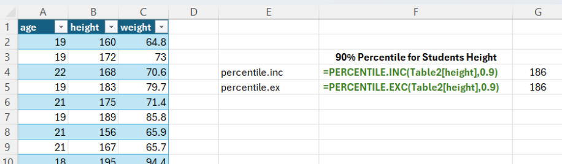{width="69%" fig-alt="Original graphic from slide 72"}

<!-- BEGIN TRY IN R 72 -->
:::: {.try-in-r #try-r-72}

#### Try this in R {.unlisted}

**Example 15: The 90th percentile**

```r
# quantile() finds the requested percentile; probs=0.90 means the 90th percentile of height in cm.
# type=7 matches Excel PERCENTILE.INC; type=6 matches PERCENTILE.EXC for this sample and probability.
quantile(students$height, probs = 0.90, type = 7)
quantile(students$height, probs = 0.90, type = 6)
```

[Open example 15 in the R practical](../practicals/descriptive-statistics-r-practical.html#the-90th-percentile).

::::
<!-- END TRY IN R 72 -->

:::

<!-- Original slide 73 -->

::: {.source-slide #slide-73}

### Quartiles {#source-title-73}

```{=html}
<div class="source-text">
<p>A Quartile divides a sorted data set into 4 equal parts, so that each part represents ¼ of the data set.</p>
</div>
```

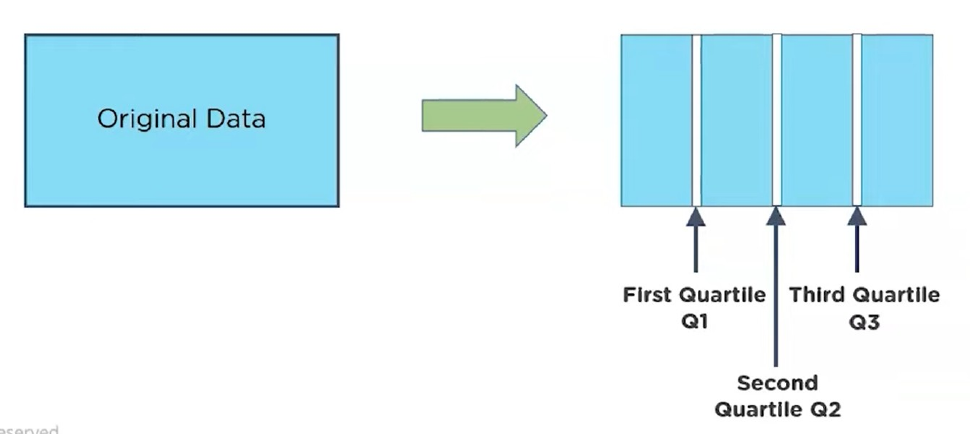{width="73%" fig-alt="Original graphic from slide 73"}

:::

<!-- Original slide 74 -->

::: {.source-slide #slide-74}

### Practical Exercise {#source-title-74}

```{=html}
<div class="source-text">
<p class="source-bullet source-level-0">Using the students.xlsx file, find the 1<sup>st</sup> and the 2<sup>nd</sup> quartiles for the “height” column.</p>
<p class="source-bullet source-level-0">You can use quartile.inc or quartile.exc to compute percentiles in Excel.</p>
</div>
```

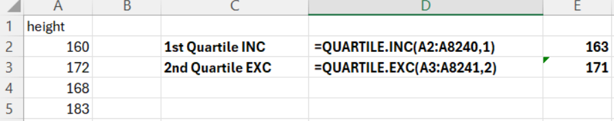{width="67%" fig-alt="Original graphic from slide 74"}

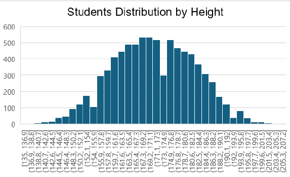{width="43%" fig-alt="Original graphic from slide 74"}

<!-- BEGIN TRY IN R 74 -->
:::: {.try-in-r #try-r-74}

#### Try this in R {.unlisted}

**Example 16: First and second quartiles**

```r
# quantile(probs=c(0.25,0.50)) returns the first and second quartiles of height in cm.
# type=7 uses Excel's inclusive convention; type=6 uses its exclusive convention for these probabilities.
quantile(students$height, probs = c(0.25, 0.50), type = 7)
quantile(students$height, probs = c(0.25, 0.50), type = 6)
```

[Open example 16 in the R practical](../practicals/descriptive-statistics-r-practical.html#first-and-second-quartiles).

::::
<!-- END TRY IN R 74 -->

:::

<!-- Original slide 75 -->

::: {.source-slide #slide-75}

### Boxplots – Box and Whiskers Plots {#source-title-75}

```{=html}
<div class="source-text">
<p class="source-bullet source-level-0">A boxplot (box-and-whisker plot) is a standardized way of displaying the distribution of data based on a five number summary. </p>
<p class="source-bullet source-level-0">The five number summary include the minimum value (Min), quartiles (Q1, Q2, and Q3), and the maximum value (Max).</p>
<p class="source-bullet source-level-0">Boxplots are useful in showing us the range and the skewness of our data as well as outliers.</p>
</div>
```

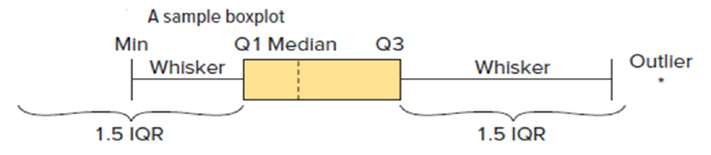{width="79%" fig-alt="Original graphic from slide 75"}

:::

<!-- Original slide 76 -->

::: {.source-slide #slide-76}

### Practical Exercise {#source-title-76}

```{=html}
<div class="source-text">
<p>Use the students.xlsx file:</p>
<p class="source-bullet source-level-0">Create a box plot that compares the height of male students vs female students.</p>
<p class="source-bullet source-level-0">Create a box plot that compares the height of Turkish male students vs Russian male students.</p>
</div>
```

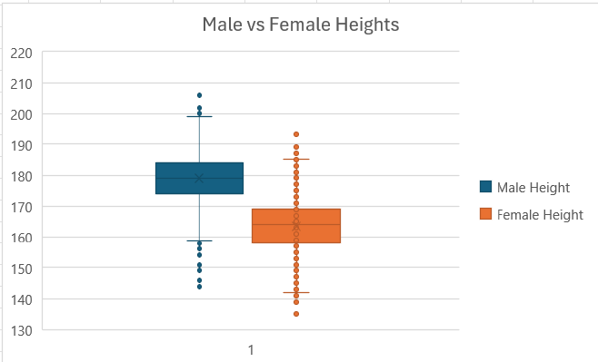{width="49%" fig-alt="Original graphic from slide 76"}

<!-- BEGIN TRY IN R 76 -->
:::: {.try-in-r #try-r-76}

#### Try this in R {.unlisted}

**Example 17: Boxplots and group comparisons**

```r
# boxplot(height~gender) compares groups; whiskers extend to the last data within 1.5 IQR of the hinges.
# subset() selects Turkish/Russian males; R's default boxplot hinges can differ from type-7 quartiles.
boxplot(height ~ gender, data = students, ylab = "Height (cm)", col = "#D4D4D4")
# The source spells Russia as "Russa"; match that original label without changing the data.
males <- subset(students, gender == "Male" & country %in% c("Turkey", "Russa"))
boxplot(height ~ country, data = males, ylab = "Height (cm)", col = "#D4D4D4")
```

[Open example 17 in the R practical](../practicals/descriptive-statistics-r-practical.html#boxplots-and-group-comparisons).

::::
<!-- END TRY IN R 76 -->

:::

<!-- Original slide 77 -->

::: {.source-slide #slide-77}

### Outliers {#source-title-77}

```{=html}
<div class="source-text">
<p class="source-bullet source-level-0">An outlier is an observation that lies an abnormal distance from other values in a random sample from a population. </p>
<p class="source-bullet source-level-0">We can identify potential outliers using Histograms, scatter plots, boxplots…etc.</p>
</div>
```

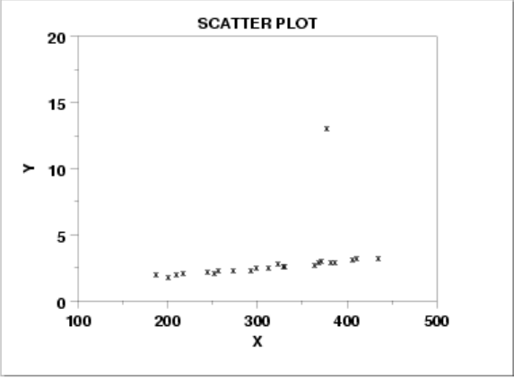{width="43%" fig-alt="Original graphic from slide 77"}

{width="38%" fig-alt="Original graphic from slide 77"}

{width="28%" fig-alt="Original graphic from slide 77"}

:::

<!-- Original slide 78 -->

::: {.source-slide #slide-78}

### The Interquartile Range (IQR) {#source-title-78}

```{=html}
<div class="source-text">
<p class="source-bullet source-level-0">The IQR is like the range, and it shows how the data is spread about the median. </p>
<p class="source-bullet source-level-0">It is less susceptible than the range to outliers and can, therefore, be more helpful.</p>
<p class="source-bullet source-level-0">The IQR is calculated according to the following formula:</p>
<p>	IQR = Q3 – Q1.</p>
</div>
```

:::

<!-- Original slide 79 -->

::: {.source-slide #slide-79}

### Using the IQR to Find Outliers {#source-title-79}

```{=html}
<div class="source-text">
<p>Using the IQR to find potential outliers:</p>
<p class="source-bullet source-level-1">Calculate the IQR for the data.</p>
<p class="source-bullet source-level-1">Multiply the interquartile range (IQR) by 1.5 (a constant used to discern outliers).</p>
<p class="source-bullet source-level-1">Add the (1.5 x (IQR)) to the third quartile, any number greater than this is a suspected outlier.</p>
<p class="source-bullet source-level-1">Subtract the (1.5 x (IQR)) from the first quartile, any number less than this is a suspected outlier.</p>
<p>However, any potential outlier obtained by the interquartile method should be examined in the context of the entire set of data. </p>
<p>We should always follow up our outlier analysis by studying the resulting outliers to see if they make sense. </p>
</div>
```

{width="84%" fig-alt="Original graphic from slide 79"}

<!-- BEGIN TRY IN R 79 -->
:::: {.try-in-r #try-r-79}

#### Try this in R {.unlisted}

**Example 18: Use IQR fences to flag potential outliers**

```r
# quantile(type=7) supplies inclusive quartiles; the 1.5-IQR fences flag values for investigation.
# sum() counts TRUE flags and does not remove observations; these age fences are measured in years.
q <- quantile(students$age, probs = c(0.25, 0.75), type = 7)
iqr <- q[2] - q[1]
lower <- q[1] - 1.5 * iqr
upper <- q[2] + 1.5 * iqr
c(lower_fence = unname(lower), upper_fence = unname(upper))
sum(students$age < lower | students$age > upper)
```

[Open example 18 in the R practical](../practicals/descriptive-statistics-r-practical.html#use-iqr-fences-to-flag-potential-outliers).

::::
<!-- END TRY IN R 79 -->

:::

<!-- Original slide 80 -->

::: {.source-slide #slide-80}

### Outliers {#source-title-80}

:::

<!-- Original slide 81 -->

::: {.source-slide #slide-81}

### Impacts of Outliers {#source-title-81}

```{=html}
<div class="source-text">
<p><strong>1. Negative Impacts</strong></p>
<p class="source-bullet source-level-0">Influence on Measures of Central Tendency: A single extreme outlier can pull the mean in its direction, making it unrepresentative of the majority of the data.</p>
<p class="source-bullet source-level-0">Impact on Dispersion Measures: The presence of outliers can inflate the measures like the standard deviation and the interquartile range (IQR), making them larger than they would be without outliers.</p>
<p class="source-bullet source-level-0">Skewing Data Distributions: Positive outliers can result in right-skewed distributions, while negative outliers can result in left-skewed distributions. This can affect the interpretation of the data.</p>
<p class="source-bullet source-level-0">Misleading Summary Statistics: Outliers can distort the interpretation of summary statistics.</p>
<p class="source-bullet source-level-0">Impact on Hypothesis Testing: Outliers can affect the results of hypothesis tests. They can lead to incorrect conclusions, such as detecting significant differences when none exist or failing to detect real differences when outliers mask them.</p>
<p><strong>2. Positive Impacts</strong></p>
<p class="source-bullet source-level-0">Detection of Anomalies: Outliers can signal the presence of anomalies or rare events in a dataset. Identifying these anomalies can be valuable in various fields, including fraud detection, quality control, and outlier detection in scientific experiments.</p>
<p class="source-bullet source-level-0">Robust Modeling: In some cases, outliers can be genuine observations that are important to model. For example, in financial modeling, extreme stock price movements may contain valuable information for predicting market trends.</p>
</div>
```

:::

<!-- Original slide 82 -->

::: {.source-slide #slide-82}

### Methods to screen for outliers in a dataset {#source-title-82}

{width="72%" fig-alt="Original graphic from slide 82"}

```{=html}
<div class="source-text">
<p class="source-bullet source-level-0">There are several methods to screen for outliers in a dataset, ranging from graphical techniques to statistical tests. Here are some commonly used methods:</p>
<p class="source-bullet source-level-0">Box Plots (Box-and-Whisker Plots):<br> Box plots provide a visual representation of the distribution of data, including the identification of potential outliers. In a box plot, outliers are typically shown as individual data points beyond the whiskers of the plot.</p>
</div>
```

:::

<!-- Original slide 83 -->

::: {.source-slide #slide-83}

### Methods to screen for outliers in a dataset {#source-title-83}

{width="41%" fig-alt="Original graphic from slide 83"}

```{=html}
<div class="source-text">
<p>Scatterplots:</p>
<p class="source-bullet source-level-0">Scatterplots are particularly useful for identifying outliers in bivariate or multivariate data.</p>
<p class="source-bullet source-level-0">Outliers can appear as data points that are far from the main cluster of points in the scatterplot.</p>
</div>
```

:::

<!-- Original slide 84 -->

::: {.source-slide #slide-84}

### Methods to screen for outliers in a dataset {#source-title-84}

```{=html}
<div class="source-text">
<p class="source-bullet source-level-0">Z-Scores:<br> Z-scores (standard scores) measure how many standard deviations a data point is away from the mean. Data points with high absolute Z-scores (typically greater than 2 or 3) are often considered potential outliers.</p>
<p class="source-bullet source-level-0">IQR (Interquartile Range) Method:<br> The IQR method involves calculating the interquartile range (IQR = Q3 – Q1) and then identifying values that fall below Q1 – 1.5 × IQR or above Q3 + 1.5 × IQR as potential outliers.</p>
</div>
```

:::

<!-- Original slide 85 -->

::: {.source-slide #slide-85}

### Methods to screen for outliers in a dataset {#source-title-85}

```{=html}
<div class="source-text">
<p>Visual Inspection:</p>
<p class="source-bullet source-level-0">Sometimes, simple visual inspection of the data through histograms, QQ plots (quantile-quantile plots), or other visualization techniques can reveal the presence of outliers.</p>
</div>
```

{width="45%" fig-alt="Original graphic from slide 85"}

:::

<!-- Original slide 86 -->

::: {.source-slide #slide-86}

### Handling Outliers in Datasets {#source-title-86}

```{=html}
<div class="source-text">
<p class="source-bullet source-level-0">Handling outliers is an important step in data preprocessing to ensure they do not unduly influence the results of analysis or modeling. The approach depends on the nature of the data, the context of the analysis, and the specific objectives. Here are several methods for handling outliers:</p>
<p class="source-bullet source-level-0"><strong>Data Truncation or Removal:</strong></p>
<p class="source-bullet source-level-1">Simply remove outliers from the dataset.</p>
<p class="source-bullet source-level-1">Should be done cautiously, especially if the outliers represent valid and important observations.</p>
<p class="source-bullet source-level-1">Appropriate when outliers are likely due to data entry or measurement errors.</p>
<p class="source-bullet source-level-0"><strong>Data Transformation:</strong></p>
<p class="source-bullet source-level-1">Transforming the data can mitigate the impact of outliers.</p>
<p class="source-bullet source-level-1">Common transformations: logarithmic, square root, or inverse.</p>
<p class="source-bullet source-level-1">These compress the range of extreme values.</p>
<p class="source-bullet source-level-0"><strong>Winsorization:</strong></p>
<p class="source-bullet source-level-1">Involves capping or limiting extreme values by replacing them with a specified percentile value.</p>
<p class="source-bullet source-level-1">Example: Replace values above the 95th percentile with the value at the 95th percentile.</p>
<p class="source-bullet source-level-0"><strong>Imputation:</strong></p>
<p class="source-bullet source-level-1">For missing values (not extreme outliers), impute using methods like:</p>
<p class="source-bullet source-level-2">Mean imputation</p>
<p class="source-bullet source-level-2">Median imputation</p>
<p class="source-bullet source-level-2">Advanced methods (e.g., regression imputation).</p>
</div>
```

:::

<!-- Original slide 87 -->

::: {.source-slide #slide-87}

### Handling Outliers in Datasets {#source-title-87}

```{=html}
<div class="source-text">
<p class="source-bullet source-level-0"><strong>Robust Statistics:</strong></p>
<p class="source-bullet source-level-1">Use statistical methods less sensitive to outliers.</p>
<p class="source-bullet source-level-1">Examples:</p>
<p class="source-bullet source-level-2">Replace mean with median.</p>
<p class="source-bullet source-level-2">Use interquartile range (IQR) instead of standard deviation.</p>
<p class="source-bullet source-level-0"><strong>Model-Based Approaches:</strong></p>
<p class="source-bullet source-level-1">In predictive modeling, use algorithms less sensitive to outliers.</p>
<p class="source-bullet source-level-1">Examples: robust regression methods, ensemble methods (e.g., random forests).</p>
<p class="source-bullet source-level-0"><strong>Domain Knowledge:</strong></p>
<p class="source-bullet source-level-1">Rely on domain expertise to interpret outliers.</p>
<p class="source-bullet source-level-1">What looks like an outlier may actually be an important and valid data point.</p>
<p class="source-bullet source-level-0"><strong>Reporting and Transparency:</strong></p>
<p class="source-bullet source-level-1">Clearly document how outliers were handled.</p>
<p class="source-bullet source-level-1">Ensures reproducibility and interpretability of results.</p>
</div>
```

:::
