This notebook combines the descriptive-statistics teaching material with all 20 executable R examples. Read each topic, then run its **Try this in R** example in Positron. Open the top-level course folder first and run Example 1 to load `students`; later examples reuse it.

<div class="original-branding"></div>

<!-- Original slide 01 -->

:::::: {.source-slide #slide-01}

## 307312 Applied Statistics — Masters Level {#source-title-01}

{width="18%" fig-alt="Original graphic from slide 1"}

::::::

<!-- Original slide 02 -->

:::::: {.source-slide #slide-02}

### What is Statistics? {#source-title-02}

::: source-text
Statistics is a mathematical science that includes methods for collecting, organizing, analyzing and visualizing data to extract useful information that can be used to make decisions.

Statistics help us solve problems, answer questions and make decisions based on data (Data Driven Decisions).

Statistics Helps to in Reduce Uncertainty.

Statistics is the science of making decisions under uncertainty (Savage, The Foundations of Statistics, 1954).
:::

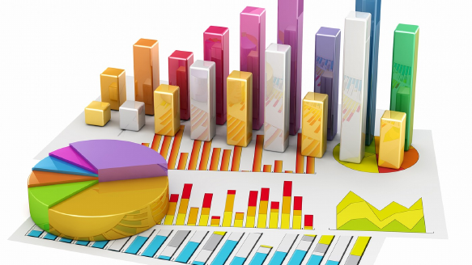{width="44%" fig-alt="Original graphic from slide 2"}

::::::

<!-- Original slide 03 -->

:::::: {.source-slide #slide-03}

### Statistics Branches {#source-title-03}

::: source-text
Statistics is generally divided into two main branches:

1\. Descriptive statistics.

Descriptive statistics refers to the summarizing and explaining data using numbers, tables and charts.

2- Inferential statistics.

Inferential statistics refers to drawing conclusions about a population based on a sample data.

A population refers to all members of a specified group (not necessarily people), whereas a sample is a subset of that population.

Population: the collection of all items we are interested in (people, things, plants, stars, trees...etc.), for the purpose of making our decision.
:::

::::::

<!-- Original slide 04 -->

:::::: {.source-slide #slide-04}

### Example of Useful Descriptive Statistics {#source-title-04}

::: source-text
1\. Business Sales:

- A store owner calculates the average daily sales to get a sense about his income.
- The owner also computes the standard deviation of daily sales to understand the variability or consistency in income.

2\. Classroom Grades:

- A teacher calculates the average grade of a test to understand the overall performance of the class.
- The teacher also determines the highest and lowest scores to understand the spread of the grades.

3\. Survey Results:

- After a customer satisfaction survey, a company finds that 70% of respondents are \"satisfied\" or \"very satisfied.\"
- The survey also indicates that the mode response to the question, \"What\'s the most important feature?\" is \"product durability.\"
:::

::::::

<!-- Original slide 05 -->

:::::: {.source-slide #slide-05}

### Examples of Useful Inferential Statistics {#source-title-05}

::: source-text
1\. Medicine:

- A research group tests a new drug on 100 patients and finds that 60 of them show significant improvement.
- Using inferential statistics, they can make conclusions about the drug\'s effectiveness on the entire population.

2\. Agriculture:

- A farmer tests a new fertilizer on a sample plot of land to see if it increases crop yield.
- Inferential statistics can help predict the impact of using the fertilizer on all their plots.

3\. Marketing:

- A company launches a new ad campaign in a small geographic area.
- They use inferential statistics to determine if rolling out the campaign nationwide would likely produce similar results.
:::

::::::

<!-- Original slide 06 -->

:::::: {.source-slide #slide-06}

### Statistical Process Life Cycle {#source-title-06}



::::::

<!-- Original slide 07 -->

:::::: {.source-slide #slide-07}

## Types of Data & Levels of Measurements {#source-title-07}

::::::

<!-- Original slide 08 -->

:::::: {.source-slide #slide-08}

### Categorical Data vs Numerical Data {#source-title-08}

::: source-text
1\. **Qualitative** or **categorical** (non-numerical) data:

Consists of descriptive information, such as colors, tastes, textures, or any other characteristics that can be counted.

2\. **Quantitative** or **numerical** data:

Includes data that can be measured and can be represented numerically, such as height, weight, or temperature.
:::

::::::

<!-- Original slide 09 -->

:::::: {.source-slide #slide-09}



::::::

<!-- Original slide 10 -->

:::::: {.source-slide #slide-10}



::::::

<!-- Original slide 11 -->

:::::: {.source-slide #slide-11}

### Why Types of Data and Levels of Measurements Matter? {#source-title-11}

::: source-text
- Data Visualization: e.g. Categorical data might be best represented in a bar chart, while continuous data might be better suited for a histogram or scatter plot.
- Data Transformation: e.g. Ordinal data might be converted into interval data under certain conditions, or continuous data might be categorized into ordinal data.
- Data Quality: e.g. If you expect a variable to be discrete and find continuous values, this could indicate a data quality issue.
- Interpretation of Results: e.g. If you have ordinal data, you can make statements about the order of values but not the difference between values.
- Appropriate Analysis: e.g. Nominal data can be analyzed using a Chi-square test, while interval data can be analyzed using a t-test or ANOVA. Using the wrong test can lead to incorrect conclusions.
:::

::::::

<!-- Original slide 12 -->

:::::: {.source-slide #slide-12}



::: source-text
Curtesy of: Introduction to statistical analysis with R, Matheus Khol
:::

:::



<!-- Original slide 13 -->

:::::: {.source-slide #slide-13}

## Descriptive Statistics Tools {#source-title-13}

::::::

<!-- Original slide 14 -->

:::::: {.source-slide #slide-14}

### Statistical Tools  Used in Descriptive Statistics {#source-title-14}

::: source-text
- Tables (Data Tables, Frequency Distribution Tables).
- Visualization & Charts.
- Numerical Measures (Measures of Central Location, Dispersion, Shape, Position, Association).
:::

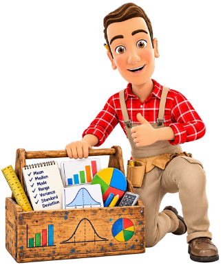{width="24%" fig-alt="Original graphic from slide 14"}

::::::

<!-- Original slide 15 -->

:::::: {.source-slide #slide-15}

### Tables in Descriptive Statistics {#source-title-15}

::: source-text
- Tables organize and display data in a structured format.
- They are essential for summarizing large data sets efficiently.

Types of Tables in Statistics

- Frequency Distribution Tables: Show how often each value in a set of data occurs.
- Summary Tables: Provide key statistics like mean, median, mode, range, etc., at a glance.
- Contingency Tables/Cross-tabulation: Display the multivariate frequency distribution for categorical data.

In the next section, we present tables examples using students dataset.
:::

::::::

<!-- Original slide 16 -->

:::::: {.source-slide #slide-16}

### Introducing Students Dataset {#source-title-16}

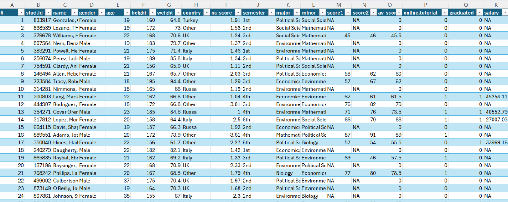{width="100%" fig-alt="Original graphic from slide 16"}

<!-- BEGIN TRY IN R 16 -->
:::: {.try-in-r #try-r-16}

#### Try this in R — Example 1: Import and inspect the student data {#import-and-inspect-the-student-data .unlisted}

##### Before we begin {.unlisted}

- Read each topic, then run its R example below. The explanations and executable examples are in this one notebook.
- Open the course root folder in Positron first and keep the working directory at the project root.
- Work through the code cells from top to bottom in Positron. Run the import cell first; later cells reuse its `students` data frame.
- These examples use base R, plus the e1071 package for skewness. Install it once with `install.packages("e1071")` in the R console; rendering the notebook also requires Quarto, knitr and rmarkdown.
- Each R example introduces the calculation and explains how to read its output. The original eighteen examples and their comments are retained in full; Examples 7a and 7b add line and dot plots.
- Before running a cell, predict what it will display. Afterwards, connect the result to the corresponding table, chart or definition in the slides.

##### The data and our purpose {.unlisted}

- **Data:** `data/descriptive-statistics/students.csv` and `data/descriptive-statistics/README.md`, containing 8,239 records and six variables.
- **Unit:** one record in the supplied student example, rather than a product line, order or customer.
- **Categorical variables:** `gender`, `country` and `major`, with the original labels retained.
- **Numerical variables:** `age` in years, `height` in centimetres and `weight` in kilograms.
- **Limit:** original data-collection provenance has not been established. Use this as a supplied teaching dataset; do not describe it as verified records of actual university students or a random sample of a wider population.
- **Goal:** reproduce the descriptive R examples accompanying the slides, covering tables, charts, centre, spread, association, shape, quartiles and potential outliers. The original Excel examples remain alongside the R examples.


- **What we are doing:** Load the same student dataset used in the descriptive slides. Each row is one record; the six variables are gender, age, height, weight, country and major. The first six rows let us check the column names and see how the values are recorded.
- **How to read the result:** Run this cell first. It creates `students`, which the later examples use. Open the course root folder in Positron first; the CSV path starts in the project folder. Height is in centimetres, weight in kilograms and age in years. No names or student IDs are included.

```{r}
#| label: r-slide-16
# read.csv() imports the supplied CSV; stringsAsFactors=FALSE keeps category labels as text.
# head() previews six rows; height is in cm, weight in kg, and age in years.
# Open the course folder in Positron; paths start in that folder.
students <- read.csv("data/descriptive-statistics/students.csv", stringsAsFactors = FALSE)
head(students)
```

::::
<!-- END TRY IN R 16 -->

::::::

<!-- Original slide 17 -->

:::::: {.source-slide #slide-17}

### Frequency Distribution Tables  {#source-title-17}

::: source-text
Used to show the distribution of data across different categories or intervals.

Frequency Types:

- Absolute Frequency: The actual count of occurrences for each category.
- Relative Frequency: The proportion of the total count represented by each category, often expressed as a percentage.
- Cumulative Frequency: A running total of frequencies through the categories, showing the number of observations up to a certain category.
:::

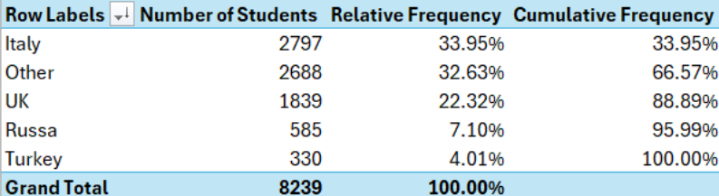{width="60%" fig-alt="Original graphic from slide 17"}

::: source-text
**Frequency of Students by Country**
:::

<!-- BEGIN TRY IN R 17 -->
:::: {.try-in-r #try-r-17}

#### Try this in R — Example 2: Frequency tables and percentages {#frequency-tables-and-percentages .unlisted}

- **What we are doing:** Describe the country categories with counts and percentages. A frequency is the number of records in a category; its percentage uses all records counted in the country table as the denominator.
- **How to read the result:** Read the two outputs together: the first gives counts and the second gives percentages. Countries are nominal categories, so a cumulative total would depend on an arbitrary ordering rather than a meaningful progression.

```{r}
#| label: r-slide-17
# table() counts students in each country category; prop.table() divides by all counted students.
# Multiplying by 100 gives percentages; cumsum() is meaningful only when categories have an order.
country_counts <- table(students$country)
country_counts
100 * prop.table(country_counts)
```

::::
<!-- END TRY IN R 17 -->

::::::

<!-- Original slide 18 -->

:::::: {.source-slide #slide-18}

### Converting Numerical Values into Categorical {#source-title-18}

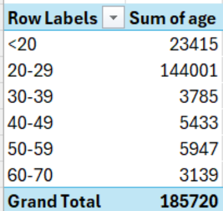{width="27%" fig-alt="Original graphic from slide 18"}

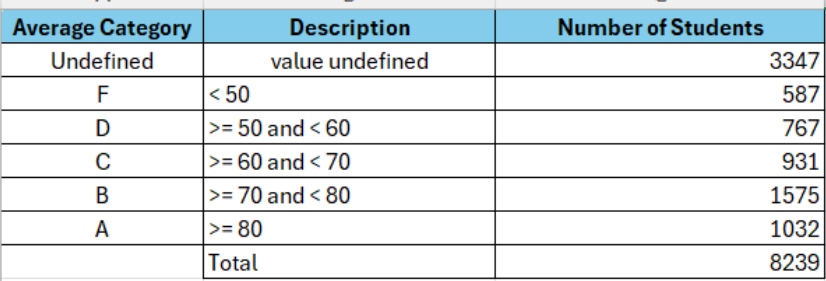{width="62%" fig-alt="Original graphic from slide 18"}

::: source-text
**Converting average into average groups**
:::

::: source-text
**Converting age into age groups**
:::

<!-- BEGIN TRY IN R 18 -->
:::: {.try-in-r #try-r-18}

#### Try this in R — Example 3: Group numerical values into intervals {#group-numerical-values-into-intervals .unlisted}

- **What we are doing:** Turn individual ages into age bands so that a frequency table can summarize a numerical variable. The selected boundaries are an added R illustration rather than a claim that these are the only suitable bands.
- **How to read the result:** The bands are [0,20), [20,25), [25,30) and [30,Inf). With `right = FALSE`, age 20 enters the second band and age 25 enters the third. Empty intervals remain visible; compare this grouped description with the original individual ages.

```{r}
#| label: r-slide-18
# cut() converts ages in years into intervals; right=FALSE includes the lower boundary, not the upper.
# table() counts each interval; these explicitly chosen bands are an added R illustration.
age_groups <- cut(students$age, breaks = c(0, 20, 25, 30, Inf), right = FALSE)
table(age_groups)
```

::::
<!-- END TRY IN R 18 -->

::::::

<!-- Original slide 19 -->

:::::: {.source-slide #slide-19}

### Cross-tabulation or Contingency Tables {#source-title-19}

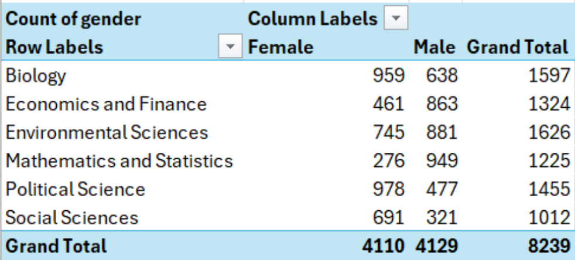{width="74%" fig-alt="Original graphic from slide 19"}

::: source-text
Used to show the **relationship between two categorical variables**.

Major by Gender in our example.
:::

<!-- BEGIN TRY IN R 19 -->
:::: {.try-in-r #try-r-19}

#### Try this in R — Example 4: Cross-tabulate two categorical variables {#cross-tabulate-two-categorical-variables .unlisted}

- **What we are doing:** Compare the distribution of majors across the recorded gender categories. A two-way table counts each major–gender combination rather than summarizing either variable alone.
- **How to read the result:** Rows represent majors and columns represent gender categories. The final row and column contain totals. These are counts, so a larger group may contribute more observations without having a larger within-group percentage.

```{r}
#| label: r-slide-19
# xtabs() counts combinations: the formula ~ major + gender creates a two-way frequency table.
# addmargins() adds row and column totals without changing the underlying counts.
major_gender <- xtabs(~ major + gender, data = students)
addmargins(major_gender)
```

::::
<!-- END TRY IN R 19 -->

::::::

<!-- Original slide 20 -->

:::::: {.source-slide #slide-20}

## Data Visualization {#source-title-20}

::::::

<!-- Original slide 21 -->

:::::: {.source-slide #slide-21}

<span class="source-slide-number">21</span>

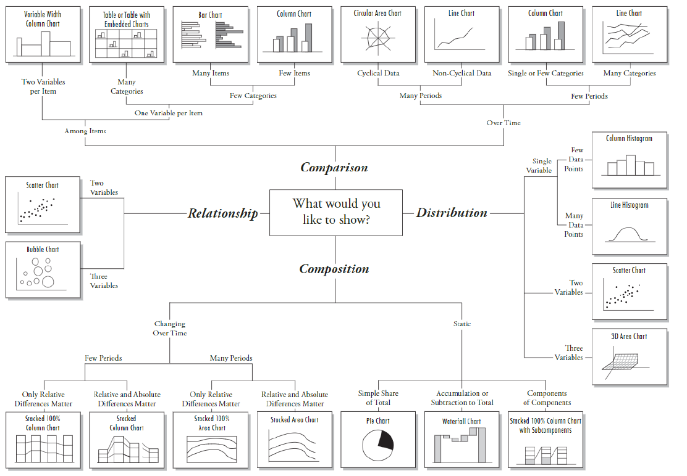{width="83%" fig-alt="Original graphic from slide 21"}

::::::

<!-- Original slide 22 -->

:::::: {.source-slide #slide-22}

### Visualizing Qualitative Data {#source-title-22}

::: source-text
Bar Chart, Pie Chart, Pareto Plots, Side by Side Bars Chart
:::

::::::

<!-- Original slide 23 -->

:::::: {.source-slide #slide-23}

### Bar Charts {#source-title-23}

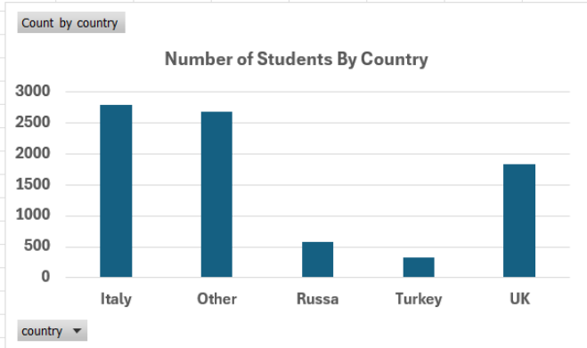{width="49%" fig-alt="Original graphic from slide 23"}

::: source-text
- A bar chart is a type of chart that presents data in rectangular bars with lengths proportional to the values they represent.
- Bar charts are commonly used to compare the magnitudes of different categories or groups of data.
:::

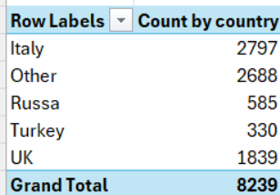{width="23%" fig-alt="Original graphic from slide 23"}

::: source-text
We need to construct a frequency table first.
:::

<!-- BEGIN TRY IN R 23 -->
:::: {.try-in-r #try-r-23}

#### Try this in R — Example 5: Bar chart of category frequencies {#bar-chart-of-category-frequencies .unlisted}

- **What we are doing:** Display the same country frequencies as a bar chart. Bar height encodes the number of records in each country category; the horizontal positions identify categories rather than a numerical scale.
- **How to read the result:** Compare the bar heights with the frequency table. Rotated labels make the category names readable. Keep the distinction between a category count and a percentage of all records.

```{r}
#| label: r-slide-23
# barplot() draws a bar for each category count supplied by table().
# las=2 rotates country labels; ylab states that bar heights are numbers of students.
barplot(table(students$country), las = 2, col = "#356B8C", ylab = "Number of students")
```

::::
<!-- END TRY IN R 23 -->

::::::

<!-- Original slide 24 -->

:::::: {.source-slide #slide-24}

### Pie Chart: Visualizing Proportions {#source-title-24}

::: source-text
- A pie chart is a circular chart that is divided into segments to represent numerical proportions or percentages.
- Each segment of the pie chart represents a different category or group, and the size of each segment is proportional to the value or percentage it represents.
- Pie charts are commonly used to display data that can be divided into categories, such as market share, demographic distributions, or survey results.
:::

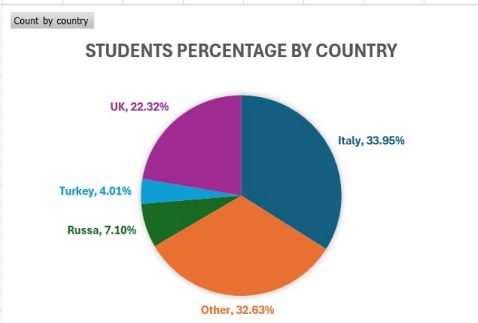{width="51%" fig-alt="Original graphic from slide 24"}

<!-- BEGIN TRY IN R 24 -->
:::: {.try-in-r #try-r-24}

#### Try this in R — Example 6: Pie chart of category shares {#pie-chart-of-category-shares .unlisted}

- **What we are doing:** Show the country composition as parts of a whole. This uses the same country counts as the table and bar chart, allowing us to compare different displays of the same information.
- **How to read the result:** Each slice represents its share of all recorded country categories, including Other. Use the frequency table when precise comparisons are needed; similarly sized slices can be difficult to compare visually.

```{r}
#| label: r-slide-24
# pie() divides the circle according to the country counts computed by table().
# The denominator is all students with a recorded country category, including Other.
pie(table(students$country))
```

::::
<!-- END TRY IN R 24 -->

::::::

<!-- Original slide 25 -->

:::::: {.source-slide #slide-25}

### Pareto Charts: Two Graphs in a Single Chart {#source-title-25}

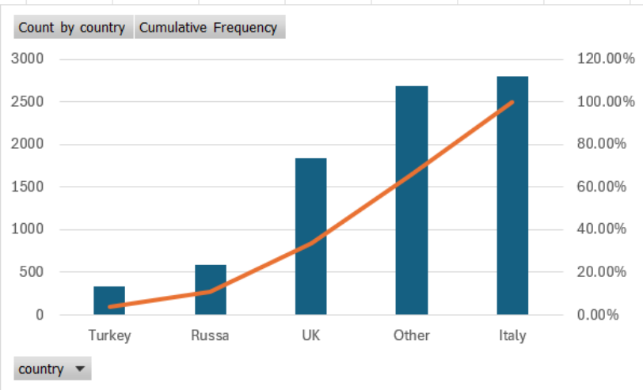{width="61%" fig-alt="Original graphic from slide 25"}

::: source-text
- A Pareto chart is a type of chart that combines a bar graph with a line graph (Combo Chart).
- It is used to display the relative frequency or size of different categories or groups, and to identify the most important factors affecting a particular outcome or result.
:::

::::::

<!-- Original slide 26 -->

:::::: {.source-slide #slide-26}

### Side by Side Bar Charts: : Visualizing Two Variables {#source-title-26}

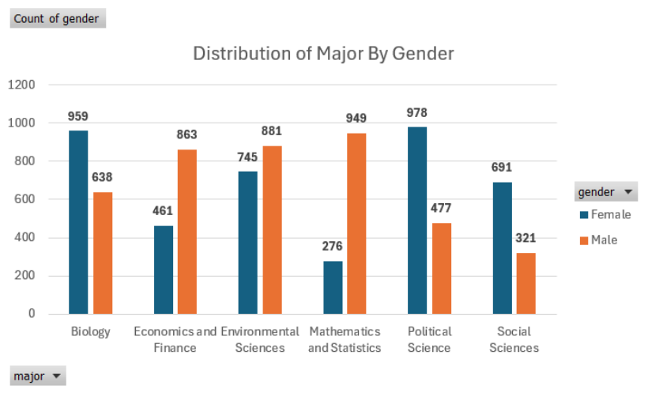{width="62%" fig-alt="Original graphic from slide 26"}

::: source-text
- A side-by-side chart is used to compare two or more variables or categories.
- The chart displays the data side-by-side in separate columns or bars, making it easy to compare the values of each variable or category.
- Side-by-side chart allows viewers to quickly and easily compare the values of different variables and identify patterns or trends in the data.
:::

<!-- BEGIN TRY IN R 26 -->
:::: {.try-in-r #try-r-26}

#### Try this in R — Example 7: Grouped bars for two categorical variables {#grouped-bars-for-two-categorical-variables .unlisted}

- **What we are doing:** Compare country counts across the recorded gender categories. Within each country, the bars are placed side by side so that the groups can be compared.
- **How to read the result:** Use the legend to identify gender categories and the vertical axis to read counts. Unequal overall group sizes affect the heights: these bars do not show within-gender or within-country percentages.

```{r}
#| label: r-slide-26
# table() cross-classifies gender and country; barplot(beside=TRUE) places gender bars side by side.
# legend.text=TRUE labels the groups; counts, rather than percentages, determine bar heights.
barplot(table(students$gender, students$country), beside = TRUE, legend.text = TRUE,
        col = c("#356B8C", "#C47735"), ylab = "Number of students", las = 2)
```

::::
<!-- END TRY IN R 26 -->

:::

<!-- Added teaching slide: line chart -->

:::::: {.source-slide #slide-added-line-chart}

### Line charts: change over time {#line-charts}

- A **line chart** joins numerical observations in time order to show how a quantity changes over time.
- **Horizontal axis:** time. **Vertical axis:** the measured quantity, with its units.
- Use it to identify an overall trend, recurring patterns and periods of increase or decline.
- Connect observations only when the sequence is meaningful; do not connect unordered country categories or unrelated student records.

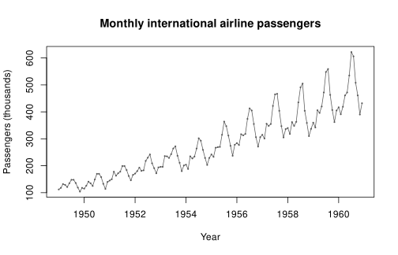{width="75%"}

- Each point represents one month. A value of 400 means 400,000 passengers in that month.
- The overall level rises, with recurring peaks and troughs. Connecting lines do not establish causes or measure the values between months.
- **Source:** R's built-in [AirPassengers dataset](https://stat.ethz.ch/R-manual/R-devel/library/datasets/html/AirPassengers.html); historical international airline passenger totals, not student data.

- **R:** `plot()` draws the stored monthly series supplied as `x`; `type = "o"` overlays points and lines. `pch = 16` gives filled circles; `cex = 0.4` shrinks them. `col` sets colour; `xlab`, `ylab` and `main` label the axes and title.

<!-- BEGIN TRY IN R added-line-chart -->
:::: {.try-in-r #try-r-added-line-chart}

#### Try this in R — Example 7a: Line chart: passengers over time {#line-chart .unlisted}

- **Purpose:** A line chart joins numerical observations in time order, showing how a quantity changes over time. Do not join unordered categories or unrelated student records.
- **Data:** R's built-in `AirPassengers` series contains 144 monthly totals of international airline passengers, January 1949–December 1960, in thousands. Each observation represents one month, not one passenger. It is separate from the student CSV.
- **Source:** [R datasets documentation: AirPassengers](https://stat.ethz.ch/R-manual/R-devel/library/datasets/html/AirPassengers.html). These are historical totals; we are describing the series, not forecasting demand or identifying causes.
- **R explained:** `plot()` draws a chart. `x = AirPassengers` supplies the built-in time-series object, which already stores monthly time positions. `type = "o"` overlays points and connecting lines; `pch = 16` selects filled circles, and `cex = 0.4` makes them smaller. `col` sets the colour; `xlab`, `ylab` and `main` set the axis labels and title.

```{r}
#| label: r-slide-added-line-chart
#| fig-cap: "Monthly international airline passengers, 1949–1960 (thousands)."
# The time-series object supplies the monthly time order; no CSV import is needed.
plot(x = AirPassengers, type = "o", pch = 16, cex = 0.4,
     col = "#595959", xlab = "Year", ylab = "Passengers (thousands)",
     main = "Monthly international airline passengers")
```

- **Read the chart:** The overall level rises and recurring within-year peaks and troughs are visible. The size of those fluctuations also increases. A point at 400 represents 400,000 passengers in that month.
- **Try independently:** Identify one interval of decline despite the overall upward pattern. Why would a histogram of these totals fail to show when the declines occurred?

::::
<!-- END TRY IN R added-line-chart -->

::::::

<!-- Original slide 27 -->

:::::: {.source-slide #slide-27}

### Visualizing Quantitative Data, Frequency Distributions and Histograms {#source-title-27}

:::

<!-- Added teaching slide: dot plot -->

:::::: {.source-slide #slide-added-dot-plot}

### Dot plots: individual numerical observations {#dot-plots}

- A **stacked dot plot** places one dot per observation on a numerical axis; repeated values stack above the same position.
- **Horizontal position:** the observed value. **Dots in each stack:** its frequency.
- Useful for small datasets: see repeated values, clusters, gaps and possible unusual observations while retaining individual values.

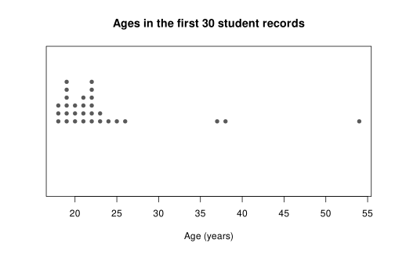{width="75%"}

- **Example:** ages in years from the first 30 rows of the supplied student CSV, in original file order. This subset is not a random sample.
- A dot plot shows individual observations; a histogram groups values into intervals and is more manageable for large datasets.
- This is a one-variable display: stack height counts repeats, rather than measuring a second variable as a scatterplot does.

- **R:** `<-` assigns a result; `$age` selects ages. `head(x = students$age, n = 30)` takes the first 30. `stripchart()` plots these values as `x`; `method = "stack"` stacks repeats and `offset = 0.7` spaces dots. `pch = 16` gives filled circles; `col`, `xlab` and `main` set colour, axis label and title.

<!-- BEGIN TRY IN R added-dot-plot -->
:::: {.try-in-r #try-r-added-dot-plot}

#### Try this in R — Example 7b: Dot plot: individual ages {#dot-plot .unlisted}

- **Purpose:** A stacked dot plot displays individual numerical observations. Each dot represents one record; dots at the same age stack vertically so repeated values remain visible.
- **Data:** The first 30 rows of `students`, using age in years. This is a convenient small subset in original file order, not a random sample or a summary of all 8,239 records. Run Example 1 first.
- **R explained:** `<-` assigns a result to a name. `head(x = students$age, n = 30)` takes the first 30 ages; `$age` selects the age column. `stripchart()` draws individual values. `x` supplies the ages, `method = "stack"` stacks repeats, and `offset = 0.7` controls the spacing between stacked dots. `pch = 16` selects filled circles; `col`, `xlab` and `main` set the colour, horizontal-axis label and title. Stack height counts repeats; it is not a second measured variable.

```{r}
#| label: r-slide-added-dot-plot
#| fig-cap: "One dot per record, using the first 30 student ages in file order."
# Keep original row order; these records are not a random sample.
age_small <- head(x = students$age, n = 30)
stripchart(x = age_small, method = "stack", offset = 0.7, pch = 16,
           col = "#595959", xlab = "Age (years)",
           main = "Ages in the first 30 student records")
```

- **Read the chart:** Position gives age; the number of dots in a stack gives the number of records at that age. Look for repeated values, gaps and the range without grouping ages into intervals.
- **Try independently:** Which age has the tallest stack? Count the dots and compare with `table(age_small)`: `table()` counts each distinct age. Why would this display become crowded for all 8,239 records?

::::
<!-- END TRY IN R added-dot-plot -->

::::::

<!-- Original slide 28 -->

:::::: {.source-slide #slide-28}

### Histograms {#source-title-28}

::: source-text
- Histograms provide a way to visualize the distribution of a numeric variable. 
- Histograms group numeric responses into bins and display the frequency of responses in each.
- The x-axis of a histogram reflects the range of values of a numeric variable, while the y-axis can reflect either the frequencies (counts) or relative frequencies.
:::

<!-- BEGIN TRY IN R 28 -->
:::: {.try-in-r #try-r-28}

#### Try this in R — Example 8: Histogram of ages {#histogram-of-ages .unlisted}

- **What we are doing:** Examine the distribution of age as a numerical variable. A histogram groups observations into adjacent numerical intervals and displays how many records fall into each bin.
- **How to read the result:** The boundaries lie halfway between recorded ages, giving one-year bins. Look for the most common ages, the overall spread and any long tail. The vertical axis shows frequencies, not probability density.

```{r}
#| label: r-slide-28
# hist() groups ages into bins; breaks specifies yearly boundaries at half-year positions.
# freq=TRUE displays counts rather than probability density; recorded ages are measured in years.
hist(students$age, breaks = seq(min(students$age) - 0.5, max(students$age) + 0.5, by = 1),
     freq = TRUE, col = "#356B8C", main = "", xlab = "Age (years)")
```

::::
<!-- END TRY IN R 28 -->

::::::

<!-- Original slide 29 -->

:::::: {.source-slide #slide-29}

### Histograms {#source-title-29}

::: source-text
Histograms tell us the following about our data:

- Shape -- what is the shape of the distribution?
  - Center -- what is an "average" value?
  - Spread -- how far away from the center do values tend to fall?
  - Unique features -- are there any outliers?
:::

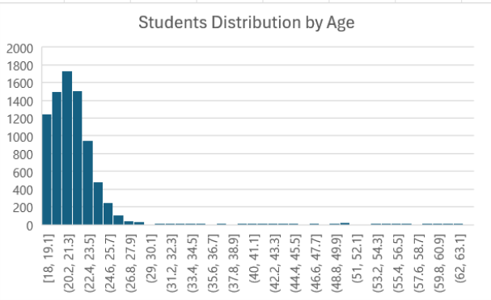{width="46%" fig-alt="Original graphic from slide 29"}

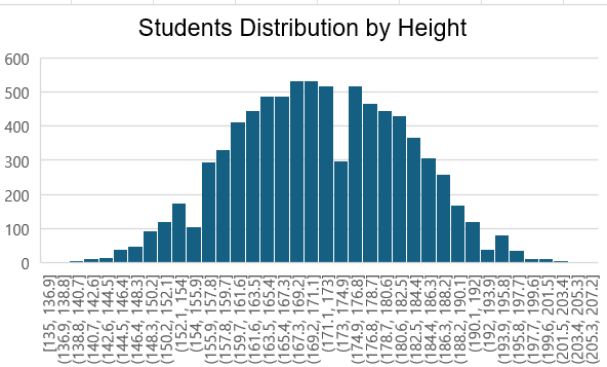{width="46%" fig-alt="Original graphic from slide 29"}

::::::

<!-- Original slide 30 -->

:::::: {.source-slide #slide-30}

### Number of Modes {#source-title-30}

::: source-text
- The first distinguishing feature apparent in a histogram is the number of modes, or, in the distribution. 
- A unimodal distribution only has one peak in the distribution, a bimodal distribution has two peaks, and a multimodal distribution has three or more peaks.
:::

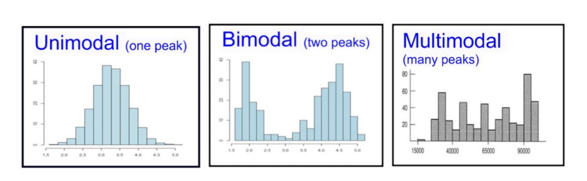{width="100%" fig-alt="Original graphic from slide 30"}

::::::

<!-- Original slide 31 -->

:::::: {.source-slide #slide-31}

### Skewness {#source-title-31}

::: source-text
- Histograms can show us if the data is skewed or symmetric. 
- Symmetric data should look nearly identical if folded in half at the center point of the distribution.
- Skewed data indicates that there is a large portion of the data collected on one side of the chart and only a small portion on the other side.
:::

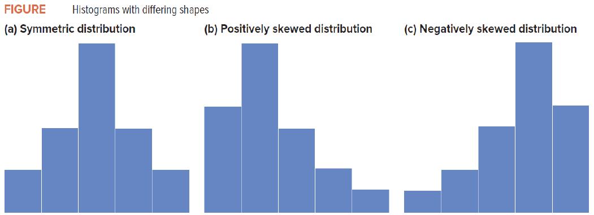{width="79%" fig-alt="Original graphic from slide 31"}

::::::

<!-- Original slide 32 -->

:::::: {.source-slide #slide-32}

### Outliers {#source-title-32}

::: source-text
- Outliers are responses that fall well away from the rest of the values.
- Histograms can be useful in identifying outliers in our data.
- Defining an observation as an outlier is subjective and should lead to an investigation of that value (not an automatic removal from the dataset).
:::

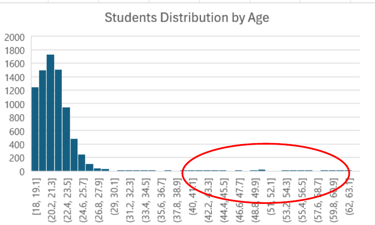{width="56%" fig-alt="Original graphic from slide 32"}

::::::

<!-- Original slide 33 -->

:::::: {.source-slide #slide-33}

### Scotter Plots {#source-title-33}

::: source-text
Scatter plots can be used to examine of there is a relation between two variables.

Consider for instance, how:

- Incomes vary with education.
- Sales vary with advertising expenditures.
- Stock prices vary with corporate profits.
- Crop yields vary with the use of fertilizer.
- Cholesterol levels vary with dietary intake.
- Price varies with reliability.
:::

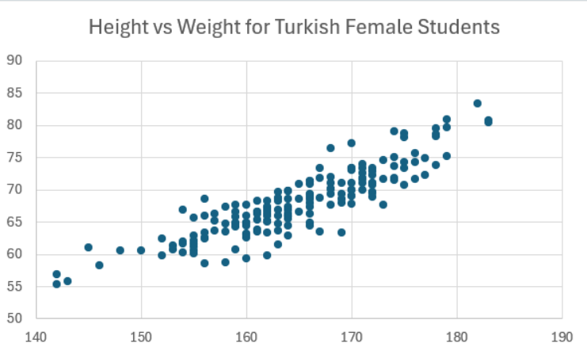{width="56%" fig-alt="Original graphic from slide 33"}

<!-- BEGIN TRY IN R 33 -->
:::: {.try-in-r #try-r-33}

#### Try this in R — Example 9: Scatterplot of height and weight {#scatterplot-of-height-and-weight .unlisted}

- **What we are doing:** Examine whether taller records tend to have greater recorded weight. Each point represents a paired height and weight from one row of the dataset.
- **How to read the result:** Read height on the horizontal axis and weight on the vertical axis. Look for direction, form, strength and unusual points. A visual association does not establish that changing height causes a change in weight.

```{r}
#| label: r-slide-33
# plot(x,y) makes a scatterplot, with height on the horizontal axis and weight on the vertical.
# pch=16 uses filled points; no fitted line or causal relationship is assumed.
plot(students$height, students$weight, pch = 16, col = "#356B8C",
     xlab = "Height (cm)", ylab = "Weight (kg)")
```

::::
<!-- END TRY IN R 33 -->

::::::

<!-- Original slide 34 -->

:::::: {.source-slide #slide-34}

### Relations between Two Variables {#source-title-34}

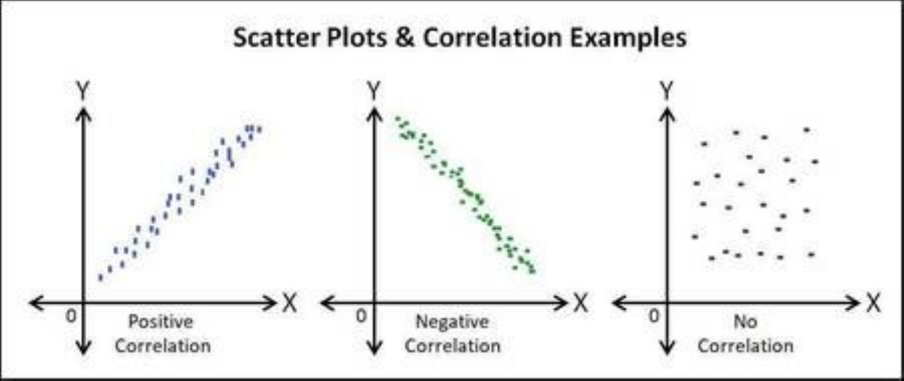{width="100%" fig-alt="Original graphic from slide 34"}

::::::

<!-- Original slide 35 -->

:::::: {.source-slide #slide-35}

## Numerical Measures in Descriptive Statistics {#source-title-35}

::::::

<!-- Original slide 36 -->

:::::: {.source-slide #slide-36}

### Numerical Measures in Descriptive Statistics {#source-title-36}

::: source-text
- Numerical measures in descriptive statistics are used to summarize and describe the main features of a dataset through numbers.
- These measures provide insights into the distribution, central tendency, dispersion, and shape of the data.
- Understanding these measures helps in interpreting the data more effectively.

Examples

- Rates in a Society (unemployment rate, crime rate, divorce rate).
- Average Income, Maximum age, Minimum score...etc.
:::

::::::

<!-- Original slide 37 -->

:::::: {.source-slide #slide-37}

### Measures of Central Location {#source-title-37}

::: source-text
Mean, Median and Mode
:::

::::::

<!-- Original slide 38 -->

:::::: {.source-slide #slide-38}

### The Mean {#source-title-38}

::: source-text
- The **Arithmetic Mean** is the primary measure of central location.
- Generally, we refer to the arithmetic mean as simply the **Mean** or the **Average**.
- In order to calculate the mean of a data set, we simply add up the observations and divide by the number of observations in the population or sample.
- **However, the mean is sensitive to** **Outliers. Consider the following sample dataset:**

**Data = (\$1.00, \$2.00, \$3.00, \$3.00, \$3.00, \$1.00, \$100.00)**

- **Most of the data values are around \$3, yet their average is** **\$16.14**
:::

::::::

<!-- Original slide 39 -->

:::::: {.source-slide #slide-39}

### The Median {#source-title-39}



::::::

<!-- Original slide 40 -->

:::::: {.source-slide #slide-40}

### The Mode {#source-title-40}

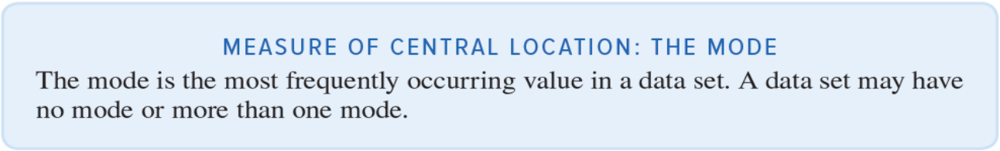{width="97%" fig-alt="Original graphic from slide 40"}

::::::

<!-- Original slide 41 -->

:::::: {.source-slide #slide-41}

### Excel Functions for Measuring Central Location {#source-title-41}

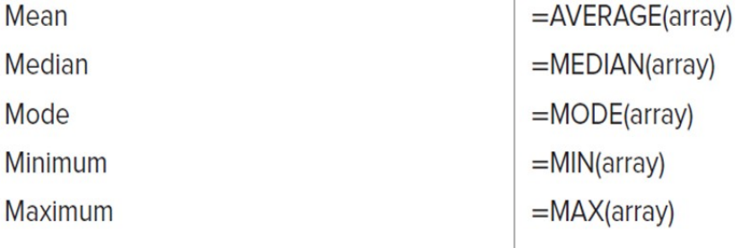{width="63%" fig-alt="Original graphic from slide 41"}

::::::

<!-- Original slide 42 -->

:::::: {.source-slide #slide-42}

### Practical Exercise {#source-title-42}

::: source-text
Use the students.xlsx file:

- Compare the Mean, Median for the "age" column for "Italy" and "Russa".
- Find the Mode "age" column for "UK".

Note: In Excel you can filter out rows by converting a Range to a Table and using the filtering list in each header of a column.
:::

{width="43%" fig-alt="Original graphic from slide 42"}

<!-- BEGIN TRY IN R 42 -->
:::: {.try-in-r #try-r-42}

#### Try this in R — Example 10: Mean, median and modes {#mean-median-and-modes .unlisted}

- **What we are doing:** Summarize the centre of the age distribution in three ways. The mean uses every value, the median is the middle ordered value, and a mode is any recorded age with the largest frequency.
- **How to read the result:** The last output can contain more than one age if the highest frequency is tied. Compare the mean and median with the histogram; extreme ages can affect the mean more strongly than the median.

```{r}
#| label: r-slide-42
# mean() and median() summarize ages; table() counts each recorded age to identify every tied mode.
# names() returns the ages whose counts equal max(), the greatest frequency.
mean(students$age)
median(students$age)
age_counts <- table(students$age)
names(age_counts)[age_counts == max(age_counts)]
```

::::
<!-- END TRY IN R 42 -->

::::::

<!-- Original slide 43 -->

:::::: {.source-slide #slide-43}

### Measures of Dispersion {#source-title-43}

::: source-text
Range, Mean Absolution Difference, Variance and Standard Deviation
:::

::::::

<!-- Original slide 44 -->

:::::: {.source-slide #slide-44}

### Measures of Dispersion {#source-title-44}

::: source-text
- Average alone is not sufficient to summarize and describe our data.
- Consider the following 5 sample datasets.
- Although the data values are very different, they all have the same average.
:::

::: source-table
+-------------+------------+------------+------------+------------+------------+
|             | **S1**     | **S2**     | **S3**     | **S4**     | **S5**     |
+=============+============+============+============+============+============+
|             | 100        | 200        | 0          | -600       | -2000      |
+-------------+------------+------------+------------+------------+------------+
|             | 200        | 200        | 600        | 600        | 2500       |
+-------------+------------+------------+------------+------------+------------+
|             | 300        | 200        | 0          | 600        | 100        |
+-------------+------------+------------+------------+------------+------------+
|             |            |            |            |            |            |
+-------------+------------+------------+------------+------------+------------+
| **Average** | **200.00** | **200.00** | **200.00** | **200.00** | **200.00** |
+-------------+------------+------------+------------+------------+------------+
:::

::::::

<!-- Original slide 45 -->

:::::: {.source-slide #slide-45}

### Measures of Dispersion – The Range {#source-title-45}

::: source-text
- The **Range** is the simplest measure of dispersion, it is the difference between the maximum value and the minimum value in a data set:

***Range = Maximum Value -- Minimum Value***

- Going back to the previous sample datasets, we can see that they have the same average, but their ranges are very different.
:::

::: source-table
+-----------+------------+----------+------------+-------------+-------------+
|           | **S1**     | **S2**   | **S3**     | **S4**      | **S5**      |
+===========+============+==========+============+=============+=============+
|           | 100        | 200      | 0          | -600        | -2000       |
+-----------+------------+----------+------------+-------------+-------------+
|           | 200        | 200      | 600        | 600         | 2500        |
+-----------+------------+----------+------------+-------------+-------------+
|           | 300        | 200      | 0          | 600         | 100         |
+-----------+------------+----------+------------+-------------+-------------+
|           |            |          |            |             |             |
+-----------+------------+----------+------------+-------------+-------------+
| Average   | 200.00     | 200.00   | 200.00     | 200.00      | 200.00      |
+-----------+------------+----------+------------+-------------+-------------+
| **Range** | **200.00** | **0.00** | **600.00** | **1200.00** | **4500.00** |
+-----------+------------+----------+------------+-------------+-------------+
:::

::: source-text
- Therefore, using the **Range** with the **Average** helped us to better describe and summarize our data (Better Understand Our Data).
- **However, the Range is sensitive to Outliers. Consider the following sample dataset:**

Data = (\$1.00, \$2.00, \$3.00, \$3.00, \$3.00, \$1.00, \$100.00)

- Most of the data values are around \$3, yet their Range is \$99.00
:::

::::::

<!-- Original slide 46 -->

:::::: {.source-slide #slide-46}

### Measures of Dispersion - The Mean Absolute Deviation {#source-title-46}

::: source-text
- A good measure of dispersion should consider differences of all observations from the mean.
- If we simply average all differences from the mean, the positives and the negatives will cancel out, even though they both contribute to dispersion, and the resulting average will equal zero.
- The **mean absolute deviation** (MAD) is an average of the absolute differences between the observations and the mean.
:::



::::::

<!-- Original slide 47 -->

:::::: {.source-slide #slide-47}

### Measures of Dispersion - The Variance and the Standard Deviation {#source-title-47}

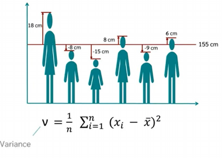{width="34%" fig-alt="Original graphic from slide 47"}

::: source-text
- MAD weights large and small differences equally.
- Better measures are the **variance** and the **standard deviation.**
- Instead of calculating the average of the absolute differences from the mean, as in MAD, we calculate the average of the squared differences from the mean.
:::

::: source-text
- The squaring of differences from the mean emphasizes larger differences more than smaller ones.
- The variance has squared units, therefore, to return the values to their original units of measurement, we compute the square root of the variance, which gives us the standard deviation.
:::



::::::

<!-- Original slide 48 -->

:::::: {.source-slide #slide-48}

### Measures of Dispersion - The Variance and the Standard Deviation {#source-title-48}



::::::

<!-- Original slide 49 -->

:::::: {.source-slide #slide-49}

### Excel Functions for Measuring Dispersion {#source-title-49}

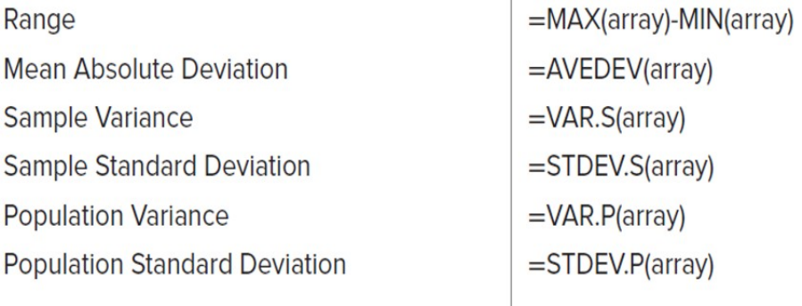{width="67%" fig-alt="Original graphic from slide 49"}

::::::

<!-- Original slide 50 -->

:::::: {.source-slide #slide-50}

### Practical Exercise {#source-title-50}

::: source-text
Use the students.xlsx file to find the Range, MAD, Variance and Standard Deviation for the age column.

Note: In Excel you can filter out rows by converting a Range to a Table and using the filtering list in each header of a column.
:::

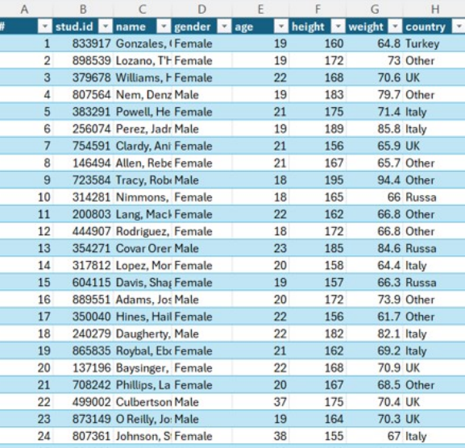{width="43%" fig-alt="Original graphic from slide 50"}

<!-- BEGIN TRY IN R 50 -->
:::: {.try-in-r #try-r-50}

#### Try this in R — Example 11: Range, mean absolute deviation, variance and standard deviation {#range-mean-absolute-deviation-variance-and-standard-deviation .unlisted}

- **What we are doing:** Describe how widely the recorded ages vary. The range uses the two endpoints; mean absolute deviation averages absolute distances from the mean; sample variance and standard deviation use squared distances with denominator n−1.
- **How to read the result:** Range, mean absolute deviation and standard deviation are in years; variance is in squared years. Here MAD means mean absolute deviation. R’s `mad()` has a different definition, so the code explicitly calculates `mean(abs(age - mean(age)))`.

```{r}
#| label: r-slide-50
# diff(range()) gives maximum minus minimum; mean(abs()) calculates mean absolute deviation.
# var() and sd() use the sample denominator n-1; R's mad() instead computes median absolute deviation.
age <- students$age
c(range = diff(range(age)), mean_absolute_deviation = mean(abs(age - mean(age))),
  sample_variance = var(age), sample_standard_deviation = sd(age))
```

::::
<!-- END TRY IN R 50 -->

::::::

<!-- Original slide 51 -->

:::::: {.source-slide #slide-51}

### Practical Exercise: using Excel’s data analysis tools option {#source-title-51}

::: source-text
Select: Data \> Data Analysis \> Descriptive Statistics \> OK.
:::

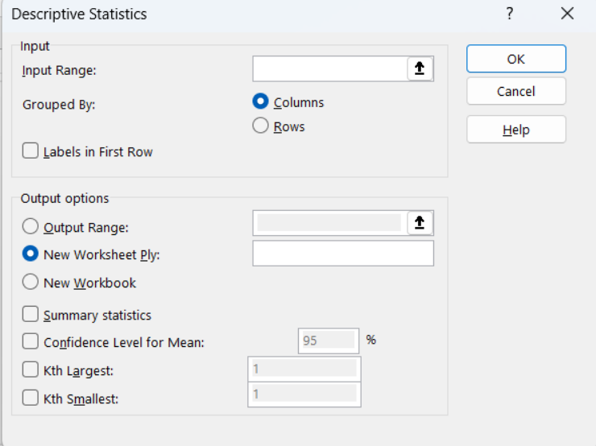{width="56%" fig-alt="Original graphic from slide 51"}

::::::

<!-- Original slide 52 -->

:::::: {.source-slide #slide-52}

### The Coefficient of Variation {#source-title-52}

::::::

<!-- Original slide 53 -->

:::::: {.source-slide #slide-53}

### The Coefficient of Variation {#source-title-53}

::: source-text
- In some instances, we need to compare the variability of two or more data sets that have different means or different units of measurement.
- Consider the following example:
- Both datasets have the same absolute spread: their sample standard deviations are equal. To compare spread relative to their different means, use the coefficient of variation.
:::

::: source-table
+-------------------------------+-----------+------------+
|                               | **DS1**   | **DS2**    |
+===============================+===========+============+
|                               | \$10      | \$1010     |
+-------------------------------+-----------+------------+
|                               | \$20      | \$1020     |
+-------------------------------+-----------+------------+
|                               | \$30      | \$1030     |
+-------------------------------+-----------+------------+
|                               | \$40      | \$1040     |
+-------------------------------+-----------+------------+
|                               | \$50      | \$1050     |
+-------------------------------+-----------+------------+
| **Average**                   | **\$30**  | **\$1030** |
+-------------------------------+-----------+------------+
| **Sample Standard Deviation** | **15.81** | **15.81**  |
+-------------------------------+-----------+------------+
:::

::::::

<!-- Original slide 54 -->

:::::: {.source-slide #slide-54}

### The Coefficient of Variation {#source-title-54}

::: source-text
- For such cases, we can use the Coefficient of Variation Measure which serves as a relative measure of dispersion.
- It can be calculated by dividing a data set's standard deviation by its mean:
- When comparing two datasets, the dataset that have larger coefficient of variation indicates that its values varies more than the other dataset. Therefore, it is less stable or less uniform.
:::



::::::

<!-- Original slide 55 -->

:::::: {.source-slide #slide-55}

### The Coefficient of Variation {#source-title-55}

::: source-text
- Going back to the previous example, we can calculate the coefficient of variation for both sets to help us in determining which dataset has more variability in its values.
- DS1 has greater relative variability than DS2: its standard deviation is larger as a proportion of its mean. Their absolute standard deviations remain equal.
:::

::: source-table
+-------------------------------+-------------+-------------+
|                               | **DS1**     | **DS2**     |
+===============================+=============+=============+
|                               | \$10        | \$1010      |
+-------------------------------+-------------+-------------+
|                               | \$20        | \$1020      |
+-------------------------------+-------------+-------------+
|                               | \$30        | \$1030      |
+-------------------------------+-------------+-------------+
|                               | \$40        | \$1040      |
+-------------------------------+-------------+-------------+
|                               | \$50        | \$1050      |
+-------------------------------+-------------+-------------+
| **Average**                   | **\$30**    | **\$1030**  |
+-------------------------------+-------------+-------------+
| **Sample Standard Deviation** | **\$15.81** | **\$15.81** |
+-------------------------------+-------------+-------------+
| **CV (ratio)**                | **0.5270**  | **0.01535** |
+-------------------------------+-------------+-------------+
:::

**As percentages:** DS1 = **52.70%**; DS2 = **1.54%**. These calculations use the unrounded sample standard deviation.

<!-- BEGIN TRY IN R 55 -->
:::: {.try-in-r #try-r-55}

#### Try this in R — Example 12: Coefficient of variation {#coefficient-of-variation .unlisted}

- **What we are doing:** Compare relative variability for the two exact datasets shown in the slides. The second dataset adds 1,000 to every value, keeping the sample standard deviation unchanged while increasing the mean.
- **How to read the result:** Each output is the sample standard deviation divided by the mean, expressed as a ratio. Multiply by 100 to express it as a percentage. These positive-mean examples illustrate the calculation; substantive CV comparisons require a meaningful ratio scale and an appropriate nonzero mean.

```{r}
#| label: r-slide-55
# c() creates the exact two datasets shown in the original table; sd() uses the sample denominator n-1.
# sd()/mean() expresses CV as a ratio, without multiplying by 100; these means are positive.
DS1 <- c(10, 20, 30, 40, 50)
DS2 <- c(1010, 1020, 1030, 1040, 1050)
c(DS1 = sd(DS1) / mean(DS1), DS2 = sd(DS2) / mean(DS2))
```

::::
<!-- END TRY IN R 55 -->

::::::

<!-- Original slide 56 -->

:::::: {.source-slide #slide-56}

### Coefficient of Variation Uses in Finance {#source-title-56}

::: source-text
- In finance, the coefficient of variation is used to measure the risk per unit of return.
- For example, assume that the average monthly return on stock A is 2980 with a standard deviation of 111.06, and the average monthly return on stock B is 9.8 with a standard deviation of 1.3
- We can use the coefficient of variation to determine which stock is more stable:
:::



::::::

<!-- Original slide 57 -->

:::::: {.source-slide #slide-57}

## Measures of Association {#source-title-57}

::: source-text
Covariance and Coefficient of Correlation
:::

::::::

<!-- Original slide 58 -->

:::::: {.source-slide #slide-58}

### Measures of Association {#source-title-58}

::: source-text
- We previously introduced the idea of a scatter plots to visually assess whether two variables had some type of linear relationship.
- In this section, we present two numerical measures of association that quantify the direction and strength of the linear relationship between two variables, x and y.
- These two numerical values are the Covariance and the Correlation.
:::

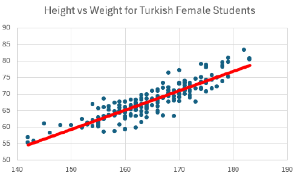{width="37%" fig-alt="Original graphic from slide 58"}

::: source-text
Note: Covariance and Correlation works when the relation between the two variables is LINEAR.
:::

::::::

<!-- Original slide 59 -->

:::::: {.source-slide #slide-59}

### Covariance {#source-title-59}

::: source-text
- Covariance measures the joint variability of two random variables.
- Indicates the direction of the linear relationship between variables.
:::

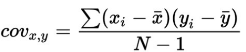{width="37%" fig-alt="Original graphic from slide 59"}

::: source-text
- Positive Covariance: X and Y move in the same direction.
- Negative Covariance: X and Y move in opposite directions.
- Zero Covariance: No linear relationship between X and Y.
:::

::: {.covariance-examples}

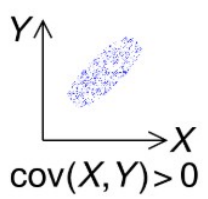{width="100%" fig-alt="Original graphic from slide 59"}

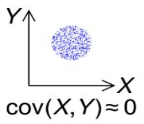{width="100%" fig-alt="Original graphic from slide 59"}

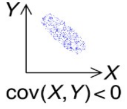{width="100%" fig-alt="Original graphic from slide 59"}

:::

::::::

<!-- Original slide 60 -->

:::::: {.source-slide #slide-60}

### Limitations of Covariance {#source-title-60}

::: source-text
Covariance is sensitive to the units of X and Y.

Changing units changes the covariance value, making direct comparisons difficult.
:::

::: source-table
+-----------------+----------+-----------+----------------------+
|                 | Height m | Height cm | Weight KG            |
+=================+==========+===========+======================+
|                 | 1.6      | 160       | 55                   |
+-----------------+----------+-----------+----------------------+
|                 | 1.7      | 170       | 68                   |
+-----------------+----------+-----------+----------------------+
|                 | 1.8      | 180       | 74                   |
+-----------------+----------+-----------+----------------------+
| **Covariance**  | **.95**  | **95**    | Which one is bigger? |
+-----------------+----------+-----------+----------------------+
| **Correlation** | **.98**  | **.98**   |                      |
+-----------------+----------+-----------+----------------------+
:::

::::::

<!-- Original slide 61 -->

:::::: {.source-slide #slide-61}

### The Correlation Coefficient {#source-title-61}

::: source-text
- Correlation coefficient can be used to determine the Direction and the Strength of a relationship between two numerical variables.
- The correlation coefficient is a dimensionless metric and its value ranges from -1 to +1.
- The closer it is to +1 or -1, the more closely the two variables are related.
:::

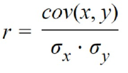{width="18%" fig-alt="Original graphic from slide 61"}

::: source-text
- Correlation Formula
:::

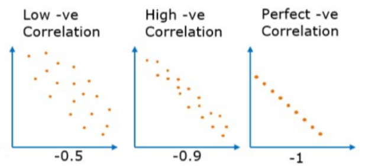{width="46%" fig-alt="Original graphic from slide 61"}

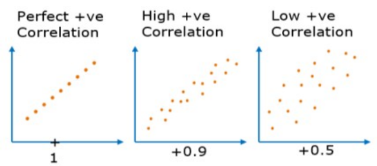{width="48%" fig-alt="Original graphic from slide 61"}

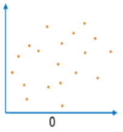{.zero-correlation-plot fig-alt="Original graphic from slide 61"}

::::::

<!-- Original slide 62 -->

:::::: {.source-slide #slide-62}

### Differences between Covariance and Correlation {#source-title-62}

::: source-table
+----------------------------------------------------------------------------------+------------------------------------------------------------------------------------------------------------+
| Covariance                                                                       | Correlation                                                                                                |
+==================================================================================+============================================================================================================+
| Covariance indicates the direction of the linear relationship between variables. | Correlation measures both the strength and the direction of the linear relationship between two variables. |
+----------------------------------------------------------------------------------+------------------------------------------------------------------------------------------------------------+
| Covariance value can vary between -∞ and +∞                                      | Correlation value ranges between -1 and +1                                                                 |
+----------------------------------------------------------------------------------+------------------------------------------------------------------------------------------------------------+
| Covariance unit is based on the product of the units of the two variables.       | Correlation is dimensionless, i.e. It's a unit-free measure of the relationship between variables.         |
+----------------------------------------------------------------------------------+------------------------------------------------------------------------------------------------------------+
:::

::::::

<!-- Original slide 63 -->

:::::: {.source-slide #slide-63}

### Practical Exercise {#source-title-63}

::: source-text
Use the students.xlsx file:

- Compute the covariance and correlation between heights and weights of the students.
- Compute the covariance and correlation between heights and ages of the students.
:::

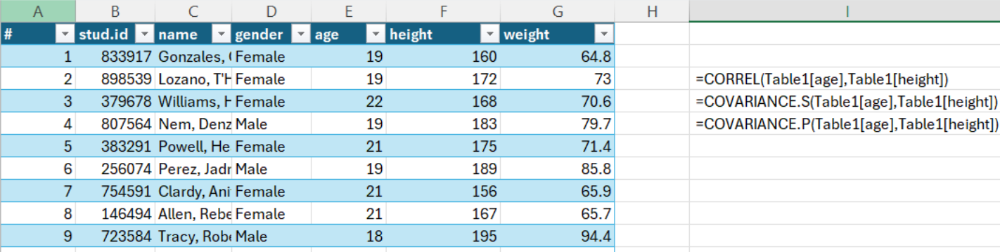{width="100%" fig-alt="Original graphic from slide 63"}

<!-- BEGIN TRY IN R 63 -->
:::: {.try-in-r #try-r-63}

#### Try this in R — Example 13: Covariance and Pearson correlation {#covariance-and-pearson-correlation .unlisted}

- **What we are doing:** Measure linear association for height–weight and height–age pairs. Covariance retains the variables’ combined units; correlation standardizes the measure onto a scale from −1 to +1.
- **How to read the result:** Outputs appear in this order: height–weight covariance, height–weight correlation, height–age covariance and height–age correlation. `complete.obs` uses rows with both variables recorded for each pair. Association alone does not establish causation, and correlation can miss nonlinear patterns.

```{r}
#| label: r-slide-63
# cov() calculates sample covariance and cor() calculates Pearson's linear correlation by default.
# use="complete.obs" omits pairs with missing values; units remain cm, kg, and years.
cov(students$height, students$weight, use = "complete.obs")
cor(students$height, students$weight, use = "complete.obs")
cov(students$height, students$age, use = "complete.obs")
cor(students$height, students$age, use = "complete.obs")
```

::::
<!-- END TRY IN R 63 -->

::::::

<!-- Original slide 64 -->

:::::: {.source-slide #slide-64}

### Practical Exercise {#source-title-64}

::: source-text
We can also use the Data Analysis add-in for this purpose.
:::

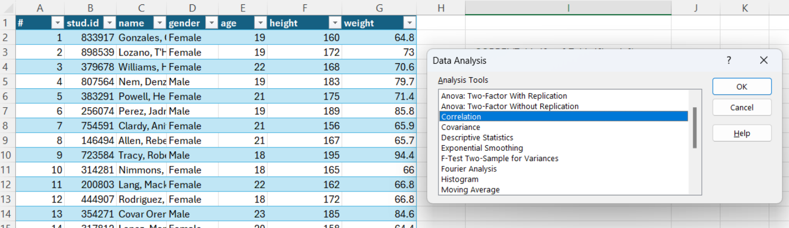{width="100%" fig-alt="Original graphic from slide 64"}

::::::

<!-- Original slide 65 -->

:::::: {.source-slide #slide-65}

## Measures of Distribution {#source-title-65}

::: source-text
Symmetry and Skewness
:::

::::::

<!-- Original slide 66 -->

:::::: {.source-slide #slide-66}

### Skewness {#source-title-66}

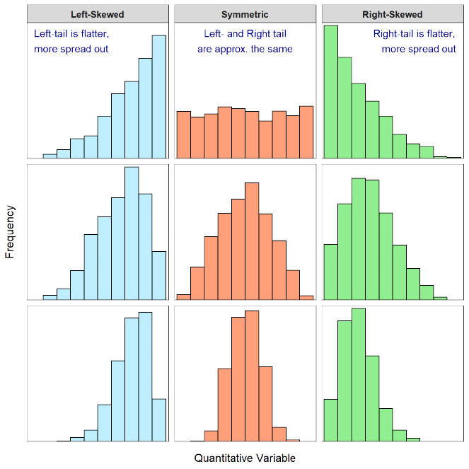{width="50%" fig-alt="Original graphic from slide 66"}

::: source-text
- **Definition**: Skewness is a measure of the asymmetry of the probability distribution of a real-valued random variable about its mean.
- **Key Point**: Indicates whether the data are spread out more to one side of the mean.
- **Positive Skewness (Right-skewed): Tail is longer on the right side of the distribution. Mean is greater than the median.**
- **Negative Skewness (Left-skewed**): Tail is longer on the left side of the distribution. Mean is less than the median.
- Symmetrical Distribution: Skewness is around 0, indicating no skew.
- Use histograms or density plots to illustrate examples of positively skewed, negatively skewed, and symmetrical distributions.
:::

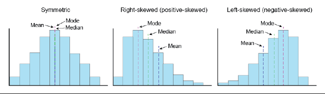{width="100%" fig-alt="Original graphic from slide 66"}

::::::

<!-- Original slide 67 -->

:::::: {.source-slide #slide-67}

### Skewness Coefficient {#source-title-67}

::: source-text
- A positive skewness coefficient implies that extreme values are concentrated in the right tail of the distribution, pulling the mean up, relative to the median and the bulk of values lie to the left of the mean.
- Similarly, a negative skewness coefficient implies that extreme values are concentrated in the left tail of the distribution, pulling the mean down, relative to the median, and the bulk of values lie to the right of the mean.
:::

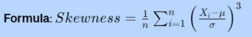{width="39%" fig-alt="Original graphic from slide 67"}

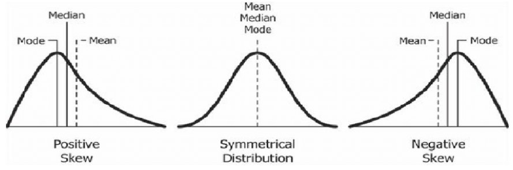{width="64%" fig-alt="Original graphic from slide 67"}

::: source-text
- **A skewness value greater than 1 or less than -1 indicates a highly skewed distribution.**
- **A value between 0.5 and 1 or -0.5 and -1 is moderately skewed.**
- **A value between -0.5 and 0.5 indicates that the distribution is fairly symmetrical.**
- **A skewness coefficient of zero indicates that the values are evenly distributed on both sides of the mean.**
:::

::::::

<!-- Original slide 68 -->

:::::: {.source-slide #slide-68}

### Practical Example {#source-title-68}

::: source-text
- Using the students.xlsx file, find the Skewness value for the "age" column.
- You can use Excel's skew() function to calculate the skewness for a sample, and the skew.p() function to calculate the skewness for a population.
:::

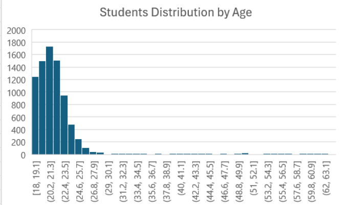{width="51%" fig-alt="Original graphic from slide 68"}

<!-- BEGIN TRY IN R 68 -->
:::: {.try-in-r #try-r-68}

#### Try this in R — Example 14: Skewness of age {#skewness-of-age .unlisted}

- **What we are doing:** Quantify the asymmetry of the age distribution with `skewness()` from the e1071 package, using its default method. The `::` notation selects the function from that package.
- **How to read the result:** A positive value indicates a longer right tail; a negative value indicates a longer left tail. Compare the sign with the histogram rather than treating this statistic as a complete description of shape.

```{r}
#| label: r-slide-68
# e1071::skewness() measures the asymmetry of the age distribution.
e1071::skewness(students$age)
```

::::
<!-- END TRY IN R 68 -->

::::::

<!-- Original slide 69 -->

:::::: {.source-slide #slide-69}

### Practical Exercise: using Excel’s data analysis tools option {#source-title-69}

::: source-text
Select: Data \> Data Analysis \> Descriptive Statistics \> OK.
:::

{width="56%" fig-alt="Original graphic from slide 69"}

::::::

<!-- Original slide 70 -->

:::::: {.source-slide #slide-70}

## Percentiles, Quartiles and Boxplots {#source-title-70}

::::::

<!-- Original slide 71 -->

:::::: {.source-slide #slide-71}

### Percentiles {#source-title-71}

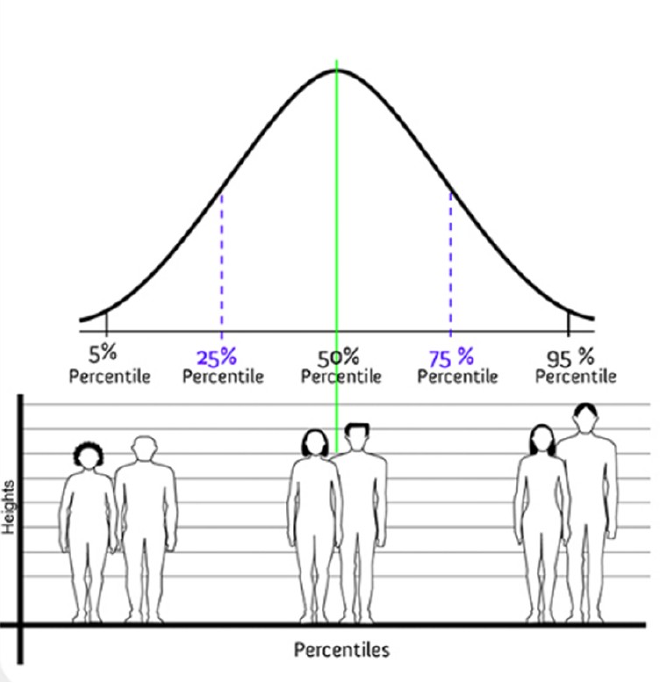{width="50%" fig-alt="Original graphic from slide 71"}

::: source-text
- A **percentile** is a measure that helps us understand the position or relative standing of a particular value within a dataset.
- Percentiles help us divide the data into equal-sized groups and determine the position of a value within those groups.
- For example, if someone\'s score is at the 80th percentile, it means they performed better than 80% of the people in the dataset.
- Percentiles provide insights into how a specific value compares to others, allowing us to assess performance, rankings, or distributions.
- They are commonly used in various fields, such as education, healthcare, and finance, to understand and communicate data in a meaningful way.
:::

::::::

<!-- Original slide 72 -->

:::::: {.source-slide #slide-72}

### Practical Exercise {#source-title-72}

::: source-text
- Using the students.xlsx file, find the 90% Percentile value for the "height" column.
- You can use percentile.inc or percentile.exc to compute percentiles in Excel.
:::

{width="43%" fig-alt="Original graphic from slide 72"}

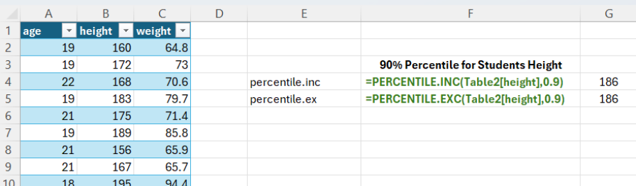{width="69%" fig-alt="Original graphic from slide 72"}

<!-- BEGIN TRY IN R 72 -->
:::: {.try-in-r #try-r-72}

#### Try this in R — Example 15: The 90th percentile {#the-90th-percentile .unlisted}

- **What we are doing:** Find the height value associated with the 90th percentile using R's default calculation.
- **How to read the result:** The output is in centimetres. About 90% of the recorded heights are at or below this value.

```{r}
#| label: r-slide-72
# quantile() finds percentiles; probs=0.90 requests the 90th percentile of height in cm.
quantile(students$height, probs = 0.90)
```

::::
<!-- END TRY IN R 72 -->

::::::

<!-- Original slide 73 -->

:::::: {.source-slide #slide-73}

### Quartiles {#source-title-73}

::: source-text
A Quartile divides a sorted data set into 4 equal parts, so that each part represents ¼ of the data set.
:::

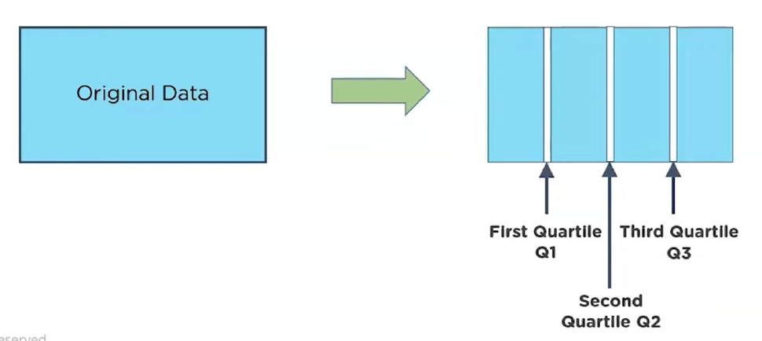{width="73%" fig-alt="Original graphic from slide 73"}

::::::

<!-- Original slide 74 -->

:::::: {.source-slide #slide-74}

### Practical Exercise {#source-title-74}

::: source-text
- Using the students.xlsx file, find the 1^st^ and the 2^nd^ quartiles for the "height" column.
- You can use quartile.inc or quartile.exc to compute percentiles in Excel.
:::

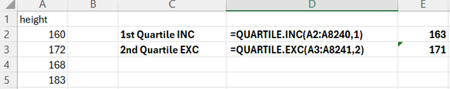{width="67%" fig-alt="Original graphic from slide 74"}

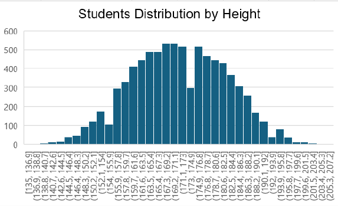{width="43%" fig-alt="Original graphic from slide 74"}

<!-- BEGIN TRY IN R 74 -->
:::: {.try-in-r #try-r-74}

#### Try this in R — Example 16: First and second quartiles {#first-and-second-quartiles .unlisted}

- **What we are doing:** Locate the 25th and 50th percentiles of height: the first quartile and median.
- **How to read the result:** The output gives Q1 and Q2 in centimetres. About 25% of recorded heights are at or below Q1; about 50% are at or below the median.

```{r}
#| label: r-slide-74
# quantile(probs=c(0.25,0.50)) returns the first quartile and median of height in cm.
quantile(students$height, probs = c(0.25, 0.50))
```

::::
<!-- END TRY IN R 74 -->

::::::

<!-- Original slide 75 -->

:::::: {.source-slide #slide-75}

### Boxplots – Box and Whiskers Plots {#source-title-75}

::: source-text
- A boxplot (box-and-whisker plot) is a standardized way of displaying the distribution of data based on a five number summary.
- The five number summary include the minimum value (Min), quartiles (Q1, Q2, and Q3), and the maximum value (Max).
- Boxplots are useful in showing us the range and the skewness of our data as well as outliers.
:::

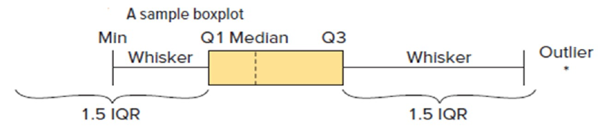{width="79%" fig-alt="Original graphic from slide 75"}

::::::

<!-- Original slide 76 -->

:::::: {.source-slide #slide-76}

### Practical Exercise {#source-title-76}

::: source-text
Use the students.xlsx file:

- Create a box plot that compares the height of male students vs female students.
- Create a box plot that compares the height of Turkish male students vs Russian male students.
:::

{width="49%" fig-alt="Original graphic from slide 76"}

<!-- BEGIN TRY IN R 76 -->
:::: {.try-in-r #try-r-76}

#### Try this in R — Example 17: Boxplots and group comparisons {#boxplots-and-group-comparisons .unlisted}

- **What we are doing:** Compare height distributions first by gender and then, among males, by the two selected country labels. Boxplots summarize the centre and spread and mark observations beyond the whiskers.
- **How to read the result:** Read the median line, box and whiskers together. R uses boxplot hinges, which can differ from the quartiles returned by quantile(); whiskers reach the most extreme observations within 1.5 IQR of the hinges. The original label `Russa` is retained for the Russian category. Group differences here are descriptive, with no causal or population inference implied.

```{r}
#| label: r-slide-76
# boxplot(height~gender) compares groups; whiskers extend to the last data within 1.5 IQR of the hinges.
# subset() selects Turkish/Russian males; R's default boxplot hinges can differ from the quartiles returned by quantile().
boxplot(height ~ gender, data = students, ylab = "Height (cm)", col = "#D4D4D4")
# The source spells Russia as "Russa"; match that original label without changing the data.
males <- subset(students, gender == "Male" & country %in% c("Turkey", "Russa"))
boxplot(height ~ country, data = males, ylab = "Height (cm)", col = "#D4D4D4")
```

::::
<!-- END TRY IN R 76 -->

::::::

<!-- Original slide 78 -->

:::::: {.source-slide #slide-78}

### The Interquartile Range (IQR) {#source-title-78}

::: source-text
- The IQR is like the range, and it shows how the data is spread about the median.
- It is less susceptible than the range to outliers and can, therefore, be more helpful.
- The IQR is calculated according to the following formula:

IQR = Q3 -- Q1.
:::

::::::

<!-- Original slide 79 -->

:::::: {.source-slide #slide-79}

### Using the IQR to Find Outliers {#source-title-79}

::: source-text
Using the IQR to find potential outliers:

- Calculate the IQR for the data.
  - Multiply the interquartile range (IQR) by 1.5 (a constant used to discern outliers).
  - Add the (1.5 x (IQR)) to the third quartile, any number greater than this is a suspected outlier.
  - Subtract the (1.5 x (IQR)) from the first quartile, any number less than this is a suspected outlier.

However, any potential outlier obtained by the interquartile method should be examined in the context of the entire set of data.

We should always follow up our outlier analysis by studying the resulting outliers to see if they make sense.
:::

{width="84%" fig-alt="Original graphic from slide 79"}

<!-- BEGIN TRY IN R 79 -->
:::: {.try-in-r #try-r-79}

#### Try this in R — Example 18: Use IQR fences to flag potential outliers {#use-iqr-fences-to-flag-potential-outliers .unlisted}

- **What we are doing:** Calculate the first and third age quartiles, their interquartile range and the lower and upper 1.5-IQR fences. Then count records outside those fences.
- **How to read the result:** The first output gives the fences in years; the second gives the number of flagged records. The strict comparisons flag ages below the lower fence or above the upper fence. Investigate flagged values in context; the code preserves every observation and does not automatically remove records.

```{r}
#| label: r-slide-79
# quantile() supplies quartiles; the 1.5-IQR fences flag values for investigation.
# sum() counts TRUE flags and does not remove observations; these age fences are measured in years.
q <- quantile(students$age, probs = c(0.25, 0.75))
iqr <- q[2] - q[1]
lower <- q[1] - 1.5 * iqr
upper <- q[2] + 1.5 * iqr
c(lower_fence = unname(lower), upper_fence = unname(upper))
sum(students$age < lower | students$age > upper)
```

::::
<!-- END TRY IN R 79 -->

::::::

<!-- Original slide 81 -->

:::::: {.source-slide #slide-81}

### Impacts of Outliers {#source-title-81}

::: source-text
**1. Negative Impacts**

- Influence on Measures of Central Tendency: A single extreme outlier can pull the mean in its direction, making it unrepresentative of the majority of the data.
- Impact on Dispersion Measures: The presence of outliers can inflate the measures like the standard deviation and the interquartile range (IQR), making them larger than they would be without outliers.
- Skewing Data Distributions: Positive outliers can result in right-skewed distributions, while negative outliers can result in left-skewed distributions. This can affect the interpretation of the data.
- Misleading Summary Statistics: Outliers can distort the interpretation of summary statistics.
- Impact on Hypothesis Testing: Outliers can affect the results of hypothesis tests. They can lead to incorrect conclusions, such as detecting significant differences when none exist or failing to detect real differences when outliers mask them.

**2. Positive Impacts**

- Detection of Anomalies: Outliers can signal the presence of anomalies or rare events in a dataset. Identifying these anomalies can be valuable in various fields, including fraud detection, quality control, and outlier detection in scientific experiments.
- Robust Modeling: In some cases, outliers can be genuine observations that are important to model. For example, in financial modeling, extreme stock price movements may contain valuable information for predicting market trends.
:::

::::::

<!-- Original slide 82 -->

:::::: {.source-slide #slide-82}

### Methods to screen for outliers in a dataset {#source-title-82}

{width="72%" fig-alt="Original graphic from slide 82"}

::: source-text
- Box Plots (Box-and-Whisker Plots):\
  Box plots provide a visual representation of the distribution of data, including the identification of potential outliers. In a box plot, outliers are typically shown as individual data points beyond the whiskers of the plot.
- Scatterplots are particularly useful for identifying outliers in bivariate or multivariate data. Outliers can appear as data points that are far from the main cluster of points in the scatterplot.
- Z-Scores:\
  Z-scores (standard scores) measure how many standard deviations a data point is away from the mean. Data points with high absolute Z-scores (typically greater than 2 or 3) are often considered potential outliers.
- Visual Inspection:\
  Sometimes, simple visual inspection of the data through histograms, QQ plots (quantile-quantile plots), or other visualization techniques can reveal the presence of outliers.
:::

::::::

<!-- Original slide 86 -->

:::::: {.source-slide #slide-86}

### Handling Outliers in Datasets {#source-title-86}

::: source-text
- Handling outliers is an important step in data preprocessing to ensure they do not unduly influence the results of analysis or modeling. The approach depends on the nature of the data, the context of the analysis, and the specific objectives. Here are several methods for handling outliers:
- **Data Truncation or Removal:**
  - Simply remove outliers from the dataset.
  - Should be done cautiously, especially if the outliers represent valid and important observations.
  - Appropriate when outliers are likely due to data entry or measurement errors.
- **Data Transformation:**
  - Transforming the data can mitigate the impact of outliers.
  - Common transformations: logarithmic, square root, or inverse.
  - These compress the range of extreme values.
- **Winsorization:**
  - Involves capping or limiting extreme values by replacing them with a specified percentile value.
  - Example: Replace values above the 95th percentile with the value at the 95th percentile.
- **Imputation:**
  - For missing values (not extreme outliers), impute using methods like:
    - Mean imputation
    - Median imputation
    - Advanced methods (e.g., regression imputation).
:::

::::::

<!-- Original slide 87 -->

:::::: {.source-slide #slide-87}

### Handling Outliers in Datasets {#source-title-87}

::: source-text
- **Robust Statistics:**
  - Use statistical methods less sensitive to outliers.
  - Examples:
    - Replace mean with median.
    - Use interquartile range (IQR) instead of standard deviation.
- **Model-Based Approaches:**
  - In predictive modeling, use algorithms less sensitive to outliers.
  - Examples: robust regression methods, ensemble methods (e.g., random forests).
- **Domain Knowledge:**
  - Rely on domain expertise to interpret outliers.
  - What looks like an outlier may actually be an important and valid data point.
- **Reporting and Transparency:**
  - Clearly document how outliers were handled.
  - Ensures reproducibility and interpretability of results.
:::

:::


## Review together

- Which tables summarize a single variable, and which compare two variables?
- Which charts suit categorical data, and which suit numerical data?
- When should observations be joined by a line? How does a dot plot differ from a histogram?
- How do the mean and median describe different aspects of the same distribution?
- Which dispersion measures retain the original units, and which do not?
- What do the 90th percentile and the quartiles tell us about the data?
- Why does an outlier flag call for investigation rather than automatic deletion?
