Read each topic and run the **Try this in R** examples beside it.

- Open the top-level course folder in Positron and keep the R Console at that project root.
- Run the R cells in order to explore probability models and calculate probabilities.
- These examples generate their values in R. Install MASS if needed for the distribution-fitting example.

<div class="original-branding"></div>

:::::: {.source-slide #part3-01-slide-01}

## 3.1 Random events and probability {#part3-01}

**Probability** is the chance that something happens. This lesson follows the approach and examples of Berenson, Levine et al., *Basic Business Statistics: Concepts and Applications*, 9th ed., Chapters 4 and 5.

- **Example 1 (3.1):** a survey of 1,000 households asked whether they *planned* to buy a big-screen television and whether they *actually bought* one.
- **Example 2 (3.2–3.3):** the number of home mortgages a bank branch approves in a week.

::::::

:::::: {.source-slide #part3-01-slide-02}

### Contents {#part3-title-01-02}

- **Random events and probability:** what probability means, and how to find the chance of an event from a table of survey results.
- **Random variables:** a variable whose value is left to chance, either a category or a number; numerical ones are discrete (counted) or continuous (measured).
- **Probability distributions:** a list of every value a numerical random variable can take, with its probability; its mean and standard deviation; and the standard models used in later lessons.

::::::

:::::: {.source-slide #probability-random-processes .course-foundation}

### Life is full of random processes

A **random process** is anything whose result we cannot predict with certainty each time it happens.

- Whether a household buys a television, how many mortgages a branch approves this week, how long a delivery takes, tomorrow's share price.
- We cannot say what the next result will be, but results often show a **pattern** when we look at many of them.

**Some random processes follow a clear pattern.**

- The pattern stays stable over many repetitions, for example the share of households that buy, or the weekly mortgage counts.
- We can describe it with a **probability distribution**, a short list or formula of the possible results and their probabilities.
- This is the territory of conventional statistics, and the subject of this lesson.

**Others are far more complicated.**

- The result depends on many interacting factors, changes over time, or has no simple shape: language, images, market behaviour.
- A single standard distribution does not describe them well.
- They often need tools beyond the conventional statistics toolbox, such as machine learning, neural networks and deep learning.
- Those methods still rely on probability ideas, so the foundations below remain useful.

::::::

:::::: {.source-slide #probability-outcomes-events .course-foundation}

### What is probability?

**Probability** is the likelihood or chance that a particular **event** will occur. An event is simply one type of occurrence, such as “a household buys a television”.

- **In real life:** businesses face random events every day, such as whether a customer buys or an order arrives late. Probability puts a number on each, so we can plan stock, staffing and promotions.
- A probability is always between **0 and 1**.
- An impossible event has probability 0; an event that is certain to occur has probability 1.
- Probability describes the *long run*. If a card is drawn from a deck and then replaced, the proportion of black cards drawn approaches 0.50, but the next two draws need not contain exactly one black card.

There are three ways to arrive at a probability:

| Approach | Where the probability comes from | Example |
|:--|:--|:--|
| **A priori** (classical) | prior knowledge of the process, with equally likely outcomes | a deck has 26 black cards out of 52, so $P(\text{black})=26/52=0.50$ |
| **Empirical** | observed data | 60% of poll respondents prefer one candidate, so a randomly chosen respondent has probability 0.60 of preferring that candidate |
| **Subjective** | an individual's judgement | a development team assigns 0.6 to a product's success and the company president assigns 0.3 |

Most of this lesson uses the *empirical* approach: probability $=\dfrac{X}{T}$, where $X$ is the number of ways the event occurs and $T$ is the total number of elementary outcomes.

::::::

:::::: {.source-slide #probability-sample-space .course-foundation}

### Sample space and events

A Consumer Electronics Company surveyed **1,000 households** about big-screen television sets.

- **Sample space:** the collection of all possible events. Here it is the whole set of 1,000 households, each classified by what it planned and what it did.
- **Event:** each possible type of occurrence. How we define events depends on the question: purchase plans, or actual purchases.
- **Simple event:** described by a single characteristic, such as “planned to purchase”.
- **Joint event:** has two or more characteristics, such as “planned to purchase **and** actually purchased”.
- **Complement** $A'$: everything that is *not* part of $A$.

**Table 4.1.** Purchase behaviour for big-screen television sets (number of households)

| Planned to purchase | Actually purchased: Yes | Actually purchased: No | Total |
|:--|--:|--:|--:|
| Yes | 200 | 50 | 250 |
| No | 100 | 650 | 750 |
| **Total** | **300** | **700** | **1,000** |

Define $A$ = planned to purchase, $A'$ = did not plan to purchase, $B$ = actually purchased and $B'$ = did not actually purchase.

::::::

:::::: {.source-slide #probability-event-rules .course-foundation}

### Simple (marginal) probability

**Simple probability** is the chance of a single event. It is also called **marginal probability** because the count comes from a margin (total) of the table.

$$P(A)=\frac{\text{number of households in the event}}{\text{total number of households}}$$

- **Planned to purchase:** $P(A)=\dfrac{250}{1{,}000}=0.25$. There is a 25% chance that a household planned to purchase.
- **Actually purchased:** $P(B)=\dfrac{300}{1{,}000}=0.30$.
- **Complement:** $P(A')=\dfrac{750}{1{,}000}=0.75$, which equals $1-P(A)$.

::::::

:::::: {.source-slide #probability-joint-events .course-foundation}

### Joint probability

**Joint probability** is the chance that two or more events occur together, shown by one cell in the middle of the table.

- **Planned and purchased:** only one cell, “Yes and Yes”, contains these households.
  $P(A\text{ and }B)=\dfrac{200}{1{,}000}=0.20$.
- A marginal probability is the sum of its joint probabilities:
  $P(A)=P(A\text{ and }B)+P(A\text{ and }B')=\dfrac{200}{1{,}000}+\dfrac{50}{1{,}000}=0.25$.
- This agrees with the margin of the table, $250/1{,}000$.

::::::

:::::: {.source-slide #probability-combining-events .course-foundation}

### “A or B”: the addition rule

**“$A$ or $B$”** means at least one of the events occurs: planned to purchase, actually purchased, or both.

- **Addition rule:** $P(A\text{ or }B)=P(A)+P(B)-P(A\text{ and }B)$.
- Here $P(A\text{ or }B)=0.25+0.30-0.20=0.35$.
- Subtract the joint probability because the 200 households in both events were counted twice.
- Check from the table: $\dfrac{200+50+100}{1{,}000}=0.35$.

**Two useful terms:**

- **Mutually exclusive** events cannot both occur. “Planned” ($A$) and “did not plan” ($A'$) are mutually exclusive; $A$ and $B$ are not, because 200 households are in both.
- **Collectively exhaustive** events cover every possibility, so one of them must occur. $A$ and $A'$ are collectively exhaustive. Being male and being female is the book's other example: nobody is both, and everyone is one or the other.

::::::

:::::: {.source-slide #probability-conditional .course-foundation}

### Conditional probability

**Conditional probability** is the chance of one event *given that* another has occurred. We keep only the households in the given event and count within them.

- **Given that a household planned to purchase,** what is the chance it actually purchased?
  Use the 250 households in the “Yes” row: $P(B\mid A)=\dfrac{200}{250}=0.80$.
- The formula gives the same answer: $P(B\mid A)=\dfrac{P(A\text{ and }B)}{P(A)}=\dfrac{0.20}{0.25}=0.80$.
- The reverse question is different. Among the 300 buyers, 200 had planned to purchase: $P(A\mid B)=\dfrac{200}{300}\approx0.67$.
- Read $P(B\mid A)$ as “the probability of $B$ given $A$”.

::::::

:::::: {.source-slide #probability-independence .course-foundation}

### Independent events

Two events are **independent** if knowing that one occurred does not change the probability of the other.

- **Test:** $A$ and $B$ are independent if $P(B\mid A)=P(B)$.
- **Our survey:** $P(B\mid A)=0.80$ but $P(B)=0.30$. Knowing that a household planned to purchase raises the chance of purchase from 30% to 80%.
- So *planning to purchase* and *actually purchasing* are **not independent**.
- An equivalent test: independence means $P(A\text{ and }B)=P(A)\,P(B)$. Here $0.25\times0.30=0.075$, but the joint probability is $0.20$.

::::::

:::::: {.source-slide #probability-joint-rule .course-foundation}

### Joint probability: dependent and independent events

A joint probability, $P(A\text{ and }B)$, exists for any two events. How we calculate it depends on whether the events are independent or dependent.

| Events | Rule | Survey: $A$ = planned, $B$ = purchased |
|:--|:--|:--|
| **Any events** (general rule) | $P(A\text{ and }B)=P(A)\times P(B\mid A)$ | $0.25\times0.80=0.20$ (matches the table) |
| **Independent events only** | $P(A\text{ and }B)=P(A)\times P(B)$ | $0.25\times0.30=0.075$ (does **not** match) |

- The general rule is the conditional-probability formula rearranged: $P(B\mid A)=\dfrac{P(A\text{ and }B)}{P(A)}$ gives $P(A\text{ and }B)=P(A)\,P(B\mid A)$.
- If the events are independent, $P(B\mid A)=P(B)$, so the general rule becomes the simpler product $P(A)\,P(B)$.
- If the events are dependent, use the conditional probability. Multiplying the two marginal probabilities would give 0.075 instead of 0.20.
- Independence is a property of the **pair of events**. The joint probability is the quantity we calculate for that pair.

::::::

:::::: {.source-slide #probability-conditioning-reference .course-foundation}

### Conditioning shrinks the reference group

A conditional probability is calculated inside a smaller group. The condition chooses a row (or column) of Table 4.1 as the new total.

| Probability | Reference group (the total) | Households in group | Of those, bought ($B$) | Probability |
|:--|:--|--:|--:|--:|
| $P(B)$ | all households | 1,000 | 300 | $300/1{,}000=0.30$ |
| $P(B\mid A)$ | planned to purchase | 250 | 200 | $200/250=0.80$ |
| $P(B\mid A')$ | did not plan to purchase | 750 | 100 | $100/750\approx0.13$ |

- **Given $A$**, the reference group shrinks from 1,000 households to 250, and we count only buyers inside that group.
- The same 200 households appear in two different probabilities:
  - joint probability $P(A\text{ and }B)=200/1{,}000=0.20$, relative to **all** households;
  - conditional probability $P(B\mid A)=200/250=0.80$, relative to the **planners** only.
- The probability of buying changes with the reference group (0.30, 0.80 or 0.13), so $A$ and $B$ are dependent.
- **In real life:** a retailer that knows planners buy about 80% of the time, against about 13% for non-planners, can decide where to focus its promotion. Using the right reference group changes the decision.

::::::

:::::: {.source-slide #probability-dependent-cards .course-foundation}

### A classic dependent case: drawing cards without replacement

Draw two cards from a standard deck of 52, which contains 4 aces. Let $A_1$ = the first card is an ace and $A_2$ = the second card is an ace.

| Probability | Cards left in the deck | Aces left | Probability |
|:--|--:|--:|--:|
| $P(A_1)$ | 52 | 4 | $4/52\approx0.0769$ |
| $P(A_2\mid A_1)$, first card **kept** (no replacement) | 51 | 3 | $3/51\approx0.0588$ |
| $P(A_2\mid A_1)$, first card **returned** (replacement) | 52 | 4 | $4/52\approx0.0769$ |

- **Without replacement**, the first card changes the deck: the reference group shrinks from 52 to 51 cards and the aces from 4 to 3. The draws are **dependent**.
- **With replacement**, the deck is restored, so $P(A_2\mid A_1)=P(A_2)$ and the draws are **independent**.

| Both cards are aces | Calculation | Result |
|:--|:--|--:|
| Dependent (no replacement) | $P(A_1)\,P(A_2\mid A_1)=\dfrac{4}{52}\times\dfrac{3}{51}$ | $\dfrac{12}{2{,}652}\approx0.0045$ |
| Independent (with replacement) | $P(A_1)\,P(A_2)=\dfrac{4}{52}\times\dfrac{4}{52}$ | $\dfrac{16}{2{,}704}\approx0.0059$ |

- Counting check without replacement: there are $52\times51=2{,}652$ ordered pairs of cards, and $4\times3=12$ of them are two aces.

::::::

:::::: {.source-slide #part3-01-slide-07}

## 3.2 Random variables {#part3-title-01-07}

Understanding the Basics of Probability in Statistics

{.compact-coin width="25%" fig-alt="Coin toss"}

::::::

:::::: {.source-slide #part3-01-slide-08}

### What is a Random Variable?  {#part3-title-01-08}

A **variable** is a characteristic recorded for every item in a survey or process. A **random variable** records the result of a **random process**: its value differs from item to item and is not known in advance, because it depends on which item is selected or on what happens.

- In the survey, pick one household and record whether it planned to purchase. The answer, yes or no, is a random variable.
- The data we collect are the **observed outcomes** (observed values) of random variables.
- No two items are exactly alike, so the observed values will virtually always differ.

There are two types:

| Type | What it records | Examples |
|:--|:--|:--|
| **Categorical** | a category, such as yes or no | planned to purchase a television; day of the week for dinner out |
| **Numerical** | a number | number of magazines subscribed to; height; mortgages approved per week |

Numerical random variables are either **discrete** or **continuous**. Probability distributions, below, are built for numerical random variables.

**In real life:** a random variable turns a random process into numbers we can analyse. Weekly mortgage approvals, a delivery time or a daily sales figure can be summarised, compared and used for decisions such as staffing or stock levels.

::::::

:::::: {.source-slide #part3-01-slide-09}

### Discrete Random Variables {#part3-title-01-09}

::: source-text
A **discrete random variable** gives a number that arises from a **counting** process. Its values can be listed one by one, such as 0, 1, 2, 3, …

Examples of discrete random variables:

- The number of home mortgages approved per week at a bank branch: 0, 1, 2, …
- The number of magazines you subscribe to.
- The number of cars that pass through a toll booth in a day.
- The number of times a coin lands on tails after being flipped 20 times.
- The number of defective widgets in a box of 50.
- The number of calls received by a call centre, or of emails received in a day.

Because the values can be listed, each value can have its own probability, $P(X=x)$.
:::

{width="34%" fig-alt="Illustration: Discrete Random Variables"}

{width="34%" fig-alt="Illustration: Discrete Random Variables"}

::::::

:::::: {.source-slide #part3-01-slide-10}

### Continuous Random Variables {#part3-title-01-10}

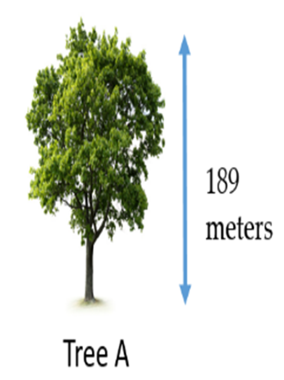{width="30%" fig-alt="Illustration: Continuous Random Variables"}

:::: {.continuous-examples}

::: source-text
A **continuous random variable** gives a number that arises from a **measuring** process. It can take any value in an interval, so its values cannot be listed.

Your height is an example: it could be 67 inches, 67 1/8 inches or 67 1/4 inches, depending on the precision of the measuring instrument. Measuring instruments round the values, so ties appear in data even though the variable is truly continuous.

Examples of continuous random variables:

- Business profits (money is usually modelled as continuous).
- The height of a tree.
- The weight of an animal.
- Arrival times of airlines.
- The time required to run a marathon.
- The weight of a chocolate bar on a production line.

Between any two possible values there are more values, so the probability of one *exact* value is 0. We find the probability that the value falls in an interval, such as $P(T>2)$.
:::

{.compact-marathon width="100%" fig-alt="Marathon finishing time: a continuous measurement"}


::::

::::::

:::::: {.source-slide #probability-discrete-or-continuous .course-foundation}

### Discrete or continuous? Count or measure

Ask one question: **do the values come from counting or from measuring?**

| | Discrete | Continuous |
|:--|:--|:--|
| How values arise | counting | measuring |
| Possible values | can be listed: 0, 1, 2, … | any value in an interval |
| Probability of one exact value | can be positive | always 0 |
| Probabilities come from | adding the probabilities of values | the area under a curve |
| Examples | mortgages approved per week, magazines subscribed to | height, delivery time, weight |

::::::

:::::: {.source-slide #part3-01-slide-11}

## 3.3 Probability distributions {#part3-title-01-11}

::: source-text
Discrete and Continuous Probability Distributions

A distribution shows how the total probability of 1 is shared among the values of a random variable.
:::

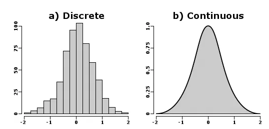{width="58%" fig-alt="Illustration: Introduction to Probability Distributions"}

::::::

:::::: {.source-slide #part3-01-slide-12}

::::::

:::::: {.source-slide #part3-01-slide-13}

### Introduction to Probability Distributions {#part3-title-01-13}

A **probability distribution for a discrete random variable** is a listing of all possible numerical values of the variable, with a probability for each value. It tells us which values are possible and how likely each is, so we can find the probability of any event about the variable.

- The values are **mutually exclusive** (only one can occur) and **collectively exhaustive** (one of them must occur), so the probabilities must add to 1.
- **Discrete variable:** the **probability mass function** (PMF), $p(x)=P(X=x)$, gives the probability of each value.
- **Continuous variable:** the **probability density function** (PDF), $f(x)$, is a curve. The probability of an interval is the **area** under the curve; the height itself is not a probability.
- **Both types:** the **cumulative distribution function** (CDF), $F(x)=P(X\leq x)$, gives the probability of being at or below $x$.
- A distribution is a **model**: a mathematical description of a random process under stated assumptions.
- **Why model?** When a process shows a stable pattern, a distribution answers practical questions, such as “how likely are four or more approvals this week?”, so we can plan. When the pattern is too complicated for a simple distribution, other tools are needed, as the earlier slide on random processes explained.

For a probability distribution to be valid, it must satisfy two criteria:

- Every probability is between 0 and 1 (for a density, $f(x)\geq0$ everywhere).
- All probabilities add up to 1 (for a density, the total area is 1).

::::::

:::::: {.source-slide #probability-mortgage-distribution .course-foundation}

### Example: mortgages approved per week

Let $X$ be the number of home mortgages approved per week at a bank branch (Table 5.1 of the textbook). The table gives the PMF, $P(X=x)$, and the CDF, $F(x)=P(X\leq x)$, for each value $x$.

| $x$ | 0 | 1 | 2 | 3 | 4 | 5 | 6 |
|:--|:--:|:--:|:--:|:--:|:--:|:--:|:--:|
| $P(X=x)$ | 0.10 | 0.10 | 0.20 | 0.30 | 0.15 | 0.10 | 0.05 |
| $F(x)=P(X\leq x)$ | 0.10 | 0.20 | 0.40 | 0.70 | 0.85 | 0.95 | 1.00 |

```{=html}
<figure class="petra-diagram uniform-chart"><svg viewBox="0 0 640 230" role="img" aria-label="Probability distribution of home mortgages approved per week: 0 has 0.10, 1 has 0.10, 2 has 0.20, 3 has 0.30, 4 has 0.15, 5 has 0.10 and 6 has 0.05"><text x="24" y="24">P(X = x)</text><path d="M70 45V180H610" fill="none" stroke="#555" stroke-width="2"/><path d="M70 140H610" stroke="#bbb" stroke-dasharray="4 4"/><path d="M70 100H610" stroke="#bbb" stroke-dasharray="4 4"/><path d="M70 60H610" stroke="#bbb" stroke-dasharray="4 4"/><text x="22" y="145">0.10</text><text x="22" y="105">0.20</text><text x="22" y="65">0.30</text><path d="M120 180V140" stroke="#763D52" stroke-width="4"/><circle cx="120" cy="140" r="5" fill="#763D52"/><text x="120" y="205" text-anchor="middle">0</text><path d="M192 180V140" stroke="#763D52" stroke-width="4"/><circle cx="192" cy="140" r="5" fill="#763D52"/><text x="192" y="205" text-anchor="middle">1</text><path d="M264 180V100" stroke="#763D52" stroke-width="4"/><circle cx="264" cy="100" r="5" fill="#763D52"/><text x="264" y="205" text-anchor="middle">2</text><path d="M336 180V60" stroke="#763D52" stroke-width="4"/><circle cx="336" cy="60" r="5" fill="#763D52"/><text x="336" y="205" text-anchor="middle">3</text><path d="M408 180V120" stroke="#763D52" stroke-width="4"/><circle cx="408" cy="120" r="5" fill="#763D52"/><text x="408" y="205" text-anchor="middle">4</text><path d="M480 180V140" stroke="#763D52" stroke-width="4"/><circle cx="480" cy="140" r="5" fill="#763D52"/><text x="480" y="205" text-anchor="middle">5</text><path d="M552 180V160" stroke="#763D52" stroke-width="4"/><circle cx="552" cy="160" r="5" fill="#763D52"/><text x="552" y="205" text-anchor="middle">6</text><text x="616" y="184">x</text></svg><figcaption>Home mortgages approved per week: the probabilities add to 1.</figcaption></figure>
```

- **Valid?** Every probability is between 0 and 1, and $0.10+0.10+0.20+0.30+0.15+0.10+0.05=1$.
- **A statement about $X$ is an event.** $\{X=3\}$ has $P(X=3)=0.30$.
- **Add the values in the event:** $P(X\geq4)=0.15+0.10+0.05=0.30$.
- **Use the CDF directly:** $P(X\leq2)=F(2)=0.40$.
- **In real life:** $P(X\geq4)=0.30$ means that, over many weeks, about 3 weeks in 10 need capacity for four or more approvals. A manager can use this when planning staff.

::::::

:::::: {.source-slide #probability-distribution-summary .course-foundation}

### Mean and standard deviation of a distribution

Two numbers summarise where a distribution is centred and how spread out it is.

- **Expected value (mean):** $E(X)=\mu=\sum x\,P(x)$, a **weighted average** of all values, weighted by their probabilities.
- **Variance:** $\sigma^2=\sum\,[x-E(X)]^2\,P(x)$, the weighted average of the squared differences from the mean. The **standard deviation** is $\sigma=\sqrt{\sigma^2}$.
- For continuous variables the sums become integrals, but the meaning is the same.

**Mortgages approved per week:**

- $E(X)=(0)(0.10)+(1)(0.10)+(2)(0.20)+(3)(0.30)+(4)(0.15)+(5)(0.10)+(6)(0.05)=2.8$.
- $\sigma^2=(0-2.8)^2(0.10)+(1-2.8)^2(0.10)+\dots+(6-2.8)^2(0.05)=2.46$.
- $\sigma=\sqrt{2.46}\approx1.57$.
- The mean of 2.8 is not literally possible in one week; it is the average number approved per week over the long run.

::::::

:::::: {.source-slide #probability-distribution-roadmap .course-foundation}

### The models we will use

Some random processes follow a pattern that a standard distribution describes well. These are the models used in later lessons.

| Model | Type | It describes | A real-life process |
|:--|:--|:--|:--|
| Discrete uniform | discrete | equally likely whole-number values | a fair die; a draw from numbered tickets |
| Binomial | discrete | the number of successes in $n$ independent yes/no trials | defective items in a sample; customers who buy out of 20 visits |
| Poisson | discrete | the number of events in a fixed interval | calls per hour; emails per day |
| Continuous uniform | continuous | equally likely values across an interval | the waiting time when a shuttle arrives at a random moment within a fixed window |
| Normal | continuous | a bell-shaped model for measurements | heights, measurement errors, many exam scores |

- Choosing a model means checking that the process really behaves this way.
- If no standard distribution fits, a more flexible method such as machine learning may be needed.

::::::

:::::: {.source-slide #part3-01-slide-14}

### Discrete Uniform Distribution {#part3-title-01-14}

Equal probability is assigned to each integer from $a$ to $b$, where $a$ and $b$ are integers and $a \le b$.

- **Notation:** $X \sim U\{a, a+1,\ldots,b\}$; there are $k=b-a+1$ possible outcomes.
- **Probability mass function:** $P(X=x)=\dfrac{1}{b-a+1}=\dfrac{1}{k}$ for $x\in\{a,\ldots,b\}$; zero otherwise.
- **Expected value:** $E(X)=\dfrac{a+b}{2}$.
- **Variance:** $\operatorname{Var}(X)=\dfrac{(b-a+1)^2-1}{12}$.

**Example — a fair six-sided die:** $a=1$, $b=6$. Each face has probability $1/6$, $E(X)=3.5$ and $\operatorname{Var}(X)=35/12\approx2.917$. The expected value is the long-run average; it need not be a possible single outcome.

```{=html}
<figure class="petra-diagram uniform-chart"><svg viewBox="0 0 640 230" role="img" aria-label="Fair die probability mass function: six outcomes, each with probability one sixth"><text x="24" y="24">P(X = x)</text><path d="M70 45V180H610" fill="none" stroke="#555" stroke-width="2"/><path d="M70 80H610" stroke="#bbb" stroke-dasharray="4 4"/><text x="30" y="85">1/6</text><path d="M154 180V80" stroke="#763D52" stroke-width="4"/><circle cx="154" cy="80" r="5" fill="#763D52"/><text x="154" y="205" text-anchor="middle">1</text><path d="M228 180V80" stroke="#763D52" stroke-width="4"/><circle cx="228" cy="80" r="5" fill="#763D52"/><text x="228" y="205" text-anchor="middle">2</text><path d="M302 180V80" stroke="#763D52" stroke-width="4"/><circle cx="302" cy="80" r="5" fill="#763D52"/><text x="302" y="205" text-anchor="middle">3</text><path d="M376 180V80" stroke="#763D52" stroke-width="4"/><circle cx="376" cy="80" r="5" fill="#763D52"/><text x="376" y="205" text-anchor="middle">4</text><path d="M450 180V80" stroke="#763D52" stroke-width="4"/><circle cx="450" cy="80" r="5" fill="#763D52"/><text x="450" y="205" text-anchor="middle">5</text><path d="M524 180V80" stroke="#763D52" stroke-width="4"/><circle cx="524" cy="80" r="5" fill="#763D52"/><text x="524" y="205" text-anchor="middle">6</text><text x="616" y="184">x</text></svg><figcaption>Fair die: all six outcomes have the same probability.</figcaption></figure>
```


::::::

:::::: {.source-slide #part3-01-slide-15}

### Discrete Uniform – PMF Uses {#part3-title-01-15}

::: source-text
**Calculating individual probabilities**

Example: For a fair die (U(1,6)), the probability of rolling a 3 is:

P(X = 3) = 1/(6-1+1) = 1/6 ≈ 0.167

**Finding probabilities of events**

For multiple outcomes: Sum the individual probabilities

Example: Probability of rolling an even number:

P(X ∈ {2,4,6}) = P(X=2) + P(X=4) + P(X=6) = 1/6 + 1/6 + 1/6 = 3/6 = 0.5

**Range probabilities**

Example: Probability of rolling between 2 and 5 inclusive:

P(2 ≤ X ≤ 5) = (5-2+1)/(6-1+1) = 4/6 = 0.667
:::

:::: {.try-in-r #r-example-01-15}

#### Try this in R {.unlisted}

- **Purpose:** Calculate probabilities for a fair die.
- **Before running:** `1:6` lists the six values; `rep(1/6,6)` gives each the same probability. `sum()` adds selected probabilities. `%in%` tests membership; `&` requires both comparisons; `>=` and `<=` include the endpoints.

```{r}
#| label: inferential-1-15
# rep() assigns equal mass to the six fair-die outcomes; sum() adds the selected probabilities.
# %in% selects even outcomes; the second selection includes both endpoints 2 and 5.
outcomes <- 1:6
probability <- rep(1/6, 6)
c(three = probability[3], even = sum(probability[outcomes %in% c(2,4,6)]),
  between_2_and_5 = sum(probability[outcomes >= 2 & outcomes <= 5]))
```

**Read the result:** One specified face has probability 1/6, even faces 1/2 and values 2 through 5 have probability 2/3. Equal probabilities are assumed.

::::
::::::

:::::: {.source-slide #part3-01-slide-16}

### Binomial Distribution {#part3-title-01-16}

The binomial distribution models the **number of successes in $n$ independent Bernoulli trials**, each with the same success probability $p$. A Bernoulli trial has two outcomes: success or failure.

- **Notation:** $X\sim\operatorname{Binomial}(n,p)$; $X$ counts successes.
- **Parameters:** $n$ is the fixed number of trials; $p$ is the success probability on each trial.
- **Probability mass function:**

$$P(X=x)=\binom{n}{x}p^x(1-p)^{n-x},\qquad x=0,1,\ldots,n.$$

Here $\binom{n}{x}$ counts the ways to choose $x$ successes among $n$ trials; $1-p$ is the failure probability.

- **Expected value:** $E(X)=np$, the average number of successes over repeated sets of $n$ trials.
- **Variance:** $\operatorname{Var}(X)=np(1-p)$, the spread of the success count in squared count units.

**Example:** If 80 cars each independently have a 2% defect probability, $n=80$ and $p=0.02$. Counting a defect as a “success”, $E(X)=80(0.02)=1.6$ defective cars per group of 80 on average; $\operatorname{Var}(X)=80(0.02)(0.98)=1.568$.


::: source-text
Example: The defect ratio in a car factory is 2% and the factory produces 80 cars in a month,. We can use the binomial distribution to answer questions similar to:

what is the probability that exactly 2 cars are defective?

what is the probability that less than 2 cars are defective?

what is the probability that more than 2 cars are defective?

What is the probability that all cars produced in a month will have no defects?
:::

{.compact-logo width="18%" fig-alt="Tesla logo"}

:::: {.try-in-r #r-example-01-16}

#### Try this in R {.unlisted}

- **Purpose:** Count defective cars among the stated 80 independent cars.
- **Before running:** `dbinom(x, size, prob)` gives an exact binomial count probability. `pbinom(q, size, prob)` gives the probability at or below cutoff q; `lower.tail=FALSE` instead gives above q. `size=80` is the trial count and `prob=0.02` is the per-car defect chance. Thus fewer than two uses cutoff 1.

```{r}
#| label: inferential-1-16
# dbinom() gives exact counts; pbinom() gives cumulative probabilities for 80 independent cars.
# less than 2 means X<=1; lower.tail=FALSE computes P(X>2), using the stated defect probability 0.02.
c(exactly_2 = dbinom(2, size=80, prob=0.02), less_than_2 = pbinom(1,80,0.02),
  more_than_2 = pbinom(2,80,0.02,lower.tail=FALSE), no_defects = dbinom(0,80,0.02))
```

**Read the result:** Interpret each labelled probability as a batch event under the independent, common-probability model; an expected count is not a guaranteed batch result.

::::
::::::

:::::: {.source-slide #part3-01-slide-17}

### The Binomial Distribution {#part3-title-01-17}

**What does the combination term count?** It counts the choices of trial positions that contain successes.

For a small illustration, toss a fair coin independently three times. H means head and T means tail; the eight sequences below each have probability $1/8$.

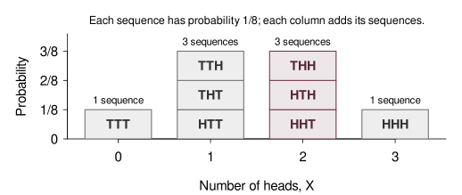{.binomial-arrangements-chart width="640" fig-alt="Eight equally likely three-toss sequences grouped by head count; HHT, HTH and THH are the three ways to get exactly two heads"}

- **Exactly two heads:** HHT, HTH or THH. We choose head positions $\{1,2\}$, $\{1,3\}$ or $\{2,3\}$.
- Thus $\binom{3}{2}=3$ (read “3 choose 2”) counts the three sequences, and $P(X=2)=3\times1/8=3/8$.

**Apply the same idea to the existing ten-toss example:**

::: source-text
What is the probability of having 2 Heads ONLY out of 10 trials, knowing that the probability of Head = 50%?
:::

There are $\binom{10}{2}=45$ choices of head positions. Each ten-toss sequence has probability $(1/2)^{10}$, so $P(X=2)=45(1/2)^{10}\approx0.04395$, or **4.39%**.

::: source-text
A binomial distribution is symmetric when p = 0.5 and skewed when p is close to 0 or 1. A normal approximation improves when both np and n(1 − p) are sufficiently large; increasing n alone is not a universal guarantee.
:::

::::: {.recovered-resources #original-resources-1-17}

:::: {.recovered-resource}
::: {.resource-description}
**Interactive calculator — binomial distribution (StatCrunch)**

Try n = 10, p = 0.5 and P(X = 2), then change n or p to inspect the distribution.

<https://www.statcrunch.com/app/calculator.html?calculator=binomial>
:::

::: {.resource-qr}
[{.compact-resource-qr width="144" fig-alt="QR code: Interactive calculator — binomial distribution (StatCrunch)"}](https://www.statcrunch.com/app/calculator.html?calculator=binomial)
:::
::::

:::: {.recovered-resource}
::: {.resource-description}
**Interactive calculator — binomial distribution (Matt Bognar)**

Choose the trial count and success probability; compare exact-count and cumulative probabilities.

<https://mabognar.github.io/apps/bin.html>
:::

::: {.resource-qr}
[{.compact-resource-qr width="144" fig-alt="QR code: Interactive calculator — binomial distribution (Matt Bognar)"}](https://mabognar.github.io/apps/bin.html)
:::
::::

:::::

:::: {.try-in-r #r-example-01-17}

#### Try this in R {.unlisted}

- **Purpose:** See how the number of trials $n$ and success probability $p$ affect the binomial shape.
- **Before running:** `c()` combines values into vectors; `[i]` selects the ith value. `1:4` lists the four panel numbers, and the `for` loop repeats the plotting steps for each panel. `0:n` lists every possible success count from zero to $n$.
- `dbinom(x, size, prob)` gives the probability at each count `x`; `size` is $n$ and `prob` is $p$. These are theoretical probabilities, not simulated data.
- `par(mfrow = c(2, 2))` arranges two rows and two columns; `mar` sets bottom, left, top and right margins. Assigning its result to `old_par` saves the old settings; `par(old_par)` restores them.
- `plot(x, y)` draws counts against probabilities. `type = "h"` draws vertical probability masses, `lwd` sets line width, `col` sets colour, `xlab`/`ylab` label axes and `main` sets a title. `paste()` joins the title text and parameter values.
- `if` runs the highlighted step only when both conditions hold: `==` tests equality and `&&` means “and”. `segments()` draws the burgundy line from `(x0, y0)` to `(x1, y1)` at two successes.

```{r}
#| label: inferential-1-17
# Compare success probabilities at n = 10, then increase n to 100.
# Save the current plotting layout so it can be restored afterwards.
old_par <- par(mfrow = c(2, 2), mar = c(4, 4, 3, 1))
trial_counts <- c(10, 10, 10, 100)
success_probs <- c(0.2, 0.5, 0.8, 0.5)
for (i in 1:4) {
  n <- trial_counts[i]
  p <- success_probs[i]
  x <- 0:n
  probabilities <- dbinom(x = x, size = n, prob = p)
  plot(x = x, y = probabilities, type = "h", lwd = 3,
       col = "#595959", xlab = "Number of successes",
       ylab = "Probability", main = paste("n =", n, "; p =", p))
  if (n == 10 && p == 0.5) {
    # Highlight the question: exactly two heads in ten fair tosses.
    segments(x0 = 2, y0 = 0, x1 = 2,
             y1 = dbinom(x = 2, size = n, prob = p),
             col = "#763D52", lwd = 4)
  }
}
par(old_par)
dbinom(x = 2, size = 10, prob = 0.5)
```

**Read the result:** At $n=10$, $p=0.2$ gives right skew, $p=0.5$ gives symmetry, and $p=0.8$ gives left skew. At $n=100$, $p=0.5$, the discrete shape is more bell-like and centred at $np=50$. In the ten-toss fair-coin panel, the burgundy line marks exactly two heads: probability 0.0439453, about 4.39%. Compare the axis scales as well as the shapes.

::::
::::::

:::::: {.source-slide #part3-01-slide-18}

### Discrete Probability Distributions The Poisson Distribution {#part3-title-01-18}

::: source-text
- Poisson Distribution can be used to model the number of times an event occurs within a specified time period or in a given space.
- It\'s particularly useful for estimating the likelihood of rare events over short intervals.
- The key feature of the Poisson distribution is that it is defined by just one parameter, **λ** (lambda), which represents the average rate at which events occur.
:::

**Poisson probability mass function**

$$P(X=x)=\frac{\lambda^x e^{-\lambda}}{x!},\qquad x=0,1,2,\ldots.$$

- $X$ counts occurrences in a specified time interval or region.
- $\lambda>0$ is the expected number of occurrences in that interval or region.
- $e\approx2.71828$ is Euler's number; $x!$ is the factorial of $x$, with $0!=1$.
- **Expected value:** $E(X)=\lambda$.
- **Variance:** $\operatorname{Var}(X)=\lambda$; the standard deviation is $\sqrt{\lambda}$.
- **Model assumptions:** occurrences are independent, with a constant rate over the interval or region.

**Example:** At an average of 1,000 calls per hour, a Poisson model has $\lambda=1000$ for a one-hour interval. Its expected count is 1,000 calls, variance 1,000 calls squared, and standard deviation approximately 31.62 calls.


::: source-text
Example: Suppose that Zein call center receives 1000 calls/hour on average, and that data center has a capacity of receiving 1100 calls/hours.

Use the Poisson Distribution to find the probability that the number of calls will exceed the call center\'s capacity, which will require additional temporary staff?
:::

{.compact-logo width="14%" fig-alt="Zain logo"}

:::: {.try-in-r #r-example-01-18}

#### Try this in R {.unlisted}

- **Purpose:** Find the probability of exceeding the stated call-centre capacity.
- **Before running:** `ppois(q=1100, lambda=1000, lower.tail=FALSE)` gives the chance of more than 1,100 events when the expected count is 1,000 per hour. The cutoff and rate refer to the same hour.

```{r}
#| label: inferential-1-18
# ppois() uses the stated one-hour mean lambda=1000 under a homogeneous Poisson model.
# lower.tail=FALSE gives P(X>1100), so exactly 1100 calls does not exceed capacity.
ppois(1100, lambda=1000, lower.tail=FALSE)
```

**Read the result:** This is the chance of exceeding the threshold under the Poisson model; exactly 1,100 is excluded. A probability alone does not determine staffing.

::::
::::::

:::::: {.source-slide #part3-01-slide-19}

### Poisson Distribution {#part3-title-01-19}

::: source-text
A Poisson distribution models counts, not continuous measurements. Small λ gives a right-skewed shape. As λ increases, it becomes more symmetric and approximately bell-shaped, while its possible outcomes remain whole numbers.
:::

::::: {.recovered-resources #original-resources-1-19}

:::: {.recovered-resource}
::: {.resource-description}
**Interactive calculator — Poisson distribution (StatCrunch)**

Try an expected count of 20 and P(X = 15), then change the expected count to inspect the shape.

<https://www.statcrunch.com/app/calculator.html?calculator=poisson>
:::

::: {.resource-qr}
[{.compact-resource-qr width="144" fig-alt="QR code: Interactive calculator — Poisson distribution (StatCrunch)"}](https://www.statcrunch.com/app/calculator.html?calculator=poisson)
:::
::::

:::: {.recovered-resource}
::: {.resource-description}
**Interactive calculator — Poisson distribution (Matt Bognar)**

Set the expected count for the interval, then calculate exact-count or cumulative probabilities.

<https://mabognar.github.io/apps/pois.html>
:::

::: {.resource-qr}
[{.compact-resource-qr width="144" fig-alt="QR code: Interactive calculator — Poisson distribution (Matt Bognar)"}](https://mabognar.github.io/apps/pois.html)
:::
::::

:::::

:::: {.try-in-r #r-example-01-19}

#### Try this in R {.unlisted}

- **Purpose:** Compare a visibly skewed Poisson distribution ($\lambda=2$) with the more symmetric $\lambda=20$ case, and calculate the probability of exactly 15 events.
- **Before running:** `dpois(x, lambda)` gives the probability at each whole-number count `x`; `lambda` is the expected count for the interval. `qpois(p = 0.999, lambda)` gives the smallest count whose cumulative probability is at least 99.9%, setting a practical plotting limit. The distribution itself continues beyond that limit.
- `c(2, 20)` combines the two parameter values; the `for` loop draws one panel per value. `0:` constructs the sequence of counts from zero to the chosen limit.
- `par(mfrow = c(1, 2))` places two panels side by side; `mar` sets the bottom, left, top and right margins. Save these settings in `old_par`, then restore the previous layout with `par(old_par)`.
- `plot(x, y)` draws counts against probabilities; `type = "h"` uses separate vertical masses, `lwd` sets width, `col` sets colour, `xlab`/`ylab` label axes and `main` supplies a title. `paste()` joins the title text with the parameter value.
- `if (lambda == 20)` highlights only the second panel: `==` tests equality. `segments()` draws the burgundy line from `(x0, y0)` to `(x1, y1)` at 15 events.

```{r}
#| label: inferential-1-19
# Compare a small expected count with the calculator example, lambda = 20.
old_par <- par(mfrow = c(1, 2), mar = c(4, 4, 3, 1))
lambda_values <- c(2, 20)
for (lambda in lambda_values) {
  # Display counts through the 99.9th percentile; a small right tail is omitted.
  x <- 0:qpois(p = 0.999, lambda = lambda)
  probabilities <- dpois(x = x, lambda = lambda)
  plot(x = x, y = probabilities, type = "h", lwd = 3,
       col = "#595959", xlab = "Number of events",
       ylab = "Probability", main = paste("Poisson: lambda =", lambda))
  if (lambda == 20) {
    segments(x0 = 15, y0 = 0, x1 = 15,
             y1 = dpois(x = 15, lambda = lambda),
             col = "#763D52", lwd = 4)
  }
}
par(old_par)
dpois(x = 15, lambda = 20)
```

**Read the result:** The $\lambda=2$ panel is right-skewed; the $\lambda=20$ panel looks more bell-shaped. Both show **discrete Poisson probabilities**, not a continuous normal density. At $\lambda=20$, the burgundy line marks $P(X=15)\approx0.05165$, or 5.16%. Compare the different axis scales too.

::::
::::::

:::::: {.source-slide #part3-01-slide-20}

### Continuous Probabilities Distributions {#part3-title-01-20}

::::::

:::::: {.source-slide #part3-01-slide-21}

### The Continuous Uniform Distribution {#part3-title-01-21}

A continuous uniform distribution has **constant probability density** on the interval $[a,b]$, where $a<b$. Equal-length subintervals have equal probability.

- **Notation:** $X\sim U(a,b)$.
- **Density:** $f(x)=\dfrac{1}{b-a}$ for $a\le x\le b$, and zero otherwise.
- **Expected value:** $E(X)=\dfrac{a+b}{2}$.
- **Variance:** $\operatorname{Var}(X)=\dfrac{(b-a)^2}{12}$; standard deviation $\sigma=\dfrac{b-a}{\sqrt{12}}$.
- **Interval probability:** $P(c\le X\le d)=\dfrac{d-c}{b-a}$ for $a\le c\le d\le b$.
- **One exact value:** $P(X=x)=0$. Probabilities are areas, not density heights.

**Example — delivery time from 2 to 5 days:** $E(X)=3.5$ days, variance $0.75$ days squared. Delivery between 3 and 4 days has probability $(4-3)/(5-2)=1/3$.


```{=html}
<figure class="petra-diagram uniform-chart"><svg viewBox="0 0 640 250" role="img" aria-label="Continuous uniform density between a and b, shaded interval c to d"><text x="20" y="28">Density f(x)</text><path d="M85 50V190H610" fill="none" stroke="#555" stroke-width="2"/><rect x="245" y="80" width="155" height="110" fill="#ddd"/><path d="M150 190V80H520V190" fill="none" stroke="#763D52" stroke-width="3"/><text x="15" y="85">1/(b−a)</text><text x="150" y="215" text-anchor="middle">a</text><text x="245" y="215" text-anchor="middle">c</text><text x="400" y="215" text-anchor="middle">d</text><text x="520" y="215" text-anchor="middle">b</text><text x="615" y="195">x</text><text x="320" y="135" text-anchor="middle">Probability = area</text></svg><figcaption>The shaded rectangle has width d − c and height 1/(b − a).</figcaption></figure>
```

::::::

:::::: {.source-slide #part3-01-slide-22}

### The Continuous Uniform Distribution Business Cases Studies {#part3-title-01-22}

::: source-text
**Inventory Arrival**

A retailer\'s deliveries arrive uniformly between 8 AM and 12 PM.
:::

::: source-text
**Manufacturing**

A machine produces widgets with diameters uniformly distributed between 9.8mm and 10.2mm.
:::

**Delivery arrivals: $X\sim U(8,12)$, in hours on the clock**

- **Mean arrival time:** $E(X)=(8+12)/2=10$, or 10 AM.
- **Before 9 AM:** $P(X<9)=(9-8)/(12-8)=0.25=25\%$.
- **Planning:** be ready from 8 AM. The uniform model gives the same arrival probability to every one-hour interval; 10 AM is not a predicted peak.


**Widget diameter: $X\sim U(9.8,10.2)$, in millimetres**

- **Mean diameter:** $E(X)=(9.8+10.2)/2=10.0$ mm.
- **Above 10.1 mm:** $P(X>10.1)=(10.2-10.1)/(10.2-9.8)=0.25=25\%$.
- **Variance:** $\operatorname{Var}(X)=(10.2-9.8)^2/12\approx0.01333$ mm squared.
- **Quality interpretation:** under this model, 25% of widgets exceed 10.1 mm. This is not a defect rate unless 10.1 mm is the specified upper limit.


:::: {.try-in-r #r-example-01-22}

#### Try this in R {.unlisted}

- **Purpose:** Apply the two uniform models.
- **Before running:** `punif(q, min, max)` returns the probability at or below cutoff `q`, with interval endpoints `min` and `max`. `lower.tail = FALSE` returns the probability above the cutoff. `c()` combines the labelled results.
- `par(mfrow = c(1, 2))` places two charts side by side. `mar` sets bottom, left, top and right margins; save previous settings as `old_par` and restore them using `par(old_par)`.
- `plot(x, y, type = "n")` sets up axes without drawing data; the two-element `x` and `y` vectors set the displayed ranges. `xlab`, `ylab` and `main` supply axis labels and the title.
- `rect()` shades a rectangle bounded by `xleft`, `xright`, `ybottom` and `ytop`. `col` sets its fill; `border = NA` omits the border. `segments()` draws the horizontal density from `(x0, y0)` to `(x1, y1)`; `lwd` sets its width.
- Arrival values are clock hours; diameters are millimetres. A density can exceed 1: its **area**, rather than its height, must total 1.

```{r}
#| label: inferential-1-22
# Exact interval probabilities from the two stated continuous uniform models.
c(arrival_before_9 = punif(q = 9, min = 8, max = 12),
  diameter_above_10_1 = punif(q = 10.1, min = 9.8, max = 10.2,
                             lower.tail = FALSE))
# Plot density heights; shaded areas represent the required probabilities.
old_par <- par(mfrow = c(1, 2), mar = c(4, 4, 3, 1))
plot(x = c(8, 12), y = c(0, 0.30), type = "n",
     xlab = "Arrival hour", ylab = "Density", main = "Arrive before 9 AM")
rect(xleft = 8, ybottom = 0, xright = 9, ytop = 1 / (12 - 8),
     col = "#D8D8D8", border = NA)
segments(x0 = 8, y0 = 0.25, x1 = 12, y1 = 0.25,
         col = "#763D52", lwd = 3)
plot(x = c(9.8, 10.2), y = c(0, 3), type = "n",
     xlab = "Diameter (mm)", ylab = "Density", main = "Diameter above 10.1 mm")
rect(xleft = 10.1, ybottom = 0, xright = 10.2, ytop = 1 / (10.2 - 9.8),
     col = "#D8D8D8", border = NA)
segments(x0 = 9.8, y0 = 2.5, x1 = 10.2, y1 = 2.5,
         col = "#763D52", lwd = 3)
par(old_par)
```

**Read the result:** Both probabilities are 0.25. Uniformity means equal-length intervals have equal probability; the midpoint is not a peak.

::::
::::::

:::::: {.source-slide #part3-01-slide-23}

### The Normal Distribution {#part3-title-01-23}

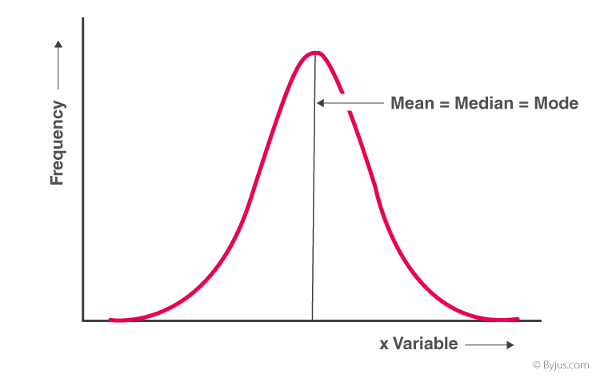{width="44%" fig-alt="Illustration: The Normal Distribution"}

::: source-text
The normal distribution is the most extensively used probability distribution in statistical work.

It is also known as the Gaussian distribution and the Bell Curve.

The x-axis represents the outcomes of the normal process (e.g. students scores, heights, salaries...etc.).

The AREA UNDER THE CURVE represents the probability of the outcome.

The normal distribution has a symmetric distribution where most of the observations cluster around the central peak.

Theoretically, a normal random variable can assume any value between minus infinity and plus infinity.

Normal Distribution Main Features:

Symmetrically distributed

Long Tails / Bell Shaped

Mean/ Mode and Median are the same
:::

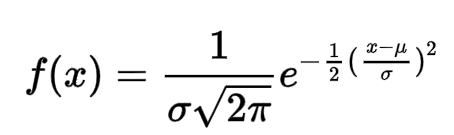{width="32%" fig-alt="Illustration: The Normal Distribution"}

::::::

:::::: {.source-slide #part3-01-slide-24}

### Parameters of the Normal Distribution {#part3-title-01-24}

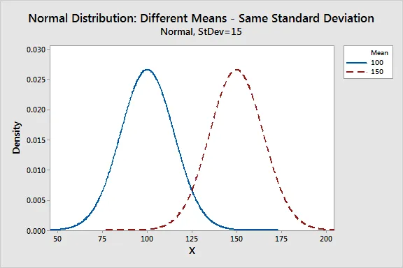{width="38%" fig-alt="Illustration: Parameters of the Normal Distribution"}

::: source-text
The normal distribution is completely described by two parameters, the Mean and the Standard Deviation.

Where X is a continuous random variable (the expected outcome of a continuous random process).

μ = The Mean of the Outcomes of the Random Process.

σ = The Standard Deviation of the Outcomes of the Random Process.

π is approximately 3.14159.

e is approximately 2.71828.
:::

{width="35%" fig-alt="Illustration: Parameters of the Normal Distribution"}

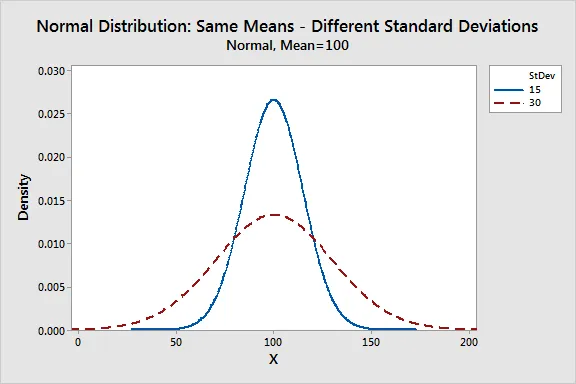{width="38%" fig-alt="Illustration: Parameters of the Normal Distribution"}

::::::

:::::: {.source-slide #part3-01-slide-25}

### The Empirical Rule for the Normal Distribution {#part3-title-01-25}

{width="44%" fig-alt="Illustration: The Empirical Rule for the Normal Distribution"}

::: source-text
The Empirical Rule describes how data (continuous outcomes) are spread in a normal distribution.

The proportion of the area that falls under the curve between two points on a probability distribution indicates the probability that a value will fall within that interval.

If we know that the data are drawn from a relatively symmetric and bell-shaped distribution - perhaps by a visual inspection of its histogram, then we can make statements about the percentage of observations that fall within certain intervals.
:::

::: source-text
- Approximately 68% of data fall within one standard deviation (σ) of the mean (μ).
- Around 95% are within two standard deviations.
- About 99.7% lie within three standard deviations.
:::

::::::

:::::: {.source-slide #part3-01-slide-26}

### Empirical Rule Example {#part3-title-01-26}

::: source-text
A large lecture class has 280 students. The professor has announced that the mean score in an exam is 74 with a standard deviation of 8.

Use the Empirical Rule to answer the following:

- Approximately how many students within 58 and 90?
  - Approximately how many students scored higher than 90?
:::

{width="41%" fig-alt="Illustration: Empirical Rule Example"}

::::::

:::::: {.source-slide #part3-01-slide-27}

### The Z - Score {#part3-title-01-27}

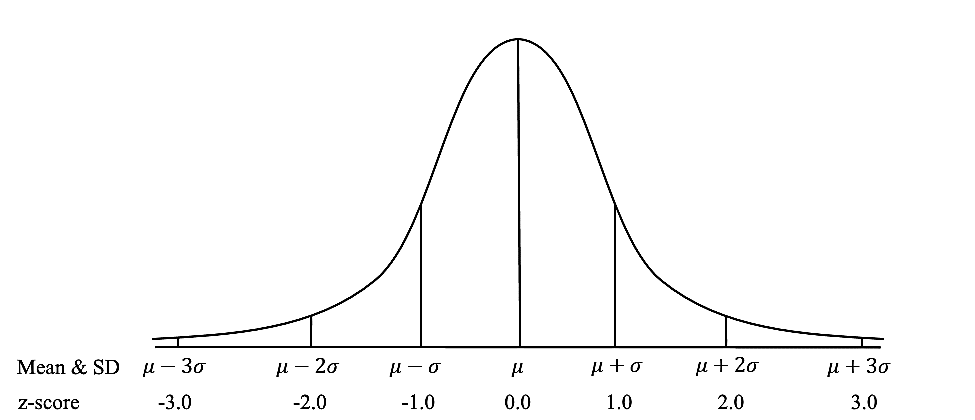{width="53%" fig-alt="Illustration: The Z - Score"}

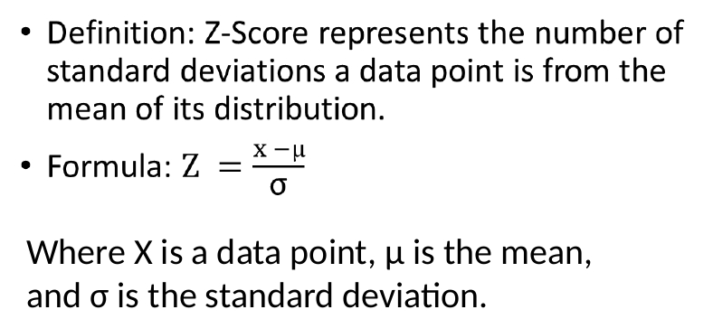{width="59%" fig-alt="Illustration: The Z - Score"}

::: source-text
Where X is a data point, μ is the mean, and σ is the standard deviation.
:::

::: source-text
Interpretation:

- A z-score of 0 corresponds to a data point that is exactly at the mean.
- Positive z-scores indicate values above the mean.
- Negative z-scores indicate values below the mean.
:::

::::::

:::::: {.source-slide #part3-01-slide-28}

### Back to our Empirical Rule Example {#part3-title-01-28}

::: source-text
A large lecture class has 280 students. The professor has announced that the mean score in an exam is 74 with a standard deviation of 8.

Use the Empirical Rule to answer the following:

- Approximately how many students within 58 and 90?
  - Approximately how many students scored higher than 90?
:::

{width="41%" fig-alt="Illustration: Back to our Empirical Rule Example"}

::: source-text
**Solution for part (a)**

- First, we find the z-scores corresponding to 58 and 90.
  - Z for 58 = (58 -- 74) / 8 = -16/8 = -2, Z for 90 = (58 -- 74) / 8 = 16/8 = +2
  - Using the empirical rule, we know that 95% of observations falls within 2 standard deviations (each side) from the mean, therefore, the number of students under this criteria = 280 x .95 = 266 students.
:::

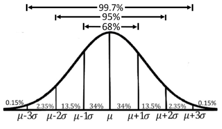{width="30%" fig-alt="Illustration: Back to our Empirical Rule Example"}

::: source-text
**Solution for part (b)**

- The score 90 is 2 standard deviations above the mean.
  - Therefore, 97.5% of students are below that value and 2.5% are above it.
  - Consequently, 2.5/100 \* 280 = 7 students are above 90.
:::

:::: {.try-in-r #r-example-01-28}

#### Try this in R {.unlisted}

- **Purpose:** Use the stated empirical-rule approximation to calculate expected counts.
- **Before running:** `c()` combines the two calculations. Multiplication by 280 converts a model probability into an expected count. The remaining 5% is divided equally between the two tails of a normal model.

```{r}
#| label: inferential-1-28
# c() collects the two approximate expected counts, using the original 95% empirical-rule approximation.
# These are normal-model approximations for 280 students, not observed counts.
c(between_58_and_90 = 280*0.95, above_90 = 280*0.025)
```

**Read the result:** The approximate expected counts are 266 between the limits and 7 above the upper limit. These are not observed class totals.

::::
::::::

:::::: {.source-slide #part3-01-slide-29}

### Z-Scores Uses in Statistics {#part3-title-01-29}

::: source-text
- **Standardization**: Z-scores standardize different distributions to be comparable by converting them to a common scale.
- **Identification of Outliers**: Data points with z-scores less than -2 or greater than 2 are often considered outliers.
- **Compare values** from different populations (e.g. exam results between courses).
- **Probabilities and Percentiles**: Z-scores link data points to their probabilities and percentiles in a normal distribution. E.g., a z-score of 1.96 corresponds to the 97.5th percentile.
:::

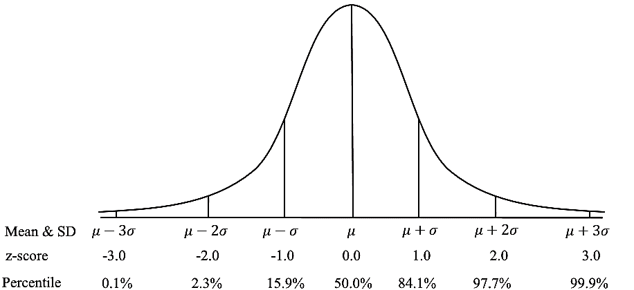{width="61%" fig-alt="Illustration: Z-Scores Uses in Statistics"}

::::::

:::::: {.source-slide #part3-01-slide-30}

### Z-Scores Example – Comparing Values {#part3-title-01-30}

::: source-text
Khalid achieved 90 in both Python & Database exams. The mean μ for the Python exam was 70 and σ = 10, The μ for the Database exam was 80 and σ = 10.

Use standard scores to determine where did Khalid achieve a better score.
:::

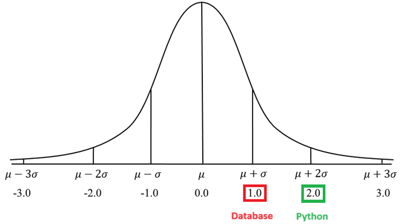{width="40%" fig-alt="Illustration: Z-Scores Example – Comparing Values"}

::: source-text
- Standard score for the Python Exam: (90−70)/10 =2
- Standard score for the Database Exam: (90−80)/10 =1
- Khalid\'s Z-score for the Python exam is 2, which means his score was 2 standard deviations above the mean.
- His Z-score for the Database exam is 1, indicating his score was 1 standard deviation above the mean.
- Khalid performed better on the Python exam than Database exam since his Z-score is higher for that exam.
:::

:::: {.try-in-r #r-example-01-30}

#### Try this in R {.unlisted}

- **Purpose:** Compare the two exam results in SD units.
- **Before running:** Parentheses make subtraction happen first; `/` divides by the course SD. `c()` labels the two standardised scores. A z-score is a relative position, not automatically a normal percentile.

```{r}
#| label: inferential-1-30
# Standardization subtracts the stated course mean and divides by that course's SD.
# Both exam scores are 90; a larger z-score means a higher position relative to the course mean.
c(Python = (90-70)/10, Database = (90-80)/10)
```

**Read the result:** The scores are 2 and 1 SDs above their respective means. This compares relative positions; it does not establish identical exam difficulty.

::::
::::::

:::::: {.source-slide #part3-01-slide-31}

### How to Find the Right Distribution {#part3-title-01-31}

::::: {.recovered-resources #original-resources-1-31}

:::: {.recovered-resource}
::: {.resource-description}
**Background reading — choosing a probability distribution**

Read about choosing and fitting probability distributions.

<https://medium.com/data-science-collective/how-to-find-the-right-distribution-for-your-data-a-practical-guide-for-non-statistician-with-two-dc2aa0ed707f>
:::

::: {.resource-qr}
[{.compact-resource-qr width="144" fig-alt="QR code: Background reading — choosing a probability distribution"}](https://medium.com/data-science-collective/how-to-find-the-right-distribution-for-your-data-a-practical-guide-for-non-statistician-with-two-dc2aa0ed707f)
:::
::::

:::::

:::: {.try-in-r #r-example-01-31}

#### Try this in R {.unlisted}

- **Purpose:** Compare three candidate models for explicitly simulated data.
- **Before running:** `set.seed()` makes the simulation reproducible. `rnorm(2000,mean=25,sd=8)` generates 2,000 values. `MASS::fitdistr()` fits a specified family; `::` selects a function from the MASS package. `lapply()` applies the anonymous function to each family; `sapply()` extracts their AIC values. `names()` labels them. Lower AIC compares only these candidates.

```{r}
#| label: inferential-1-31
# set.seed() makes rnorm() reproducible; the 2,000 simulated values use the source mean 25 and SD 8.
# MASS::fitdistr() fits three candidate families by maximum likelihood; this is a limited R comparison.
set.seed(307312)
y <- rnorm(2000, mean=25, sd=8)
# lapply() passes each family name to the anonymous function and collects its fitted model.
fits <- lapply(c("normal","logistic","cauchy"), function(family) MASS::fitdistr(y, family))
# AIC() trades fit against parameter count; lower AIC only compares these candidates, not all distributions.
# sapply() applies AIC to each fitted object; names label the results for interpretation.
aic <- sapply(fits, AIC)
names(aic) <- c("normal","logistic","cauchy")
aic
```

**Read the result:** These are simulated values, not business observations. The comparison is limited to normal, logistic and Cauchy models; it does not establish a true distribution or check the data-collection design.

::::
::::::

:::::: {.source-slide #part3-01-slide-32}

::: source-text
Z-Tables
:::

::::::

:::::: {.source-slide #part3-01-slide-33}

### The Z-Tables {#part3-title-01-33}

::: source-text
The area under the curve in continuous probability distributions represents the probability of outcome occurrence.

The Empirical Rule has pre-defined areas for certain Z-Scores.

What can we do if we need the area between other Z-Scores e.g. +1.25, -2.33?

It will be hard to compute the integral for different intervals:

A simpler solution would be to use a table of pre-computed areas (The Z-Table).

But we need to compute that area ONCE. Therefore, we need to create a Standard Distribution.
:::

{width="45%" fig-alt="Illustration: The Z-Tables"}

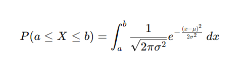{width="33%" fig-alt="Illustration: The Z-Tables"}

::::::

:::::: {.source-slide #part3-01-slide-34}

### Standard Normal Distribution and Standard Z Scores {#part3-title-01-34}

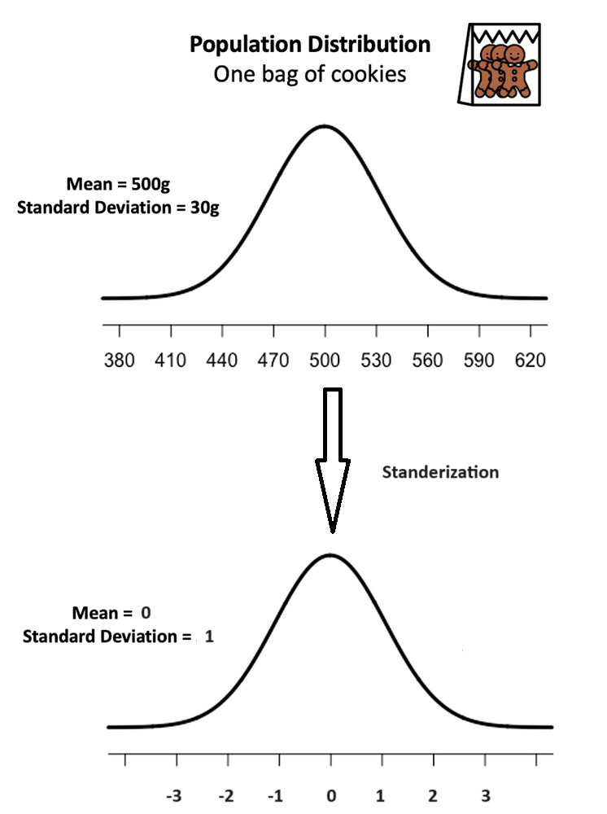{width="36%" fig-alt="Illustration: Standard Normal Distribution and Standard Z Scores"}

::: source-text
The standard normal distribution is a special case of the normal distribution where the mean is zero and the standard deviation is 1.

This distribution is also known as the Z-distribution.

A value on the standard normal distribution is known as a standard score or a Z-score.

A standard score represents the number of standard deviations above or below the mean that a specific observation falls.

For example, a standard score of 1.5 indicates that the observation is 1.5 standard deviations above the mean.

On the other hand, a negative score represents a value below the average.

The mean has a Z-score of 0.
:::

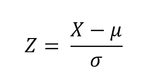{width="30%" fig-alt="Illustration: Standard Normal Distribution and Standard Z Scores"}

::::: {.recovered-resources #original-resources-1-34}

:::: {.recovered-resource}
::: {.resource-description}
**Background reading — p-values**

Further reading on p-values, used in hypothesis testing.

<https://medium.com/towards-data-science/what-is-p-value-370056b8244d>
:::

::: {.resource-qr}
[{.compact-resource-qr width="144" fig-alt="QR code: Background reading — p-values"}](https://medium.com/towards-data-science/what-is-p-value-370056b8244d)
:::
::::

:::::

::::::

:::::: {.source-slide #part3-01-slide-35}

### Z-Table for Z Values above 0 {#part3-title-01-35}

::: source-text
**Z-Table for Z Values below 0**
:::

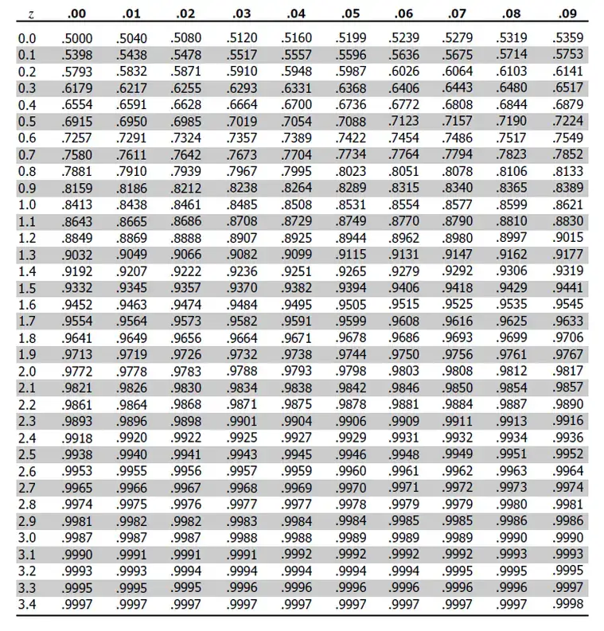{width="45%" fig-alt="Illustration: Z-Table for Z Values above 0"}

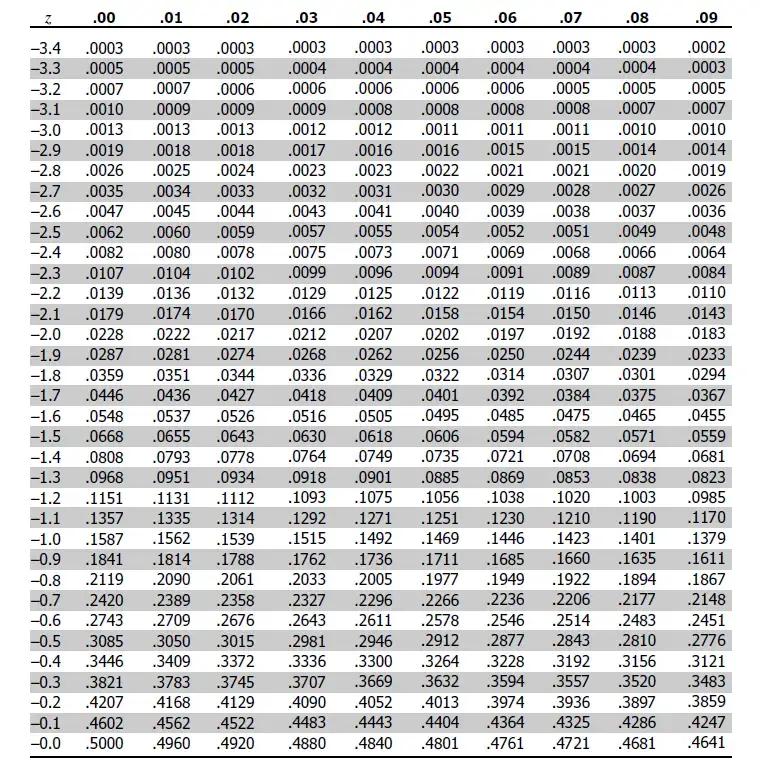{width="44%" fig-alt="Illustration: Z-Table for Z Values above 0"}

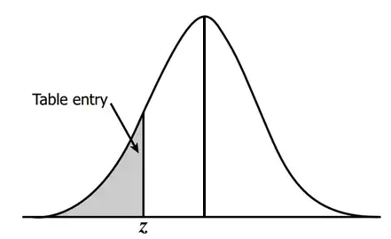{width="30%" fig-alt="Illustration: Z-Table for Z Values above 0"}

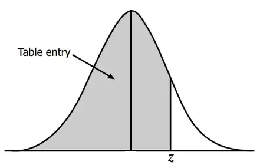{width="30%" fig-alt="Illustration: Z-Table for Z Values above 0"}

::::::

:::::: {.source-slide #part3-01-slide-36}

### Z-Tables Example {#part3-title-01-36}

::: source-text
The average score for the MID exam in Descriptive Statistics course was 70. The standard Deviation for that exam was 6.

Knowing that the exam scores are normally distributed, what is the probability of having a score higher than 75 in that exam?
:::

{width="45%" fig-alt="Illustration: Z-Tables Example"}

::: source-text
First, we need to find the standard position (z-score) for the 75 score.

Z score for (75) = (75 -- 70) / 6 = 5/6 = .833

Using the z table, the closest value for .833 is: 0.7967 which corresponds to 79.67% of scores are below 75.

To find the probability of having a score over 75, we subtract 79.67% out of the total probability of 100%:

100 -- 79.67 = 20.33%
:::

:::: {.try-in-r #r-example-01-36}

#### Try this in R {.unlisted}

- **Purpose:** Find the upper-tail normal probability for the stated score threshold.
- **Before running:** `pnorm(q,mean,sd)` returns a cumulative normal probability. Here the first argument 75 is q, mean is 70 and SD is 6. `lower.tail=FALSE` gives the area above 75.

```{r}
#| label: inferential-1-36
# pnorm() integrates the stated normal model: mean 70, SD 6, and a score threshold of 75.
# lower.tail=FALSE gives P(score>75) directly, without rounding the z-score to a table entry.
pnorm(75, mean=70, sd=6, lower.tail=FALSE)
```

**Read the result:** The model probability is about 0.20233, or 20.233%. A probability and its percentage use different scales.

::::
::::::

:::::: {.source-slide #part3-01-slide-37}

### Normal probabilities in R {#part3-title-01-37}

::: source-text
The average score for the MID exam in Descriptive Statistics course was 70. The standard Deviation for that exam was 6.

What is the probability of having a score higher than 90 in that exam?
:::

:::: {.try-in-r #r-example-01-37}

#### Try this in R {.unlisted}

- **Purpose:** Answer this slide’s question: a score above 90.
- **Before running:** `pnorm(q=90,mean=70,sd=6,lower.tail=FALSE)` calculates the upper normal tail. `<-` stores it; `c()` displays it as a probability and after multiplying by 100 as a percentage.

```{r}
#| label: inferential-1-37
# The question on this slide asks for a score above 90.
p_above_90 <- pnorm(q=90, mean=70, sd=6, lower.tail=FALSE)
c(probability=p_above_90, percentage=100*p_above_90)
```

**Read the result:** The result is about 0.000429, or 0.0429%. This follows the stated threshold 90; the former spreadsheet illustration used a different threshold.

::::
::::::

