Read each topic and run the **Try this in R** examples beside it.

- Open the top-level course folder in Positron and keep the R Console at that project root.
- Run the R cells in order; later comparisons and regression checks reuse the data and models introduced earlier.
- Complete Probability foundations first. CSVs are supplied under `data/inferential-statistics/`. Install the recommended R package MASS if needed for the distribution-fitting example.

<div class="original-branding"></div>

:::::: {.source-slide #part3-02-slide-01}

## 4.1 Statistical inference and estimation {#part3-02}

::::::

:::::: {.source-slide #part3-02-slide-02}

### Content {#part3-title-02-02}

- **Statistical inference:** populations, samples, parameters and statistics.
- **Sampling distributions and standard error:** how estimates vary across random samples.
- **Central limit theorem:** when a normal approximation for the sample mean is justified.
- **Estimation:** point estimates, confidence intervals, normal and t methods, and sample size.
- **Hypothesis testing:** hypotheses, significance, p-values and comparisons.
- **Regression:** linear models, interpretation and diagnostics.

::::::

:::::: {.source-slide #part3-01-slide-03}

### Introduction to Inferential Statistics {#part3-title-01-03}

::: source-text
**Definition**: Inferential statistics is the branch of statistics that involves making inferences or predictions about a population based on sample data.

**Objective**: The main goal of inferential statistics is to draw conclusions, make predictions, or test hypotheses about a population using information obtained from a sample.
:::

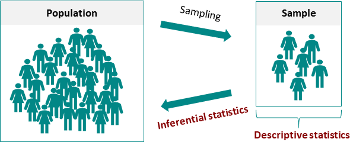{width="68%" fig-alt="Illustration: Introduction to Inferential Statistics"}

::::::

:::::: {.source-slide #part3-01-slide-04}

### Inferential Statistics Uses {#part3-title-01-04}

::: source-text
Inferential statistics is used in various fields and contexts to make predictions, draw conclusions, and make inferences about populations based on sample data. Here are some common areas and applications where inferential statistics is used:

**Scientific Research**: Inferential statistics is fundamental in scientific research across disciplines such as biology, physics, chemistry, and environmental science. Researchers use statistical tests to analyze data and draw conclusions about hypotheses.

**Business and Economics**: Businesses use inferential statistics for market research, sales forecasting, quality control, and decision-making. Econometric models are employed to analyze economic data and make policy recommendations.

**Healthcare and Medicine**: Medical researchers and healthcare professionals use inferential statistics to study the effectiveness of treatments, analyze patient data, and draw conclusions about disease prevalence. Clinical trials rely heavily on inferential statistics.

**Education**: In the field of education, inferential statistics are used to assess the effectiveness of teaching methods, evaluate standardized test scores, and make policy decisions about educational programs.

**Market Research and Data Analysis**: Market researchers use inferential statistics to make predictions about consumer preferences, market trends, and the impact of marketing campaigns.

**Finance and Investment**: In finance, inferential statistics are used to assess investment risk, analyze stock market data, and estimate future asset prices. Portfolio optimization and risk management rely on statistical modeling.

**Criminal Justice and Criminology**: Researchers and law enforcement agencies use inferential statistics to analyze crime data, study crime patterns, and evaluate the effectiveness of criminal justice programs.

**Sports and Athletics**:  In sports analytics, inferential statistics are used to analyze player performance, predict game outcomes, and make strategic decisions in sports management.
:::

::::::

:::::: {.source-slide #part3-01-slide-05}

### Introduction to Inferential Statistics {#part3-title-01-05}

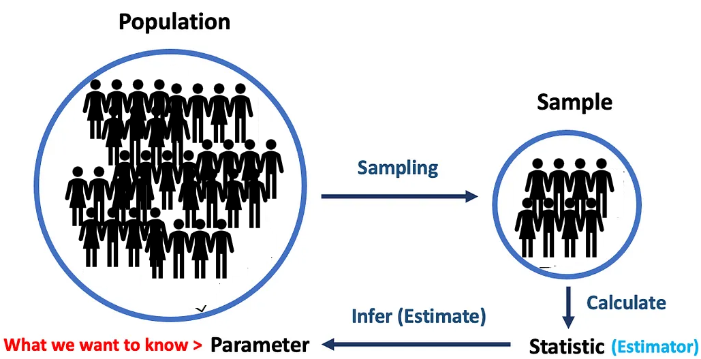{width="54%" fig-alt="Illustration: Introduction to Inferential Statistics"}

::: source-text
**Key** **Concepts**:

**Population**: The entire group of individuals or items of interest that we want to study.

**Sample**: A subset of the population from which data is collected and analyzed.

**Parameter**: A numerical characteristic of a population (e.g., mean, proportion).

**Statistic**: A numerical characteristic of a sample (e.g., sample mean, sample proportion).
:::

::: source-text
https://medium.com/towards-data-science/what-is-p-value-370056b8244d
:::

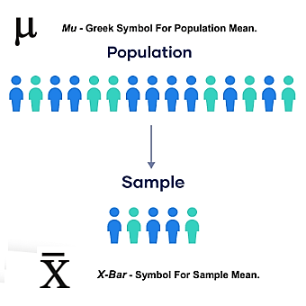{width="30%" fig-alt="Illustration: Introduction to Inferential Statistics"}

::::::

:::::: {.source-slide #part3-01-slide-06}

### Types of Inferential Statistics {#part3-title-01-06}

::: source-text
- Estimation

Point Estimation: Provides a single best guess about a population parameter (e.g., the mean, proportion).

Interval Estimation (Confidence Intervals): Gives a range of values for a population parameter with a certain level of confidence.

- Hypothesis Testing

A statistical method that uses sample data to evaluate a hypothesis about a population parameter, determining whether there is sufficient evidence to accept or reject a given hypothesis about that population.

- Regression Analysis

Assesses the linear relationship between one continuous dependent variable and one or more independent variables.
:::

::::::

:::::: {.source-slide #inference-sampling-distributions .course-foundation}

### What is a sampling distribution?

A **sampling distribution** is the probability distribution of a statistic over repeated random samples of the same size from the same population.

- A population distribution describes individual observations $X$.
- One sample contains $n$ observations and produces one sample mean $\bar{x}$.
- Repeating that sampling process gives different sample means; their distribution is the sampling distribution of $\bar{X}$.
- $\bar{X}$ denotes the random sample mean before sampling; $\bar{x}$ denotes its observed value.
- The distribution exists as a mathematical model; we do not have to collect many real samples to use it.

::::::

:::::: {.source-slide #inference-sample-size-repetitions .course-foundation}

### Sample size and simulation repetitions are different

**Sample size** is the number of observations contributing to one statistic. **Simulation repetitions** count how many such statistics we generate to study its distribution.

- A simulation with 1,000 samples of 30 observations produces 1,000 sample means; each mean still uses $n=30$.
- More repetitions show the sampling distribution more clearly.
- Increasing $n$ reduces the standard error of the mean under independent sampling.
- In the CLT, the normal approximation improves as **sample size** grows; merely generating more samples does not make a small-sample distribution normal.

::::::

:::::: {.source-slide #part3-02-slide-11 .course-foundation}

### Standard error: the spread of an estimator {#part3-title-02-11}

The **standard error (SE)** is the standard deviation of a statistic's sampling distribution.

For independent, identically distributed observations with population mean $\mu$ and finite variance $\sigma^2$:

$$E(\bar{X})=\mu,\qquad \operatorname{Var}(\bar{X})=\frac{\sigma^2}{n},\qquad SE(\bar{X})=\frac{\sigma}{\sqrt{n}}.$$

- $n$: observations per sample; $\sigma$: population standard deviation; $\bar{X}$: sample mean.
- When $\sigma$ is unknown, estimate the SE using $s/\sqrt{n}$, where $s$ is the sample standard deviation.
- SD describes spread between individual observations; SE describes spread between estimates from repeated samples.
- These mean/variance identities follow from expectation and independence, not from the CLT. They do not require a normal population.
- Sampling without replacement from a substantial fraction of a finite population requires a finite-population correction; the formula above uses independent sampling.

::::::

:::::: {.source-slide #part3-02-slide-12}

### The Central Limit Theorem {#part3-title-02-12}

::: source-text
The **central limit theorem (CLT)** explains why the sampling distribution of a mean can be approximately normal even when individual observations are not normal.

- In the basic version, observations are independent and identically distributed, with finite mean $\mu$ and finite positive variance $\sigma^2$.
- As sample size $n$ increases, the standardised mean $(\bar{X}-\mu)/(\sigma/\sqrt{n})$ approaches a standard normal distribution.
- For sufficiently large $n$, we therefore approximate $\bar{X}$ by a normal distribution with mean $\mu$ and standard deviation $\sigma/\sqrt{n}$.
- There is no universal sample size that guarantees accuracy. Strong skewness, heavy tails and extreme observations can make convergence slow.
- If the observations themselves are independent normal variables, their mean is exactly normal for every $n$; the CLT approximation is unnecessary.
- The CLT concerns the distribution of sample means, not a claim that the individual observations become normal.
:::

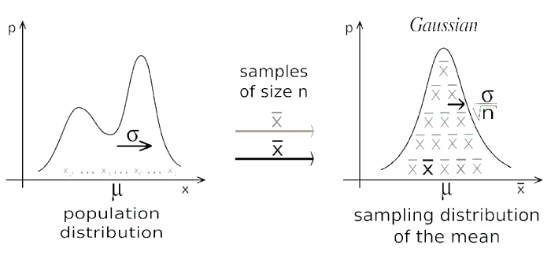{width="47%" fig-alt="Illustration: The Central Limit Theorem"}

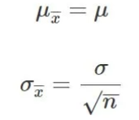{width="30%" fig-alt="Illustration: The Central Limit Theorem"}

{width="30%" fig-alt="Illustration: The Central Limit Theorem"}

::: source-text
Distinguish the population distribution from the sampling distributions illustrated above.
:::

::::::

:::::: {.source-slide #part3-02-slide-16}

### Simulating sampling variation and estimated standard error {#part3-title-02-16}

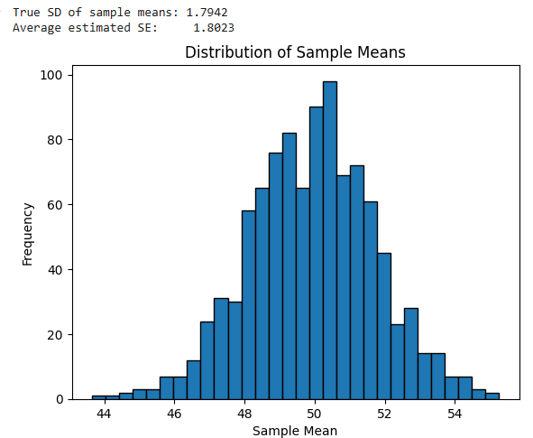{width="48%" fig-alt="Illustration: Simulating sampling variation and estimated standard error"}

:::: {.try-in-r #r-example-02-16}

#### Try this in R {.unlisted}

- **Purpose:** Illustrate sampling variation and estimated standard error.
- **Before running:** `set.seed()` fixes the random sequence; `rnorm()` generates an artificial population. `replicate(1000,{...})` repeats the brace-enclosed calculations 1,000 times. `sample(size=30,replace=TRUE)` draws 30 observations with replacement. `mean()` and `sd()` summarise each draw; `sqrt(30)` converts sample SD to estimated SE. `[1,]` and `[2,]` select result rows. `hist(breaks=30)` displays the sample means; labels and `col` control presentation.

```{r}
#| label: inferential-2-16
# set.seed() makes this simulation reproducible; rnorm() creates the source's artificial population.
# replicate() repeats sampling with replacement; each column returns a mean and a sample-based SE.
set.seed(307312)
population <- rnorm(1000000, mean=50, sd=10)
# sample(replace=TRUE) draws independently with replacement; sqrt(30) is the SE denominator.
results <- replicate(1000, {
  x <- sample(population, size=30, replace=TRUE)
  c(sample_mean=mean(x), estimated_SE=sd(x)/sqrt(30))
})
# sd() and mean() compare simulated sampling spread and average estimated SE; agreement is illustrative.
# hist() uses 30 bins to display the 1,000 sample means; this simulation is not a mathematical proof.
c(SD_of_sample_means=sd(results[1,]), average_estimated_SE=mean(results[2,]))
hist(results[1,], breaks=30, col="#D4D4D4", main="Distribution of Sample Means", xlab="Sample Mean")
```

**Read the result:** The artificial population here is normal, so this illustrates sampling variation and SE rather than the CLT for a non-normal population. Compare the SD across sample means with the average estimated SE. Agreement illustrates the model; simulation is not a proof. Observations per sample and simulation repetitions are different quantities.

::::
::::::

:::::: {.source-slide #part3-02-slide-03}

### Estimation in Statistics {#part3-title-02-03}

::: source-text
- Often in statistics we're interested in measuring population parameters.
- Two of the most common population parameters are:
  - Population mean: the mean value of some variable in a population (e.g. the mean height of males in the U.S.)
  - Population proportion: the proportion of some variable in a population (e.g. the proportion of residents in a county who support a certain law)
- Although we're interested in measuring these parameters, it's usually too costly and time-consuming to go around and collect data on every individual in a population in order to calculate the population parameter.
- Instead, **we typically take a random sample** from the overall population and use data from the sample to **estimate** the population parameter.
:::

::::::

:::::: {.source-slide #part3-02-slide-05}

### Point Estimates {#part3-title-02-05}

::: source-text
- Suppose we want to estimate the mean weight of a students in the university.
- Since there are thousands of students in the university, it would be extremely time-consuming and costly to go around and weigh each individual student.
- Instead, we might take a random sample of 50 students and use the mean weight of the students in this sample to estimate the true population mean.
:::

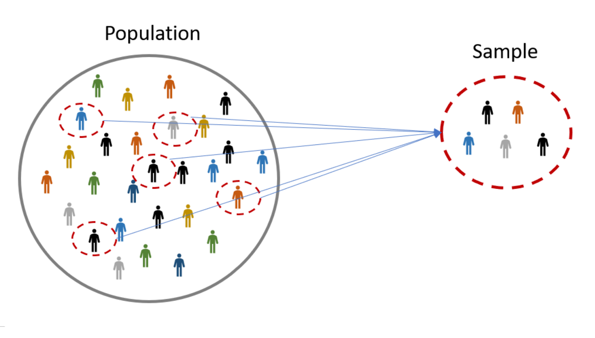{width="49%" fig-alt="Illustration: Point Estimates"}

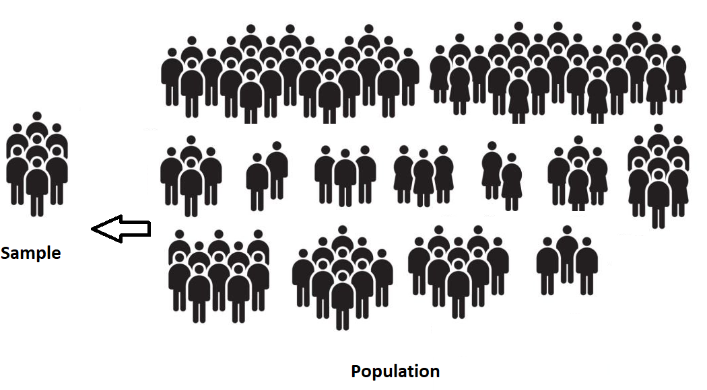{width="30%" fig-alt="Illustration: Point Estimates"}

::: source-text
- In this case, the mean weight of the sample is called a Point Estimate for the true mean weight of the population.
:::

::::::

:::::: {.source-slide #part3-02-slide-04}

### Point vs. Interval {#part3-title-02-04}

::: source-text
- A point estimate is a single value estimate of a parameter. For instance, a sample mean is a point estimate of a population mean.
- An interval estimate gives you a range of values where the parameter is expected to lie.
- Both types of estimates are important for gathering a clear idea of where a parameter is likely to lie.
:::

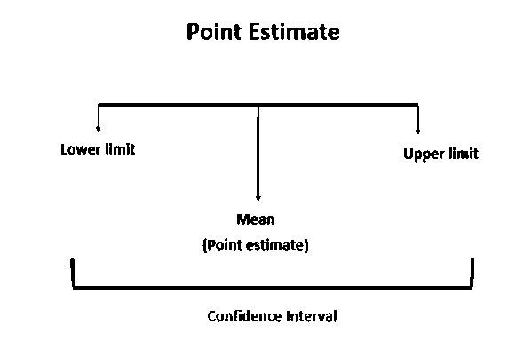{width="42%" fig-alt="Illustration: Point vs. Interval"}

::::::

:::::: {.source-slide #part3-02-slide-06}

### Interval Estimates - Confidence Intervals {#part3-title-02-06}

::: source-text
- The problem with the previous example is that the mean weight of students in the sample **is not guaranteed** to exactly match the mean weight of students in the whole population.
- For example, we might just happen to pick a sample full of low-weight students or perhaps a sample full of heavy students.
- To capture this uncertainty, we can create an Interval Estimate or a confidence interval around our point estimate**.**
:::

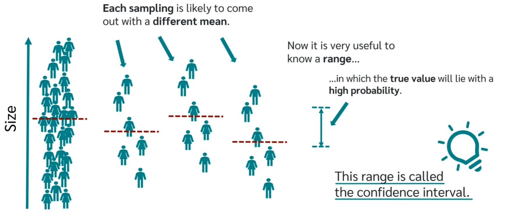{width="60%" fig-alt="Illustration: Interval Estimates - Confidence Intervals"}

::: source-text
- The confidence interval gives us a range of values that are likely to contain the true population parameter.
:::

::::::

:::::: {.source-slide #part3-02-slide-13}

### Inference: Turning the Sampling Model Around {#part3-title-02-13}

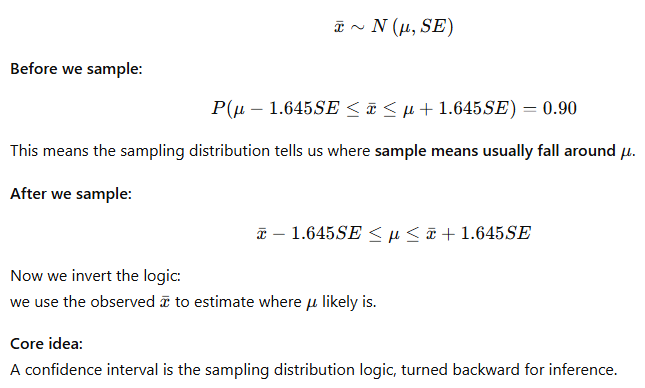{width="71%" fig-alt="Illustration: Inference: Turning the Sampling Model Around"}

::::::

:::::: {.source-slide #part3-02-slide-14}

### The symmetry idea behind confidence intervals {#part3-title-02-14}

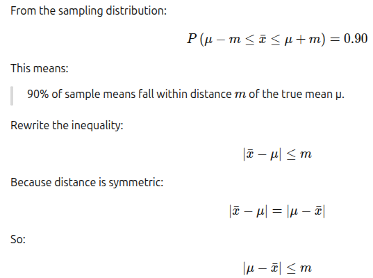{width="50%" fig-alt="Illustration: The symmetry idea behind confidence intervals"}

::::::

:::::: {.source-slide #part3-02-slide-15 .course-foundation}

### From CLT to Confidence Intervals {#part3-title-02-15}

A confidence interval uses a statistic's sampling distribution to account for estimation uncertainty.

- With known population SD $\sigma$, an approximately normal sampling distribution gives
  $P(-1.96\leq(\bar{X}-\mu)/(\sigma/\sqrt{n})\leq1.96)\approx0.95$.
- Rearranging gives the 95% interval $\bar{x}\pm1.96\,\sigma/\sqrt{n}$.
- Here $\bar{x}$ is the observed sample mean, and 1.96 is the standard normal cutoff leaving 2.5% in each tail.
- Over repeated samples, approximately 95% of intervals constructed this way contain the fixed population mean $\mu$.
- If $\sigma$ is unknown, use $s$ and the appropriate t cutoff. The one-sample t interval is exact for independent normal observations and approximate more generally under suitable conditions.
- The CLT supports large-sample normal approximations for means; not every confidence interval is derived from the CLT.

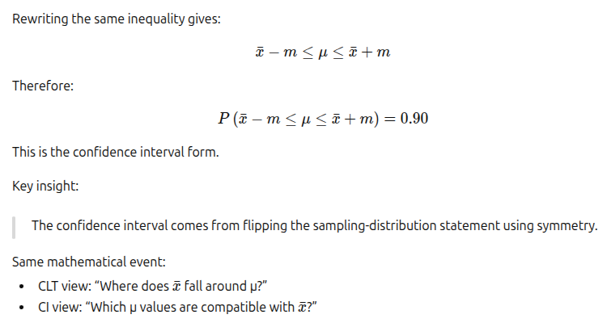{width="70%" fig-alt="Illustration: From CLT to Confidence Intervals"}

::::::

:::::: {.source-slide #part3-02-slide-08}

### The Significance Level Alpha (α) and The Confidence Level {#part3-title-02-08}

::: source-text
- To compute the confidence interval, we need to define the Significance Level Alpha (*α)* or the Confidence Level.
- The two terms are related to each other according to the following equation:

**Confidence level= 1 --** ***α***

- Common values for these notations are listed in the table
:::

::: source-table
+----------------------+----------+----------+
| **Alpha -** *α*      | **5%**   | **1%**   |
+======================+==========+==========+
| **Confidence level** | **95%**  | **99%**  |
+----------------------+----------+----------+
| **z-Value**          | **1.96** | **2.58** |
+----------------------+----------+----------+
:::

::::::

:::::: {.source-slide #part3-02-slide-09}

### The Significance Level Alpha (α) and The Confidence Level {#part3-title-02-09}

::: source-text
- The confidence level (e.g. 95%) means that if we collected 100 samples and created confidence intervals for each of these samples, we would expect that 95% of these confidence intervals will contain the true population parameter.
- It\'s important to note that this is a theoretical long-term proportion---it\'s about what we\'d expect to happen over many repetitions of the same process, not a guarantee for any individual interval.
:::

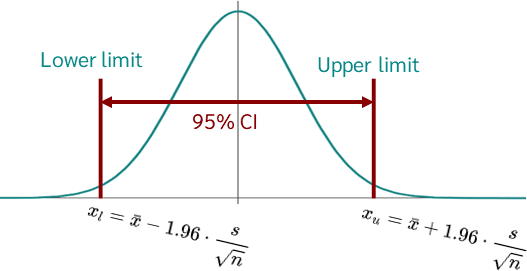{width="47%" fig-alt="Illustration: The Significance Level Alpha (α) and The Confidence Level"}

::::::

:::::: {.source-slide #part3-02-slide-10}

### Relationship Between Confidence Level and Significance Level in Statistics {#part3-title-02-10}

{width="40%" fig-alt="Illustration: Relationship Between Confidence Level and Significance Level in Statistics"}

::: source-text
The **confidence level** and the **significance level (α)** are inverse and complementary concepts in statistical inference and hypothesis testing.

**Relationship:**

- The two are **complementary**, meaning that if you increase one, you decrease the other, and vice versa.
- A **higher confidence level** corresponds to a **lower significance level**, while a **lower confidence level** corresponds to a **higher significance level**.

**Formula:**

- Confidence Level=1−α

**Example:**

- A 95% confidence level means the significance level is 0.05 (α = 5%).
- A 99% confidence level means the significance level is 0.01 (α = 1%).
:::

::::::

:::::: {.source-slide #part3-02-slide-07}

### Computing Confidence Intervals {#part3-title-02-07}

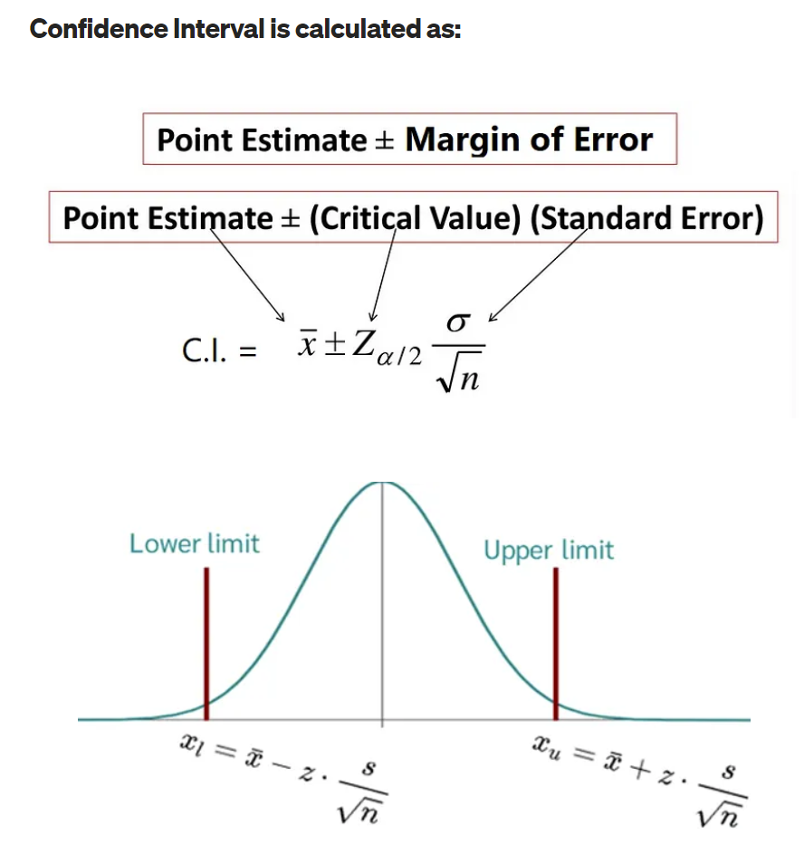{width="47%" fig-alt="Illustration: Computing Confidence Intervals"}

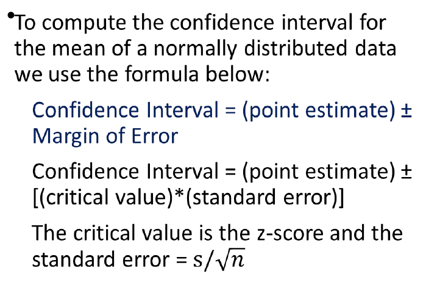{width="52%" fig-alt="Illustration: Computing Confidence Intervals"}

::: source-text
https://medium.com/@ashisharora2204/hypothesis-testing-confidence-interval-level-margin-of-error-39aa7c7ddcd2
:::

::::::

:::::: {.source-slide #part3-02-slide-17}

### Confidence Intervals Example {#part3-title-02-17}

::: source-text
Suppose we randomly collected a sample of students with the following information:

- Sample size n = 50
  - Sample mean weight x = 73.16 kg
  - Population standard deviation s = 8.63

What is the 90% confidence interval for the true population mean weight?
:::

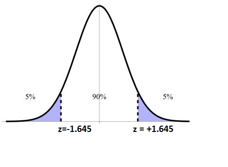{width="30%" fig-alt="Illustration: Confidence Intervals Example"}

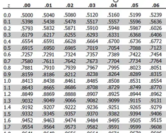{width="35%" fig-alt="Illustration: Confidence Intervals Example"}

::: source-text
- To find the upper bound z-score for the 90% CI, we need to look for area 95% in the z table i.e. 90% + 5% (Look at the Figure)
- Therefore, according to the z-table, the upper bound z-score for the 90% Confidence Interval = 1.64 i.e. lower bound is -1.64.
- The Margin of Error = 1.64 \* (8.63/√50) = \~2
- Therefore, the 90% CI = 73.16 ± 2 = \[71.16, 75.16\]
:::

:::: {.try-in-r #r-example-02-17}

#### Try this in R {.unlisted}

- **Purpose:** Calculate the 90% mean interval when population SD is treated as known.
- **Before running:** `qnorm(0.95)` gives the standard-normal cutoff leaving 5% above it. `sqrt(n)` converts the stated population SD to SE. `c(-1,1)` subtracts and adds the margin; n, xbar and sigma store the supplied summaries.

```{r}
#| label: inferential-2-17
# qnorm(0.95) gives the upper critical z for a central 90% interval; sigma=8.63 is treated as known.
# sqrt(n) scales population SD into SE; c(-1,1) constructs the lower and upper endpoints in kg.
n <- 50; xbar <- 73.16; sigma <- 8.63
xbar + c(-1,1)*qnorm(0.95)*sigma/sqrt(n)
```

**Read the result:** The two output values are the lower and upper limits in kg. This calculation depends on the slide’s stated known-population-SD setting.

::::
::::::

:::::: {.source-slide #part3-02-slide-18}

### Confidence Intervals Example {#part3-title-02-18}

{width="46%" fig-alt="Illustration: Confidence Intervals Example"}

::: source-text
We interpret this 90% confidence interval as follows:

- The interval \[71.16 kgs to 75.16 kgs\] gives us a good estimate of where the mean lies, based on the collective information from our samples.
- The 90% means that if we estimate the population parameter and computed the confidence intervals 100 times, we expect that 90% of these intervals will contain our parameter.
:::

::::::

:::::: {.source-slide #part3-02-slide-19}

### Solving Confidence Intervals using R {#part3-title-02-19}

::: source-text
Suppose we randomly collected a sample of students with the following information:

- Sample size n = 50
  - Sample mean weight x = 73.16 kg
  - Sample standard deviation s = 8.63

What is the 90% confidence interval for the true population mean weight?
:::

::: source-text
:::

:::: {.try-in-r #r-example-02-19}

#### Try this in R {.unlisted}

- **Purpose:** Calculate the 90% mean interval using the stated sample SD.
- **Before running:** `qt(p=0.95,df=49)` gives the central 90% t critical value for 50 observations. `sqrt(50)` appears in the SE; `c(-1,1)` gives lower and upper limits. The value 8.63 is estimated from the sample here.

```{r}
#| label: inferential-2-19
# qt(0.95,df=49) gives the central 90% t critical value when SD 8.63 is estimated from 50 observations.
# This t interval uses unknown population SD; it can differ from the original normal approximation.
73.16 + c(-1,1)*qt(0.95,df=49)*8.63/sqrt(50)
```

**Read the result:** Use t when population SD is unknown under suitable assumptions. This interval can differ from the preceding known-SD normal calculation.

::::
::::::

:::::: {.source-slide #part3-02-slide-20}

### Transitioning to T-Distribution {#part3-title-02-20}

::: source-text
- The T-distribution, like the normal distribution, is bell-shaped and symmetric but has heavier tails.
- This means there is more probability in the tails and less in the center compared to a normal distribution.
- The exact shape of the T-distribution depends on the degrees of freedom (df), which are related to the sample size.
- Degrees of freedom in the context of the T-distribution refer to the number of independent values in a calculation of a statistic that are free to vary.
- For a confidence interval, df is equal to the sample size (n) minus 1 (df = n - 1).
- As the sample size increases, the T-distribution approaches the normal Z-distribution.
:::

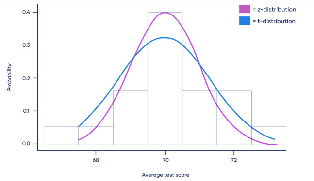{width="43%" fig-alt="Illustration: Transitioning to T-Distribution"}

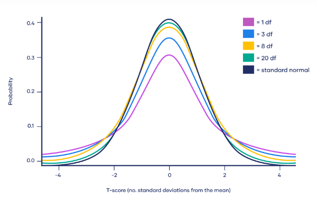{width="39%" fig-alt="Illustration: Transitioning to T-Distribution"}

::: source-text
https://www.scribbr.com/statistics/t-distribution/
:::

::::::

:::::: {.source-slide #part3-02-slide-21}

### When to use T-Distribution {#part3-title-02-21}

::: source-text
- We can use the Z-distribution when the population variance is known or when our data is large enough (n \> 30).
- However, real-world data often doesn\'t come with this information.
- In practice, the population variance is unknown, and we usually estimate the population variance using the sample variance, which introduces more variability into our statistics.
- The T-distribution accommodates this additional uncertainty and is especially useful for small sample sizes.
- The T-distribution often serves as a safer alternative because it accounts for the additional uncertainty from estimating the population variance.
:::

::::::

:::::: {.source-slide #part3-02-slide-22}

### The T Table {#part3-title-02-22}

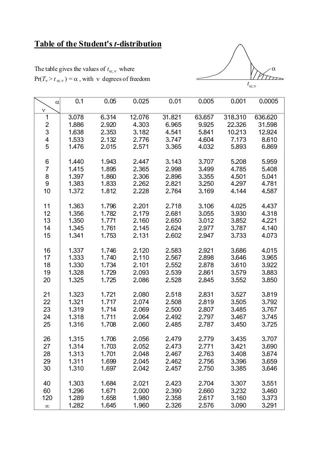{width="42%" fig-alt="Illustration: The T Table"}

::: source-text
- The first column, denoted \"v,\" lists the degrees of freedom.
- Degrees of freedom typically equal the sample size minus one (n-1) and relate to the number of independent values in a set of observations.
- The top row lists different significance levels (α), like the probabilities in z-table.
- The intersection of a row and column gives the t-value or t score, which is the cutoff point on the t-distribution.
- The table lists the areas (probability) on the right side, of the t-scores (opposite to the z-tables), therefore, to find a t scores for confident intervals we split α by 2 and look out the resulting value in the table.
- For example, to find the 90% confidence interval for a sample of 20 observations, we find α which is 1 - .9 = .1
- We split α by 2 = .1 / 2 = 0.05 and we lookout that value in the table = 1.729
:::

::::::

:::::: {.source-slide #part3-02-slide-23}

### Confidence Intervals Using T-Distribution {#part3-title-02-23}

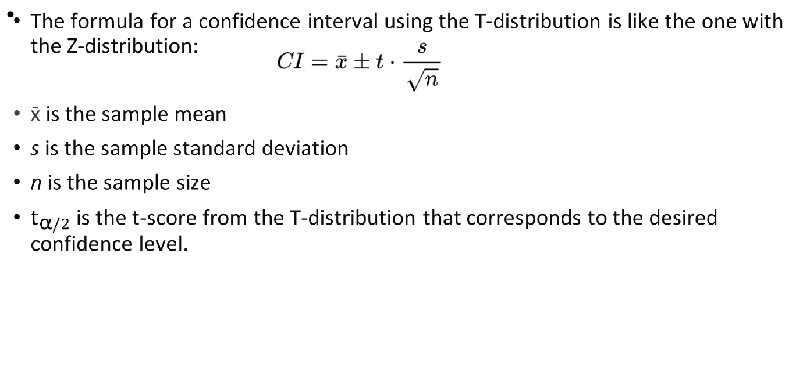{width="100%" fig-alt="Illustration: Confidence Intervals Using T-Distribution"}

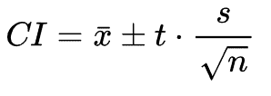{width="30%" fig-alt="Illustration: Confidence Intervals Using T-Distribution"}

::::::

:::::: {.source-slide #part3-02-slide-24}

### Interval Estimates - Confidence Intervals {#part3-title-02-24}

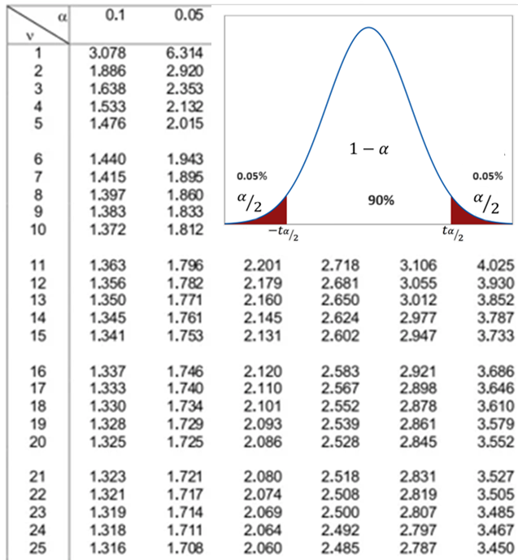{width="40%" fig-alt="Illustration: Interval Estimates - Confidence Intervals"}

::: source-text
Suppose we randomly collected a sample of students with the following information:

- Sample size n = 20
  - Sample mean weight x = 72.94 kg
  - Samples standard deviation s = 8.3946

What is the 90% confidence interval for the true population mean weight?
:::

::: source-text
- Confidence Interval 90%  *α* *= 1 - 0.9 = 0.1* ** *α/2 = 0.05*
- According to the t-table, the t-score for the 0.05 with df 20 -- 1 = 19  t score = 1.729
- The Margin of Error = 1.729 \* (8.3946/√20) = 3.25
- Therefore, the 90% CI = 72.94 ± 3.25 = \[69.69, 76.19\]
:::

::: source-text
**What is the difference between the 90% Confidence Interval of the Z-Distribution and the 90% Confidence Interval of the T-Distribution?**
:::

::::::

:::::: {.source-slide #part3-02-slide-25}

### Solving Confidence Intervals using R {#part3-title-02-25}

::: source-text
Suppose we randomly collected a sample of students with the following information:

- Sample size n = 20
  - Sample mean weight x = 72.94 kg
  - Samples standard deviation s = 8.3946

What is the 90% confidence interval for the true population mean weight?
:::

::: source-text
:::

:::: {.try-in-r #r-example-02-25}

#### Try this in R {.unlisted}

- **Purpose:** Calculate the 90% t interval for the sample of 20.
- **Before running:** `qt(0.95,df=19)` leaves 5% in the upper tail. Multiply it by sample SD 8.3946 divided by `sqrt(20)`. `c(-1,1)` places the resulting margin below and above mean 72.94.

```{r}
#| label: inferential-2-25
# qt() uses 19 degrees of freedom for n=20; the central 90% interval leaves 5% in each tail.
# The stated sample SD 8.3946 and mean 72.94 are in kg; no individual observations are invented.
72.94 + c(-1,1)*qt(0.95,df=19)*8.3946/sqrt(20)
```

**Read the result:** The limits are about 69.69 to 76.19 kg. A confidence interval concerns the population mean, not the range containing 90% of individual weights.

::::
::::::

:::::: {.source-slide #part3-02-slide-26}

### Steps to Calculate the Needed Sample Size {#part3-title-02-26}

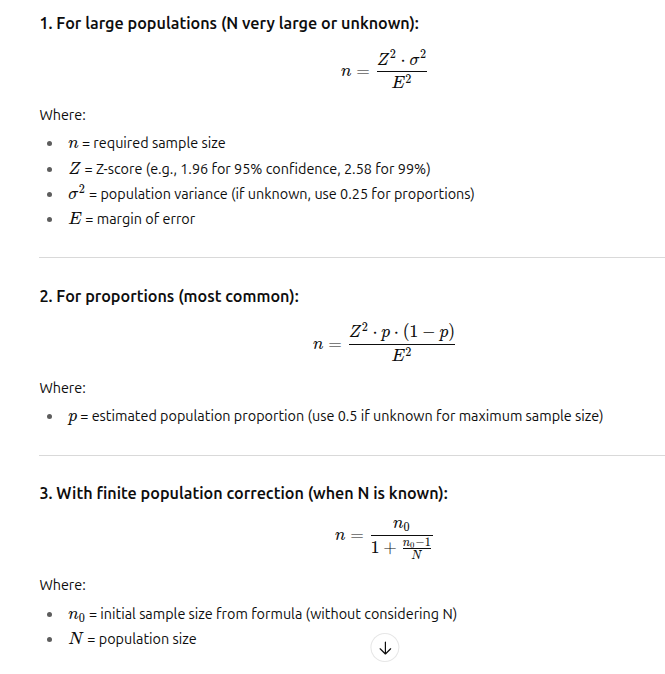{width="55%" fig-alt="Illustration: Steps to Calculate the Needed Sample Size"}

::: source-text
- **Define your research objectives and questions.**
- **Choose a significance level (α) and desired margin of error (E).**
- **Estimate population variability (σ),** or use conservative estimates if unknown.
- **Determine the population size (N).**
- **Select the type of sampling** (random or stratified).
- **Choose the statistical test or analysis** that will be applied.
- **Use a sample size formula or software tool** to calculate the required sample size.
- **Consider practical constraints** and adjust for potential non-response.
- **Conduct the study, analyze data, and interpret results.**
:::

::::::

:::::: {.source-slide #part3-03-slide-01}

## 4.2 Hypothesis testing {#part3-03}

::::::

:::::: {.source-slide #part3-03-slide-02}

### Content {#part3-title-03-02}

::: source-text
Introduction to Hypothesis Testing

Business Examples

Significance Level -- Alpha

Computing T-Statistic

Critical Value Approach vs P-Value Approach

Type I and Type II Errors

T-Test: Used for normally distributed data when the variance is unknown.

One-sample t-test: Tests the mean of a single group against a known mean.

Two-sample t-test: Compares the means of two dependent groups (paired test).

Two-sample t-test: Compares the means of two independent groups (variance assumed to be equal).

Two-sample t-test: Compares the means of two independent groups (variance assumed to be not equal).

Proportion Test: Compare sample proportion to a benchmark (e.g., open rate, conversion rate).

ANOVA (Analysis of Variance): Used to compare the means of three or more samples.

- One Way ANOVA
  - Two Way ANOVA

Chi-square test: Tests for relationships between categorical variables.
:::

::::::

:::::: {.source-slide #part3-03-slide-03}

### Hypothesis Testing {#part3-title-03-03}

::: source-text
**Hypothesis Testing** is a statistical method that uses sample data to evaluate a hypothesis about a population parameter.

A **hypothesis** is a claim about a population parameter that can be examined.

The purpose of hypothesis testing is to determine whether there is enough evidence in a sample of data to support a particular belief about a population.

Examples of claims that can be checked:

- Testing if a new marketing campaign increases customer engagement.
  - Checking whether a redesigned website improves conversion rates.
  - Evaluating if a new product packaging affects sales volume.
  - Determining if weekend promotions boost in-store foot traffic.
  - Assessing whether remote work impacts employee productivity.
  - Comparing customer satisfaction between two service locations.
  - Testing if a loyalty program increases repeat purchase rates.
  - Seeing if a price change affects total revenue.
  - Checking whether a new supplier leads to fewer product defects.
  - Measuring if training improves sales team performance.
:::

::::::

:::::: {.source-slide #part3-03-slide-04}

### Business Related Examples in Hypothesis Testing {#part3-title-03-04}

::: source-table
+---------------------------------------+---------------------------------------------------------------------------+---------------------------------------+------------------------------------------------------------------------------------------------------+
| Category                              | Scenario                                                                  | Type of Test                          | Detailed Experiment Design                                                                           |
+=======================================+===========================================================================+=======================================+======================================================================================================+
| Marketing                             | Testing if a new marketing campaign increases customer engagement.        | Proportion                            | - Compare engagement rates (clicks, opens) between users exposed to the new vs. old campaign.        |
|                                       |                                                                           |                                       | - Randomly assign at least 500 customers to two groups: one receiving the new campaign, one the old. |
|                                       |                                                                           |                                       | - Track engagement (clicks/opens) over a week.                                                       |
+---------------------------------------+---------------------------------------------------------------------------+---------------------------------------+------------------------------------------------------------------------------------------------------+
|                                       | Seeing if a promotional email improves open or click-through rates.       | Proportion                            | - Compare open/click-through rates between two versions of an email.                                 |
|                                       |                                                                           |                                       | - Send Version A to 1,000 customers and Version B to another 1,000.                                  |
|                                       |                                                                           |                                       | - Ensure equal demographic spread.                                                                   |
|                                       |                                                                           |                                       | - Compare open and click-through rates.                                                              |
+---------------------------------------+---------------------------------------------------------------------------+---------------------------------------+------------------------------------------------------------------------------------------------------+
|                                       | Measuring whether influencer partnerships drive more traffic to the site. | Mean                                  | - Compare average daily website visits with and without influencer campaigns.                        |
|                                       |                                                                           |                                       | - Track daily website traffic for 30 days before and after the influencer campaign.                  |
|                                       |                                                                           |                                       | - Use rolling averages to minimize noise.                                                            |
+---------------------------------------+---------------------------------------------------------------------------+---------------------------------------+------------------------------------------------------------------------------------------------------+
|                                       | Evaluating if social media ads result in more conversions.                | Proportion                            | - Compare conversion rates for users who saw the ads vs. those who did not.                          |
|                                       |                                                                           |                                       | - Randomly expose 5,000 users to social media ads while keeping a matched control group unexposed.   |
|                                       |                                                                           |                                       | - Track conversion behavior over 7 days.                                                             |
+---------------------------------------+---------------------------------------------------------------------------+---------------------------------------+------------------------------------------------------------------------------------------------------+
| Sales & Revenue                       | Determining if a price change affects total revenue.                      | Mean                                  | - Compare average revenue per user before and after price change.                                    |
|                                       |                                                                           |                                       | - Collect revenue data for 4 weeks before and after price change.                                    |
|                                       |                                                                           |                                       | - Use at least 1,000 transactions in each period to ensure reliability.                              |
+---------------------------------------+---------------------------------------------------------------------------+---------------------------------------+------------------------------------------------------------------------------------------------------+
|                                       | Testing whether bundling products increases average order value.          | Mean                                  | - Compare average order value for bundled vs. unbundled products.                                    |
|                                       |                                                                           |                                       | - Assign 500 customers to view bundled product pricing and 500 to unbundled.                         |
|                                       |                                                                           |                                       | - Track order values across one sales cycle.                                                         |
+---------------------------------------+---------------------------------------------------------------------------+---------------------------------------+------------------------------------------------------------------------------------------------------+
|                                       | Assessing if offering free shipping improves purchase completion rates.   | Proportion                            | - Compare checkout completion rates with and without free shipping.                                  |
|                                       |                                                                           |                                       | - Split 2,000 checkout users evenly into groups with and without free shipping.                      |
|                                       |                                                                           |                                       | - Track completion rate within 24 hours.                                                             |
+---------------------------------------+---------------------------------------------------------------------------+---------------------------------------+------------------------------------------------------------------------------------------------------+
:::

::::::

:::::: {.source-slide #part3-03-slide-05}

::: source-table
+---------------------------------------+-----------------------------------------------------------------------+---------------------------------------+---------------------------------------------------------------------------------------------------------------------------------------------------------------------------------------------------+
| Category                              | Scenario                                                              | Type of Test                          | Detailed Experiment Design                                                                                                                                                                        |
+=======================================+=======================================================================+=======================================+===================================================================================================================================================================================================+
| Operations                            | Checking whether a new supplier leads to fewer product defects.       | Proportion                            | - Compare defect rates between products from the old vs. new supplier.                                                                                                                            |
|                                       |                                                                       |                                       | - Collect defect data from 1,000 units produced using the old supplier and 1,000 from the new.                                                                                                    |
|                                       |                                                                       |                                       | - Monitor under similar production conditions.                                                                                                                                                    |
+---------------------------------------+-----------------------------------------------------------------------+---------------------------------------+---------------------------------------------------------------------------------------------------------------------------------------------------------------------------------------------------+
|                                       | Evaluating if a new production method reduces waste or error rates.   | Mean                                  | - Compare mean waste/error amounts using old vs. new methods.                                                                                                                                     |
|                                       |                                                                       |                                       | - Run the production process using each method for a week, generating at least 500 measurements of waste or errors per method.                                                                    |
+---------------------------------------+-----------------------------------------------------------------------+---------------------------------------+---------------------------------------------------------------------------------------------------------------------------------------------------------------------------------------------------+
|                                       | Determining if delivery time decreases with a new logistics provider. | Mean                                  | - Compare average delivery times between the two providers.                                                                                                                                       |
|                                       |                                                                       |                                       | - Record 1,000 delivery times for each provider across the same set of shipping regions and similar order types.                                                                                  |
+---------------------------------------+-----------------------------------------------------------------------+---------------------------------------+---------------------------------------------------------------------------------------------------------------------------------------------------------------------------------------------------+
| Customer Behavior                     | Testing if a loyalty program increases repeat purchase rates.         | Proportion                            | - Compare proportion of returning customers with and without loyalty program.                                                                                                                     |
|                                       |                                                                       |                                       | - Track purchase frequency over 3 months for 1,000 loyalty program users and 1,000 non-users, matched by purchase history.                                                                        |
+---------------------------------------+-----------------------------------------------------------------------+---------------------------------------+---------------------------------------------------------------------------------------------------------------------------------------------------------------------------------------------------+
|                                       | Seeing if a new mobile app design boosts daily active users.          | Mean                                  | - Compare average daily users before and after redesign.                                                                                                                                          |
|                                       |                                                                       |                                       | - Monitor app usage data for 30 days before and after the redesign, using data from at least 5,000 active users.                                                                                  |
+---------------------------------------+-----------------------------------------------------------------------+---------------------------------------+---------------------------------------------------------------------------------------------------------------------------------------------------------------------------------------------------+
|                                       | Measuring if customer satisfaction differs after a policy change.     | Mean                                  | - Compare satisfaction ratings before and after the policy change.                                                                                                                                |
|                                       |                                                                       |                                       | - Survey at least 500 customers before and after the policy change or use NPS ratings from two equivalent time periods.                                                                           |
+---------------------------------------+-----------------------------------------------------------------------+---------------------------------------+---------------------------------------------------------------------------------------------------------------------------------------------------------------------------------------------------+
| Human Resources                       | Assessing whether remote work impacts employee productivity.          | Mean                                  | - Compare average productivity scores of remote vs. in-office workers.                                                                                                                            |
|                                       |                                                                       |                                       | - Randomly select 200 remote and 200 in-office employees with similar roles. Track weekly productivity for 1 month.                                                                               |
+---------------------------------------+-----------------------------------------------------------------------+---------------------------------------+---------------------------------------------------------------------------------------------------------------------------------------------------------------------------------------------------+
|                                       | Measuring if training improves sales team performance.                | Mean                                  | - Compare average sales figures before and after training.                                                                                                                                        |
|                                       |                                                                       |                                       | - Analyze sales data from 100 employees for the 3 months before and after training. Normalize for seasonal trends.                                                                                |
+---------------------------------------+-----------------------------------------------------------------------+---------------------------------------+---------------------------------------------------------------------------------------------------------------------------------------------------------------------------------------------------+
|                                       | Testing if flexible hours reduce employee turnover.                   | Proportion                            | - Compare turnover rates between employees with and without flexible hours. Track turnover across 1,000 employees with flexible hours and 1,000 without, matched on role and tenure, over a year. |
+---------------------------------------+-----------------------------------------------------------------------+---------------------------------------+---------------------------------------------------------------------------------------------------------------------------------------------------------------------------------------------------+
:::

::::::

:::::: {.source-slide #part3-03-slide-06}

### Key Concepts {#part3-title-03-06}

::: source-text
- **Null Hypothesis (H₀):** A statement of no effect or no difference (usually we want to test this null state against a difference made by an intervention)
- **Alternative Hypothesis (H₁ or Ha):** What you want to prove -- a statement of effect or difference.
- **Significance Level (α):** Probability of rejecting H₀ when it is actually true. Common choices: 0.05, 0.01.
- **p-value:** Probability of observing a result at least as extreme as the one obtained, assuming H₀ is true.
- **Test Statistic:** A value calculated from the sample to decide whether to reject H₀.
:::

::::::

:::::: {.source-slide #part3-03-slide-07}

### The Null and The Alternative Hypothesis {#part3-title-03-07}

::: source-text
When formulating a hypothesis test, we define two hypotheses: the null hypothesis (𝐻₀) and the alternative hypothesis (𝐻₁ or 𝐻ₐ).

These two hypotheses complement each other---only one of them can be valid.

For example, suppose a company claims that the average delivery time of its orders is 3 days.

To test this claim, the company defines the hypotheses as following:

**The Null hypothesis 𝐻₀:** The average delivery time **IS EQUAL TO 3 days.**

**The Alternative hypothesis 𝐻ₐ:** The average delivery time **IS NOT 3 days.**

Hypotheses are often expressed with symbols like this:

𝐻₀: μ = 3 days

𝐻ₐ: μ ≠ 3 days

Notice that the null hypothesis sets a **baseline** assuming no difference or effect---in this context, that the mean delivery time is not different from 3 days.

The burden of proof lies with the alternative hypothesis, which must show sufficient evidence that the average delivery time is different from 3 days.
:::

::::::

:::::: {.source-slide #part3-03-slide-08}

### Choosing the Right Test {#part3-title-03-08}

::: source-text
- **One-sample z-test or t-test**: Compare sample mean to a known value.

**Proportion test**: Compare sample proportion to a benchmark (e.g., open rate, conversion rate).

- **Two-sample t-test**: Compare means between two groups (e.g., control vs test).
- **Chi-square test**: Compare categorical variables (e.g., customer satisfaction vs region).
- **ANOVA Test:** Compare means between three or more groups.
:::

::::::

:::::: {.source-slide #part3-03-slide-09}

### The Process {#part3-title-03-09}

::: source-text
**Compare the Test Statistic to Critical Values**

If the calculated test statistic falls into the critical region, reject H₀.

Otherwise, fail to reject H₀.

**Calculate the P-Value (Alternative Approach)**

The p-value is the probability of observing a test statistic as extreme as, or more extreme than, the one obtained, assuming H₀ is true.

**Decision rule:**

If p ≤ α → reject H₀

If p \> α → fail to reject H₀

**Make a Decision**

**Reject H₀:** Conclude there is evidence supporting Hₐ.

**Fail to reject H₀:** Conclude there is insufficient evidence to support Hₐ.

**Interpret Results**

Explain findings in the context of the research question.

Discuss practical significance and implications of the results.

Would you like me to also turn this into a **step-by-step flowchart** or **visual diagram** for easier understanding?
:::

::: source-text
**Formulate Hypotheses**

**Null hypothesis (H₀):** A statement of no effect or no difference. It represents the default assumption being tested.

**Alternative hypothesis (Hₐ):** The hypothesis you want to provide evidence for, suggesting there is an effect, difference, or relationship in the population.

**Choose a Significance Level (α)**

Select the probability of making a Type I error (rejecting H₀ when it is true).

Common choices: 0.05 (5%) or 0.01 (1%).

**Collect and Analyze Data**

Gather sample data relevant to your research question.

Perform an appropriate statistical analysis (e.g., t-test, chi-square test, ANOVA) depending on your study design.

**Calculate the Test Statistic**

Compute the test statistic based on sample data and H₀.

This quantifies how different the sample is from what is expected under H₀.

**Determine the Critical Region**

Identify the rejection region in the probability distribution of the test statistic.

If the statistic falls within this region, H₀ will be rejected.
:::

::::::

:::::: {.source-slide #part3-03-slide-10}

### The Process in Brief {#part3-title-03-10}

::: source-text
- **State** H₀ and Ha.
- **Choose** α (e.g., 0.05).
- **Collect data** and compute a test statistic.
- **Compute** the p-value.
- **Compare** p-value to α.
- **Decision:** Reject or fail to reject H₀.
:::

::: source-text
- Note: We cannot we accept the null hypothesis, we can only reject it or fail to reject it.
- The basis for this testing process comes from logic.
- For example, if our null hypothesis = All students live in Amman, it will be challenging to check if all students live in Amman.
- On the other hand, it will be much easier to find just one student who does not live in Amman and therefore reject the null hypothesis.
- Rejecting is much easier that proving or accepting the hypothesis.
:::

::::::

:::::: {.source-slide #part3-03-slide-11}

### More about Hypothesis Testing Core Concepts {#part3-title-03-11}

::: source-text
Alpha value, The Test Statistic and Critical Values, P-Value, Type I and Type II Errors
:::

::::::

:::::: {.source-slide #part3-03-slide-12}

### The Significance Level α {#part3-title-03-12}

::: source-text
Before conducting the test, we need to set the significance level α.

The significance level is a measure of the strength of the evidence that must be present in our sample to reject the null hypothesis and conclude that the effect is statistically significant.

Typical significance levels are: α=0.1 (10%), α=0.05 (5%), α=0.01 (1%)

A lower significance level means that the evidence in the data needs to be stronger to reject the null hypothesis.
:::

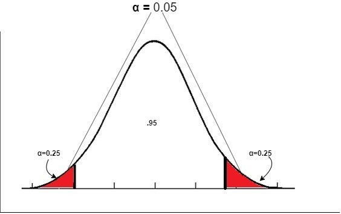{width="44%" fig-alt="Illustration: The Significance Level α"}

::: source-text
There is no \"correct\" significance level - it only states the amount of uncertainty of the conclusion.

A 5% significance level means that we expect to reject a true null hypothesis 5 out of 100 times (Type I Error).
:::

::::::

:::::: {.source-slide #part3-03-slide-13}

### The Test Statistic {#part3-title-03-13}

::: source-text
The test statistic is the value we compute based on the sample data that we collect.

The test statistic is used to decide the outcome of the hypothesis test.

We standardize test statistic using:

Z Standard Normal Distribution for large samples or when the variance is known.

The Student\'s T-Distribution (T) for small samples and the population variance is unknown.
:::

::::::

:::::: {.source-slide #part3-03-slide-14}

### Computing the Test Statistic Dependence on our Knowledge about Variance {#part3-title-03-14}

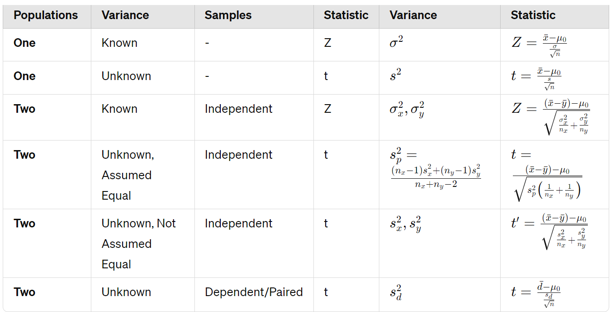{width="100%" fig-alt="Illustration: Computing the Test Statistic Dependence on our Knowledge about Variance"}

::::::

:::::: {.source-slide #part3-03-slide-15}

### The Critical Value and the p-Value Approach to Hypothesis Testing {#part3-title-03-15}

::: source-text
To decide whether to reject the null hypothesis, a test statistic is calculated.

The decision is made based on the numerical value of that test statistic.

There are two approaches how to arrive at that decision: The critical value approach and the p-value approach.

**The critical value approach**

By applying the critical value approach, it is determined, whether the observed test statistic is more extreme than a defined critical value.

Therefore, the observed test statistic (calculated based on sample data) is compared to the critical value (a kind of cutoff value).

If the test statistic is more extreme than the critical value, the null hypothesis is rejected.

If the test statistic is not as extreme as the critical value, the null hypothesis is not rejected.

The critical value is computed based on the given significance level α and the type of probability distribution of the idealized model.

The critical value divides the area under the probability distribution curve in rejection region(s) and non-rejection region.
:::

{width="30%" fig-alt="Illustration: The Critical Value and the p-Value Approach to Hypothesis Testing"}

::::::

:::::: {.source-slide #part3-03-slide-16}

### The Critical Value Approach to Hypothesis Testing {#part3-title-03-16}

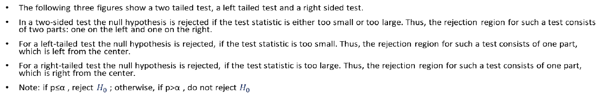{width="100%" fig-alt="Illustration: The Critical Value Approach to Hypothesis Testing"}

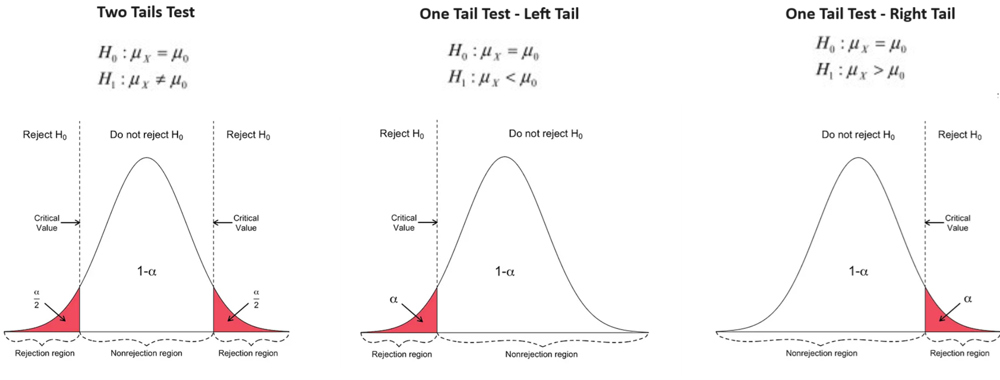{width="78%" fig-alt="Illustration: The Critical Value Approach to Hypothesis Testing"}

{width="30%" fig-alt="Illustration: The Critical Value Approach to Hypothesis Testing"}

::::::

:::::: {.source-slide #part3-03-slide-17}

### The p-Value Approach to Hypothesis Testing {#part3-title-03-17}

::: source-text
The p-value represents:

The probability of observing the sample data or more extreme values, given that the null hypothesis is true.

The amount of evidence against the null hypothesis, the smaller (closer to 0) the p-value, the stronger is the evidence against the null hypothesis.

If the p-value (**Green Area**) is less than or equal to the specified significance level α (**Yellow Area**) , the null hypothesis is rejected. Otherwise, we fail to reject the null hypothesis.
:::

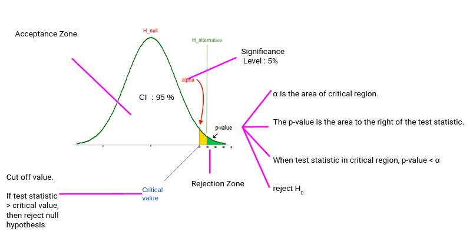{width="65%" fig-alt="Illustration: The p-Value Approach to Hypothesis Testing"}

{width="30%" fig-alt="Illustration: The p-Value Approach to Hypothesis Testing"}

::::::

:::::: {.source-slide #part3-03-slide-18}

### Type I and Type II Errors {#part3-title-03-18}

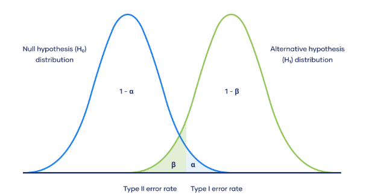{width="50%" fig-alt="Illustration: Type I and Type II Errors"}

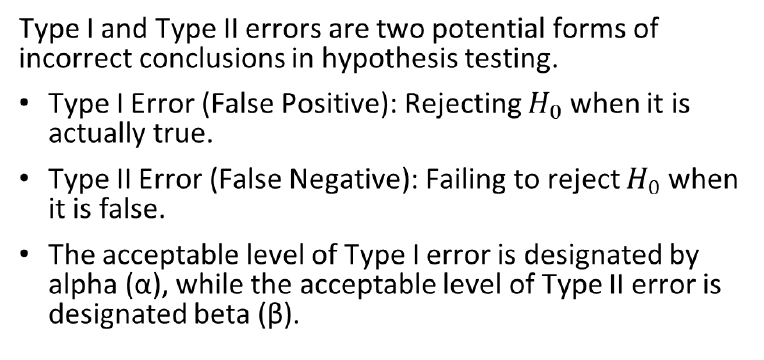{width="57%" fig-alt="Illustration: Type I and Type II Errors"}

::: source-text
A Type I error occurs when the null hypothesis is incorrectly rejected when it is actually true.

Conversely, a Type II error happens when the null hypothesis is not rejected when it is in fact false, akin to a false negative, where we fail to detect a true effect or difference.

Consider a pharmaceutical company deciding whether a new drug is effective. A Type I error would occur if the company concludes the drug works when it does not, potentially leading to a costly recall and reputation damage when the truth emerges.

On the other hand, a Type II error would be failing to recognize the drug\'s efficacy, missing out on the opportunity to bring a beneficial product to market, which can result in lost revenue and competitive disadvantage. The company must balance these risks, often prioritizing the avoidance of one type of error over the other based on the potential costs and impacts associated with each.
:::

::::::

:::::: {.source-slide #part3-03-slide-19}

### Hypothesis Testing Examples {#part3-title-03-19}

::::::

:::::: {.source-slide #part3-03-slide-20}

### Z Test vs T Test {#part3-title-03-20}

::: source-text
- A z-test is used to test a Null Hypothesis if the popula on variance is known, or if the sample size is larger than 30, for an unknown popula on variance.
- A t-test is used when the sample size is less than 30 and the popula on variance is unknown.

In our work, we will focus on T-Tests
:::

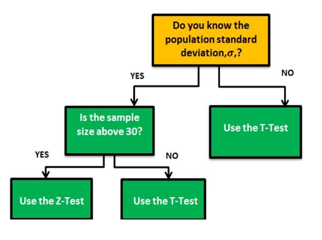{width="50%" fig-alt="Illustration: Z Test vs T Test"}

::::::

:::::: {.source-slide #part3-03-slide-21}

### One Sample Test – Testing for Two Tails {#part3-title-03-21}

::: source-text
- **Scenario:** A logistics company believe that its average delivery time is equal to 3 days. The company wants to test this belief.
- The company collected a sample data of 40 delivery times to test if there enough evidence (at α = .05) to conclude that the population mean delivery time for the company is equal to 3 days?

H₀: μ = 3

Ha: μ ≠ 3

- Using the collected data, the t-statistic will be computed:

If the test statistic is within the rejection region, we reject the null hypothesis, otherwise we fail to reject the null hypothesis noting that the sample data did not show enough evidence against the null hypothesis.
:::

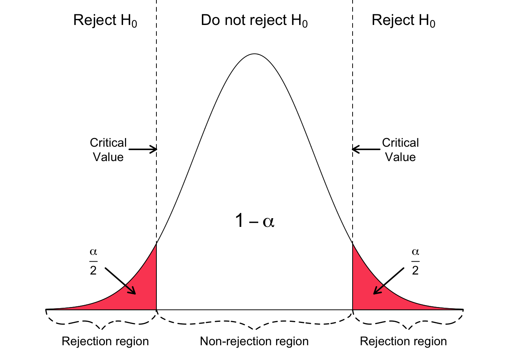{width="34%" fig-alt="Illustration: One Sample Test – Testing for Two Tails"}

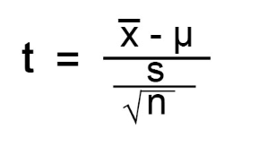{width="30%" fig-alt="Illustration: One Sample Test – Testing for Two Tails"}

::::::

:::::: {.source-slide #part3-03-slide-22}

### Implement the Test Using R {#part3-title-03-22}

::: source-table
+----------------------------------------------+---+---+---+
| Delivery Times for 40 Days Sample -- In Days |   |   |   |
+==============================================+===+===+===+
| 1                                            | 4 | 1 | 4 |
+----------------------------------------------+---+---+---+
| 3                                            | 3 | 4 | 2 |
+----------------------------------------------+---+---+---+
| 5                                            | 1 | 6 | 3 |
+----------------------------------------------+---+---+---+
| 3                                            | 4 | 4 | 3 |
+----------------------------------------------+---+---+---+
| 3                                            | 2 | 4 | 4 |
+----------------------------------------------+---+---+---+
| 4                                            | 2 | 1 | 3 |
+----------------------------------------------+---+---+---+
| 2                                            | 3 | 3 | 3 |
+----------------------------------------------+---+---+---+
| 5                                            | 4 | 6 | 5 |
+----------------------------------------------+---+---+---+
| 3                                            | 5 | 2 | 4 |
+----------------------------------------------+---+---+---+
| 6                                            | 2 | 4 | 5 |
+----------------------------------------------+---+---+---+
:::

::: source-text
- According to the test results, we fail to reject the null hypothesis which states that the mean delivery time is equal to 3 days.
- The collected sample data did not provide us with sufficient evidence to conclude that the mean delivery time is different from 3.
- We reached this conclusion because the t statistic falls inside the non-rejection region.
- We also reached that conclusion because the p-value (0.07315) which is greater than alpha 0.05.
- Computing t-statistic manually, t = (3.4 - 3) / (1.37 / √40) ≈ 1.84
:::

:::: {.try-in-r #r-example-03-22}

#### Try this in R {.unlisted}

- **Purpose:** Reproduce the two-sided mean test from the supplied summary statistics.
- **Before running:** `sqrt(variance/n)` is the estimated SE. `abs()` takes the magnitude of t. `pt(...,df=n-1,lower.tail=FALSE)` finds the upper t tail; multiplying by two gives the two-sided p-value. `c()` labels t, degrees of freedom and p.

```{r}
#| label: inferential-3-22
# This summary-data t test uses the source's n=40, mean 3.4 days, and variance 1.887179487 days squared.
# pt() gives tail area with df=39; doubling the upper tail of abs(t) gives the two-sided p-value.
n <- 40; t_stat <- (3.4-3)/sqrt(1.887179487/n)
c(t=t_stat, df=n-1, p_value=2*pt(abs(t_stat),df=n-1,lower.tail=FALSE))
```

**Read the result:** The p-value is about 0.0732, so at 5% we fail to reject the stated mean of three days. This does not prove equality.

::::
::::::

:::::: {.source-slide #part3-03-slide-23}

### One Sample – One Tail Test – Upper Tail {#part3-title-03-23}

::: source-text
**Business Context:**\
A manufacturing company believes that its daily production output is larger than 500 units.

The company collect sample outputs for 30 days.

**Hypothesis Formulation:**

Null Hypothesis (H₀): μ ≤ 500 (Baseline)

Alternative Hypothesis (H₁): μ \> 500 (Output is larger)

This setup calls for a **one-tailed (upper-tailed) t-test**, as the interest lies specifically in detecting an increase in the mean output.
:::

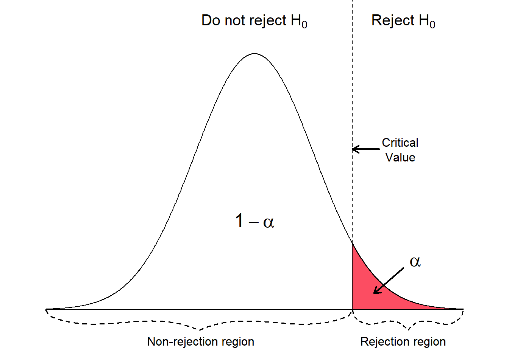{width="40%" fig-alt="Illustration: One Sample – One Tail Test – Upper Tail"}

::::::

:::::: {.source-slide #part3-03-slide-24}

### Implement the Test Using R {#part3-title-03-24}

::: source-table
+---------------------------+-----+
| Collect Daily Output Data |     |
+===========================+=====+
| 517                       | 534 |
+---------------------------+-----+
| 528                       | 483 |
+---------------------------+-----+
| 517                       | 520 |
+---------------------------+-----+
| 494                       | 539 |
+---------------------------+-----+
| 537                       | 530 |
+---------------------------+-----+
| 486                       | 509 |
+---------------------------+-----+
| 515                       | 547 |
+---------------------------+-----+
| 528                       | 526 |
+---------------------------+-----+
| 500                       | 538 |
+---------------------------+-----+
| 564                       | 531 |
+---------------------------+-----+
| 521                       | 509 |
+---------------------------+-----+
| 510                       | 538 |
+---------------------------+-----+
| 512                       | 491 |
+---------------------------+-----+
| 519                       | 505 |
+---------------------------+-----+
| 518                       | 534 |
+---------------------------+-----+
:::

::: source-text
T statistic is above the critical value and P-Value is very small \< alpha, therefore we reject the null hypothesis
:::

:::: {.try-in-r #r-example-03-24}

#### Try this in R {.unlisted}

- **Purpose:** Reproduce the upper-tail production-output test.
- **Before running:** Subtract benchmark 500 from mean output 520 and divide by `sqrt(340.0689655/30)`. `pt(t_stat,df=29,lower.tail=FALSE)` gives the upper-tail probability for the specified alternative.

```{r}
#| label: inferential-3-24
# Use the source summary values: n=30, mean output 520 units, and sample variance 340.0689655 units squared.
# pt(lower.tail=FALSE) tests the stated upper-tail alternative mu>500, with df=29.
t_stat <- (520-500)/sqrt(340.0689655/30)
c(t=t_stat, p_value=pt(t_stat,df=29,lower.tail=FALSE))
```

**Read the result:** The p-value is about 9.38 × 10⁻⁷, supporting rejection under the stated model. The supplied summaries are used directly; no observations are fabricated.

::::
::::::

:::::: {.source-slide #part3-03-slide-25}

### Two Sample T-Tests {#part3-title-03-25}

::: source-text
- Two-sample t-test: Compares the means of two dependent groups (Paired t test).
- Two-sample t-test: Compares the means of two independent groups (variance assumed to be equal).
- Two-sample t-test: Compares the means of two independent groups (variance assumed to be not equal).
:::

::::::

:::::: {.source-slide #part3-03-slide-26}

### Two Samples T-Test – Testing Dependent Groups (Paired T Test) {#part3-title-03-26}

::: source-text
The dependent samples T-test (or paired samples t-test) is a statistical test that determines whether there is a difference between two dependent groups or samples.

We need the paired t-test whenever we survey the same group or sample at two points in time.

This can be the case, for example, in longitudinal studies with several measurement points (time series analyses) or in intervention studies with experimental designs (before-after measurement).

An example of dependent sampling is when the weight of a group of people is measured at two points in time (before and after going into a diet).

The weight of a person can be measured individually before and after going into the diet, and the difference in the measured values can be calculated in each case.
:::

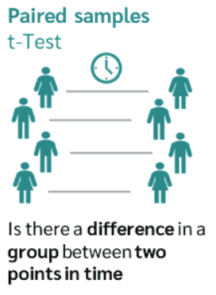{width="30%" fig-alt="Illustration: Two Samples T-Test – Testing Dependent Groups (Paired T Test)"}

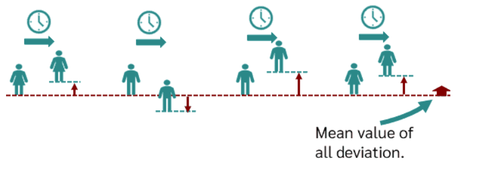{width="43%" fig-alt="Illustration: Two Samples T-Test – Testing Dependent Groups (Paired T Test)"}

{width="30%" fig-alt="Illustration: Two Samples T-Test – Testing Dependent Groups (Paired T Test)"}

::::::

:::::: {.source-slide #part3-03-slide-27}

### Two Samples T-Test – Testing Dependent Groups (Paired T Test) {#part3-title-03-27}

::: source-text
We are interested in the question whether an online statistics learning tutorial helps students improve their grades.

There are three variables of interest in the student\'s data set (score1, score2 and online.tutorial).

The variables score1 and score2 show the grades (0-100) for two exams on mathematics after attending online training. The higher the value the better the student performed.

The variable online.tutorial is a binary variable, which is 1 if the student completed the online statistics learning tutorial, or 0 otherwise.

The first exam takes place before the students attended the online statistics learning tutorial.

The participation in the online statistics learning tutorial is not mandatory, however the two exams are obligatory for all students.

We want to examine if the group of students, which attended the online statistics learning tutorial, performs better on the second exam compared to the first exam.
:::

::: source-table
+--------------------------------------------------------+---------+---------+
| Random sample of students who took the online training |         |         |
+========================================================+=========+=========+
| \`                                                     | Score 1 | Score 2 |
+--------------------------------------------------------+---------+---------+
| 1                                                      | 67      | 71      |
+--------------------------------------------------------+---------+---------+
| 2                                                      | 62      | 64      |
+--------------------------------------------------------+---------+---------+
| 3                                                      | 60      | 57      |
+--------------------------------------------------------+---------+---------+
| 4                                                      | 53      | 52      |
+--------------------------------------------------------+---------+---------+
| 5                                                      | 75      | 77      |
+--------------------------------------------------------+---------+---------+
| 6                                                      | 64      | 79      |
+--------------------------------------------------------+---------+---------+
| 7                                                      | 43      | 48      |
+--------------------------------------------------------+---------+---------+
| 8                                                      | 74      | 70      |
+--------------------------------------------------------+---------+---------+
| 9                                                      | 59      | 53      |
+--------------------------------------------------------+---------+---------+
| 10                                                     | 54      | 58      |
+--------------------------------------------------------+---------+---------+
| 11                                                     | 66      | 66      |
+--------------------------------------------------------+---------+---------+
| 12                                                     | 81      | 90      |
+--------------------------------------------------------+---------+---------+
| 13                                                     | 55      | 57      |
+--------------------------------------------------------+---------+---------+
| 14                                                     | 64      | 68      |
+--------------------------------------------------------+---------+---------+
| 15                                                     | 72      | 71      |
+--------------------------------------------------------+---------+---------+
| 16                                                     | 76      | 78      |
+--------------------------------------------------------+---------+---------+
| 17                                                     | 75      | 73      |
+--------------------------------------------------------+---------+---------+
| 18                                                     | 90      | 92      |
+--------------------------------------------------------+---------+---------+
| 19                                                     | 83      | 90      |
+--------------------------------------------------------+---------+---------+
| 20                                                     | 64      | 73      |
+--------------------------------------------------------+---------+---------+
| 21                                                     | 49      | 51      |
+--------------------------------------------------------+---------+---------+
| 22                                                     | 41      | 51      |
+--------------------------------------------------------+---------+---------+
| 23                                                     | 75      | 87      |
+--------------------------------------------------------+---------+---------+
| 24                                                     | 66      | 66      |
+--------------------------------------------------------+---------+---------+
| 25                                                     | 75      | 74      |
+--------------------------------------------------------+---------+---------+
| 26                                                     | 49      | 57      |
+--------------------------------------------------------+---------+---------+
| 27                                                     | 91      | 89      |
+--------------------------------------------------------+---------+---------+
| 28                                                     | 68      | 69      |
+--------------------------------------------------------+---------+---------+
| 29                                                     | 72      | 72      |
+--------------------------------------------------------+---------+---------+
| 30                                                     | 87      | 93      |
+--------------------------------------------------------+---------+---------+
:::

::: source-table
+---+------------------------------------------------------------------------+
|   | *Null Hypothesis states that there is no effect for the intervention*  |
+===+========================================================================+
|   | *Alternative Hypothesis claims that the intervention caused an effect* |
+---+------------------------------------------------------------------------+
:::

{width="30%" fig-alt="Illustration: Two Samples T-Test – Testing Dependent Groups (Paired T Test)"}

:::: {.try-in-r #r-example-03-27}

#### Try this in R {.unlisted}

- **Purpose:** Load the paired scores and inspect their change.
- **Before running:** `read.csv()` reads the supplied project-root CSV; `$` selects a column. `head()` previews rows; `nrow()` counts paired students. `mean(score2-score1)` averages within-student changes. Run this cell before the next test.

```{r}
#| label: inferential-3-27
# Load the exact 30 paired observations printed in the source slide.
paired <- read.csv("data/inferential-statistics/paired_scores.csv")
head(paired)
c(n=nrow(paired), mean_change=mean(paired$score2 - paired$score1))
```

**Read the result:** Each row is one student measured twice. The unit of the paired analysis is the within-student difference, not two independent groups.

::::
::::::

:::::: {.source-slide #part3-03-slide-28}

### Two Samples T-Test – Testing Dependent Groups (Paired T Test) {#part3-title-03-28}

::: source-text
- Based on the sample data and the test statistic, we found that there is a statistically significant difference between the before and after score, the after score (score2) is higher than score1.
- This finding is supported by the test statistic and the p-value, therefore we REJECT the null hypothesis, and we conclude that the online tutorial helped students in enhancing their exam performance.
:::

{width="30%" fig-alt="Illustration: Two Samples T-Test – Testing Dependent Groups (Paired T Test)"}

:::: {.try-in-r #r-example-03-28}

#### Try this in R {.unlisted}

- **Purpose:** Test the within-student score difference.
- **Before running:** `t.test(x,y,paired=TRUE)` analyses x minus y for each matching row. `alternative="greater"` tests a positive score2-minus-score1 mean change; `conf.level=0.95` requests the corresponding one-sided confidence bound.

```{r}
#| label: inferential-3-28
# Compare score2 minus score1 within the same students.
t.test(x=paired$score2, y=paired$score1, paired=TRUE,
       alternative="greater", conf.level=0.95)
```

**Read the result:** The test supports a positive average change under its assumptions. Pairing alone does not establish that the tutorial caused that change.

::::
::::::

:::::: {.source-slide #part3-03-slide-29}

### Two Samples T-Test – Testing Independent Groups (Unpaired T Test) (variance assumed to be equal) {#part3-title-03-29}

::: source-table
+----+--------------------+----------------------+
|    | Male Random Sample | Female Random Sample |
+====+====================+======================+
| 1  | \$39,647.68        | \$29,543.60          |
+----+--------------------+----------------------+
| 2  | \$55,726.10        | \$30,972.76          |
+----+--------------------+----------------------+
| 3  | \$34,717.77        | \$33,216.12          |
+----+--------------------+----------------------+
| 4  | \$29,999.35        | \$24,143.27          |
+----+--------------------+----------------------+
| 5  | \$50,763.66        | \$40,466.69          |
+----+--------------------+----------------------+
| 6  | \$52,433.73        | \$29,543.60          |
+----+--------------------+----------------------+
| 7  | \$44,385.84        | \$47,760.48          |
+----+--------------------+----------------------+
| 8  | \$36,599.27        | \$45,054.95          |
+----+--------------------+----------------------+
| 9  | \$47,842.44        | \$42,742.79          |
+----+--------------------+----------------------+
| 10 | \$30,854.42        | \$42,202.39          |
+----+--------------------+----------------------+
| 11 | \$58,614.72        | \$40,606.41          |
+----+--------------------+----------------------+
| 12 | \$62,887.03        | \$29,783.76          |
+----+--------------------+----------------------+
| 13 | \$48,288.53        | \$46,945.17          |
+----+--------------------+----------------------+
| 14 | \$43,191.15        | \$29,555.94          |
+----+--------------------+----------------------+
| 15 | \$43,756.58        | \$45,042.30          |
+----+--------------------+----------------------+
| 16 | \$48,453.00        | \$29,555.94          |
+----+--------------------+----------------------+
| 17 | \$23,090.67        | \$45,625.09          |
+----+--------------------+----------------------+
| 18 | \$55,660.20        | \$28,017.87          |
+----+--------------------+----------------------+
| 19 | \$57,527.17        | \$35,840.90          |
+----+--------------------+----------------------+
| 20 | \$65,776.23        | \$33,648.38          |
+----+--------------------+----------------------+
| 21 | \$50,011.69        | \$46,858.67          |
+----+--------------------+----------------------+
| 22 | \$46,213.64        | \$42,463.48          |
+----+--------------------+----------------------+
| 23 | \$42,211.41        | \$33,200.27          |
+----+--------------------+----------------------+
| 24 | \$61,384.55        | \$28,338.17          |
+----+--------------------+----------------------+
| 25 | \$49,780.18        | \$26,265.35          |
+----+--------------------+----------------------+
| 26 | \$50,474.57        | \$34,373.99          |
+----+--------------------+----------------------+
| 27 | \$43,281.92        | \$37,312.85          |
+----+--------------------+----------------------+
| 28 | \$55,484.64        | \$37,709.73          |
+----+--------------------+----------------------+
| 29 | \$24,409.73        | \$35,106.01          |
+----+--------------------+----------------------+
| 30 | \$40,489.49        | \$37,807.11          |
+----+--------------------+----------------------+
:::

::: source-text
In this section we perform a hypothesis test for the means of two populations.

We examine the mean annual salary (in Euro) of graduates.

The first population consist of male students and the second population of female students.

The standard deviations of the two populations are unknown but assumed to be equal.

The question is, whether there is a difference (at α 5%) in the mean annual salary of graduates related to gender (two tailed test)
:::

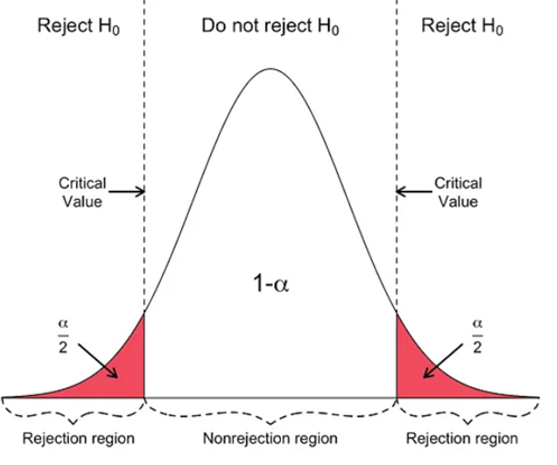{width="30%" fig-alt="Illustration: Two Samples T-Test – Testing Independent Groups (Unpaired T Test) (variance assumed to be equal)"}

::: source-table
+---+------------------------------------------------------------+
|   | *Null Hypothesis states that there is no difference*       |
+===+============================================================+
|   | *Alternative Hypothesis claims that there is a difference* |
+---+------------------------------------------------------------+
:::

{width="30%" fig-alt="Illustration: Two Samples T-Test – Testing Independent Groups (Unpaired T Test) (variance assumed to be equal)"}

:::: {.try-in-r #r-example-03-29}

#### Try this in R {.unlisted}

- **Purpose:** Load the two salary samples and compare their means.
- **Before running:** `read.csv()` loads the supplied CSV. `$male` and `$female` select the two samples; `mean()` calculates their averages. Keep the source currency-label inconsistency in mind.

```{r}
#| label: inferential-3-29
# Load the exact printed salary samples; the source currency labels conflict.
salaries <- read.csv("data/inferential-statistics/graduate_salaries.csv")
c(male_mean=mean(salaries$male), female_mean=mean(salaries$female))
```

**Read the result:** These are independent-group sample means. The next cell tests their difference under the specified equal-variance model.

::::
::::::

:::::: {.source-slide #part3-03-slide-30}

### Two Samples T-Test – Testing Independent Groups (Unpaired T Test) (variance assumed to be equal) {#part3-title-03-30}

::: source-text
- Based on the sample data and the test statistic, we found that there is a statistically significant difference between male salaries and female salaries.
- This finding is supported by the test statistic and the p-value, therefore we REJECT the null hypothesis, and we conclude that the salaries of male graduates and female graduates are not equal.
:::

{width="30%" fig-alt="Illustration: Two Samples T-Test – Testing Independent Groups (Unpaired T Test) (variance assumed to be equal)"}

:::: {.try-in-r #r-example-03-30}

#### Try this in R {.unlisted}

- **Purpose:** Run the equal-variance independent-samples test.
- **Before running:** `t.test(x,y,var.equal=TRUE)` uses a pooled variance. `alternative="two.sided"` tests for either direction; `conf.level=0.95` requests a two-sided interval for mean male minus mean female salary.

```{r}
#| label: inferential-3-30
# Pooled two-sided comparison under the source equal-variance assumption.
t.test(x=salaries$male, y=salaries$female, var.equal=TRUE,
       alternative="two.sided", conf.level=0.95)
```

**Read the result:** Read the estimated difference, interval and p-value together. Equal population variances and an appropriate independent sampling model are assumptions, not consequences of a small p-value.

::::
::::::

:::::: {.source-slide #part3-03-slide-31}

### Two Samples T-Test – Testing Independent Groups (Unpaired T Test) (variance assumed to be NOT equal) {#part3-title-03-31}

::: source-text
In this section we perform a hypothesis test for the means of two populations.

To showcase the non-pooled t-test we test a claim that states that the annual salaries for political science female students is higher than the annual salaries of the social science female students.

The standard deviations of the two populations are unknown and assumed to be unequal.

We want to test at α 1%, whether the mean political science salary is higher than the mean salary of the social science (one tail test, upper tail).
:::

::: source-table
+----+---------------------------------+------------------------------+
|    | Political Science Random Sample | Social Science Random Sample |
+====+=================================+==============================+
| 1  | \$30,796.16                     | \$33,641.73                  |
+----+---------------------------------+------------------------------+
| 2  | \$32,038.41                     | \$29,635.67                  |
+----+---------------------------------+------------------------------+
| 3  | \$32,038.41                     | \$38,738.01                  |
+----+---------------------------------+------------------------------+
| 4  | \$32,996.39                     | \$21,453.99                  |
+----+---------------------------------+------------------------------+
| 5  | \$33,648.38                     | \$31,484.80                  |
+----+---------------------------------+------------------------------+
| 6  | \$41,430.16                     | \$34,287.96                  |
+----+---------------------------------+------------------------------+
| 7  | \$40,032.78                     | \$35,583.43                  |
+----+---------------------------------+------------------------------+
| 8  | \$39,710.80                     | \$28,672.85                  |
+----+---------------------------------+------------------------------+
| 9  | \$36,911.26                     | \$30,062.71                  |
+----+---------------------------------+------------------------------+
| 10 | \$45,900.13                     | \$34,420.48                  |
+----+---------------------------------+------------------------------+
| 11 | \$35,270.19                     | \$33,641.73                  |
+----+---------------------------------+------------------------------+
| 12 | \$43,318.41                     | \$26,291.32                  |
+----+---------------------------------+------------------------------+
| 13 | \$41,282.13                     | \$31,151.42                  |
+----+---------------------------------+------------------------------+
| 14 | \$41,430.16                     | \$38,738.01                  |
+----+---------------------------------+------------------------------+
| 15 | \$21,485.62                     | \$33,565.74                  |
+----+---------------------------------+------------------------------+
| 16 | \$29,195.50                     | \$31,484.80                  |
+----+---------------------------------+------------------------------+
| 17 | \$45,141.81                     | \$32,194.59                  |
+----+---------------------------------+------------------------------+
| 18 | \$34,492.08                     | \$35,746.22                  |
+----+---------------------------------+------------------------------+
| 19 | \$27,893.26                     | \$28,281.25                  |
+----+---------------------------------+------------------------------+
| 20 | \$38,591.54                     | \$31,405.48                  |
+----+---------------------------------+------------------------------+
| 21 | \$33,726.58                     | \$32,194.59                  |
+----+---------------------------------+------------------------------+
| 22 | \$29,832.22                     | \$35,987.41                  |
+----+---------------------------------+------------------------------+
| 23 | \$32,154.94                     | \$35,583.43                  |
+----+---------------------------------+------------------------------+
| 24 | \$34,686.49                     | \$34,227.49                  |
+----+---------------------------------+------------------------------+
| 25 | \$25,607.82                     | \$25,758.88                  |
+----+---------------------------------+------------------------------+
| 26 | \$33,726.58                     | \$34,373.99                  |
+----+---------------------------------+------------------------------+
| 27 | \$37,782.86                     | \$25,658.83                  |
+----+---------------------------------+------------------------------+
| 28 | \$35,507.83                     | \$34,201.58                  |
+----+---------------------------------+------------------------------+
| 29 | \$33,955.21                     | \$31,151.42                  |
+----+---------------------------------+------------------------------+
| 30 | \$25,883.03                     | \$33,641.73                  |
+----+---------------------------------+------------------------------+
:::

{width="30%" fig-alt="Illustration: Two Samples T-Test – Testing Independent Groups (Unpaired T Test) (variance assumed to be NOT equal)"}

::: source-table
+---+------------------------------------------------------------------+
|   | *Null Hypothesis states that the salaries are equal*             |
+===+==================================================================+
|   | *Alternative Hypothesis claims that political science is higher* |
+---+------------------------------------------------------------------+
:::

{width="30%" fig-alt="Illustration: Two Samples T-Test – Testing Independent Groups (Unpaired T Test) (variance assumed to be NOT equal)"}

:::: {.try-in-r #r-example-03-31}

#### Try this in R {.unlisted}

- **Purpose:** Load the two female-graduate salary samples.
- **Before running:** `read.csv()` imports the CSV; `$` selects each subject’s salary column. `mean()` summarises each sample. Run this before the comparison on the following slide.

```{r}
#| label: inferential-3-31
# Load the exact printed female-graduate salary samples.
majors <- read.csv("data/inferential-statistics/female_major_salaries.csv")
c(political_science_mean=mean(majors$political_science),
  social_science_mean=mean(majors$social_science))
```

**Read the result:** The two displayed means describe these samples. Preserve the source units and avoid interpreting a sample difference as causal.

::::
::::::

:::::: {.source-slide #part3-03-slide-32}

### Two Samples T-Test – Testing Independent Groups (Unpaired T Test) (variance assumed to be NOT equal) {#part3-title-03-32}

::: source-text
- Based on the sample data and the test statistic, we found that there is no statistically significant difference (at α 1%) between the salaries of political science and social science.
- This finding is supported by the test statistic and the p-value, therefore we FAIL TO REJECT the null hypothesis which states that the salaries of political science and social science are equal for female graduates.
:::

{width="30%" fig-alt="Illustration: Two Samples T-Test – Testing Independent Groups (Unpaired T Test) (variance assumed to be NOT equal)"}

:::: {.try-in-r #r-example-03-32}

#### Try this in R {.unlisted}

- **Purpose:** Use Welch’s test for the stated directional comparison.
- **Before running:** `var.equal=FALSE` avoids assuming equal population variances. `alternative="greater"` tests Political Science minus Social Science above zero. `conf.level=0.99` matches the source 1% one-sided question.

```{r}
#| label: inferential-3-32
# Welch comparison for the stated one-sided question at alpha 0.01.
t.test(x=majors$political_science, y=majors$social_science,
       alternative="greater", var.equal=FALSE, conf.level=0.99)
```

**Read the result:** The one-sided p-value is about 0.0182, above 0.01; fail to reject at the stated level. Do not change direction or significance level after examining the result.

::::
::::::

:::::: {.source-slide #part3-03-slide-33}

### Testing Proportions {#part3-title-03-33}

::::::

:::::: {.source-slide #part3-03-slide-34}

### Introduction to Proportion Tests {#part3-title-03-34}

::: source-text
- **A Proportion** is a fraction or percentage of a population exhibiting a specific trait (e.g., success/failure).
- Proportion tests allow us to **infer population parameters** from sample data.

**Key Differences from t-tests:**

- Applied to **categorical data** (e.g., success/failure), not continuous variables.
- Uses the **normal approximation** to the binomial distribution. The **central limit theorem** says: if the sample size is large enough, the binomial distribution starts to look like a **normal distribution**.
- Therefore, to use the normal distribution as an approximation for the binomial, both of these must be true:

𝑛.𝑝 ≥ 10

𝑛.(1−𝑝) ≥ 10

Where:

𝑛 = sample size

𝑝 = hypothesized population proportion (under the null hypothesis)
:::

::::::

:::::: {.source-slide #part3-03-slide-35}

### One-Sample Proportion Test {#part3-title-03-35}

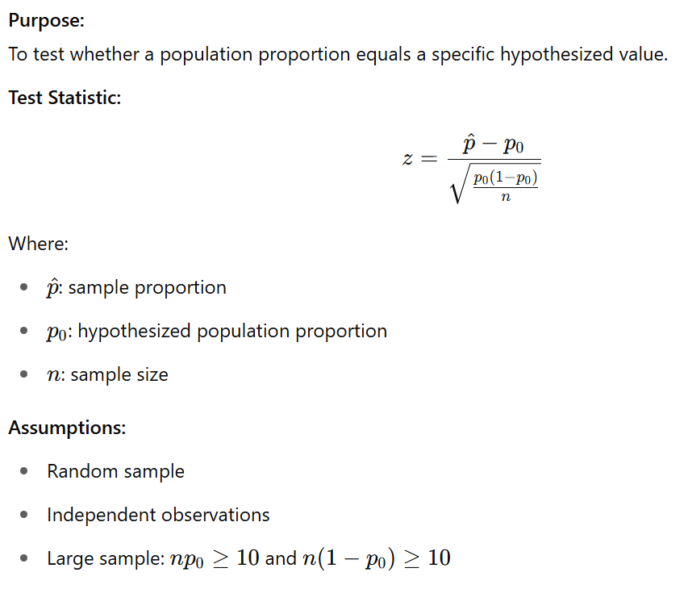{width="57%" fig-alt="Illustration: One-Sample Proportion Test"}

::::::

:::::: {.source-slide #part3-03-slide-36}

### Example {#part3-title-03-36}

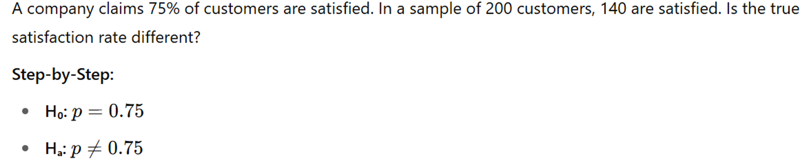{width="86%" fig-alt="Illustration: Example"}

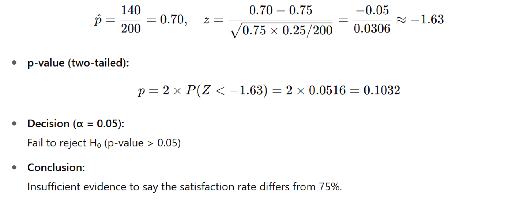{width="69%" fig-alt="Illustration: Example"}

:::: {.try-in-r #r-example-03-36}

#### Try this in R {.unlisted}

- **Purpose:** Test the stated population satisfaction rate.
- **Before running:** `prop.test(x=140,n=200,p=0.75)` uses 140 successes among 200 observations against null rate 0.75. `alternative="two.sided"` allows either direction; `correct=FALSE` omits continuity correction to match the uncorrected score calculation.

```{r}
#| label: inferential-3-36
# prop.test() tests the source's 140 satisfied customers out of 200 against p=0.75.
# correct=FALSE omits continuity correction to match the source normal-approximation calculation.
prop.test(140,200,p=0.75,alternative="two.sided",correct=FALSE)
```

**Read the result:** The sample rate is 70%. Compare p with the chosen significance level, under an appropriate independent sampling model; the result does not establish the null as true.

::::
::::::

:::::: {.source-slide #part3-03-slide-37}

### Two-Samples Proportion Test {#part3-title-03-37}

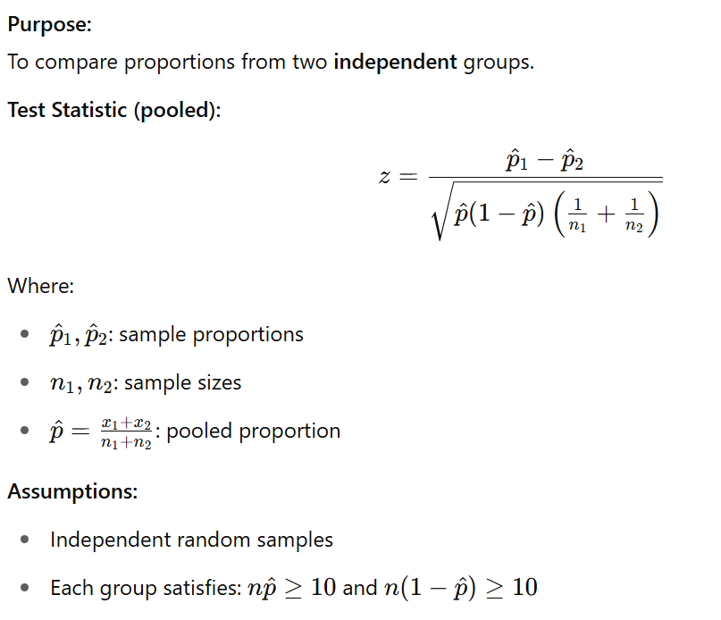{width="57%" fig-alt="Illustration: Two-Samples Proportion Test"}

::::::

:::::: {.source-slide #part3-03-slide-38}

### Example: Does the New Treatment Work? {#part3-title-03-38}

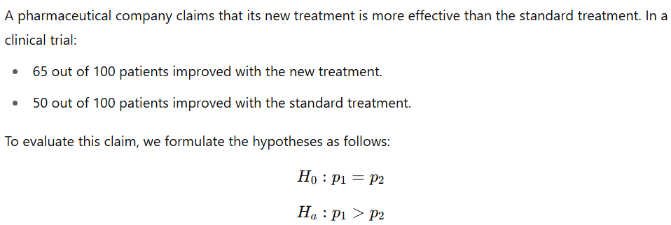{width="67%" fig-alt="Illustration: Example: Does the New Treatment Work?"}

::: source-text
This is a one-tailed test for comparing two proportions
:::

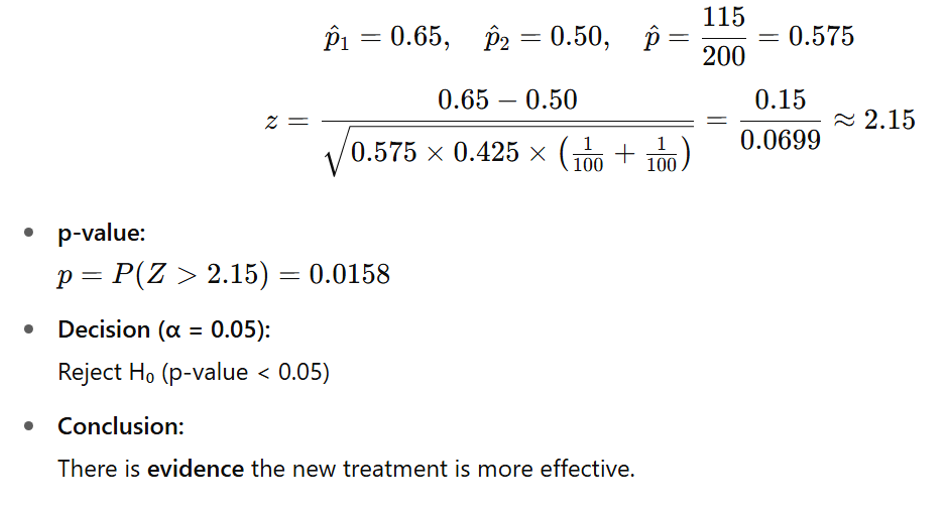{width="43%" fig-alt="Illustration: Example: Does the New Treatment Work?"}

:::: {.try-in-r #r-example-03-38}

#### Try this in R {.unlisted}

- **Purpose:** Compare the treatment success counts.
- **Before running:** The first `c()` supplies success counts and the second their group totals, in matching order. `alternative="greater"` tests the first rate above the second; `correct=FALSE` omits continuity correction.

```{r}
#| label: inferential-3-38
# prop.test() compares 65/100 in the new-treatment group with 50/100 in the standard-treatment group.
# greater sets the source's one-sided alternative; correct=FALSE matches its uncorrected pooled z test.
prop.test(c(65,50),c(100,100),alternative="greater",correct=FALSE)
```

**Read the result:** The observed rates are 65% and 50%, a 15-percentage-point difference. Interpret the one-sided test under the study’s design and assumptions.

::::
::::::

:::::: {.source-slide #part3-03-slide-39}

### Hypothesis Testing for Categorical Data {#part3-title-03-39}

::: source-text
Chi-Square Tests
:::

::::::

:::::: {.source-slide #part3-03-slide-40}

### Introduction to Chi-Square Tests {#part3-title-03-40}

::: source-text
Definition: Chi-square tests are statistical methods used to determine whether there\'s a significant association between categorical variables or whether observed data differs significantly from expected values.

Types of Chi-Square Tests:

Test of Independence: Determines if two or more categories are independent.

Goodness of Fit Test: Determines if a sample matches an expected distribution.
:::

::::::

:::::: {.source-slide #part3-03-slide-41}

### Examples {#part3-title-03-41}

::: source-text
**Test of Independence**

- **Marketing**: Is customer gender associated with product preference?
- **HR Analytics**: Is employee department linked to job satisfaction level?
- **Retail**: Does store location affect the type of payment method used?
- **Healthcare Management**: Is patient age group related to preferred appointment times?
- **Customer Service**: Is complaint category associated with region?
:::

::::::

:::::: {.source-slide #part3-03-slide-42}

### Chi-Square Steps – Test of Independence {#part3-title-03-42}

::: source-text
Step-by-Step Process:

1\. Set a contingency table to show the expected frequencies and the observed frequencies.

2\. Calculate the expected frequencies for each cell using the following formula.
:::

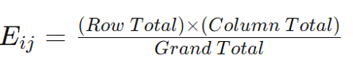{width="34%" fig-alt="Illustration: Chi-Square Steps – Test of Independence"}

::: source-text
3\. Compute Chi-Square statistic using the formula
:::

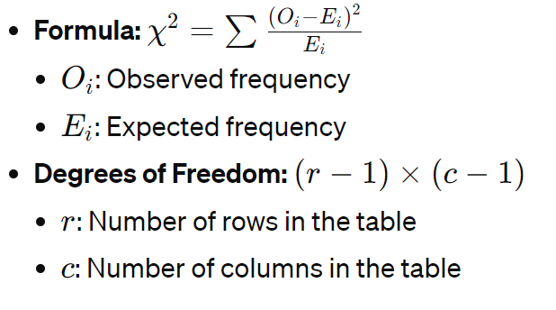{width="30%" fig-alt="Illustration: Chi-Square Steps – Test of Independence"}

::::::

:::::: {.source-slide #part3-03-slide-43}

### Chi-Square Steps – Test of Independence {#part3-title-03-43}

::: source-text
4\. Use the Chi-Square distribution to find the Chi-Square statistic and compare it to the critical values at common significance level e.g. (0.05)
:::

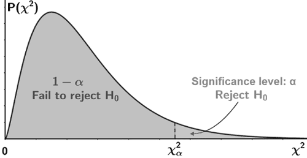{width="47%" fig-alt="Illustration: Chi-Square Steps – Test of Independence"}

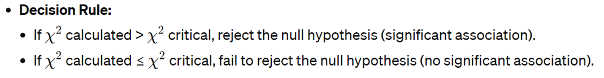{width="100%" fig-alt="Illustration: Chi-Square Steps – Test of Independence"}

::::::

:::::: {.source-slide #part3-03-slide-44}

### Example: Product Preference Across Age Groups {#part3-title-03-44}

::: source-text
A company wants to determine if there is a significant association between the age group of its customers and their preference for one of two new beverage products.

The marketing team has conducted a survey and **collected data** from different age groups.

The table below shows the **observed frequency** table based on the survey:
:::

::: source-table
+---------------------------------------+---------------------------------------+---------------------------------------+---------------------------------------+
|                                       | \                                     | **Product B**                         | **Total**                             |
|                                       | **Product A**                         |                                       |                                       |
+=======================================+=======================================+=======================================+=======================================+
| **Under 30**                          | 30                                    | 40                                    | 70                                    |
+---------------------------------------+---------------------------------------+---------------------------------------+---------------------------------------+
| **30 to 50**                          | 50                                    | 30                                    | 80                                    |
+---------------------------------------+---------------------------------------+---------------------------------------+---------------------------------------+
| **Over 50**                           | 20                                    | 30                                    | 50                                    |
+---------------------------------------+---------------------------------------+---------------------------------------+---------------------------------------+
| **Total**                             | 100                                   | 100                                   | 200                                   |
+---------------------------------------+---------------------------------------+---------------------------------------+---------------------------------------+
:::

::: source-text
**Task:** Perform a Chi-Square Test of Independence to determine if there\'s a significant relationship between age group and product preference.
:::

:::: {.try-in-r #r-example-03-44}

#### Try this in R {.unlisted}

- **Purpose:** Enter the product-preference counts.
- **Before running:** `matrix()` arranges the values into `nrow=3` rows. `byrow=TRUE` fills each age-group row in order. `dimnames=list(...)` names the rows and columns; `c()` makes each label vector. Counts, rather than percentages, are entered.

```{r}
#| label: inferential-3-44
# Enter the original observed counts, with age groups as rows.
beverages <- matrix(c(30,40,50,30,20,30), nrow=3, byrow=TRUE,
  dimnames=list(c("Under 30","30 to 50","Over 50"),
                c("Product A","Product B")))
beverages
```

**Read the result:** The table contains 200 observations. This cell defines beverages for the following expected-count and test calculations.

::::
::::::

:::::: {.source-slide #part3-03-slide-45}

### State the Null and the Alternative Hypothesis {#part3-title-03-45}

::: source-text
For a **Chi-Square Test of Independence**, the hypotheses are defined in terms of whether the two categorical variables are related.

**Null Hypothesis (H₀):** There is **no association** between customer age group and beverage product preference.\
Equivalently, product preference is **independent** of age group.

**Alternative Hypothesis (H₁):** There **is an association** between customer age group and beverage product preference.\
Equivalently, product preference is **not independent** of age group.

These hypotheses set up the test to evaluate whether the observed differences in product preference across age groups are due to random variation or reflect a statistically significant relationship.
:::

::::::

:::::: {.source-slide #part3-03-slide-46}

### Calculate Expected Counts in R {#part3-title-03-46}

:::: {.try-in-r #r-example-03-46}

#### Try this in R {.unlisted}

- **Purpose:** Calculate the expected counts under independence.
- **Before running:** `rowSums()` and `colSums()` give group totals. `outer(...,FUN="*")` multiplies every row total by every column total. Divide by `sum(beverages)`, the grand total, to obtain the expected table.

```{r}
#| label: inferential-3-46
# Expected counts under independence: row total times column total / grand total.
expected <- outer(X=rowSums(beverages), Y=colSums(beverages), FUN="*") /
            sum(beverages)
expected
```

**Read the result:** Expected counts describe the independence model, not newly observed people. Compare them with the observed table before testing.

::::
::::::

:::::: {.source-slide #part3-03-slide-47}

### Calculate Chi-Square Value {#part3-title-03-47}

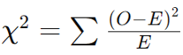{width="30%" fig-alt="Illustration: Calculate Chi-Square Value"}

::: source-table
+-----------------------------------+------------------+------------------+---------+--------------+---------------+
| **Category (Age Group, Product)** | **Observed (O)** | **Expected (E)** | **O−E** | **(O−E)\^2** | **E(O−E)\^2​** |
+===================================+==================+==================+=========+==============+===============+
| Under 30, Product A               | 30               | 35               | -5      | 25           | 25/35≈0.714   |
+-----------------------------------+------------------+------------------+---------+--------------+---------------+
| Under 30, Product B               | 40               | 35               | 5       | 25           | 25/35≈0.714   |
+-----------------------------------+------------------+------------------+---------+--------------+---------------+
| 30 to 50, Product A               | 50               | 40               | 10      | 100          | 100/40=2.500  |
+-----------------------------------+------------------+------------------+---------+--------------+---------------+
| 30 to 50, Product B               | 30               | 40               | -10     | 100          | 100/40=2.500  |
+-----------------------------------+------------------+------------------+---------+--------------+---------------+
| Over 50, Product A                | 20               | 25               | -5      | 25           | 25/25=1.000   |
+-----------------------------------+------------------+------------------+---------+--------------+---------------+
| Over 50, Product B                | 30               | 25               | 5       | 25           | 25/25=1.000   |
+-----------------------------------+------------------+------------------+---------+--------------+---------------+
| Total                             | 200              | 200              |         |              | χ2≈8.428      |
+-----------------------------------+------------------+------------------+---------+--------------+---------------+
:::

::::::

:::::: {.source-slide #part3-03-slide-48}

### Calculate the Chi-Square Test in R {#part3-title-03-48}

::: source-text
**Interpretation**

After calculating the Chi-Square statistic and comparing it with the critical value from a Chi-Square distribution table (or using p-value), you can conclude whether there is a statistically significant association between age group and product preference.
:::

:::: {.try-in-r #r-example-03-48}

#### Try this in R {.unlisted}

- **Purpose:** Calculate the chi-square statistic and its p-value.
- **Before running:** `chisq.test(x=beverages)` tests independence in the count table. `correct=FALSE` disables the optional 2×2 continuity correction; this 3×2 table does not use it. `<-` stores the result as chi.

```{r}
#| label: inferential-3-48
# Compare the observed and expected counts with the chi-square test.
chi <- chisq.test(x=beverages, correct=FALSE)
chi
```

**Read the result:** The statistic is about 8.4286 on two degrees of freedom, with p≈0.0148. Under the sampling model this is evidence of association, not causation.

::::
::::::

:::::: {.source-slide #part3-03-slide-49}

### Review the Calculation in R {#part3-title-03-49}

:::: {.try-in-r #r-example-03-49}

#### Try this in R {.unlisted}

- **Purpose:** Review the cell contributions to the test statistic.
- **Before running:** `(observed-expected)^2/expected` calculates each contribution. `sum()` adds them. `$parameter` selects the degrees of freedom and `$p.value` the p-value; `unname()` removes the parameter’s label inside the named output vector.

```{r}
#| label: inferential-3-49
# Review each contribution before adding the chi-square statistic.
contributions <- (beverages - expected)^2 / expected
contributions
c(chi_square=sum(contributions), df=unname(chi$parameter),
  p_value=chi$p.value)
```

**Read the result:** The contributions sum to the same chi-square statistic. Small rounding differences from the hand table are expected.

::::
::::::

:::::: {.source-slide #part3-03-slide-50}

### Hypothesis Testing for More than Two Populations Means {#part3-title-03-50}

::: source-text
One Way ANOVA
:::

::::::

:::::: {.source-slide #part3-03-slide-51}

### Introduction to One-Way ANOVA {#part3-title-03-51}

::: source-text
**Definition:** One-Way ANOVA is a statistical test that compares the means of three or more independent groups to determine if at least one group mean is statistically different from the others.

**Purpose:** To test for significant differences between the means of multiple groups when you have one categorical independent variable and one continuous dependent variable.

Appropriate Use Cases:

Comparing customer satisfaction levels across different store locations.

Examining student performance across different teaching methods.

Key Advantage:

Allows simultaneous comparison of more than two groups, providing a broader analysis than t-tests.
:::

::::::

:::::: {.source-slide #part3-03-slide-52}

### One Way ANOVA {#part3-title-03-52}

::: source-text
Hypothesis in One-Way ANOVA:

Null Hypothesis (H0): All group means are equal.

Alternative Hypothesis (H1): At least one group mean is different from the others.

How to Calculate?

- Calculate Group Means and Overall Mean
- Compute Sum of Squares:

Total Sum of Squares (SST): Variability of all data points around the overall mean.

Within-Group Sum of Squares (SSW): Variability within each group.

Between-Group Sum of Squares (SSB): Variability due to the interaction between the groups.

- Calculate Mean Squares:

Mean Square Between (MSB): SSB divided by the degrees of freedom between groups (k-1).

Mean Square Within (MSW): SSW divided by the degrees of freedom within groups (N-k).

- F-Statistic:

F = MSB / MSW
:::

::::::

:::::: {.source-slide #part3-03-slide-53}

### ANOVA Example {#part3-title-03-53}

::: source-text
Scenario: A school tests three different teaching methods to determine which one results in the best performance on a standardized test.

The students are randomly assigned to one of three groups, each receiving instruction through a different method.

Their scores on a standardized test are recorded.

Variables:

Group: The teaching method group (A, B, C)

Score: The score each student received on the standardized test.
:::

::: source-table
+----------------+-----------+-----------+
| **Student ID** | **Group** | **Score** |
+================+===========+===========+
| 1              | A         | 82        |
+----------------+-----------+-----------+
| 2              | A         | 88        |
+----------------+-----------+-----------+
| 3              | A         | 84        |
+----------------+-----------+-----------+
| 4              | A         | 90        |
+----------------+-----------+-----------+
| 5              | A         | 85        |
+----------------+-----------+-----------+
| 6              | B         | 78        |
+----------------+-----------+-----------+
| 7              | B         | 75        |
+----------------+-----------+-----------+
| 8              | B         | 80        |
+----------------+-----------+-----------+
| 9              | B         | 82        |
+----------------+-----------+-----------+
| 10             | B         | 77        |
+----------------+-----------+-----------+
| 11             | C         | 90        |
+----------------+-----------+-----------+
| 12             | C         | 92        |
+----------------+-----------+-----------+
| 13             | C         | 95        |
+----------------+-----------+-----------+
| 14             | C         | 91        |
+----------------+-----------+-----------+
| 15             | C         | 94        |
+----------------+-----------+-----------+
:::

:::: {.try-in-r #r-example-03-53}

#### Try this in R {.unlisted}

- **Purpose:** Fit the one-way ANOVA for the teaching-method scores.
- **Before running:** `read.csv()` loads the 15 supplied scores. In `aov(score~group,data=methods)`, `~` means model score by group; `data` names the table. `summary()` displays the ANOVA F test.

```{r}
#| label: inferential-3-53
# read.csv() loads the exact 15 scores printed for the three teaching methods.
# aov(score~group) fits one-way ANOVA; summary() reports its F test under independent normal errors and equal variances.
# Open the course folder in Positron; paths start in that folder.
methods <- read.csv("data/inferential-statistics/teaching_methods.csv")
summary(aov(score~group,data=methods))
```

**Read the result:** The omnibus test asks whether all population group means are equal. A rejection does not establish that every pair differs or identify one uniquely best method.

::::
::::::

:::::: {.source-slide #part3-03-slide-54}

### Interpreting Results {#part3-title-03-54}

{width="57%" fig-alt="Illustration: Interpreting Results"}

::: source-text
F-Statistic and P-Value:

An F-Statistic higher than the critical value or a P-value less than the alpha level (e.g., 0.05) indicates significant differences between group means.

In our example, both the F-Statistic and the P-value indicate significant difference between groups means, therefore we reject the null hypothesis.

Post Hoc Tests: If the ANOVA is significant, perform post hoc tests (e.g., Tukey's HSD) to determine which specific groups differ from each other.
:::

::::::

:::::: {.source-slide #part3-03-slide-55}

### 2-Way ANOVA {#part3-title-03-55}

::: source-text
**Case Study: Effect of Teaching Method and Gender on Student Performance**

**Objective:**

A school administrator wants to investigate whether **student performance** is affected by:

- **Teaching method** (Traditional vs. Online)
  - **Student gender** (Male vs. Female)

This leads to a **2x2 factorial design**:

- Factor A: Teaching Method (Traditional, Online)
- Factor B: Gender (Male, Female)
- Response Variable: Final Exam Score (numerical)
:::

::::::

:::::: {.source-slide #part3-03-slide-56}

### 2-Way ANOVA {#part3-title-03-56}

::: source-table
+------------+---------------------+----------------+
| **Gender** | **Teaching Method** | **Exam Score** |
+============+=====================+================+
| Male       | Traditional         | 75             |
+------------+---------------------+----------------+
| Male       | Traditional         | 78             |
+------------+---------------------+----------------+
| Female     | Traditional         | 85             |
+------------+---------------------+----------------+
| Female     | Traditional         | 82             |
+------------+---------------------+----------------+
| Male       | Online              | 70             |
+------------+---------------------+----------------+
| Male       | Online              | 68             |
+------------+---------------------+----------------+
| Female     | Online              | 80             |
+------------+---------------------+----------------+
| Female     | Online              | 83             |
+------------+---------------------+----------------+
:::

::: source-table
+--------+-------------+--------+--------+--------+
|        | Traditional |        | Online |        |
+========+=============+========+========+========+
|        | Male        | Female | Male   | Female |
+--------+-------------+--------+--------+--------+
| Score1 | 75          | 85     | 70     | 80     |
+--------+-------------+--------+--------+--------+
| Score2 | 78          | 82     | 68     | 83     |
+--------+-------------+--------+--------+--------+
:::

:::: {.try-in-r #r-example-03-56}

#### Try this in R {.unlisted}

- **Purpose:** Fit both factors and their interaction for the eight observations.
- **Before running:** `factor()` treats the source gender/method values as categories. In the formula, `gender*method` includes both main effects and their interaction. `aov()` fits the model; `summary()` displays its tests.

```{r}
#| label: inferential-3-56
# factor() treats gender and method as categories in the exact eight printed observations.
# gender*method includes both main effects and their interaction; aov() assumes independent, equal-variance normal errors.
# Open the course folder in Positron; paths start in that folder.
teaching <- read.csv("data/inferential-statistics/teaching_gender.csv")
teaching$gender <- factor(teaching$gender)
teaching$method <- factor(teaching$method)
summary(aov(score~gender*method,data=teaching))
```

**Read the result:** Read the main-effect and interaction rows separately, conditional on independent, common-variance normal errors. Eight observations give limited information for checking these assumptions.

::::
::::::

:::::: {.source-slide #part3-03-slide-57}

### How to Select Test Type {#part3-title-03-57}

{width="47%" fig-alt="Illustration: How to Select Test Type"}

::::::

:::::: {.source-slide #part3-04-slide-01}

## 4.3 Regression {#part3-04}

::::::

:::::: {.source-slide #part3-04-slide-02}

### Introduction to Regression Analysis {#part3-title-04-02}

::: source-text
Definition: Regression analysis is a powerful statistical method used for predicting a dependent variable based on one or more independent variables.

Purpose: To understand how the typical value of the dependent variable changes when any one of the independent variables is varied, while the other independent variables are held fixed
:::

::::::

:::::: {.source-slide #part3-04-slide-03}

### Types of Regression {#part3-title-04-03}

::: source-text
Simple Linear Regression: Involves one independent variable and one dependent variable and the relationship between them is modeled by a linear function.

Multiple Linear Regression (Focus of this presentation): Involves multiple independent variables influencing a single dependent variable.

Other Types: Logistic regression, polynomial regression, Ridge Regression, Lasso Regression etc., used for more specific types of data and relationships.
:::

::::::

:::::: {.source-slide #part3-04-slide-04}

### The Regression Equation {#part3-title-04-04}

{width="94%" fig-alt="Illustration: The Regression Equation"}

{width="38%" fig-alt="Illustration: The Regression Equation"}

::::::

:::::: {.source-slide #part3-04-slide-05}

### Finding the Best Fit Line {#part3-title-04-05}

{width="53%" fig-alt="Illustration: Finding the Best Fit Line"}

::: source-text
The goal of the linear regression algorithm is to get the best values for B0 and B1 to find the best fit line.

The best fit line is the line that has the least error which means the error between predicted values and actual values should be minimum.

In regression, the difference between the observed value of the dependent variable(Yi) and the predicted value(predicted) is called the residuals.
:::

::: source-text
*εi =  Y Predicted --   Yi*

*Where Y Predicted =   B0 + B1 \* Xi*

In simple terms, the best fit line is a line that fits the given scatter plot in the best way. Mathematically, the best fit line is obtained by minimizing the Residual Sum of Squares(RSS).
:::

::::::

:::::: {.source-slide #part3-04-slide-06}

### Finding the Best Fit Line {#part3-title-04-06}

{width="57%" fig-alt="Illustration: Finding the Best Fit Line"}

{width="30%" fig-alt="Illustration: Finding the Best Fit Line"}

{width="43%" fig-alt="Illustration: Finding the Best Fit Line"}

::::::

:::::: {.source-slide #part3-04-slide-07}

### Evaluating the Model {#part3-title-04-07}

::: source-text
R-squared (The Goodness of Fit): Proportion of variance in the dependent variable that is predictable from the independent variables.

Adjusted R-squared: Modified version of R-squared adjusted for the number of predictors.

F-Statistic: Tests whether at least one predictor variable has a non-zero coefficient.

t-Tests on Coefficients: Each beta coefficient has an associated t-test to determine if the variable is statistically significant.
:::

::::::

:::::: {.source-slide #part3-04-slide-08}

### Linear Regression Example {#part3-title-04-08}

::: source-text
Scenario: A real estate company wants to predict the selling price of houses based on various features.

Variables:

Price: Selling price of the house (in thousands of dollars).

Size: Size of the house in square feet.

Bedrooms: Number of bedrooms.

Age: Age of the house in years.

Location: Categorical variable indicating the neighborhood quality (1 = Low, 2 = Medium, 3 = High).
:::

::::::

:::::: {.source-slide #part3-04-slide-09}

### Simple Linear Regression {#part3-title-04-09}

::: source-table
+--------------+-----------+----------+
| **House ID** | **Price** | **Size** |
+==============+===========+==========+
| 1            | 250       | 1500     |
+--------------+-----------+----------+
| 2            | 315       | 1800     |
+--------------+-----------+----------+
| 3            | 270       | 1650     |
+--------------+-----------+----------+
| 4            | 230       | 1400     |
+--------------+-----------+----------+
| 5            | 450       | 2000     |
+--------------+-----------+----------+
| 6            | 190       | 1300     |
+--------------+-----------+----------+
| 7            | 350       | 1850     |
+--------------+-----------+----------+
| 8            | 300       | 1600     |
+--------------+-----------+----------+
| 9            | 280       | 1500     |
+--------------+-----------+----------+
| 10           | 310       | 1700     |
+--------------+-----------+----------+
:::

:::: {.try-in-r #r-example-04-09}

#### Try this in R {.unlisted}

- **Purpose:** Fit the house-price regression.
- **Before running:** `read.csv()` loads the ten houses; price is in thousands of dollars and size in square feet. `lm(price~size,data=houses)` fits a line with an intercept; `~` places the response on the left and predictor on the right. `summary()` displays coefficients and fit.

```{r}
#| label: inferential-4-9
# read.csv() imports the ten houses printed in the source; price is in thousands of dollars and size in square feet.
# lm(price~size) fits least squares with an intercept; summary() reports coefficients, R-squared, and inference.
# Open the course folder in Positron; paths start in that folder.
houses <- read.csv("data/inferential-statistics/houses.csv")
simple <- lm(price~size,data=houses)
summary(simple)
```

**Read the result:** The slope is change in fitted price per square foot, in thousands of dollars. Read uncertainty and units; a fitted association is not evidence of causation.

::::
::::::

:::::: {.source-slide #part3-04-slide-10}

### Regression Statistics {#part3-title-04-10}

::: source-text
- **Multiple R (0.946288)**:

This is the **correlation coefficient**, showing the strength and direction of the linear relationship between the independent variable (Size) and the dependent variable (Price).

Value close to 1 or -1 indicates a strong linear relationship.

- **R Square (0.895461)**:

The **coefficient of determination**, indicating how much of the variation in the dependent variable (Price) is explained by the independent variable (Size).

In this case, \~89.55% of the variance in price is explained by size.

- **Adjusted R Square (0.882394)**:

Adjusted for the number of predictors in the model.

Useful when comparing models with different numbers of predictors; penalizes for adding non-significant predictors.

- **Standard Error (24.46997)**:

The **standard deviation of the residuals**. Smaller values indicate better model fit, as residuals are closer to zero.

- **Observations (10)**:

The number of data points used in the regression analysis.
:::

::::::

:::::: {.source-slide #part3-04-slide-11}

### ANOVA (Analysis of Variance): {#part3-title-04-11}

::: source-text
The ANOVA table tests whether the regression model as a whole is statistically significant.

- **df** **(Degrees of Freedom)**:

Regression: Number of predictors (1) + Intercept (0) = 1.

Residual: Total observations (10) - Number of predictors (1) - 1 = 8.

Total: n−1=9n - 1 = 9n−1=9.

- **SS (Sum of Squares)**:

**Regression SS (41032.27)**: Variation in the dependent variable explained by the model.

**Residual SS (4790.234)**: Variation not explained by the model (errors).

**Total SS (45822.5)**: Total variation in the dependent variable.

- **MS (Mean Square)**:

**Regression MS (41032.27)**: Regression SS divided by its df: 41032.27 ÷ 1

**Residual MS (598.7793)**: Residual SS divided by its df: 4790.234 ÷ 8

- **F (68.52653)**:

The **F-statistic**, which tests whether the regression model explains a significant proportion of the variation in the dependent variable.

Larger values indicate the model is a good fit.

- **Significance F (3.41185E-05)**:

The **p-value** for the F-test. A small value (e.g., \<0.05) indicates the model is statistically significant.
:::

:::: {.try-in-r #r-example-04-11}

#### Try this in R {.unlisted}

- **Purpose:** Display the regression analysis-of-variance table.
- **Before running:** `anova(simple)` uses the fitted model from the preceding R example. It partitions response variation into regression and residual parts and reports the F test of zero slope.

```{r}
#| label: inferential-4-11
# anova() partitions the fitted model's variability into regression and residual components.
# The F test assumes the source's independent, constant-variance normal-error linear model.
anova(simple)
```

**Read the result:** The F test is conditional on the linear-model assumptions. It does not establish that the model is useful for every prediction task.

::::
::::::

:::::: {.source-slide #part3-04-slide-12}

### Coefficients Table {#part3-title-04-12}

::: source-text
- **Intercept (-217.422)**:
  - The value of the dependent variable (Price) when the independent variable (Size) is zero.
- **Size Coefficient (0.31406)**:
  - The **slope** of the regression line. For every unit increase in size, the price increases by 0.31406 units.
- **Standard Error (62.32294 for Intercept, 0.037939 for Size)**:
  - Measures the variability in the coefficient estimates. Smaller values indicate more precise estimates.
  - The standard error of a coefficient measures the variability in the estimate of that coefficient if we repeatedly sampled data from the population and fitted the regression model each time.
- **t Stat (-3.48863 for Intercept, 8.278075 for Size)**:
  - The **t-test statistic**, used to test whether the coefficient is significantly different from zero.
- **P-value (0.008215 for Intercept, 3.411E-05 for Size)**:
  - Tests the null hypothesis that the coefficient is zero (no effect).
  - A small p-value (\<0.05) means the coefficient is statistically significant.
  - The smaller the value, the better the predictor -- note value like 9.3499E-5 = 9.3 X 10 \^-5 = 0.00000934
- **Lower 95% and Upper 95%**:
  - The **confidence interval** for the coefficient. For example, the coefficient for Size (0.31406) is likely between 0.22657 and 0.40155, with 95% confidence.
:::

::::::

:::::: {.source-slide #part3-04-slide-13}

### Conclusion {#part3-title-04-13}

::: source-text
- The model is statistically significant (Significance F \< 0.05), and **Size** has a significant positive effect on Price (p-value for Size is very small).
- The model explains \~89.55% of the variation in Price (R² = 0.895461), which is strong.
- The residuals have a standard error of 24.47, indicating the average prediction error.

**What Does Standard Error Mean in Regression?**

In regression, the **standard error (SE)** reported in the output refers to the **standard deviation of the residuals**, also known as the **residual standard error (RSE)** or simply the \"standard error of the regression.\" It measures how far the observed data points (dependent variable values) are from the predicted values, on average.

In our example, the standard error value indicates that, on average, the predictions made by your regression model are **off by 24.47 units** (the units of your dependent variable, likely apartment prices).

It tells you how much variability (or error) remains unexplained by your model.
:::

::::::

:::::: {.source-slide #part3-04-slide-14}

### Multiple Linear Regression {#part3-title-04-14}

::: source-text
Overall model p-value (significance), small value  good model
:::

::: source-text
Smaller P-Value  Best Predictor
:::

::: source-table
+--------------+-----------+----------+--------------+---------+--------------+
| **House ID** | **Price** | **Size** | **Bedrooms** | **Age** | **Location** |
+==============+===========+==========+==============+=========+==============+
| 1            | 250       | 1500     | 3            | 10      | 2            |
+--------------+-----------+----------+--------------+---------+--------------+
| 2            | 315       | 1800     | 4            | 15      | 3            |
+--------------+-----------+----------+--------------+---------+--------------+
| 3            | 270       | 1650     | 3            | 5       | 3            |
+--------------+-----------+----------+--------------+---------+--------------+
| 4            | 230       | 1400     | 2            | 20      | 2            |
+--------------+-----------+----------+--------------+---------+--------------+
| 5            | 450       | 2000     | 4            | 2       | 3            |
+--------------+-----------+----------+--------------+---------+--------------+
| 6            | 190       | 1300     | 3            | 30      | 1            |
+--------------+-----------+----------+--------------+---------+--------------+
| 7            | 350       | 1850     | 4            | 8       | 3            |
+--------------+-----------+----------+--------------+---------+--------------+
| 8            | 300       | 1600     | 3            | 12      | 2            |
+--------------+-----------+----------+--------------+---------+--------------+
| 9            | 280       | 1500     | 3            | 10      | 2            |
+--------------+-----------+----------+--------------+---------+--------------+
| 10           | 310       | 1700     | 3            | 6       | 3            |
+--------------+-----------+----------+--------------+---------+--------------+
:::

::: source-text
Overall Model Accuracy
:::

:::: {.try-in-r #r-example-04-14}

#### Try this in R {.unlisted}

- **Purpose:** Fit the multiple-regression specification.
- **Before running:** `factor(location)` makes the location codes categories. In `lm()`, `+` adds predictors; size, bedrooms, age and location are modelled together. `summary()` displays their partial slopes and uncertainty.

```{r}
#| label: inferential-4-14
# factor(location) treats the source location codes 1,2,3 as categories rather than equal-spaced numerical scores.
# lm() adds size, bedrooms, age, and location effects; ten rows provide very limited residual degrees of freedom.
houses$location <- factor(houses$location)
multiple <- lm(price~size+bedrooms+age+location,data=houses)
summary(multiple)
```

**Read the result:** Interpret a slope while holding the other model predictors fixed. Ten houses leave very few residual degrees of freedom; this is not evidence of a reliable general prediction system.

::::
::::::

:::::: {.source-slide #part3-04-slide-15}

### Assumptions of Linear Regression {#part3-title-04-15}

::: source-text
1\. Linearity

The relationship between the independent variables (predictors) and the dependent variable (response) should be linear.

This means that the change in the dependent variable is proportional to the change in the independent variable.

**Example**: If you are predicting house prices (dependent variable) based on the size of the house (independent variable), a linear relationship implies that each additional square foot of the house size increases the price by a constant amount.
:::

::::::

:::::: {.source-slide #part3-04-slide-16}

### Assumptions of Linear Regression {#part3-title-04-16}

::: source-text
**How to Test Linearity**: Plot the residuals vs. predicted using a scatter plot, look for a random distribution (no patterns).
:::

{width="46%" fig-alt="Illustration: Assumptions of Linear Regression"}

{width="48%" fig-alt="Illustration: Assumptions of Linear Regression"}

::: source-text
To check if the relationship between the independent variable (Size) and the dependent variable (Price) is linear, we look for patterns in the residuals, a random scatter indicates a linear relationship while curves or trends suggest a non-linear relationship.
:::

:::: {.try-in-r #r-example-04-16}

#### Try this in R {.unlisted}

- **Purpose:** Inspect residual pattern and spread in the house-price model.
- **Before running:** `fitted(simple)` returns predicted prices and `resid(simple)` returns observed minus predicted prices. `plot(x,y)` draws them; `pch` sets point shape, `col` colour and `xlab`/`ylab` the axis labels. `abline(h=0,lty=2)` adds a dashed zero reference.

```{r}
#| label: inferential-4-16
# fitted() returns predicted prices and resid() returns observed minus fitted prices in thousands of dollars.
# abline(h=0) adds a horizontal reference: patterns may reveal model problems, not prove an assumption.
plot(fitted(simple),resid(simple),pch=16,col="#595959",xlab="Fitted price (thousands of dollars)",ylab="Residual")
abline(h=0,lty=2)
```

**Read the result:** Look for curvature, changing spread or unusual points. A diagnostic can reveal problems but cannot prove model assumptions.

::::
::::::

:::::: {.source-slide #part3-04-slide-17}

### Assumptions of Linear Regression {#part3-title-04-17}

::: source-text
2\. Independence

Observations should be independent of each other. This means that the residuals (errors) should not be correlated across observations. This assumption is important for the validity of standard statistical tests.

Example: In a study measuring the effect of a new drug on blood pressure, each patient\'s measurement should be independent. If measurements from the same patient at different times are used, they are not independent.

**How to Test**: Use the Durbin-Watson test to check for autocorrelation in residuals, particularly for time-series data. This test calculates a test statistic (range 0-4). A value around 2 indicates no autocorrelation, values \<2 suggest positive autocorrelation, and \>2 indicate negative autocorrelation.
:::

::::::

:::::: {.source-slide #part3-04-slide-18}

### Assumptions of Linear Regression {#part3-title-04-18}

::: source-text
3\. Homoscedasticity

The variance of the error terms (residuals) should be constant across all levels of the independent variables.

If this assumption is violated, it indicates heteroscedasticity, meaning the spread of residuals varies at different levels of the independent variables.

**Example:** When plotting residuals against fitted values in a regression analysis of apartment prices against apartment size, the spread of residuals should be roughly constant. If residuals spread out more as apartment size increases, this indicates heteroscedasticity.
:::

::::::

:::::: {.source-slide #part3-04-slide-19}

### Assumptions of Linear Regression {#part3-title-04-19}

::: source-text
**How to Test Homoscedasticity** : Plot residuals vs. predicted values. The spread of residuals variance should be consistent (no funnel-shaped patterns).
:::

{width="66%" fig-alt="Illustration: Assumptions of Linear Regression"}

::: source-text
**Good Residual Spead**

**Good Linear Relation**
:::

::: source-text
**Not a Good Residual Spead**

**Not a Good Linear Relation**
:::

::: source-text
**Funnel shape note good**

**الشكل مثل القمع يبين بأن العلاقة الخطية غير مناسبة**
:::

::: source-text
**التوزيع العشوائي للنقاط حول الصفر على طول المدى هو التوزيع الأفضل الذي يبين أن الموديل الخطي مناسب**
:::

::::::

:::::: {.source-slide #part3-04-slide-20}

### Assumptions of Linear Regression {#part3-title-04-20}

::: source-text
4\. Normal Distribution of Errors

The error terms should be normally distributed. This assumption is especially important for small sample sizes because it affects the validity of confidence intervals and hypothesis tests.

Example: After fitting a regression model predicting apartment price based on apartment size, plotting a histogram or a Q-Q plot of the residuals should show that they follow a normal distribution.
:::

{width="45%" fig-alt="Illustration: Assumptions of Linear Regression"}

::: source-table
+------------+--------------------+------+-------------+-----------------------+
| Residuals  | Standard Residuals | Rank | Percentiles | Theoritical Residuals |
+============+====================+======+=============+=======================+
| -32.890625 | -1.425656831       | 1    | 0.05        | -1.644853627          |
+------------+--------------------+------+-------------+-----------------------+
| -30.78125  | -1.334225158       | 2    | 0.15        | -1.036433389          |
+------------+--------------------+------+-------------+-----------------------+
| -13.59375  | -0.589226339       | 3    | 0.25        | -0.67448975           |
+------------+--------------------+------+-------------+-----------------------+
| -6.484375  | -0.281067736       | 4    | 0.35        | -0.385320466          |
+------------+--------------------+------+-------------+-----------------------+
| -3.671875  | -0.159158839       | 5    | 0.45        | -0.125661347          |
+------------+--------------------+------+-------------+-----------------------+
| -0.859375  | -0.037249941       | 6    | 0.55        | 0.125661347           |
+------------+--------------------+------+-------------+-----------------------+
| 7.734375   | 0.335249469        | 7    | 0.65        | 0.385320466           |
+------------+--------------------+------+-------------+-----------------------+
| 14.921875  | 0.646794429        | 8    | 0.75        | 0.67448975            |
+------------+--------------------+------+-------------+-----------------------+
| 26.328125  | 1.141202737        | 9    | 0.85        | 1.036433389           |
+------------+--------------------+------+-------------+-----------------------+
| 39.296875  | 1.703338209        | 10   | 0.95        | 1.644853627           |
+------------+--------------------+------+-------------+-----------------------+
:::

:::: {.try-in-r #r-example-04-20}

#### Try this in R {.unlisted}

- **Purpose:** Compare the model’s residuals with a normal shape.
- **Before running:** `qqnorm()` plots ordered residuals against theoretical normal quantiles; `pch` and `col` control the points. `qqline()` adds a reference line.

```{r}
#| label: inferential-4-20
# qqnorm() compares residual quantiles with a normal distribution; qqline() adds a reference line.
# This plot examines the error-normality assumption; it does not require normally distributed predictors.
qqnorm(resid(simple),pch=16,col="#595959")
qqline(resid(simple))
```

**Read the result:** Assess departures from the line, especially in the tails. Normality of errors is distinct from normality of the predictors.

::::
::::::

:::::: {.source-slide #part3-04-slide-21}

### Assumptions of Linear Regression {#part3-title-04-21}

::: source-text
5\. No Multicollinearity

Independent variables should not be too highly correlated with each other. High correlation between predictors (multicollinearity) can inflate the variances of the coefficient estimates and make the model unstable.

Example: In a regression model predicting salary based on education level and years of experience, if education level and years of experience are highly correlated, it could cause multicollinearity issues. Checking the Variance Inflation Factor (VIF) can help detect this.

**How to Test**: Calculate Variance Inflation Factor (VIF). VIF values above 10 (or sometimes 5) indicate high multicollinearity. A VIF \>10 (or sometimes \>5) indicates problematic multicollinearity.
:::

::::::

