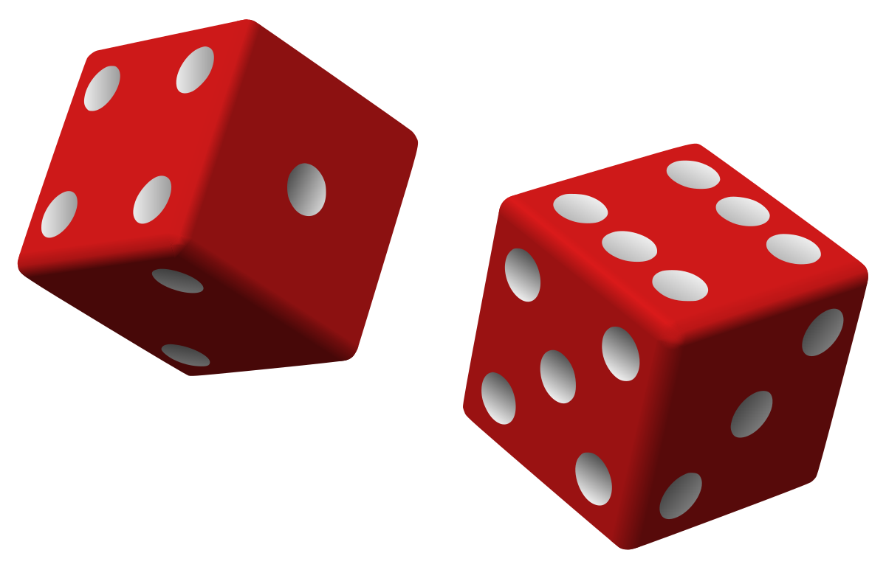
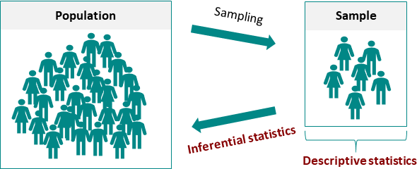
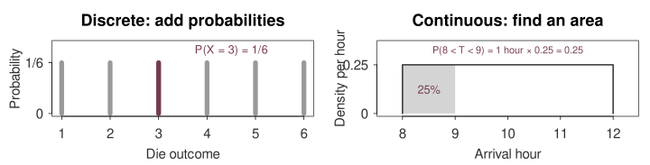
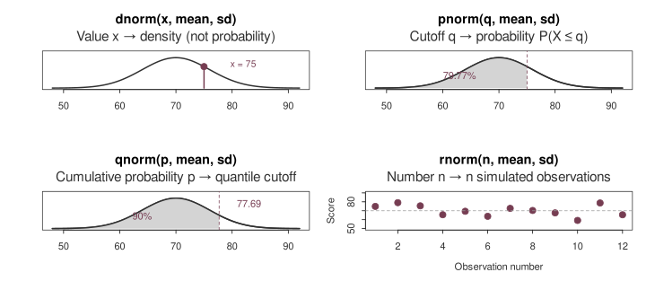

```{r}
#| label: pd-setup
#| include: false
options(digits=6, width=72)
knitr::opts_chunk$set(dev="png", dpi=160)
par(family="sans", col="#303030", col.axis="#303030",
    col.lab="#303030", col.main="#262626", bg="white",
    mar=c(4.2,4.3,2.2,1.1))
```

::: {.source-slide .teaching-slide #pd-01}

## Probability models before inference

A **probability model** describes the possible outcomes of an uncertain process and assigns probabilities to events. Here we use given model inputs to calculate how likely different outcomes are; later, inference will use samples to learn about unknown population features.

- How many cars might be defective in the next production batch?
- How many customers might arrive in the next minute?
- What proportion of measurements might exceed a threshold?

::: {.teaching-illustration .dice-picture}


::: {.visual-credit}
A fair die is a simple example of a probability model: each of its six faces has probability 1/6. Dice illustration retained from original probability slides, source slide 8.
:::
:::

**By the end of this section, you should be able to:**

1. Define a random variable, including its units and observation window.
2. Choose a plausible model and state its assumptions.
3. Calculate an exact-count, cumulative or interval probability.
4. Explain the result in the context of the question.

::: {.slide-footer}
01 / 23 · Learning route
:::
:::

::: {.source-slide .teaching-slide #pd-02}

## What does statistical inference do?

**Statistical inference uses sample data to draw conclusions about a population and quantify the uncertainty in those conclusions.** It helps us estimate unknown features, test claims and assess relationships.

::: {.teaching-illustration .population-picture}


::: {.visual-credit}
Original probability slides, source slide 3. Sampling moves from population to sample; inference reasons back to the population.
:::
:::

- **Population:** the group or process we want to understand.
- **Sample:** the observations we actually collect.
- **Parameter:** a population feature, such as mean product strength, $\mu$.
- **Statistic:** a sample calculation, such as sample mean strength, $\bar x$.

| Question | What inference contributes |
|---|---|
| What is the mean product strength? | An estimate and an uncertainty interval. |
| Does a store display change sales? | Evidence from a comparison designed to answer that question. |
| How does price relate to sales? | An estimated relationship, with assumptions and limits. |

**How the data are obtained affects the conclusion**

- Random **sampling** helps a sample represent a defined population.
- Random **assignment** helps isolate a treatment comparison in an experiment.

Sampling supports conclusions about a population; assignment supports a causal comparison. Neither is established merely by calculating a probability.

::: {.slide-footer}
02 / 23 · Inference · Berenson et al., ninth ed., §§1.1–1.2, 1.7; p. 336
:::
:::

::: {.source-slide .teaching-slide #pd-03}

## Define the random variable first

A **random variable** assigns a numerical value to each outcome of an uncertain process. For example, the number of defective cars in the next batch is unknown before inspection; its possible values are 0, 1, 2, and so on up to 80.

| Variable | Definition | Type |
|---|---|---|
| $X$ | Defective cars among the next 80 cars | Discrete count |
| $Y$ | Customer arrivals during one minute | Discrete count |
| $T$ | Waiting time in minutes | Continuous measurement |
| $D$ | Component diameter in millimetres | Continuous measurement |

::: {.teaching-illustration .inspection-picture}


::: {.visual-credit}
A batch gives a **count** of components; an individual component has a **measured diameter**. Photo retained from original probability slides, source slide 9.
:::
:::

- Discrete values form a finite or countable set.
- A continuous model describes measurements over an interval.
- Recorded measurements may be rounded even when the underlying model is continuous.

**Before calculating:** state what is measured, on which unit, over what window, and in which units.

::: {.question-note}
A branch records the number of arrivals and each customer's waiting time. Why do these require different kinds of probability models?
:::

::: {.slide-footer}
03 / 23 · Random variables · Book §§1.8, 5.1 and 6.1
:::
:::

::: {.source-slide .teaching-slide #pd-04}

## Probability mass and probability density

A **probability mass function** assigns a probability to each possible value of a discrete random variable: $p(x)=P(X=x)$.

A **probability density function** describes how probability is spread across the values of a continuous random variable. A height $f(x)$ is not a probability: **the area under the curve over an interval is its probability**.

| Discrete model | Continuous model |
|---|---|
| $p(x)=P(X=x)$ is a probability. | $f(x)$ is a density height. |
| Add masses for the outcomes in an event. | Find the area over an interval. |
| Each mass is between 0 and 1. | A density height can exceed 1. |
| All masses sum to 1. | The total area under the density is 1. |

$$P(a<X<b)=\int_a^b f(x)\,dx.$$

- For a continuous model, $P(X=x)=0$ at one exact point.
- Including or excluding an endpoint does not change a continuous interval probability.
- The probability of a nonzero-width interval can be positive.

::: {.teaching-illustration .mass-density-picture}


::: {.visual-credit}
**Read the contrast:** a bar gives a probability at a discrete value; the shaded **area**, rather than the curve's height, gives a continuous interval probability. Course illustration using the stated models.
:::
:::

::: {.slide-footer}
04 / 23 · Probability mass and density · Book §§5.1 and 6.1
:::
:::

::: {.source-slide .teaching-slide #pd-05}

## Discrete uniform: equally likely outcomes

A **discrete uniform distribution** assigns the same probability to each of a finite set of possible values. For a fair six-sided die, each outcome has probability $1/6$.

| Event | Included outcomes | Probability |
|---|---|---|
| Roll a 3 | 3 | $1/6=0.1667$ |
| Roll an even number | 2, 4, 6 | $3/6=0.5$ |
| Roll from 2 to 5, inclusive | 2, 3, 4, 5 | $4/6=0.6667$ |

For equally likely integers $a,a+1,\ldots,b$:

$$p(x)=\frac{1}{b-a+1}.$$

**How to read the R code**

- `outcomes <- 1:6` stores the six possible values (1 through 6) in `outcomes`; `<-` means “assign.”
- `outcomes == 3` checks each value and returns `FALSE FALSE TRUE FALSE FALSE FALSE`. `==` tests equality.
- `mean()` treats `TRUE` as 1 and `FALSE` as 0. Here it gives $(0+0+1+0+0+0)/6=1/6$: the **proportion satisfying the condition**, not the mean die score.
- `%%` gives the remainder after division: `outcomes %% 2 == 0` selects even values. `&` requires both conditions to hold; `>=` and `<=` include the endpoints.
- `c()` combines results into one vector. Labels such as `roll_3 =` name the results in the output.

These proportions are probabilities because **all six outcomes are equally likely**.

```{r}
#| label: pd-die
outcomes <- 1:6
c(roll_3 = mean(outcomes == 3),
  even = mean(outcomes %% 2 == 0),
  from_2_to_5 = mean(outcomes >= 2 & outcomes <= 5))
```

**Equivalent calculation:** `sum(outcomes == 3) / length(outcomes)` counts the matching values and divides by the total number of values. `sum()` adds the 1s and 0s; `length()` counts all entries.

Fairness is stipulated here; it is not established by one roll.

::: {.slide-footer}
05 / 23 · Original probability deck, slides 14–15; probability principles: book §5.1
:::
:::

::: {.source-slide .teaching-slide #pd-06}

## Binomial: defective cars in a batch

A **binomial distribution** describes the number of successes in a fixed number of independent trials, each with the same success probability. Here, “success” means a car is classified as defective; it does not mean a desirable outcome.

**Question:** how many of 80 cars might be defective if the defect probability is 2%?

Let $X=$ number of defective cars among the 80 cars.

$$X\sim\operatorname{Binomial}(n=80,p=0.02).$$

The binomial model assumes:

1. A fixed number of trials: 80 cars.
2. Two outcomes for each trial: defective or not defective, under a defined rule.
3. The same defect probability for each car: 0.02.
4. Independence between cars' defect outcomes.

**What could undermine it?** A shared production fault might cause several cars to be defective together.

**Model input:** 2% is the assumed probability in this exercise, not a new estimate from observed factory records.

::: {.slide-footer}
06 / 23 · Original probability deck, slide 16; binomial method: book §5.3
:::
:::

::: {.source-slide .teaching-slide #pd-07}

## Binomial: translate the wording into an event

An **exact-count probability** concerns one value, such as $X=2$. A **cumulative probability** adds the probabilities of all counts up to a cutoff, such as $P(X\leq2)$. For the same car model, $n=80$ and $p=0.02$.

$$P(X=x)=\binom{n}{x}p^x(1-p)^{n-x}.$$

| Question | Event | Probability |
|---|---|---|
| Exactly two defective cars | $X=2$ | 0.26145 |
| Fewer than two | $X=0$ or $X=1$ | 0.52297 |
| More than two | $X\geq3$ | 0.21558 |
| No defective cars | $X=0$ | 0.19865 |

**Interpretation:** exactly two defects has a probability of about **26.14%** for a batch under this model. “More than two” starts at three, so it excludes two.

**R functions: what they calculate**

- **`dbinom(x, size, prob)`** returns $P(X=x)$: the probability of **exactly** `x` successes. `binom` identifies the binomial distribution; R uses the `d` prefix for mass/density functions. Here the result is a probability mass.
- **`pbinom(q, size, prob)`** returns $P(X\leq q)$ by default: the **cumulative probability up to and including** cutoff `q`. The `p` prefix identifies a cumulative probability function.
- `size=80` is the number of trials; `prob=0.02` is the success probability **on each trial**, not the requested batch probability.
- `lower.tail=FALSE` changes the cumulative calculation to $P(X>q)$. Thus “fewer than two” uses cutoff **1**, while “more than two” uses cutoff **2** and the upper tail.
- `c()` combines the four answers; the names before `=` label the output.

```{r}
#| label: pd-binomial-probabilities
c(exactly_2 = dbinom(x=2, size=80, prob=0.02),
  fewer_than_2 = pbinom(q=1, size=80, prob=0.02),
  more_than_2 = pbinom(q=2, size=80, prob=0.02,
                       lower.tail=FALSE),
  no_defects = dbinom(x=0, size=80, prob=0.02))
```

**Excel:** `BINOM.DIST(2,80,0.02,FALSE)` gives exactly two. Use `TRUE` for the cumulative probability $P(X\leq x)$.

::: {.slide-footer}
07 / 23 · Binomial count probabilities · Book §5.3
:::
:::

::: {.source-slide .teaching-slide #pd-08}

## A binomial distribution need not look normal

A binomial model can be skewed when successes are rare. With only 1.6 defective cars expected per batch, this model places most probability near zero, even though the batch contains 80 cars.

Here, $E(X)$ is the expected (long-run mean) count and $SD(X)$ measures its spread:

$$E(X)=np=1.6,\qquad SD(X)=\sqrt{np(1-p)}\approx1.252.$$

```{r}
#| label: pd-binomial-shape
#| echo: false
x <- 0:8
masses <- dbinom(x,80,.02)
plot(x,masses,type="h",lwd=8,col="#777777",
     xlab="Defective cars among 80",ylab="Probability",
     main="Binomial model: n = 80, p = 0.02",ylim=c(0,.36))
points(x,masses,pch=19,col="#4B4B4B")
abline(v=1.6,lty=2,col="#763D52",lwd=1.5)
legend("topright","Mean = 1.6",lty=2,col="#763D52",bty="n")
```

- Most probability is concentrated at a few small counts; there is also a very small tail beyond the displayed counts.
- The shape is right-skewed even though $n=80$.
- A normal approximation needs both $np$ and $n(1-p)$ to be sufficiently large; “large $n$” alone is not enough.
- The mean of 1.6 is a long-run average, not a possible count for a single batch.

::: {.slide-footer}
08 / 23 · Binomial shape and interpretation · Book §5.3
:::
:::

::: {.source-slide .teaching-slide #pd-09}

## Poisson: arrivals during a minute

A **Poisson distribution** models the number of events in a fixed interval. Its parameter $\lambda$ is the expected count in that interval; it must match the interval used in the question.

**Book example:** a bank's assumed arrival rate during its lunch period is three customers per minute.

Let $X=$ number of arrivals in one specified minute.

$$X\sim\operatorname{Poisson}(\lambda=3).$$

- Count events over a defined time or space interval.
- State the unit of the rate: **three per minute**, not three per hour.
- A homogeneous Poisson model assumes a suitable constant rate and independent event occurrences.
- Groups arriving together or a strong change in the rate may require a different model.

**Question:** what is the probability of exactly two arrivals? More than two?

Arrival volume alone does not determine queue length or required staffing; service times also matter.

::: {.slide-footer}
09 / 23 · Bank-arrival model · Book §5.5, pp. 183–184
:::
:::

::: {.source-slide .teaching-slide #pd-10}

## Poisson: exact counts and the complement

The **complement rule** gives an event’s probability by subtracting the probability of everything outside it from 1. For the bank model with $\lambda=3$, “more than two” is the complement of “two or fewer.”

$$P(X=x)=e^{-\lambda}\frac{\lambda^x}{x!}.$$

- Exactly two: $P(X=2)=0.22404$, approximately **22.40%**.
- More than two: $P(X>2)=1-P(X\leq2)=0.57681$, approximately **57.68%**.

**R functions: exact count versus cumulative probability**

- **`dpois(x, lambda)`** returns $P(X=x)$: exactly `x` events. `pois` identifies the Poisson distribution; `d` gives its probability mass.
- **`ppois(q, lambda)`** returns $P(X\leq q)$ by default. `p` means cumulative probability; `lower.tail=FALSE` instead returns $P(X>q)$.
- `lambda=3` is the expected number of arrivals **in one minute**. The first answer uses count `x=2`; the second uses cutoff `q=2`. `c()` collects and labels the answers.

```{r}
#| label: pd-poisson-probabilities
c(exactly_2 = dpois(x=2, lambda=3),
  more_than_2 = ppois(q=2, lambda=3, lower.tail=FALSE))
```

```{r}
#| label: pd-poisson-shape
#| echo: false
x <- 0:10
plot(x,dpois(x,3),type="h",lwd=7,col="#777777",
     xlab="Arrivals in one minute",ylab="Probability",
     main="Poisson model: mean three arrivals per minute")
points(x,dpois(x,3),pch=19,col="#4B4B4B")
```

**Excel:** `POISSON.DIST(2,3,FALSE)` and `1-POISSON.DIST(2,3,TRUE)`.

**Interpretation:** under this model, about 57.68% of one-minute intervals have more than two arrivals in the long run. “More than two” excludes two; “two or more” includes it.

::: {.slide-footer}
10 / 23 · Poisson probabilities · Book p. 184
:::
:::

::: {.source-slide .teaching-slide #pd-11}

## Continuous uniform: probability is interval length

A **continuous uniform distribution** spreads probability evenly over an interval. The probability of a subinterval equals its length divided by the full interval length; the density is constant throughout.

Assume arrival time $T$ is uniform from 8 a.m. to noon:

$$T\sim U(8,12),\qquad f(t)=\frac{1}{12-8}=0.25\text{ per hour}.$$

```{r}
#| label: pd-uniform-area
#| echo: false
plot(c(7.5,8,8,12,12,12.5),c(0,0,.25,.25,0,0),
     type="l",lwd=2,col="#4B4B4B",ylim=c(0,.3),
     xlab="Arrival hour",ylab="Density per hour",
     main="One hour out of a four-hour interval")
polygon(c(8,8,9,9),c(0,.25,.25,0),col="#D4D4D4",border=NA)
lines(c(8,8,12,12),c(0,.25,.25,0),lwd=2,col="#4B4B4B")
text(8.5,.13,"25%",cex=1.2)
```

$$P(T<9)=\frac{9-8}{12-8}=0.25.$$

**Interpretation:** the model assigns a 25% chance to arrival before 9 a.m.; this covers one hour of the four-hour window.

- Equal-length intervals have equal probabilities.
- The mean is $(8+12)/2=10$ a.m.; **10 a.m. is not a peak**.
- There is no basis here for saying that 10 a.m. requires especially high staffing.

::: {.slide-footer}
11 / 23 · Original probability deck, slide 22; uniform method: book §6.3
:::
:::

::: {.source-slide .teaching-slide #pd-12}

## Continuous uniform: component diameters

Under a uniform model, the proportion above a threshold equals the length of the interval above that threshold divided by the full interval length. We now apply that rule to a measurement in millimetres.

Assume component diameter $D$ is uniform from 9.8 to 10.2 mm.

**Question:** what proportion exceeds 10.1 mm?

$$P(D>10.1)=\frac{10.2-10.1}{10.2-9.8}=0.25.$$

| Quantity | Calculation | Result |
|---|---|---|
| Mean diameter | $(9.8+10.2)/2$ | 10.0 mm |
| Diameter variance | $(10.2-9.8)^2/12$ | 0.013333 mm² |
| Above 10.1 mm | Interval length 0.1 divided by 0.4 | 25% |

**R function: cumulative uniform probability**

- **`punif(q, min, max)`** returns the probability at or below cutoff `q` under a continuous uniform model. `p` means cumulative probability; `unif` identifies the uniform distribution.
- `min` and `max` are the model’s lower and upper limits, **not values R estimates from data**. For arrival time, `q=9`, `min=8` and `max=12` are hours.
- `lower.tail=FALSE` requests the probability **above** `q`. For diameters, all three values are in millimetres.
- For a continuous model, including the cutoff does not change the probability. `c()` combines two separate answers, both 0.25; the labels identify their contexts.

```{r}
#| label: pd-uniform-check
c(arrival_before_9 = punif(q=9, min=8, max=12),
  diameter_above_10_1 = punif(q=10.1, min=9.8, max=10.2,
                             lower.tail=FALSE))
```

- Uniformity is stipulated, not established by the fact that a machine made the components.
- “Above 10.1 mm” is not automatically a defect definition; a specification must be supplied separately.

::: {.slide-footer}
12 / 23 · Original probability deck, slide 22; uniform method: book §6.3
:::
:::

::: {.source-slide .teaching-slide #pd-13}

## The normal distribution: centre and spread

The **normal distribution** is a continuous, symmetric, bell-shaped probability model. Its mean $\mu$ locates the centre, and its standard deviation $\sigma$ controls the spread.

$$X\sim N(\mu,\sigma^2).$$

- A symmetric, bell-shaped model with mean $\mu$ and SD $\sigma$.
- Mean, median and mode coincide.
- The second parameter in this notation is the **variance**; R's normal functions ask for the **SD**.

```{r}
#| label: pd-normal-shapes
#| echo: false
x <- seq(40,100,length.out=450)
plot(x,dnorm(x,70,6),type="l",lwd=2,col="#4B4B4B",
     xlab="Value",ylab="Density",ylim=c(0,.075),
     main="Same mean, different spread")
lines(x,dnorm(x,70,10),lwd=2,lty=2,col="#777777")
legend("topright",c("Mean 70, SD 6","Mean 70, SD 10"),
       lty=c(1,2),col=c("#4B4B4B","#777777"),bty="n")
```

A normal model has unbounded tails. It may approximate some bounded measurements when impossible tail values are negligible. Salaries, profits and waiting times are **not automatically normal**.

::: {.slide-footer}
13 / 23 · Normal model · Book §6.1; assessing normality §6.2
:::
:::

::: {.source-slide .teaching-slide #pd-14}

## Four R functions: density, probability, cutoff and simulation

R provides **four related functions** for many distributions. The prefix tells us the task; the ending identifies the distribution. For the normal model, the ending is `norm`.

::: {.teaching-illustration .r-functions-picture}

:::

- `mean` and `sd` specify the normal model in all four functions. `x` is a value; `q` is a cutoff; `p` is a probability; `n` is the number of generated values.
- All panels use mean 70 and SD 6. The dots show the 12 simulated scores generated below.

**Create a small simulated dataset**

- `set.seed(312)` makes the random sequence reproducible when this code is rerun in the same R setup. The seed is a chosen starting value, not a sample size.
- `rnorm(n=12, mean=70, sd=6)` generates 12 scores. `data.frame(score=...)` puts them in a table with one column named `score`; `<-` stores that table as `simulated_scores`. `head()` displays its first six rows.

```{r}
#| label: pd-r-distribution-family
set.seed(312)
simulated_scores <- data.frame(score=rnorm(n=12, mean=70, sd=6))
head(simulated_scores)
```

**Read the output:** each row is one simulated observation. These are generated values, not collected student records. The model mean is 70 and SD is 6; a sample of 12 will generally have a different mean and SD.

Other distribution families use the same prefixes: `binom` (binomial), `pois` (Poisson) and `unif` (uniform). For discrete models, `d` gives probability mass.

::: {.slide-footer}
14 / 23 · R distribution functions and simulated data · Course R activity
:::
:::

::: {.source-slide .teaching-slide #pd-15}

## The empirical rule: approximate normal areas

The **empirical rule** states that, under a normal model, approximately 68%, 95% and 99.7% of values lie within one, two and three standard deviations of the mean, respectively.

| Interval | Approximate share under a normal model |
|---|---|
| $\mu\pm\sigma$ | 68% |
| $\mu\pm2\sigma$ | 95% |
| $\mu\pm3\sigma$ | 99.7% |

```{r}
#| label: pd-empirical-rule-plot
#| echo: false
z <- seq(-3.6,3.6,length.out=500)
plot(z,dnorm(z),type="l",lwd=2,xlab="Standard deviations from the mean",
     ylab="Density",main="About 95% lies within two SDs")
x <- seq(-2,2,length.out=250)
polygon(c(-2,x,2),c(0,dnorm(x),0),col="#D4D4D4",border=NA)
lines(z,dnorm(z),lwd=2,col="#4B4B4B")
abline(v=c(-2,2),lty=2,col="#777777")
text(0,.18,"Approximately 95%",cex=1.15)
```

- Use this rule when a roughly normal shape is defensible.
- These are rounded model percentages, not guarantees for every sample.
- For example, the exact normal area within two SDs is approximately **95.45%**.

::: {.slide-footer}
15 / 23 · Empirical rule · Book §6.1 and p. 108
:::
:::

::: {.source-slide .teaching-slide #pd-16}

## Worked example: expected exam-score counts

An **expected count** is the model’s predicted average number in a group: multiply the group size by the probability of the event. We use the rounded empirical-rule percentages here.

A class has 280 students. Assume scores are approximately normal with mean 74 and SD 8.

**1. Between 58 and 90**

$$58=74-2(8),\qquad90=74+2(8).$$

- Both limits are two SDs from the mean.
- Approximate count: $280\times0.95=266$ students.

**2. Above 90**

- The upper tail beyond two SDs is approximately $(1-0.95)/2=0.025$.
- Approximate count: $280\times0.025=7$ students.

**Interpretation:** these are approximate model-based expected counts. They are not the observed class counts or a guarantee about this class.

**Check the reasoning:** why do we divide the remaining 5% by two?

::: {.slide-footer}
16 / 23 · Original probability deck, slides 26 and 28; empirical rule: book §6.1
:::
:::

::: {.source-slide .teaching-slide #pd-17}

## z-scores: expressing position in SD units

A **z-score** tells us how many standard deviations a value lies above or below the mean. Subtract the mean from the value, then divide by the standard deviation; a positive result is above the mean.

$$z=\frac{x-\mu}{\sigma}.$$

| z-score | Interpretation |
|---|---|
| 0 | At the mean |
| +1 | One SD above the mean |
| −2 | Two SDs below the mean |

For the exam example:

$$z_{58}=\frac{58-74}{8}=-2,\qquad
z_{90}=\frac{90-74}{8}=2.$$

- Standardisation cancels the measurement units.
- You can calculate a standard score without assuming normality.
- Converting that score into a **standard normal probability** requires a normal model.
- A z-score rule can flag an observation for investigation; it is not a reason to delete it automatically.

::: {.slide-footer}
17 / 23 · Standard scores · Book §6.1, p. 199 onward
:::
:::

::: {.source-slide .teaching-slide #pd-18}

## Comparing relative performance

Comparing **z-scores** shows how far each result lies above or below its own group’s mean. This lets us compare relative positions when the groups have different means or spreads.

Khalid scores 90 in both Python and Database.

| Course | Mean | SD | Score | z-score |
|---|---|---|---|---|
| Python | 70 | 10 | 90 | $(90-70)/10=2$ |
| Database | 80 | 10 | 90 | $(90-80)/10=1$ |

- His score is **two SDs above the Python mean**, compared with **one SD above the Database mean**. His relative position is higher in Python.
- The same raw score need not indicate the same relative position.
- This comparison does not show that the examinations measured identical knowledge or had equal difficulty.

**Reading the R calculation:** `(score - mean) / SD` implements the z-score formula; parentheses make the subtraction happen before division. `c()` puts the two calculated values into one vector, with `Python` and `Database` as output labels. It does not fit a model or calculate probabilities.

```{r}
#| label: pd-standard-scores
c(Python = (90-70)/10, Database = (90-80)/10)
```

**Interpret in one sentence:** what does a z-score of 2 tell us here?

::: {.slide-footer}
18 / 23 · Original probability deck, slide 30; standardisation: book §6.1
:::
:::

::: {.source-slide .teaching-slide #pd-19}

## Normal probability: start with the event

Under a normal model, the probability of exceeding a threshold is the **area to its right under the density curve**. Standardising the threshold lets us find that same area on the standard normal distribution, which has mean 0 and SD 1.

Assume exam score $X$ is normal with mean 70 and SD 6.

**Question:** what is the probability of a score above 75?

$$P(X>75)=P\left(Z>\frac{75-70}{6}\right)
=P(Z>0.83333).$$

```{r}
#| label: pd-normal-tail-plot
#| echo: false
x <- seq(48,92,length.out=500)
plot(x,dnorm(x,70,6),type="l",lwd=2,col="#4B4B4B",
     xlab="Exam score",ylab="Density",main="The required right-tail area: score above 75")
tail_x <- seq(75,92,length.out=200)
polygon(c(75,tail_x,92),c(0,dnorm(tail_x,70,6),0),
        col="#D4D4D4",border=NA)
lines(x,dnorm(x,70,6),lwd=2,col="#4B4B4B")
abline(v=75,lty=2,col="#763D52")
text(81,.012,"P(X > 75)",cex=1.1)
```

**Workflow:** define the event → locate its area → standardise → calculate → interpret.

::: {.slide-footer}
19 / 23 · Original probability deck, slide 36; normal probabilities: book §6.1
:::
:::

::: {.source-slide .teaching-slide #pd-20}

## Reading a left-cumulative z table

A **left-cumulative z table** gives the probability that a standard normal variable is at or below a specified z-score: $\Phi(z)=P(Z\leq z)$. To find an upper-tail probability, subtract this table value from 1.

For $z=0.83$, read row **0.8** and column **0.03**.

```{r}
#| label: pd-z-table
#| echo: false
row_z <- c(.7,.8,.9)
column_z <- c(.00,.01,.02,.03,.04)
tab <- outer(row_z,column_z,function(r,c) pnorm(r+c))
rownames(tab) <- sprintf("%.1f",row_z)
colnames(tab) <- sprintf("%.2f",column_z)
knitr::kable(round(tab,4),caption="Left-cumulative standard normal probabilities")
```

- The table gives approximately 0.7967 **below** $z=0.83$.
- The required upper tail is $1-0.7967=0.2033$, approximately **20.33%**.
- Our unrounded z-score is 0.83333; software will give a slightly different result.
- Check the table convention: some tables show area between zero and z instead.

| Needed area | Left-cumulative calculation |
|---|---|
| Below z | $\Phi(z)$ |
| Above z | $1-\Phi(z)$ |
| Between a and b | $\Phi(b)-\Phi(a)$ |

::: {.slide-footer}
20 / 23 · Standard normal table · Book §6.1
:::
:::

::: {.source-slide .teaching-slide #pd-21}

## The same probability in Excel and R

Excel and R calculate normal probabilities directly from a threshold, mean and SD. Both normally return the area below the threshold; to answer “above 75,” request the upper tail or subtract the lower-tail probability from 1.

The question remains **score above 75**, with mean 70 and SD 6.

**Excel**

`=1-NORM.DIST(75,70,6,TRUE)`

**R: what the function and arguments mean**

- **`pnorm(q, mean, sd)`** returns the probability at or below cutoff `q` under a normal model. `p` means cumulative probability; `norm` identifies the normal distribution.
- `q=75` is the score threshold, `mean=70` sets the model’s centre and `sd=6` sets its standard deviation, **not its variance**.
- `lower.tail=FALSE` requests $P(X>75)$ instead of $P(X\leq75)$. `<-` stores the result in `p`; `c()` displays it alongside `100*p`, its percentage.

```{r}
#| label: pd-normal-probability
p <- pnorm(q=75, mean=70, sd=6, lower.tail=FALSE)
c(probability=p,percentage=100*p)
```

**Interpretation:** the model assigns a probability of approximately **0.20233**, or **20.233%**, to an exam score above 75.

- `lower.tail=FALSE` asks for the area above the threshold.
- A probability of 0.20233 is not 0.20233%.
- Table rounding explains 20.33% versus the unrounded software result of 20.23%.
- For a normal interval, subtract two cumulative probabilities: for example, $P(64<X<76)=\Phi(1)-\Phi(-1)\approx0.68269$.

::: {.slide-footer}
21 / 23 · Normal probabilities · Book §6.1 and software Appendix 6
:::
:::

::: {.source-slide .teaching-slide #pd-22}

## Your turn: define, calculate and interpret

Apply the same four steps to each question: **define the event, state the assumptions, calculate the probability and interpret the result**. Use the models and inputs given below.

1. **Car defects:** among 80 cars with independent defect probability 0.02, find the probability of **at least two** defective cars. How does it differ from “more than two”?
2. **Bank arrivals:** under the Poisson model with mean three per minute, find the probability of **no arrivals** in one minute.
3. **Deliveries:** under $U(8,12)$, find the probability of an arrival between **10 and 11 a.m.**
4. **Exam scores:** under the normal model with mean 70 and SD 6, find the probability of a score **between 64 and 76**.

For each question:

- Define the random variable and event before opening R.
- State one model assumption that would matter in practice.
- Calculate using a suitable function.
- Write a sentence giving the probability and its context.

**Explain:** why does a correct software calculation not establish that the chosen model fits real observations?

::: {.slide-footer}
22 / 23 · Independent activity using the stated probability models
:::
:::

::: {.source-slide .teaching-slide #pd-23}

## Choose the model—and state its limits

Choose a probability model by matching **what is being counted or measured** and **how the process is assumed to work**. A correct calculation is useful only when those assumptions are reasonable for the question.

| Situation | Model in this section | Main assumption to check |
|---|---|---|
| Equally likely listed outcomes | Discrete uniform | The outcomes really are equally likely. |
| Successes in a fixed number of trials | Binomial | Independent trials, fixed n, common p. |
| Event counts in a defined interval | Poisson | A suitable stable-rate event process. |
| Measurement equally distributed over an interval | Continuous uniform | Equal-length intervals have equal probability. |
| Roughly symmetric bell-shaped measurement | Normal | The shape and tails are suitable for the question. |

**What we can now do**

- Translate wording into a probability event.
- Distinguish an exact count from a cumulative probability or an interval area.
- Connect a calculation to its units, assumptions and business meaning.

**Next: sampling and estimation**

So far, model parameters have been given. Next we ask how to estimate an unknown population parameter from a sample, and how much sampling uncertainty that estimate has.

::: {.source-note}
Sources: original probability slides; Berenson, Levine and Krehbiel, *Basic Business Statistics: Concepts and Applications*, ninth edition, selected §§1.1–1.2, 1.7–1.8, 5.1, 5.3, 5.5 and 6.1–6.3. R examples and practice questions prepared for this course. No new observed business dataset is claimed in this section.
:::

::: {.slide-footer}
23 / 23 · Summary and transition to sampling and estimation
:::
:::
